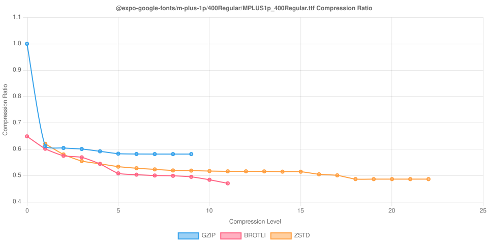
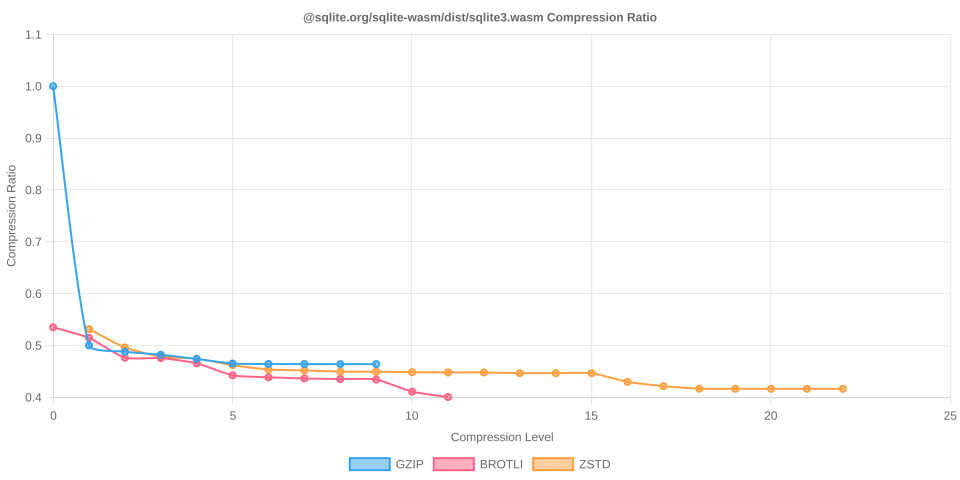
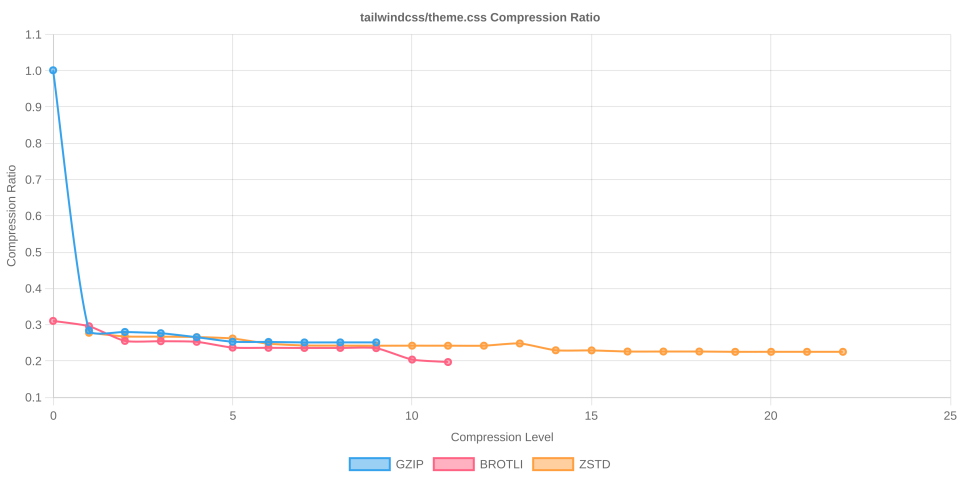

# Node Compression Benchmark

Last updated: 2026-11-20T21:07:15.379Z

This benchmark measures compression time, output size, and compression ratios for several popular npm packages across all gzip, Brotli, and Zstandard compression levels.

## Table of Contents

- [jquery/dist/jquery.min.js](#jquery-dist-jquery-min-js)
- [@expo-google-fonts/m-plus-1p/400Regular/MPLUS1p_400Regular.ttf](#expo-google-fonts-m-plus-1p-400regular-mplus1p-400regular-ttf)
- [@openfonts/m-plus-1p_japanese/m-plus-1p-japanese-400.woff2](#openfonts-m-plus-1p-japanese-m-plus-1p-japanese-400-woff2)
- [@codemirror/view/dist/index.js](#codemirror-view-dist-index-js)
- [react/cjs/react.production.js](#react-cjs-react-production-js)
- [dayjs/dayjs.min.js](#dayjs-dayjs-min-js)
- [vue/dist/vue.global.prod.js](#vue-dist-vue-global-prod-js)
- [lodash/lodash.min.js](#lodash-lodash-min-js)
- [@fortawesome/fontawesome-free/css/all.min.css](#fortawesome-fontawesome-free-css-all-min-css)
- [bootstrap/dist/css/bootstrap.min.css](#bootstrap-dist-css-bootstrap-min-css)
- [world-countries/dist/countries-unescaped.json](#world-countries-dist-countries-unescaped-json)
- [@sqlite.org/sqlite-wasm/dist/sqlite3.wasm](#sqlite-org-sqlite-wasm-dist-sqlite3-wasm)
- [tailwindcss/theme.css](#tailwindcss-theme-css)

Benchmark settings:

- Warmup runs per level: 1
- Fixed samples per level: 9
- Target relative interval radius: 0.0500
- Elapsed benchmark time: 179.5 seconds
- [Raw observations and environment](results/latest.json) · [Measurement methodology](BENCHMARK.md)
- Intervals have at least 95% coverage for independent, identically distributed samples. Precision met means both bounds are within the target distance of the observed median; it is not an accuracy guarantee.

<h2 id="jquery-dist-jquery-min-js">jquery/dist/jquery.min.js</h2>

- Original size: 78,965 bytes
- Chart: 

| Algorithm | Level | Time (ms) | Size (bytes) | Compression Ratio | Samples | Median CI (ms) | Precision met |
| --- | ---: | ---: | ---: | ---: | ---: | --- | --- |
| gzip | 0 | 0.108 | 78,993 | 1.0004 | 9 | 0.095–0.134 | no |
| gzip | 1 | 0.673 | 31,138 | 0.3943 | 9 | 0.663–0.703 | yes |
| gzip | 2 | 0.738 | 30,222 | 0.3827 | 9 | 0.722–0.751 | yes |
| gzip | 3 | 0.830 | 29,738 | 0.3766 | 9 | 0.820–0.836 | yes |
| gzip | 4 | 0.907 | 28,514 | 0.3611 | 9 | 0.895–0.933 | yes |
| gzip | 5 | 1.213 | 27,798 | 0.3520 | 9 | 1.203–1.221 | yes |
| gzip | 6 | 1.434 | 27,655 | 0.3502 | 9 | 1.420–1.439 | yes |
| gzip | 7 | 1.588 | 27,619 | 0.3498 | 9 | 1.568–1.703 | no |
| gzip | 8 | 1.784 | 27,606 | 0.3496 | 9 | 1.777–1.791 | yes |
| gzip | 9 | 1.781 | 27,606 | 0.3496 | 9 | 1.765–1.799 | yes |
| brotli | 0 | 0.228 | 33,137 | 0.4196 | 9 | 0.219–0.233 | yes |
| brotli | 1 | 0.339 | 31,905 | 0.4040 | 9 | 0.316–0.389 | no |
| brotli | 2 | 0.611 | 29,484 | 0.3734 | 9 | 0.608–0.676 | no |
| brotli | 3 | 0.682 | 29,187 | 0.3696 | 9 | 0.668–0.767 | no |
| brotli | 4 | 0.940 | 28,456 | 0.3604 | 9 | 0.933–0.997 | no |
| brotli | 5 | 1.442 | 27,075 | 0.3429 | 9 | 1.424–1.525 | no |
| brotli | 6 | 1.665 | 26,921 | 0.3409 | 9 | 1.629–1.738 | yes |
| brotli | 7 | 3.846 | 26,847 | 0.3400 | 9 | 3.775–4.335 | no |
| brotli | 8 | 2.066 | 26,802 | 0.3394 | 9 | 2.048–2.183 | no |
| brotli | 9 | 9.767 | 26,772 | 0.3390 | 9 | 9.635–10.800 | no |
| brotli | 10 | 26.637 | 25,484 | 0.3227 | 9 | 26.204–26.988 | yes |
| brotli | 11 | 75.935 | 25,019 | 0.3168 | 9 | 75.838–77.784 | yes |
| zstd | 1 | 0.224 | 31,249 | 0.3957 | 9 | 0.206–0.325 | no |
| zstd | 2 | 0.263 | 30,186 | 0.3823 | 9 | 0.251–0.279 | no |
| zstd | 3 | 0.294 | 29,281 | 0.3708 | 9 | 0.287–0.307 | yes |
| zstd | 4 | 0.352 | 29,146 | 0.3691 | 9 | 0.345–0.399 | no |
| zstd | 5 | 0.600 | 28,404 | 0.3597 | 9 | 0.587–0.613 | yes |
| zstd | 6 | 0.800 | 27,670 | 0.3504 | 9 | 0.789–0.827 | yes |
| zstd | 7 | 0.997 | 27,453 | 0.3477 | 9 | 0.981–1.022 | yes |
| zstd | 8 | 1.141 | 27,312 | 0.3459 | 9 | 1.136–1.201 | no |
| zstd | 9 | 1.239 | 27,198 | 0.3444 | 9 | 1.229–1.271 | yes |
| zstd | 10 | 1.408 | 27,138 | 0.3437 | 9 | 1.395–1.411 | yes |
| zstd | 11 | 2.770 | 27,056 | 0.3426 | 9 | 2.764–2.782 | yes |
| zstd | 12 | 2.920 | 27,059 | 0.3427 | 9 | 2.908–2.950 | yes |
| zstd | 13 | 4.333 | 26,959 | 0.3414 | 9 | 4.316–4.371 | yes |
| zstd | 14 | 5.841 | 26,521 | 0.3359 | 9 | 5.832–5.890 | yes |
| zstd | 15 | 5.990 | 26,514 | 0.3358 | 9 | 5.947–6.505 | no |
| zstd | 16 | 7.295 | 26,432 | 0.3347 | 9 | 7.238–7.437 | yes |
| zstd | 17 | 7.414 | 26,432 | 0.3347 | 9 | 7.317–7.807 | no |
| zstd | 18 | 7.243 | 26,432 | 0.3347 | 9 | 7.196–7.334 | yes |
| zstd | 19 | 14.248 | 26,378 | 0.3340 | 9 | 14.098–14.360 | yes |
| zstd | 20 | 14.334 | 26,378 | 0.3340 | 9 | 14.273–14.559 | yes |
| zstd | 21 | 14.305 | 26,378 | 0.3340 | 9 | 14.120–14.346 | yes |
| zstd | 22 | 14.321 | 26,378 | 0.3340 | 9 | 14.140–14.335 | yes |

<h2 id="expo-google-fonts-m-plus-1p-400regular-mplus1p-400regular-ttf">@expo-google-fonts/m-plus-1p/400Regular/MPLUS1p_400Regular.ttf</h2>

- Original size: 1,714,248 bytes
- Chart: 

| Algorithm | Level | Time (ms) | Size (bytes) | Compression Ratio | Samples | Median CI (ms) | Precision met |
| --- | ---: | ---: | ---: | ---: | ---: | --- | --- |
| gzip | 0 | 1.117 | 1,714,526 | 1.0002 | 9 | 0.881–1.305 | no |
| gzip | 1 | 21.007 | 1,049,634 | 0.6123 | 9 | 20.605–21.457 | yes |
| gzip | 2 | 21.955 | 1,036,805 | 0.6048 | 9 | 21.655–24.128 | no |
| gzip | 3 | 23.073 | 1,030,268 | 0.6010 | 9 | 23.046–23.118 | yes |
| gzip | 4 | 25.649 | 1,015,229 | 0.5922 | 9 | 25.061–26.062 | yes |
| gzip | 5 | 30.149 | 999,772 | 0.5832 | 9 | 30.098–30.224 | yes |
| gzip | 6 | 35.306 | 997,720 | 0.5820 | 9 | 35.230–37.535 | no |
| gzip | 7 | 38.692 | 997,295 | 0.5818 | 9 | 38.656–38.966 | yes |
| gzip | 8 | 42.822 | 997,191 | 0.5817 | 9 | 42.750–43.196 | yes |
| gzip | 9 | 54.600 | 997,191 | 0.5817 | 9 | 47.196–80.355 | no |
| brotli | 0 | 8.222 | 1,112,634 | 0.6491 | 9 | 5.468–8.528 | no |
| brotli | 1 | 7.985 | 1,031,943 | 0.6020 | 9 | 7.566–9.933 | no |
| brotli | 2 | 13.626 | 986,211 | 0.5753 | 9 | 13.590–13.687 | yes |
| brotli | 3 | 15.680 | 976,041 | 0.5694 | 9 | 15.440–15.739 | yes |
| brotli | 4 | 24.277 | 933,224 | 0.5444 | 9 | 23.963–25.220 | yes |
| brotli | 5 | 33.255 | 872,005 | 0.5087 | 9 | 32.981–33.770 | yes |
| brotli | 6 | 41.360 | 863,383 | 0.5037 | 9 | 37.892–46.384 | no |
| brotli | 7 | 83.170 | 857,835 | 0.5004 | 9 | 82.894–83.521 | yes |
| brotli | 8 | 94.726 | 855,950 | 0.4993 | 9 | 93.153–95.965 | yes |
| brotli | 9 | 118.281 | 849,266 | 0.4954 | 9 | 113.456–126.397 | no |
| brotli | 10 | 1636.574 | 830,083 | 0.4842 | 9 | 1603.990–1693.488 | yes |
| brotli | 11 | 2845.153 | 806,920 | 0.4707 | 9 | 2814.638–2980.523 | yes |
| zstd | 1 | 4.547 | 1,063,995 | 0.6207 | 9 | 4.521–4.595 | yes |
| zstd | 2 | 5.360 | 995,049 | 0.5805 | 9 | 5.285–5.593 | yes |
| zstd | 3 | 7.198 | 951,924 | 0.5553 | 9 | 7.187–7.582 | no |
| zstd | 4 | 10.076 | 934,018 | 0.5449 | 9 | 9.823–10.905 | no |
| zstd | 5 | 13.095 | 915,542 | 0.5341 | 9 | 12.880–14.106 | no |
| zstd | 6 | 15.865 | 905,207 | 0.5280 | 9 | 15.738–16.194 | yes |
| zstd | 7 | 17.086 | 897,707 | 0.5237 | 9 | 16.998–18.254 | no |
| zstd | 8 | 20.009 | 890,668 | 0.5196 | 9 | 19.889–21.920 | no |
| zstd | 9 | 20.377 | 889,701 | 0.5190 | 9 | 20.249–20.923 | yes |
| zstd | 10 | 25.807 | 886,752 | 0.5173 | 9 | 25.491–26.003 | yes |
| zstd | 11 | 33.433 | 884,967 | 0.5162 | 9 | 33.339–35.960 | no |
| zstd | 12 | 33.448 | 884,967 | 0.5162 | 9 | 33.388–33.563 | yes |
| zstd | 13 | 72.074 | 884,574 | 0.5160 | 9 | 70.910–73.671 | yes |
| zstd | 14 | 82.941 | 882,969 | 0.5151 | 9 | 80.694–85.423 | yes |
| zstd | 15 | 96.771 | 882,565 | 0.5148 | 9 | 91.033–101.616 | no |
| zstd | 16 | 131.126 | 865,802 | 0.5051 | 9 | 130.532–134.827 | yes |
| zstd | 17 | 149.329 | 858,980 | 0.5011 | 9 | 147.919–161.674 | no |
| zstd | 18 | 203.557 | 834,631 | 0.4869 | 9 | 198.136–212.497 | yes |
| zstd | 19 | 205.398 | 834,350 | 0.4867 | 9 | 203.609–265.043 | no |
| zstd | 20 | 205.977 | 834,350 | 0.4867 | 9 | 204.061–208.834 | yes |
| zstd | 21 | 209.100 | 834,350 | 0.4867 | 9 | 205.795–214.508 | yes |
| zstd | 22 | 205.447 | 834,350 | 0.4867 | 9 | 203.365–209.066 | yes |

<h2 id="openfonts-m-plus-1p-japanese-m-plus-1p-japanese-400-woff2">@openfonts/m-plus-1p_japanese/m-plus-1p-japanese-400.woff2</h2>

- Original size: 598,576 bytes
- Chart: 

| Algorithm | Level | Time (ms) | Size (bytes) | Compression Ratio | Samples | Median CI (ms) | Precision met |
| --- | ---: | ---: | ---: | ---: | ---: | --- | --- |
| gzip | 0 | 0.318 | 598,684 | 1.0002 | 9 | 0.295–0.328 | no |
| gzip | 1 | 10.496 | 596,192 | 0.9960 | 9 | 9.978–10.724 | yes |
| gzip | 2 | 10.645 | 596,183 | 0.9960 | 9 | 10.516–10.970 | yes |
| gzip | 3 | 10.470 | 596,173 | 0.9960 | 9 | 10.327–10.564 | yes |
| gzip | 4 | 10.806 | 596,171 | 0.9960 | 9 | 10.371–10.843 | yes |
| gzip | 5 | 10.727 | 596,154 | 0.9960 | 9 | 10.574–10.824 | yes |
| gzip | 6 | 10.571 | 596,154 | 0.9960 | 9 | 10.538–10.826 | yes |
| gzip | 7 | 10.511 | 596,154 | 0.9960 | 9 | 10.354–10.720 | yes |
| gzip | 8 | 10.350 | 596,154 | 0.9960 | 9 | 10.262–10.522 | yes |
| gzip | 9 | 10.557 | 596,154 | 0.9960 | 9 | 10.510–10.613 | yes |
| brotli | 0 | 0.271 | 596,751 | 0.9970 | 9 | 0.249–0.302 | no |
| brotli | 1 | 0.300 | 598,581 | 1.0000 | 9 | 0.269–0.350 | no |
| brotli | 2 | 0.520 | 598,587 | 1.0000 | 9 | 0.501–0.580 | no |
| brotli | 3 | 0.604 | 598,559 | 1.0000 | 9 | 0.543–1.279 | no |
| brotli | 4 | 0.611 | 598,581 | 1.0000 | 9 | 0.576–0.641 | no |
| brotli | 5 | 1.160 | 598,581 | 1.0000 | 9 | 1.091–1.289 | no |
| brotli | 6 | 1.475 | 598,581 | 1.0000 | 9 | 1.360–1.543 | no |
| brotli | 7 | 1.825 | 598,581 | 1.0000 | 9 | 1.802–2.639 | no |
| brotli | 8 | 1.887 | 598,581 | 1.0000 | 9 | 1.862–1.921 | yes |
| brotli | 9 | 2.722 | 598,581 | 1.0000 | 9 | 2.678–3.008 | no |
| brotli | 10 | 94.906 | 598,581 | 1.0000 | 9 | 94.158–96.194 | yes |
| brotli | 11 | 208.633 | 598,581 | 1.0000 | 9 | 207.221–232.595 | no |
| zstd | 1 | 0.307 | 598,601 | 1.0000 | 9 | 0.294–0.346 | no |
| zstd | 2 | 0.319 | 598,600 | 1.0000 | 9 | 0.302–0.358 | no |
| zstd | 3 | 0.400 | 598,600 | 1.0000 | 9 | 0.370–0.525 | no |
| zstd | 4 | 0.623 | 598,600 | 1.0000 | 9 | 0.401–0.838 | no |
| zstd | 5 | 0.496 | 598,600 | 1.0000 | 9 | 0.488–0.534 | no |
| zstd | 6 | 0.479 | 598,600 | 1.0000 | 9 | 0.461–0.492 | yes |
| zstd | 7 | 0.573 | 598,600 | 1.0000 | 9 | 0.543–0.588 | no |
| zstd | 8 | 0.526 | 598,600 | 1.0000 | 9 | 0.509–0.716 | no |
| zstd | 9 | 1.061 | 598,600 | 1.0000 | 9 | 0.785–1.297 | no |
| zstd | 10 | 0.797 | 598,600 | 1.0000 | 9 | 0.758–0.836 | yes |
| zstd | 11 | 0.857 | 598,600 | 1.0000 | 9 | 0.836–0.954 | no |
| zstd | 12 | 0.824 | 598,600 | 1.0000 | 9 | 0.806–0.926 | no |
| zstd | 13 | 2.647 | 595,998 | 0.9957 | 9 | 2.549–2.700 | yes |
| zstd | 14 | 2.549 | 595,998 | 0.9957 | 9 | 2.538–2.670 | yes |
| zstd | 15 | 2.660 | 595,998 | 0.9957 | 9 | 2.552–2.670 | yes |
| zstd | 16 | 13.604 | 595,898 | 0.9955 | 9 | 13.577–13.683 | yes |
| zstd | 17 | 13.630 | 595,889 | 0.9955 | 9 | 13.521–13.690 | yes |
| zstd | 18 | 17.295 | 595,891 | 0.9955 | 9 | 17.267–17.490 | yes |
| zstd | 19 | 20.553 | 595,894 | 0.9955 | 9 | 20.499–20.628 | yes |
| zstd | 20 | 20.570 | 595,894 | 0.9955 | 9 | 20.533–20.651 | yes |
| zstd | 21 | 21.294 | 595,894 | 0.9955 | 9 | 20.481–22.181 | yes |
| zstd | 22 | 23.062 | 595,894 | 0.9955 | 9 | 22.260–23.571 | yes |

<h2 id="codemirror-view-dist-index-js">@codemirror/view/dist/index.js</h2>

- Original size: 495,588 bytes
- Chart: 

| Algorithm | Level | Time (ms) | Size (bytes) | Compression Ratio | Samples | Median CI (ms) | Precision met |
| --- | ---: | ---: | ---: | ---: | ---: | --- | --- |
| gzip | 0 | 0.287 | 495,681 | 1.0002 | 9 | 0.264–0.298 | no |
| gzip | 1 | 2.986 | 147,019 | 0.2967 | 9 | 2.971–3.007 | yes |
| gzip | 2 | 3.280 | 140,161 | 0.2828 | 9 | 3.245–3.302 | yes |
| gzip | 3 | 4.220 | 135,613 | 0.2736 | 9 | 4.184–4.363 | yes |
| gzip | 4 | 4.236 | 127,170 | 0.2566 | 9 | 4.215–4.263 | yes |
| gzip | 5 | 6.151 | 122,480 | 0.2471 | 9 | 6.135–6.187 | yes |
| gzip | 6 | 8.972 | 120,752 | 0.2437 | 9 | 8.963–9.035 | yes |
| gzip | 7 | 11.424 | 120,280 | 0.2427 | 9 | 11.396–11.478 | yes |
| gzip | 8 | 23.959 | 120,006 | 0.2421 | 9 | 23.915–24.008 | yes |
| gzip | 9 | 37.051 | 119,944 | 0.2420 | 9 | 36.998–37.139 | yes |
| brotli | 0 | 1.097 | 151,389 | 0.3055 | 9 | 1.081–1.121 | yes |
| brotli | 1 | 1.538 | 139,012 | 0.2805 | 9 | 1.530–1.550 | yes |
| brotli | 2 | 2.918 | 130,704 | 0.2637 | 9 | 2.903–2.947 | yes |
| brotli | 3 | 3.187 | 128,093 | 0.2585 | 9 | 3.174–3.196 | yes |
| brotli | 4 | 4.572 | 124,144 | 0.2505 | 9 | 4.490–4.615 | yes |
| brotli | 5 | 7.071 | 114,090 | 0.2302 | 9 | 6.950–7.383 | yes |
| brotli | 6 | 8.403 | 111,384 | 0.2248 | 9 | 8.363–8.531 | yes |
| brotli | 7 | 10.133 | 109,376 | 0.2207 | 9 | 10.080–10.326 | yes |
| brotli | 8 | 11.960 | 108,340 | 0.2186 | 9 | 11.869–12.273 | yes |
| brotli | 9 | 25.192 | 107,449 | 0.2168 | 9 | 24.091–26.363 | yes |
| brotli | 10 | 218.407 | 99,878 | 0.2015 | 9 | 216.974–241.021 | no |
| brotli | 11 | 574.082 | 97,648 | 0.1970 | 9 | 570.764–578.667 | yes |
| zstd | 1 | 1.366 | 139,921 | 0.2823 | 9 | 1.357–1.386 | yes |
| zstd | 2 | 1.434 | 135,629 | 0.2737 | 9 | 1.414–1.453 | yes |
| zstd | 3 | 1.554 | 127,698 | 0.2577 | 9 | 1.544–1.556 | yes |
| zstd | 4 | 1.806 | 127,469 | 0.2572 | 9 | 1.792–1.832 | yes |
| zstd | 5 | 3.062 | 118,828 | 0.2398 | 9 | 3.047–3.100 | yes |
| zstd | 6 | 4.187 | 114,849 | 0.2317 | 9 | 4.177–4.201 | yes |
| zstd | 7 | 4.860 | 113,233 | 0.2285 | 9 | 4.833–4.965 | yes |
| zstd | 8 | 6.123 | 112,404 | 0.2268 | 9 | 6.088–6.231 | yes |
| zstd | 9 | 6.244 | 112,404 | 0.2268 | 9 | 6.155–6.263 | yes |
| zstd | 10 | 7.606 | 111,395 | 0.2248 | 9 | 7.569–7.762 | yes |
| zstd | 11 | 9.532 | 110,772 | 0.2235 | 9 | 9.502–9.677 | yes |
| zstd | 12 | 9.543 | 110,772 | 0.2235 | 9 | 9.514–9.552 | yes |
| zstd | 13 | 22.964 | 109,611 | 0.2212 | 9 | 22.877–23.205 | yes |
| zstd | 14 | 28.704 | 108,976 | 0.2199 | 9 | 28.638–32.196 | no |
| zstd | 15 | 31.591 | 108,836 | 0.2196 | 9 | 31.401–32.112 | yes |
| zstd | 16 | 61.629 | 103,236 | 0.2083 | 9 | 57.539–64.332 | no |
| zstd | 17 | 69.171 | 102,296 | 0.2064 | 9 | 61.743–69.639 | no |
| zstd | 18 | 79.776 | 101,518 | 0.2048 | 9 | 79.016–81.208 | yes |
| zstd | 19 | 100.604 | 101,389 | 0.2046 | 9 | 99.383–101.061 | yes |
| zstd | 20 | 113.556 | 101,389 | 0.2046 | 9 | 110.437–114.904 | yes |
| zstd | 21 | 102.470 | 101,411 | 0.2046 | 9 | 101.574–122.557 | no |
| zstd | 22 | 113.847 | 101,411 | 0.2046 | 9 | 105.913–114.242 | no |

<h2 id="react-cjs-react-production-js">react/cjs/react.production.js</h2>

- Original size: 18,040 bytes
- Chart: 

| Algorithm | Level | Time (ms) | Size (bytes) | Compression Ratio | Samples | Median CI (ms) | Precision met |
| --- | ---: | ---: | ---: | ---: | ---: | --- | --- |
| gzip | 0 | 0.019 | 18,063 | 1.0013 | 9 | 0.018–0.026 | no |
| gzip | 1 | 0.105 | 5,189 | 0.2876 | 9 | 0.091–0.124 | no |
| gzip | 2 | 0.104 | 5,069 | 0.2810 | 9 | 0.102–0.131 | no |
| gzip | 3 | 0.126 | 5,003 | 0.2773 | 9 | 0.121–0.134 | no |
| gzip | 4 | 0.143 | 4,715 | 0.2614 | 9 | 0.137–0.154 | no |
| gzip | 5 | 0.196 | 4,618 | 0.2560 | 9 | 0.185–0.208 | no |
| gzip | 6 | 0.224 | 4,607 | 0.2554 | 9 | 0.221–0.236 | no |
| gzip | 7 | 0.255 | 4,600 | 0.2550 | 9 | 0.246–0.263 | yes |
| gzip | 8 | 0.360 | 4,597 | 0.2548 | 9 | 0.347–0.364 | yes |
| gzip | 9 | 0.363 | 4,597 | 0.2548 | 9 | 0.355–0.368 | yes |
| brotli | 0 | 0.043 | 5,483 | 0.3039 | 9 | 0.040–0.052 | no |
| brotli | 1 | 0.051 | 5,356 | 0.2969 | 9 | 0.047–0.074 | no |
| brotli | 2 | 0.114 | 4,956 | 0.2747 | 9 | 0.106–0.119 | no |
| brotli | 3 | 0.129 | 4,866 | 0.2697 | 9 | 0.123–0.159 | no |
| brotli | 4 | 0.188 | 4,752 | 0.2634 | 9 | 0.179–0.200 | no |
| brotli | 5 | 0.264 | 4,451 | 0.2467 | 9 | 0.262–0.286 | no |
| brotli | 6 | 0.287 | 4,446 | 0.2465 | 9 | 0.280–0.310 | no |
| brotli | 7 | 0.337 | 4,432 | 0.2457 | 9 | 0.321–0.358 | no |
| brotli | 8 | 0.342 | 4,424 | 0.2452 | 9 | 0.335–0.371 | no |
| brotli | 9 | 0.414 | 4,416 | 0.2448 | 9 | 0.399–0.424 | yes |
| brotli | 10 | 5.997 | 4,142 | 0.2296 | 9 | 5.964–6.067 | yes |
| brotli | 11 | 15.971 | 4,027 | 0.2232 | 9 | 15.915–16.007 | yes |
| zstd | 1 | 0.047 | 5,114 | 0.2835 | 9 | 0.041–0.061 | no |
| zstd | 2 | 0.048 | 5,057 | 0.2803 | 9 | 0.045–0.059 | no |
| zstd | 3 | 0.077 | 4,922 | 0.2728 | 9 | 0.071–0.095 | no |
| zstd | 4 | 0.082 | 4,885 | 0.2708 | 9 | 0.075–0.109 | no |
| zstd | 5 | 0.159 | 4,708 | 0.2610 | 9 | 0.121–0.176 | no |
| zstd | 6 | 0.156 | 4,620 | 0.2561 | 9 | 0.150–0.165 | no |
| zstd | 7 | 0.196 | 4,618 | 0.2560 | 9 | 0.187–0.277 | no |
| zstd | 8 | 0.210 | 4,601 | 0.2550 | 9 | 0.204–0.215 | yes |
| zstd | 9 | 0.235 | 4,592 | 0.2545 | 9 | 0.230–0.245 | yes |
| zstd | 10 | 0.263 | 4,584 | 0.2541 | 9 | 0.258–0.268 | yes |
| zstd | 11 | 0.542 | 4,562 | 0.2529 | 9 | 0.537–0.552 | yes |
| zstd | 12 | 0.574 | 4,562 | 0.2529 | 9 | 0.571–0.581 | yes |
| zstd | 13 | 0.816 | 4,554 | 0.2524 | 9 | 0.811–0.823 | yes |
| zstd | 14 | 1.165 | 4,473 | 0.2479 | 9 | 1.162–1.168 | yes |
| zstd | 15 | 1.237 | 4,468 | 0.2477 | 9 | 1.235–1.242 | yes |
| zstd | 16 | 1.633 | 4,452 | 0.2468 | 9 | 1.629–1.643 | yes |
| zstd | 17 | 1.700 | 4,452 | 0.2468 | 9 | 1.690–1.703 | yes |
| zstd | 18 | 1.699 | 4,452 | 0.2468 | 9 | 1.687–1.753 | yes |
| zstd | 19 | 3.325 | 4,436 | 0.2459 | 9 | 3.313–3.336 | yes |
| zstd | 20 | 3.699 | 4,436 | 0.2459 | 9 | 3.336–3.753 | no |
| zstd | 21 | 3.729 | 4,436 | 0.2459 | 9 | 3.417–3.775 | no |
| zstd | 22 | 3.329 | 4,436 | 0.2459 | 9 | 3.320–3.399 | yes |

<h2 id="dayjs-dayjs-min-js">dayjs/dayjs.min.js</h2>

- Original size: 7,161 bytes
- Chart: 

| Algorithm | Level | Time (ms) | Size (bytes) | Compression Ratio | Samples | Median CI (ms) | Precision met |
| --- | ---: | ---: | ---: | ---: | ---: | --- | --- |
| gzip | 0 | 0.014 | 7,184 | 1.0032 | 9 | 0.010–0.037 | no |
| gzip | 1 | 0.060 | 3,220 | 0.4497 | 9 | 0.048–0.087 | no |
| gzip | 2 | 0.057 | 3,182 | 0.4444 | 9 | 0.048–0.069 | no |
| gzip | 3 | 0.063 | 3,153 | 0.4403 | 9 | 0.050–0.075 | no |
| gzip | 4 | 0.069 | 3,095 | 0.4322 | 9 | 0.060–0.081 | no |
| gzip | 5 | 0.091 | 3,051 | 0.4261 | 9 | 0.083–0.133 | no |
| gzip | 6 | 0.084 | 3,044 | 0.4251 | 9 | 0.079–0.094 | no |
| gzip | 7 | 0.088 | 3,042 | 0.4248 | 9 | 0.082–0.098 | no |
| gzip | 8 | 0.080 | 3,042 | 0.4248 | 9 | 0.078–0.089 | no |
| gzip | 9 | 0.077 | 3,042 | 0.4248 | 9 | 0.074–0.083 | no |
| brotli | 0 | 0.021 | 3,549 | 0.4956 | 9 | 0.021–0.028 | no |
| brotli | 1 | 0.032 | 3,381 | 0.4721 | 9 | 0.027–0.036 | no |
| brotli | 2 | 0.060 | 3,263 | 0.4557 | 9 | 0.054–0.069 | no |
| brotli | 3 | 0.068 | 3,216 | 0.4491 | 9 | 0.061–0.089 | no |
| brotli | 4 | 0.124 | 3,147 | 0.4395 | 9 | 0.107–0.138 | no |
| brotli | 5 | 0.156 | 2,963 | 0.4138 | 9 | 0.140–0.204 | no |
| brotli | 6 | 0.154 | 2,952 | 0.4122 | 9 | 0.149–0.163 | no |
| brotli | 7 | 0.186 | 2,944 | 0.4111 | 9 | 0.177–0.196 | no |
| brotli | 8 | 0.184 | 2,944 | 0.4111 | 9 | 0.175–0.207 | no |
| brotli | 9 | 0.225 | 2,945 | 0.4113 | 9 | 0.215–0.230 | yes |
| brotli | 10 | 2.388 | 2,814 | 0.3930 | 9 | 2.373–2.424 | yes |
| brotli | 11 | 6.315 | 2,772 | 0.3871 | 9 | 6.250–6.447 | yes |
| zstd | 1 | 0.028 | 3,254 | 0.4544 | 9 | 0.024–0.042 | no |
| zstd | 2 | 0.034 | 3,200 | 0.4469 | 9 | 0.026–0.042 | no |
| zstd | 3 | 0.031 | 3,176 | 0.4435 | 9 | 0.030–0.041 | no |
| zstd | 4 | 0.060 | 3,102 | 0.4332 | 9 | 0.057–0.074 | no |
| zstd | 5 | 0.075 | 3,079 | 0.4300 | 9 | 0.071–0.088 | no |
| zstd | 6 | 0.093 | 3,060 | 0.4273 | 9 | 0.088–0.101 | no |
| zstd | 7 | 0.106 | 3,053 | 0.4263 | 9 | 0.105–0.114 | no |
| zstd | 8 | 0.103 | 3,053 | 0.4263 | 9 | 0.102–0.116 | no |
| zstd | 9 | 0.147 | 3,055 | 0.4266 | 9 | 0.142–0.162 | no |
| zstd | 10 | 0.142 | 3,055 | 0.4266 | 9 | 0.141–0.153 | no |
| zstd | 11 | 0.264 | 3,044 | 0.4251 | 9 | 0.257–0.268 | yes |
| zstd | 12 | 0.349 | 3,011 | 0.4205 | 9 | 0.343–0.368 | no |
| zstd | 13 | 0.426 | 2,998 | 0.4187 | 9 | 0.418–0.438 | yes |
| zstd | 14 | 0.426 | 2,998 | 0.4187 | 9 | 0.423–0.442 | yes |
| zstd | 15 | 0.588 | 2,998 | 0.4187 | 9 | 0.436–0.613 | no |
| zstd | 16 | 0.830 | 2,992 | 0.4178 | 9 | 0.820–0.877 | no |
| zstd | 17 | 0.839 | 2,992 | 0.4178 | 9 | 0.829–1.171 | no |
| zstd | 18 | 0.829 | 2,992 | 0.4178 | 9 | 0.825–0.836 | yes |
| zstd | 19 | 0.823 | 2,992 | 0.4178 | 9 | 0.820–0.827 | yes |
| zstd | 20 | 0.830 | 2,992 | 0.4178 | 9 | 0.818–0.836 | yes |
| zstd | 21 | 0.825 | 2,992 | 0.4178 | 9 | 0.817–0.831 | yes |
| zstd | 22 | 0.822 | 2,992 | 0.4178 | 9 | 0.820–0.825 | yes |

<h2 id="vue-dist-vue-global-prod-js">vue/dist/vue.global.prod.js</h2>

- Original size: 172,939 bytes
- Chart: 

| Algorithm | Level | Time (ms) | Size (bytes) | Compression Ratio | Samples | Median CI (ms) | Precision met |
| --- | ---: | ---: | ---: | ---: | ---: | --- | --- |
| gzip | 0 | 0.084 | 172,982 | 1.0002 | 9 | 0.080–0.098 | no |
| gzip | 1 | 1.524 | 70,513 | 0.4077 | 9 | 1.504–1.566 | yes |
| gzip | 2 | 1.643 | 68,699 | 0.3972 | 9 | 1.626–1.685 | yes |
| gzip | 3 | 1.879 | 67,625 | 0.3910 | 9 | 1.872–1.886 | yes |
| gzip | 4 | 2.064 | 65,132 | 0.3766 | 9 | 2.042–2.075 | yes |
| gzip | 5 | 2.832 | 63,397 | 0.3666 | 9 | 2.801–2.855 | yes |
| gzip | 6 | 3.529 | 63,096 | 0.3648 | 9 | 3.518–3.536 | yes |
| gzip | 7 | 3.867 | 63,059 | 0.3646 | 9 | 3.862–3.878 | yes |
| gzip | 8 | 4.187 | 63,043 | 0.3645 | 9 | 4.177–4.201 | yes |
| gzip | 9 | 4.192 | 63,043 | 0.3645 | 9 | 4.178–4.204 | yes |
| brotli | 0 | 0.510 | 75,027 | 0.4338 | 9 | 0.493–0.520 | yes |
| brotli | 1 | 0.680 | 71,725 | 0.4147 | 9 | 0.654–0.698 | yes |
| brotli | 2 | 1.339 | 66,180 | 0.3827 | 9 | 1.332–1.348 | yes |
| brotli | 3 | 1.451 | 65,609 | 0.3794 | 9 | 1.436–1.463 | yes |
| brotli | 4 | 1.933 | 64,402 | 0.3724 | 9 | 1.912–1.967 | yes |
| brotli | 5 | 3.203 | 60,882 | 0.3520 | 9 | 3.172–3.290 | yes |
| brotli | 6 | 3.725 | 60,456 | 0.3496 | 9 | 3.693–3.942 | no |
| brotli | 7 | 4.554 | 60,190 | 0.3480 | 9 | 4.515–4.575 | yes |
| brotli | 8 | 5.286 | 60,079 | 0.3474 | 9 | 4.905–5.527 | no |
| brotli | 9 | 5.886 | 59,995 | 0.3469 | 9 | 5.799–6.564 | no |
| brotli | 10 | 75.035 | 57,085 | 0.3301 | 9 | 74.871–75.880 | yes |
| brotli | 11 | 201.113 | 56,019 | 0.3239 | 9 | 200.780–203.179 | yes |
| zstd | 1 | 0.483 | 69,658 | 0.4028 | 9 | 0.474–0.511 | no |
| zstd | 2 | 0.618 | 66,613 | 0.3852 | 9 | 0.615–0.629 | yes |
| zstd | 3 | 0.739 | 65,991 | 0.3816 | 9 | 0.731–0.759 | yes |
| zstd | 4 | 1.213 | 63,991 | 0.3700 | 9 | 1.200–1.240 | yes |
| zstd | 5 | 1.408 | 63,425 | 0.3667 | 9 | 1.392–1.427 | yes |
| zstd | 6 | 1.746 | 62,483 | 0.3613 | 9 | 1.727–1.776 | yes |
| zstd | 7 | 2.168 | 61,603 | 0.3562 | 9 | 2.153–2.181 | yes |
| zstd | 8 | 2.723 | 61,082 | 0.3532 | 9 | 2.714–2.748 | yes |
| zstd | 9 | 3.150 | 60,788 | 0.3515 | 9 | 3.137–3.161 | yes |
| zstd | 10 | 3.731 | 60,625 | 0.3506 | 9 | 3.720–3.749 | yes |
| zstd | 11 | 7.362 | 60,349 | 0.3490 | 9 | 7.342–7.435 | yes |
| zstd | 12 | 7.678 | 60,327 | 0.3488 | 9 | 7.613–7.708 | yes |
| zstd | 13 | 12.665 | 59,296 | 0.3429 | 9 | 12.546–12.765 | yes |
| zstd | 14 | 14.501 | 58,844 | 0.3403 | 9 | 14.479–14.619 | yes |
| zstd | 15 | 14.740 | 58,823 | 0.3401 | 9 | 14.706–14.817 | yes |
| zstd | 16 | 17.990 | 58,601 | 0.3389 | 9 | 17.967–18.158 | yes |
| zstd | 17 | 17.937 | 58,601 | 0.3389 | 9 | 17.900–18.088 | yes |
| zstd | 18 | 29.769 | 58,546 | 0.3385 | 9 | 29.723–29.859 | yes |
| zstd | 19 | 29.752 | 58,546 | 0.3385 | 9 | 29.722–29.834 | yes |
| zstd | 20 | 29.814 | 58,546 | 0.3385 | 9 | 29.733–30.035 | yes |
| zstd | 21 | 29.772 | 58,546 | 0.3385 | 9 | 29.715–29.878 | yes |
| zstd | 22 | 29.899 | 58,546 | 0.3385 | 9 | 29.702–30.029 | yes |

<h2 id="lodash-lodash-min-js">lodash/lodash.min.js</h2>

- Original size: 73,234 bytes
- Chart: 

| Algorithm | Level | Time (ms) | Size (bytes) | Compression Ratio | Samples | Median CI (ms) | Precision met |
| --- | ---: | ---: | ---: | ---: | ---: | --- | --- |
| gzip | 0 | 0.039 | 73,262 | 1.0004 | 9 | 0.037–0.045 | no |
| gzip | 1 | 0.599 | 28,819 | 0.3935 | 9 | 0.582–0.623 | yes |
| gzip | 2 | 0.642 | 28,191 | 0.3849 | 9 | 0.634–0.645 | yes |
| gzip | 3 | 0.741 | 27,724 | 0.3786 | 9 | 0.729–0.752 | yes |
| gzip | 4 | 0.849 | 26,950 | 0.3680 | 9 | 0.807–0.902 | no |
| gzip | 5 | 1.071 | 26,101 | 0.3564 | 9 | 1.065–1.077 | yes |
| gzip | 6 | 1.388 | 25,938 | 0.3542 | 9 | 1.361–1.504 | no |
| gzip | 7 | 1.595 | 25,913 | 0.3538 | 9 | 1.591–1.607 | yes |
| gzip | 8 | 2.181 | 25,894 | 0.3536 | 9 | 2.175–2.192 | yes |
| gzip | 9 | 2.180 | 25,894 | 0.3536 | 9 | 2.166–2.207 | yes |
| brotli | 0 | 0.256 | 30,978 | 0.4230 | 9 | 0.242–0.272 | no |
| brotli | 1 | 0.286 | 29,754 | 0.4063 | 9 | 0.258–0.319 | no |
| brotli | 2 | 0.532 | 27,438 | 0.3747 | 9 | 0.520–0.559 | yes |
| brotli | 3 | 0.583 | 27,227 | 0.3718 | 9 | 0.576–0.592 | yes |
| brotli | 4 | 0.827 | 26,678 | 0.3643 | 9 | 0.813–1.247 | no |
| brotli | 5 | 1.333 | 25,217 | 0.3443 | 9 | 1.318–1.389 | yes |
| brotli | 6 | 1.483 | 25,093 | 0.3426 | 9 | 1.465–1.511 | yes |
| brotli | 7 | 1.819 | 24,950 | 0.3407 | 9 | 1.809–1.834 | yes |
| brotli | 8 | 1.943 | 24,912 | 0.3402 | 9 | 1.911–1.947 | yes |
| brotli | 9 | 2.304 | 24,870 | 0.3396 | 9 | 2.295–2.337 | yes |
| brotli | 10 | 29.652 | 23,472 | 0.3205 | 9 | 29.618–29.766 | yes |
| brotli | 11 | 75.936 | 23,030 | 0.3145 | 9 | 75.887–76.161 | yes |
| zstd | 1 | 0.179 | 28,919 | 0.3949 | 9 | 0.174–0.203 | no |
| zstd | 2 | 0.225 | 28,008 | 0.3824 | 9 | 0.217–0.242 | no |
| zstd | 3 | 0.276 | 27,463 | 0.3750 | 9 | 0.265–0.293 | no |
| zstd | 4 | 0.295 | 27,100 | 0.3700 | 9 | 0.288–0.318 | no |
| zstd | 5 | 0.512 | 26,525 | 0.3622 | 9 | 0.502–0.522 | yes |
| zstd | 6 | 0.719 | 25,834 | 0.3528 | 9 | 0.707–0.732 | yes |
| zstd | 7 | 0.887 | 25,663 | 0.3504 | 9 | 0.870–0.918 | yes |
| zstd | 8 | 0.979 | 25,557 | 0.3490 | 9 | 0.972–1.001 | yes |
| zstd | 9 | 1.108 | 25,466 | 0.3477 | 9 | 1.106–1.141 | yes |
| zstd | 10 | 1.296 | 25,397 | 0.3468 | 9 | 1.288–1.303 | yes |
| zstd | 11 | 2.594 | 25,317 | 0.3457 | 9 | 2.585–2.610 | yes |
| zstd | 12 | 2.771 | 25,315 | 0.3457 | 9 | 2.759–2.790 | yes |
| zstd | 13 | 4.095 | 25,185 | 0.3439 | 9 | 4.091–4.104 | yes |
| zstd | 14 | 5.674 | 24,642 | 0.3365 | 9 | 5.661–5.717 | yes |
| zstd | 15 | 5.720 | 24,606 | 0.3360 | 9 | 5.710–5.760 | yes |
| zstd | 16 | 7.040 | 24,499 | 0.3345 | 9 | 7.000–7.109 | yes |
| zstd | 17 | 7.050 | 24,499 | 0.3345 | 9 | 7.021–7.092 | yes |
| zstd | 18 | 7.024 | 24,499 | 0.3345 | 9 | 7.014–7.040 | yes |
| zstd | 19 | 13.387 | 24,463 | 0.3340 | 9 | 13.343–13.418 | yes |
| zstd | 20 | 13.367 | 24,463 | 0.3340 | 9 | 13.325–13.378 | yes |
| zstd | 21 | 13.376 | 24,463 | 0.3340 | 9 | 13.346–13.424 | yes |
| zstd | 22 | 13.360 | 24,463 | 0.3340 | 9 | 13.336–13.419 | yes |

<h2 id="fortawesome-fontawesome-free-css-all-min-css">@fortawesome/fontawesome-free/css/all.min.css</h2>

- Original size: 90,336 bytes
- Chart: 

| Algorithm | Level | Time (ms) | Size (bytes) | Compression Ratio | Samples | Median CI (ms) | Precision met |
| --- | ---: | ---: | ---: | ---: | ---: | --- | --- |
| gzip | 0 | 0.047 | 90,364 | 1.0003 | 9 | 0.042–0.051 | no |
| gzip | 1 | 0.496 | 25,642 | 0.2839 | 9 | 0.479–0.510 | yes |
| gzip | 2 | 0.564 | 25,381 | 0.2810 | 9 | 0.542–0.575 | yes |
| gzip | 3 | 0.654 | 25,183 | 0.2788 | 9 | 0.642–0.675 | yes |
| gzip | 4 | 0.728 | 23,806 | 0.2635 | 9 | 0.726–0.741 | yes |
| gzip | 5 | 1.031 | 22,906 | 0.2536 | 9 | 1.022–1.038 | yes |
| gzip | 6 | 1.584 | 22,672 | 0.2510 | 9 | 1.573–1.675 | no |
| gzip | 7 | 2.131 | 22,565 | 0.2498 | 9 | 2.127–2.150 | yes |
| gzip | 8 | 8.721 | 22,320 | 0.2471 | 9 | 8.701–8.736 | yes |
| gzip | 9 | 8.803 | 22,318 | 0.2471 | 9 | 8.793–8.826 | yes |
| brotli | 0 | 0.205 | 27,781 | 0.3075 | 9 | 0.191–0.215 | no |
| brotli | 1 | 0.288 | 25,973 | 0.2875 | 9 | 0.274–0.316 | no |
| brotli | 2 | 0.536 | 23,497 | 0.2601 | 9 | 0.520–0.554 | yes |
| brotli | 3 | 0.595 | 23,445 | 0.2595 | 9 | 0.585–0.610 | yes |
| brotli | 4 | 0.854 | 23,003 | 0.2546 | 9 | 0.812–1.115 | no |
| brotli | 5 | 1.321 | 21,939 | 0.2429 | 9 | 1.299–1.412 | no |
| brotli | 6 | 1.541 | 21,822 | 0.2416 | 9 | 1.519–1.608 | yes |
| brotli | 7 | 1.864 | 21,742 | 0.2407 | 9 | 1.829–2.109 | no |
| brotli | 8 | 2.085 | 21,693 | 0.2401 | 9 | 2.081–2.100 | yes |
| brotli | 9 | 2.689 | 21,604 | 0.2392 | 9 | 2.676–2.731 | yes |
| brotli | 10 | 26.668 | 18,961 | 0.2099 | 9 | 26.567–26.809 | yes |
| brotli | 11 | 85.601 | 18,432 | 0.2040 | 9 | 85.479–85.713 | yes |
| zstd | 1 | 0.208 | 24,608 | 0.2724 | 9 | 0.200–0.222 | no |
| zstd | 2 | 0.224 | 24,387 | 0.2700 | 9 | 0.218–0.245 | no |
| zstd | 3 | 0.256 | 24,157 | 0.2674 | 9 | 0.250–0.264 | yes |
| zstd | 4 | 0.284 | 24,076 | 0.2665 | 9 | 0.281–0.300 | no |
| zstd | 5 | 0.516 | 23,365 | 0.2586 | 9 | 0.499–0.552 | no |
| zstd | 6 | 0.724 | 22,468 | 0.2487 | 9 | 0.719–0.746 | yes |
| zstd | 7 | 0.919 | 21,961 | 0.2431 | 9 | 0.906–0.955 | yes |
| zstd | 8 | 1.049 | 21,892 | 0.2423 | 9 | 1.039–1.075 | yes |
| zstd | 9 | 1.329 | 21,821 | 0.2416 | 9 | 1.321–1.340 | yes |
| zstd | 10 | 1.725 | 21,755 | 0.2408 | 9 | 1.720–1.735 | yes |
| zstd | 11 | 2.995 | 21,610 | 0.2392 | 9 | 2.971–3.006 | yes |
| zstd | 12 | 4.103 | 21,581 | 0.2389 | 9 | 4.095–4.113 | yes |
| zstd | 13 | 4.645 | 21,357 | 0.2364 | 9 | 4.635–4.660 | yes |
| zstd | 14 | 6.381 | 20,565 | 0.2277 | 9 | 6.306–6.512 | yes |
| zstd | 15 | 7.599 | 20,426 | 0.2261 | 9 | 7.575–7.662 | yes |
| zstd | 16 | 9.616 | 20,254 | 0.2242 | 9 | 9.592–9.656 | yes |
| zstd | 17 | 12.851 | 20,220 | 0.2238 | 9 | 12.828–12.878 | yes |
| zstd | 18 | 20.194 | 20,218 | 0.2238 | 9 | 20.169–20.220 | yes |
| zstd | 19 | 19.045 | 20,225 | 0.2239 | 9 | 18.979–19.080 | yes |
| zstd | 20 | 22.462 | 20,194 | 0.2235 | 9 | 22.423–22.556 | yes |
| zstd | 21 | 33.389 | 20,185 | 0.2234 | 9 | 33.366–33.456 | yes |
| zstd | 22 | 40.282 | 20,186 | 0.2235 | 9 | 40.248–40.403 | yes |

<h2 id="bootstrap-dist-css-bootstrap-min-css">bootstrap/dist/css/bootstrap.min.css</h2>

- Original size: 232,360 bytes
- Chart: 

| Algorithm | Level | Time (ms) | Size (bytes) | Compression Ratio | Samples | Median CI (ms) | Precision met |
| --- | ---: | ---: | ---: | ---: | ---: | --- | --- |
| gzip | 0 | 0.108 | 232,413 | 1.0002 | 9 | 0.103–0.124 | no |
| gzip | 1 | 0.806 | 41,475 | 0.1785 | 9 | 0.790–0.816 | yes |
| gzip | 2 | 0.865 | 38,476 | 0.1656 | 9 | 0.858–0.876 | yes |
| gzip | 3 | 1.015 | 36,182 | 0.1557 | 9 | 1.003–1.022 | yes |
| gzip | 4 | 1.179 | 33,859 | 0.1457 | 9 | 1.162–1.197 | yes |
| gzip | 5 | 1.530 | 31,434 | 0.1353 | 9 | 1.518–1.532 | yes |
| gzip | 6 | 2.098 | 30,846 | 0.1328 | 9 | 2.090–2.105 | yes |
| gzip | 7 | 2.583 | 30,703 | 0.1321 | 9 | 2.581–2.679 | yes |
| gzip | 8 | 3.491 | 30,693 | 0.1321 | 9 | 3.483–3.504 | yes |
| gzip | 9 | 3.542 | 30,691 | 0.1321 | 9 | 3.529–3.554 | yes |
| brotli | 0 | 0.312 | 43,302 | 0.1864 | 9 | 0.292–0.342 | no |
| brotli | 1 | 0.465 | 39,981 | 0.1721 | 9 | 0.458–0.554 | no |
| brotli | 2 | 0.876 | 36,562 | 0.1574 | 9 | 0.865–0.883 | yes |
| brotli | 3 | 0.990 | 34,895 | 0.1502 | 9 | 0.988–1.003 | yes |
| brotli | 4 | 1.347 | 33,039 | 0.1422 | 9 | 1.322–1.371 | yes |
| brotli | 5 | 2.123 | 28,277 | 0.1217 | 9 | 2.101–2.191 | yes |
| brotli | 6 | 2.340 | 27,459 | 0.1182 | 9 | 2.331–2.402 | yes |
| brotli | 7 | 2.666 | 26,981 | 0.1161 | 9 | 2.647–2.678 | yes |
| brotli | 8 | 2.977 | 26,832 | 0.1155 | 9 | 2.970–2.998 | yes |
| brotli | 9 | 3.612 | 26,593 | 0.1144 | 9 | 3.593–3.627 | yes |
| brotli | 10 | 75.898 | 23,494 | 0.1011 | 9 | 75.762–76.889 | yes |
| brotli | 11 | 254.139 | 22,775 | 0.0980 | 9 | 253.506–254.413 | yes |
| zstd | 1 | 0.349 | 35,583 | 0.1531 | 9 | 0.345–0.368 | no |
| zstd | 2 | 0.385 | 34,327 | 0.1477 | 9 | 0.383–0.395 | yes |
| zstd | 3 | 0.393 | 34,431 | 0.1482 | 9 | 0.386–0.410 | yes |
| zstd | 4 | 0.920 | 31,007 | 0.1334 | 9 | 0.918–0.930 | yes |
| zstd | 5 | 1.126 | 29,774 | 0.1281 | 9 | 1.117–1.134 | yes |
| zstd | 6 | 1.357 | 29,751 | 0.1280 | 9 | 1.343–1.371 | yes |
| zstd | 7 | 1.545 | 29,733 | 0.1280 | 9 | 1.523–1.559 | yes |
| zstd | 8 | 1.922 | 28,664 | 0.1234 | 9 | 1.912–1.935 | yes |
| zstd | 9 | 2.323 | 28,253 | 0.1216 | 9 | 2.314–2.328 | yes |
| zstd | 10 | 2.823 | 28,067 | 0.1208 | 9 | 2.817–2.841 | yes |
| zstd | 11 | 6.622 | 27,912 | 0.1201 | 9 | 6.610–6.649 | yes |
| zstd | 12 | 8.290 | 27,823 | 0.1197 | 9 | 8.274–8.309 | yes |
| zstd | 13 | 15.700 | 27,289 | 0.1174 | 9 | 15.651–15.820 | yes |
| zstd | 14 | 18.310 | 26,840 | 0.1155 | 9 | 18.267–18.360 | yes |
| zstd | 15 | 22.673 | 26,485 | 0.1140 | 9 | 22.627–22.742 | yes |
| zstd | 16 | 33.437 | 26,085 | 0.1123 | 9 | 33.374–33.682 | yes |
| zstd | 17 | 36.076 | 26,061 | 0.1122 | 9 | 35.955–36.474 | yes |
| zstd | 18 | 50.308 | 26,025 | 0.1120 | 9 | 50.189–50.518 | yes |
| zstd | 19 | 54.491 | 26,027 | 0.1120 | 9 | 54.353–54.659 | yes |
| zstd | 20 | 56.039 | 26,039 | 0.1121 | 9 | 55.902–56.198 | yes |
| zstd | 21 | 55.929 | 26,039 | 0.1121 | 9 | 55.901–56.124 | yes |
| zstd | 22 | 56.093 | 26,039 | 0.1121 | 9 | 55.974–56.285 | yes |

<h2 id="world-countries-dist-countries-unescaped-json">world-countries/dist/countries-unescaped.json</h2>

- Original size: 615,946 bytes
- Chart: 

| Algorithm | Level | Time (ms) | Size (bytes) | Compression Ratio | Samples | Median CI (ms) | Precision met |
| --- | ---: | ---: | ---: | ---: | ---: | --- | --- |
| gzip | 0 | 0.297 | 616,054 | 1.0002 | 9 | 0.289–0.321 | no |
| gzip | 1 | 2.971 | 152,340 | 0.2473 | 9 | 2.938–3.019 | yes |
| gzip | 2 | 3.147 | 145,913 | 0.2369 | 9 | 3.114–3.165 | yes |
| gzip | 3 | 3.748 | 141,899 | 0.2304 | 9 | 3.731–3.768 | yes |
| gzip | 4 | 4.131 | 132,790 | 0.2156 | 9 | 4.096–4.138 | yes |
| gzip | 5 | 5.514 | 125,989 | 0.2045 | 9 | 5.495–5.543 | yes |
| gzip | 6 | 6.942 | 124,806 | 0.2026 | 9 | 6.925–6.946 | yes |
| gzip | 7 | 9.154 | 124,380 | 0.2019 | 9 | 9.134–9.212 | yes |
| gzip | 8 | 14.199 | 124,262 | 0.2017 | 9 | 14.168–14.262 | yes |
| gzip | 9 | 14.264 | 124,261 | 0.2017 | 9 | 14.258–14.311 | yes |
| brotli | 0 | 1.137 | 153,668 | 0.2495 | 9 | 1.117–1.145 | yes |
| brotli | 1 | 1.566 | 138,763 | 0.2253 | 9 | 1.523–1.586 | yes |
| brotli | 2 | 2.905 | 129,972 | 0.2110 | 9 | 2.894–2.927 | yes |
| brotli | 3 | 3.185 | 124,918 | 0.2028 | 9 | 3.177–3.195 | yes |
| brotli | 4 | 3.938 | 119,620 | 0.1942 | 9 | 3.927–3.986 | yes |
| brotli | 5 | 6.919 | 110,145 | 0.1788 | 9 | 6.839–6.961 | yes |
| brotli | 6 | 8.161 | 108,159 | 0.1756 | 9 | 7.992–8.502 | yes |
| brotli | 7 | 9.744 | 103,756 | 0.1684 | 9 | 9.683–10.318 | no |
| brotli | 8 | 11.248 | 102,997 | 0.1672 | 9 | 11.204–11.318 | yes |
| brotli | 9 | 24.071 | 101,406 | 0.1646 | 9 | 22.847–24.711 | no |
| brotli | 10 | 264.943 | 92,766 | 0.1506 | 9 | 263.358–304.556 | no |
| brotli | 11 | 750.495 | 90,842 | 0.1475 | 9 | 746.580–862.662 | no |
| zstd | 1 | 1.273 | 135,634 | 0.2202 | 9 | 1.271–1.309 | yes |
| zstd | 2 | 1.412 | 131,675 | 0.2138 | 9 | 1.399–1.427 | yes |
| zstd | 3 | 1.490 | 124,682 | 0.2024 | 9 | 1.469–1.524 | yes |
| zstd | 4 | 1.709 | 124,515 | 0.2022 | 9 | 1.697–1.749 | yes |
| zstd | 5 | 3.110 | 115,616 | 0.1877 | 9 | 3.074–3.131 | yes |
| zstd | 6 | 4.152 | 112,622 | 0.1828 | 9 | 4.139–4.165 | yes |
| zstd | 7 | 4.891 | 111,386 | 0.1808 | 9 | 4.801–4.978 | yes |
| zstd | 8 | 5.961 | 110,885 | 0.1800 | 9 | 5.953–5.985 | yes |
| zstd | 9 | 6.241 | 110,856 | 0.1800 | 9 | 6.198–6.262 | yes |
| zstd | 10 | 7.671 | 110,262 | 0.1790 | 9 | 7.610–7.703 | yes |
| zstd | 11 | 9.619 | 109,660 | 0.1780 | 9 | 9.595–9.686 | yes |
| zstd | 12 | 9.605 | 109,660 | 0.1780 | 9 | 9.423–9.713 | yes |
| zstd | 13 | 19.972 | 108,855 | 0.1767 | 9 | 19.592–20.393 | yes |
| zstd | 14 | 24.053 | 108,631 | 0.1764 | 9 | 24.027–24.142 | yes |
| zstd | 15 | 27.161 | 108,683 | 0.1764 | 9 | 26.882–27.360 | yes |
| zstd | 16 | 59.919 | 102,692 | 0.1667 | 9 | 59.848–60.361 | yes |
| zstd | 17 | 67.493 | 101,496 | 0.1648 | 9 | 67.233–68.098 | yes |
| zstd | 18 | 92.580 | 100,215 | 0.1627 | 9 | 92.253–93.682 | yes |
| zstd | 19 | 119.050 | 99,575 | 0.1617 | 9 | 118.472–120.086 | yes |
| zstd | 20 | 120.509 | 99,575 | 0.1617 | 9 | 119.483–136.806 | no |
| zstd | 21 | 120.922 | 99,575 | 0.1617 | 9 | 120.044–121.585 | yes |
| zstd | 22 | 120.436 | 99,575 | 0.1617 | 9 | 119.361–121.489 | yes |

<h2 id="sqlite-org-sqlite-wasm-dist-sqlite3-wasm">@sqlite.org/sqlite-wasm/dist/sqlite3.wasm</h2>

- Original size: 859,730 bytes
- Chart: 

| Algorithm | Level | Time (ms) | Size (bytes) | Compression Ratio | Samples | Median CI (ms) | Precision met |
| --- | ---: | ---: | ---: | ---: | ---: | --- | --- |
| gzip | 0 | 0.480 | 859,878 | 1.0002 | 9 | 0.439–0.576 | no |
| gzip | 1 | 9.694 | 429,925 | 0.5001 | 9 | 9.568–10.030 | yes |
| gzip | 2 | 10.366 | 419,493 | 0.4879 | 9 | 10.284–10.531 | yes |
| gzip | 3 | 12.217 | 414,493 | 0.4821 | 9 | 12.189–12.322 | yes |
| gzip | 4 | 12.730 | 407,503 | 0.4740 | 9 | 12.654–12.965 | yes |
| gzip | 5 | 18.967 | 399,866 | 0.4651 | 9 | 18.860–19.134 | yes |
| gzip | 6 | 22.548 | 399,154 | 0.4643 | 9 | 22.496–22.663 | yes |
| gzip | 7 | 23.828 | 399,020 | 0.4641 | 9 | 23.759–24.290 | yes |
| gzip | 8 | 26.274 | 398,974 | 0.4641 | 9 | 26.263–26.327 | yes |
| gzip | 9 | 26.321 | 398,973 | 0.4641 | 9 | 26.278–26.606 | yes |
| brotli | 0 | 2.845 | 460,125 | 0.5352 | 9 | 2.807–2.902 | yes |
| brotli | 1 | 3.796 | 442,506 | 0.5147 | 9 | 3.787–4.066 | no |
| brotli | 2 | 7.618 | 409,638 | 0.4765 | 9 | 7.608–7.645 | yes |
| brotli | 3 | 8.523 | 408,960 | 0.4757 | 9 | 8.497–8.663 | yes |
| brotli | 4 | 11.355 | 400,331 | 0.4656 | 9 | 11.236–11.757 | yes |
| brotli | 5 | 19.565 | 380,339 | 0.4424 | 9 | 19.457–19.923 | yes |
| brotli | 6 | 22.916 | 377,100 | 0.4386 | 9 | 22.880–23.383 | yes |
| brotli | 7 | 33.345 | 375,149 | 0.4364 | 9 | 33.220–33.728 | yes |
| brotli | 8 | 44.871 | 374,164 | 0.4352 | 9 | 39.059–45.875 | no |
| brotli | 9 | 58.449 | 373,347 | 0.4343 | 9 | 57.618–58.779 | yes |
| brotli | 10 | 692.783 | 353,246 | 0.4109 | 9 | 691.046–698.896 | yes |
| brotli | 11 | 1528.053 | 344,353 | 0.4005 | 9 | 1481.939–1565.784 | yes |
| zstd | 1 | 2.420 | 457,015 | 0.5316 | 9 | 2.342–2.493 | yes |
| zstd | 2 | 3.082 | 426,694 | 0.4963 | 9 | 3.067–3.095 | yes |
| zstd | 3 | 4.615 | 411,278 | 0.4784 | 9 | 4.263–5.092 | no |
| zstd | 4 | 5.397 | 408,051 | 0.4746 | 9 | 5.390–5.502 | yes |
| zstd | 5 | 7.190 | 397,246 | 0.4621 | 9 | 7.171–7.212 | yes |
| zstd | 6 | 9.558 | 390,015 | 0.4536 | 9 | 9.515–9.578 | yes |
| zstd | 7 | 10.846 | 388,562 | 0.4520 | 9 | 10.634–10.954 | yes |
| zstd | 8 | 13.086 | 386,566 | 0.4496 | 9 | 13.066–13.178 | yes |
| zstd | 9 | 13.584 | 386,404 | 0.4494 | 9 | 13.457–13.636 | yes |
| zstd | 10 | 16.037 | 385,609 | 0.4485 | 9 | 15.949–16.351 | yes |
| zstd | 11 | 19.945 | 385,152 | 0.4480 | 9 | 19.745–20.110 | yes |
| zstd | 12 | 20.052 | 385,152 | 0.4480 | 9 | 19.742–20.124 | yes |
| zstd | 13 | 49.472 | 383,952 | 0.4466 | 9 | 48.760–50.166 | yes |
| zstd | 14 | 51.089 | 383,886 | 0.4465 | 9 | 50.243–52.351 | yes |
| zstd | 15 | 51.898 | 383,877 | 0.4465 | 9 | 51.115–52.870 | yes |
| zstd | 16 | 87.008 | 369,550 | 0.4298 | 9 | 85.648–88.684 | yes |
| zstd | 17 | 107.463 | 362,382 | 0.4215 | 9 | 105.712–109.199 | yes |
| zstd | 18 | 133.993 | 358,220 | 0.4167 | 9 | 132.111–135.707 | yes |
| zstd | 19 | 148.837 | 358,047 | 0.4165 | 9 | 147.323–150.950 | yes |
| zstd | 20 | 165.600 | 358,047 | 0.4165 | 9 | 162.538–169.009 | yes |
| zstd | 21 | 163.709 | 358,041 | 0.4165 | 9 | 162.494–167.793 | yes |
| zstd | 22 | 149.591 | 358,041 | 0.4165 | 9 | 147.203–152.262 | yes |

<h2 id="tailwindcss-theme-css">tailwindcss/theme.css</h2>

- Original size: 19,586 bytes
- Chart: 

| Algorithm | Level | Time (ms) | Size (bytes) | Compression Ratio | Samples | Median CI (ms) | Precision met |
| --- | ---: | ---: | ---: | ---: | ---: | --- | --- |
| gzip | 0 | 0.019 | 19,609 | 1.0012 | 9 | 0.017–0.026 | no |
| gzip | 1 | 0.102 | 5,565 | 0.2841 | 9 | 0.092–0.126 | no |
| gzip | 2 | 0.122 | 5,486 | 0.2801 | 9 | 0.117–0.146 | no |
| gzip | 3 | 0.132 | 5,419 | 0.2767 | 9 | 0.124–0.162 | no |
| gzip | 4 | 0.152 | 5,202 | 0.2656 | 9 | 0.146–0.158 | yes |
| gzip | 5 | 0.203 | 4,958 | 0.2531 | 9 | 0.200–0.216 | no |
| gzip | 6 | 0.290 | 4,947 | 0.2526 | 9 | 0.282–0.297 | yes |
| gzip | 7 | 0.388 | 4,921 | 0.2513 | 9 | 0.380–0.396 | yes |
| gzip | 8 | 0.514 | 4,923 | 0.2514 | 9 | 0.510–0.523 | yes |
| gzip | 9 | 0.518 | 4,923 | 0.2514 | 9 | 0.516–0.534 | yes |
| brotli | 0 | 0.042 | 6,082 | 0.3105 | 9 | 0.036–0.046 | no |
| brotli | 1 | 0.059 | 5,794 | 0.2958 | 9 | 0.051–0.066 | no |
| brotli | 2 | 0.110 | 5,002 | 0.2554 | 9 | 0.106–0.131 | no |
| brotli | 3 | 0.136 | 4,986 | 0.2546 | 9 | 0.125–0.149 | no |
| brotli | 4 | 0.193 | 4,954 | 0.2529 | 9 | 0.184–0.205 | no |
| brotli | 5 | 0.315 | 4,641 | 0.2370 | 9 | 0.308–0.411 | no |
| brotli | 6 | 0.342 | 4,630 | 0.2364 | 9 | 0.340–0.351 | yes |
| brotli | 7 | 0.429 | 4,622 | 0.2360 | 9 | 0.425–0.439 | yes |
| brotli | 8 | 0.472 | 4,623 | 0.2360 | 9 | 0.460–0.487 | yes |
| brotli | 9 | 0.557 | 4,612 | 0.2355 | 9 | 0.549–0.563 | yes |
| brotli | 10 | 5.833 | 3,996 | 0.2040 | 9 | 5.769–5.860 | yes |
| brotli | 11 | 18.471 | 3,863 | 0.1972 | 9 | 18.408–19.702 | no |
| zstd | 1 | 0.045 | 5,441 | 0.2778 | 9 | 0.041–0.051 | no |
| zstd | 2 | 0.058 | 5,242 | 0.2676 | 9 | 0.049–0.071 | no |
| zstd | 3 | 0.060 | 5,234 | 0.2672 | 9 | 0.055–0.072 | no |
| zstd | 4 | 0.063 | 5,212 | 0.2661 | 9 | 0.055–0.072 | no |
| zstd | 5 | 0.121 | 5,133 | 0.2621 | 9 | 0.112–0.129 | no |
| zstd | 6 | 0.163 | 4,853 | 0.2478 | 9 | 0.160–0.186 | no |
| zstd | 7 | 0.197 | 4,757 | 0.2429 | 9 | 0.189–0.211 | no |
| zstd | 8 | 0.223 | 4,750 | 0.2425 | 9 | 0.221–0.244 | no |
| zstd | 9 | 0.274 | 4,744 | 0.2422 | 9 | 0.268–0.283 | yes |
| zstd | 10 | 0.334 | 4,746 | 0.2423 | 9 | 0.327–0.342 | yes |
| zstd | 11 | 0.503 | 4,745 | 0.2423 | 9 | 0.499–0.514 | yes |
| zstd | 12 | 0.552 | 4,745 | 0.2423 | 9 | 0.546–0.557 | yes |
| zstd | 13 | 0.822 | 4,865 | 0.2484 | 9 | 0.816–0.829 | yes |
| zstd | 14 | 1.403 | 4,497 | 0.2296 | 9 | 1.395–1.510 | no |
| zstd | 15 | 1.501 | 4,490 | 0.2292 | 9 | 1.491–1.519 | yes |
| zstd | 16 | 1.896 | 4,430 | 0.2262 | 9 | 1.848–1.908 | yes |
| zstd | 17 | 1.865 | 4,430 | 0.2262 | 9 | 1.847–1.909 | yes |
| zstd | 18 | 1.900 | 4,430 | 0.2262 | 9 | 1.891–1.908 | yes |
| zstd | 19 | 3.745 | 4,414 | 0.2254 | 9 | 3.696–4.750 | no |
| zstd | 20 | 3.738 | 4,415 | 0.2254 | 9 | 3.720–3.756 | yes |
| zstd | 21 | 3.750 | 4,415 | 0.2254 | 9 | 3.740–3.757 | yes |
| zstd | 22 | 3.742 | 4,415 | 0.2254 | 9 | 3.732–3.892 | yes |
