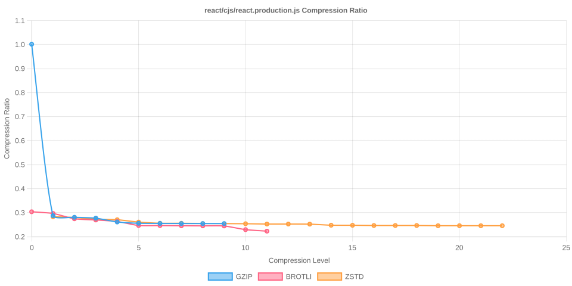
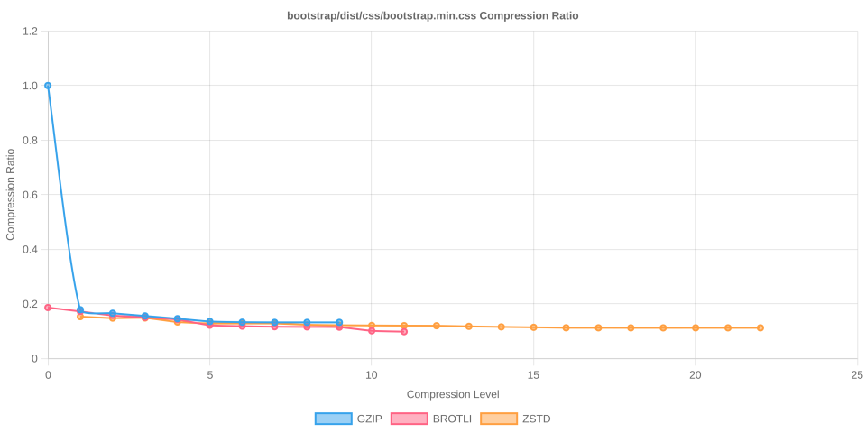

# Node Compression Benchmark

Last updated: 2026-11-14T21:05:20.342Z

This benchmark measures compression time, output size, and compression ratios for several popular npm packages across all gzip, Brotli, and Zstandard compression levels.

## Table of Contents

- [jquery/dist/jquery.min.js](#jquery-dist-jquery-min-js)
- [@expo-google-fonts/m-plus-1p/400Regular/MPLUS1p_400Regular.ttf](#expo-google-fonts-m-plus-1p-400regular-mplus1p-400regular-ttf)
- [@openfonts/m-plus-1p_japanese/m-plus-1p-japanese-400.woff2](#openfonts-m-plus-1p-japanese-m-plus-1p-japanese-400-woff2)
- [@codemirror/view/dist/index.js](#codemirror-view-dist-index-js)
- [react/cjs/react.production.js](#react-cjs-react-production-js)
- [dayjs/dayjs.min.js](#dayjs-dayjs-min-js)
- [vue/dist/vue.global.prod.js](#vue-dist-vue-global-prod-js)
- [lodash/lodash.min.js](#lodash-lodash-min-js)
- [@fortawesome/fontawesome-free/css/all.min.css](#fortawesome-fontawesome-free-css-all-min-css)
- [bootstrap/dist/css/bootstrap.min.css](#bootstrap-dist-css-bootstrap-min-css)
- [world-countries/dist/countries-unescaped.json](#world-countries-dist-countries-unescaped-json)
- [@sqlite.org/sqlite-wasm/dist/sqlite3.wasm](#sqlite-org-sqlite-wasm-dist-sqlite3-wasm)
- [tailwindcss/theme.css](#tailwindcss-theme-css)

Benchmark settings:

- Warmup runs per level: 1
- Fixed samples per level: 9
- Target relative interval radius: 0.0500
- Elapsed benchmark time: 144.4 seconds
- [Raw observations and environment](results/latest.json) · [Measurement methodology](BENCHMARK.md)
- Intervals have at least 95% coverage for independent, identically distributed samples. Precision met means both bounds are within the target distance of the observed median; it is not an accuracy guarantee.

<h2 id="jquery-dist-jquery-min-js">jquery/dist/jquery.min.js</h2>

- Original size: 78,748 bytes
- Chart: 

| Algorithm | Level | Time (ms) | Size (bytes) | Compression Ratio | Samples | Median CI (ms) | Precision met |
| --- | ---: | ---: | ---: | ---: | ---: | --- | --- |
| gzip | 0 | 0.086 | 78,776 | 1.0004 | 9 | 0.079–0.123 | no |
| gzip | 1 | 0.597 | 31,033 | 0.3941 | 9 | 0.578–0.609 | yes |
| gzip | 2 | 0.669 | 30,134 | 0.3827 | 9 | 0.646–0.683 | yes |
| gzip | 3 | 0.712 | 29,671 | 0.3768 | 9 | 0.710–0.719 | yes |
| gzip | 4 | 0.805 | 28,457 | 0.3614 | 9 | 0.803–0.828 | yes |
| gzip | 5 | 1.071 | 27,721 | 0.3520 | 9 | 1.062–1.099 | yes |
| gzip | 6 | 1.260 | 27,584 | 0.3503 | 9 | 1.254–1.264 | yes |
| gzip | 7 | 1.378 | 27,547 | 0.3498 | 9 | 1.372–1.387 | yes |
| gzip | 8 | 1.568 | 27,530 | 0.3496 | 9 | 1.563–1.574 | yes |
| gzip | 9 | 1.543 | 27,530 | 0.3496 | 9 | 1.534–1.589 | yes |
| brotli | 0 | 0.157 | 33,111 | 0.4205 | 9 | 0.135–0.182 | no |
| brotli | 1 | 0.285 | 31,803 | 0.4039 | 9 | 0.258–0.329 | no |
| brotli | 2 | 0.525 | 29,394 | 0.3733 | 9 | 0.513–0.555 | no |
| brotli | 3 | 0.560 | 29,072 | 0.3692 | 9 | 0.551–0.587 | yes |
| brotli | 4 | 0.801 | 28,392 | 0.3605 | 9 | 0.794–0.804 | yes |
| brotli | 5 | 1.180 | 27,013 | 0.3430 | 9 | 1.173–1.206 | yes |
| brotli | 6 | 1.286 | 26,844 | 0.3409 | 9 | 1.262–1.332 | yes |
| brotli | 7 | 4.277 | 26,773 | 0.3400 | 9 | 4.231–4.345 | yes |
| brotli | 8 | 1.535 | 26,725 | 0.3394 | 9 | 1.525–1.545 | yes |
| brotli | 9 | 12.304 | 26,711 | 0.3392 | 9 | 12.290–12.345 | yes |
| brotli | 10 | 21.556 | 25,340 | 0.3218 | 9 | 21.456–23.390 | no |
| brotli | 11 | 62.063 | 24,992 | 0.3174 | 9 | 61.730–62.342 | yes |
| zstd | 1 | 0.147 | 31,062 | 0.3944 | 9 | 0.127–0.172 | no |
| zstd | 2 | 0.211 | 30,069 | 0.3818 | 9 | 0.187–0.226 | no |
| zstd | 3 | 0.204 | 29,214 | 0.3710 | 9 | 0.195–0.249 | no |
| zstd | 4 | 0.280 | 29,108 | 0.3696 | 9 | 0.265–0.313 | no |
| zstd | 5 | 0.500 | 28,349 | 0.3600 | 9 | 0.490–0.509 | yes |
| zstd | 6 | 0.706 | 27,592 | 0.3504 | 9 | 0.701–0.717 | yes |
| zstd | 7 | 0.857 | 27,383 | 0.3477 | 9 | 0.856–0.867 | yes |
| zstd | 8 | 0.980 | 27,237 | 0.3459 | 9 | 0.974–1.330 | no |
| zstd | 9 | 1.054 | 27,118 | 0.3444 | 9 | 1.051–1.065 | yes |
| zstd | 10 | 1.328 | 27,062 | 0.3437 | 9 | 1.284–1.452 | no |
| zstd | 11 | 2.364 | 26,969 | 0.3425 | 9 | 2.332–2.397 | yes |
| zstd | 12 | 2.450 | 26,970 | 0.3425 | 9 | 2.443–2.458 | yes |
| zstd | 13 | 3.627 | 26,867 | 0.3412 | 9 | 3.618–3.664 | yes |
| zstd | 14 | 4.902 | 26,432 | 0.3357 | 9 | 4.895–4.922 | yes |
| zstd | 15 | 4.992 | 26,420 | 0.3355 | 9 | 4.979–5.054 | yes |
| zstd | 16 | 6.255 | 26,336 | 0.3344 | 9 | 6.238–6.267 | yes |
| zstd | 17 | 6.262 | 26,336 | 0.3344 | 9 | 6.250–6.296 | yes |
| zstd | 18 | 6.257 | 26,336 | 0.3344 | 9 | 6.252–6.297 | yes |
| zstd | 19 | 12.260 | 26,282 | 0.3337 | 9 | 12.233–12.314 | yes |
| zstd | 20 | 12.255 | 26,282 | 0.3337 | 9 | 12.248–12.276 | yes |
| zstd | 21 | 12.265 | 26,282 | 0.3337 | 9 | 12.237–12.311 | yes |
| zstd | 22 | 12.277 | 26,282 | 0.3337 | 9 | 12.261–12.314 | yes |

<h2 id="expo-google-fonts-m-plus-1p-400regular-mplus1p-400regular-ttf">@expo-google-fonts/m-plus-1p/400Regular/MPLUS1p_400Regular.ttf</h2>

- Original size: 1,714,248 bytes
- Chart: 

| Algorithm | Level | Time (ms) | Size (bytes) | Compression Ratio | Samples | Median CI (ms) | Precision met |
| --- | ---: | ---: | ---: | ---: | ---: | --- | --- |
| gzip | 0 | 0.756 | 1,714,526 | 1.0002 | 9 | 0.572–1.133 | no |
| gzip | 1 | 18.834 | 1,049,634 | 0.6123 | 9 | 18.770–19.099 | yes |
| gzip | 2 | 19.692 | 1,036,805 | 0.6048 | 9 | 19.662–19.734 | yes |
| gzip | 3 | 20.930 | 1,030,268 | 0.6010 | 9 | 20.850–21.344 | yes |
| gzip | 4 | 22.924 | 1,015,229 | 0.5922 | 9 | 22.874–23.307 | yes |
| gzip | 5 | 27.448 | 999,772 | 0.5832 | 9 | 27.431–27.589 | yes |
| gzip | 6 | 32.359 | 997,720 | 0.5820 | 9 | 32.337–32.474 | yes |
| gzip | 7 | 34.820 | 997,295 | 0.5818 | 9 | 34.770–35.024 | yes |
| gzip | 8 | 37.801 | 997,191 | 0.5817 | 9 | 37.758–37.853 | yes |
| gzip | 9 | 42.251 | 997,191 | 0.5817 | 9 | 42.212–42.282 | yes |
| brotli | 0 | 3.984 | 1,112,634 | 0.6491 | 9 | 3.980–3.992 | yes |
| brotli | 1 | 5.842 | 1,031,943 | 0.6020 | 9 | 5.803–5.932 | yes |
| brotli | 2 | 10.592 | 986,211 | 0.5753 | 9 | 10.537–10.748 | yes |
| brotli | 3 | 12.096 | 976,041 | 0.5694 | 9 | 12.072–12.146 | yes |
| brotli | 4 | 15.348 | 933,224 | 0.5444 | 9 | 15.282–16.090 | yes |
| brotli | 5 | 22.390 | 872,005 | 0.5087 | 9 | 22.292–22.600 | yes |
| brotli | 6 | 24.651 | 863,383 | 0.5037 | 9 | 24.318–25.484 | yes |
| brotli | 7 | 50.800 | 857,835 | 0.5004 | 9 | 50.733–50.989 | yes |
| brotli | 8 | 57.143 | 855,950 | 0.4993 | 9 | 57.077–57.912 | yes |
| brotli | 9 | 92.004 | 849,266 | 0.4954 | 9 | 91.146–104.814 | no |
| brotli | 10 | 1355.457 | 830,083 | 0.4842 | 9 | 1353.324–1368.593 | yes |
| brotli | 11 | 2324.109 | 806,920 | 0.4707 | 9 | 2312.834–2345.093 | yes |
| zstd | 1 | 3.593 | 1,063,995 | 0.6207 | 9 | 3.583–3.631 | yes |
| zstd | 2 | 4.234 | 995,049 | 0.5805 | 9 | 4.213–4.331 | yes |
| zstd | 3 | 5.730 | 951,924 | 0.5553 | 9 | 5.688–6.067 | no |
| zstd | 4 | 6.522 | 934,018 | 0.5449 | 9 | 6.499–6.592 | yes |
| zstd | 5 | 10.615 | 915,542 | 0.5341 | 9 | 10.577–10.891 | yes |
| zstd | 6 | 13.313 | 905,207 | 0.5280 | 9 | 13.286–13.643 | yes |
| zstd | 7 | 14.154 | 897,707 | 0.5237 | 9 | 14.057–14.228 | yes |
| zstd | 8 | 16.678 | 890,668 | 0.5196 | 9 | 16.667–16.696 | yes |
| zstd | 9 | 16.726 | 889,701 | 0.5190 | 9 | 16.681–16.756 | yes |
| zstd | 10 | 20.098 | 886,752 | 0.5173 | 9 | 20.071–20.259 | yes |
| zstd | 11 | 24.265 | 884,967 | 0.5162 | 9 | 24.119–24.725 | yes |
| zstd | 12 | 24.443 | 884,967 | 0.5162 | 9 | 24.364–24.592 | yes |
| zstd | 13 | 68.163 | 884,574 | 0.5160 | 9 | 67.682–69.887 | yes |
| zstd | 14 | 73.517 | 882,969 | 0.5151 | 9 | 73.303–74.381 | yes |
| zstd | 15 | 76.172 | 882,565 | 0.5148 | 9 | 75.176–79.198 | yes |
| zstd | 16 | 110.803 | 865,802 | 0.5051 | 9 | 109.159–111.679 | yes |
| zstd | 17 | 121.698 | 858,980 | 0.5011 | 9 | 120.887–128.469 | no |
| zstd | 18 | 164.696 | 834,631 | 0.4869 | 9 | 164.002–167.896 | yes |
| zstd | 19 | 174.414 | 834,350 | 0.4867 | 9 | 173.281–176.760 | yes |
| zstd | 20 | 175.105 | 834,350 | 0.4867 | 9 | 173.826–179.310 | yes |
| zstd | 21 | 174.510 | 834,350 | 0.4867 | 9 | 173.318–176.069 | yes |
| zstd | 22 | 174.644 | 834,350 | 0.4867 | 9 | 173.408–178.119 | yes |

<h2 id="openfonts-m-plus-1p-japanese-m-plus-1p-japanese-400-woff2">@openfonts/m-plus-1p_japanese/m-plus-1p-japanese-400.woff2</h2>

- Original size: 598,576 bytes
- Chart: 

| Algorithm | Level | Time (ms) | Size (bytes) | Compression Ratio | Samples | Median CI (ms) | Precision met |
| --- | ---: | ---: | ---: | ---: | ---: | --- | --- |
| gzip | 0 | 0.168 | 598,684 | 1.0002 | 9 | 0.163–0.175 | yes |
| gzip | 1 | 8.228 | 596,192 | 0.9960 | 9 | 8.217–8.244 | yes |
| gzip | 2 | 8.228 | 596,183 | 0.9960 | 9 | 8.226–8.237 | yes |
| gzip | 3 | 8.240 | 596,173 | 0.9960 | 9 | 8.224–8.657 | no |
| gzip | 4 | 8.541 | 596,171 | 0.9960 | 9 | 8.517–8.562 | yes |
| gzip | 5 | 8.527 | 596,154 | 0.9960 | 9 | 8.516–8.540 | yes |
| gzip | 6 | 8.535 | 596,154 | 0.9960 | 9 | 8.528–8.588 | yes |
| gzip | 7 | 8.536 | 596,154 | 0.9960 | 9 | 8.529–8.550 | yes |
| gzip | 8 | 8.533 | 596,154 | 0.9960 | 9 | 8.530–8.551 | yes |
| gzip | 9 | 8.537 | 596,154 | 0.9960 | 9 | 8.526–8.543 | yes |
| brotli | 0 | 0.129 | 596,751 | 0.9970 | 9 | 0.125–0.141 | no |
| brotli | 1 | 0.165 | 598,581 | 1.0000 | 9 | 0.145–0.181 | no |
| brotli | 2 | 0.447 | 598,587 | 1.0000 | 9 | 0.438–0.465 | yes |
| brotli | 3 | 0.369 | 598,559 | 1.0000 | 9 | 0.334–0.970 | no |
| brotli | 4 | 0.426 | 598,581 | 1.0000 | 9 | 0.418–0.428 | yes |
| brotli | 5 | 0.659 | 598,581 | 1.0000 | 9 | 0.630–0.814 | no |
| brotli | 6 | 0.862 | 598,581 | 1.0000 | 9 | 0.657–0.990 | no |
| brotli | 7 | 1.007 | 598,581 | 1.0000 | 9 | 0.978–1.724 | no |
| brotli | 8 | 1.037 | 598,581 | 1.0000 | 9 | 1.029–1.063 | yes |
| brotli | 9 | 12.605 | 598,581 | 1.0000 | 9 | 12.582–12.827 | yes |
| brotli | 10 | 65.382 | 598,581 | 1.0000 | 9 | 65.250–66.228 | yes |
| brotli | 11 | 160.962 | 598,581 | 1.0000 | 9 | 160.134–161.741 | yes |
| zstd | 1 | 0.133 | 598,601 | 1.0000 | 9 | 0.126–0.153 | no |
| zstd | 2 | 0.144 | 598,600 | 1.0000 | 9 | 0.140–0.153 | no |
| zstd | 3 | 0.164 | 598,600 | 1.0000 | 9 | 0.160–0.207 | no |
| zstd | 4 | 0.265 | 598,600 | 1.0000 | 9 | 0.181–0.777 | no |
| zstd | 5 | 0.225 | 598,600 | 1.0000 | 9 | 0.220–0.241 | no |
| zstd | 6 | 0.238 | 598,600 | 1.0000 | 9 | 0.230–0.243 | yes |
| zstd | 7 | 0.261 | 598,600 | 1.0000 | 9 | 0.241–0.277 | no |
| zstd | 8 | 0.249 | 598,600 | 1.0000 | 9 | 0.222–0.412 | no |
| zstd | 9 | 0.729 | 598,600 | 1.0000 | 9 | 0.308–0.963 | no |
| zstd | 10 | 0.294 | 598,600 | 1.0000 | 9 | 0.293–0.301 | yes |
| zstd | 11 | 0.297 | 598,600 | 1.0000 | 9 | 0.295–0.311 | yes |
| zstd | 12 | 0.301 | 598,600 | 1.0000 | 9 | 0.298–0.308 | yes |
| zstd | 13 | 1.140 | 595,998 | 0.9957 | 9 | 1.049–2.641 | no |
| zstd | 14 | 1.035 | 595,998 | 0.9957 | 9 | 1.022–1.047 | yes |
| zstd | 15 | 1.039 | 595,998 | 0.9957 | 9 | 1.030–1.045 | yes |
| zstd | 16 | 7.482 | 595,898 | 0.9955 | 9 | 7.475–7.511 | yes |
| zstd | 17 | 7.732 | 595,889 | 0.9955 | 9 | 7.694–10.235 | no |
| zstd | 18 | 10.730 | 595,891 | 0.9955 | 9 | 10.717–10.770 | yes |
| zstd | 19 | 13.026 | 595,894 | 0.9955 | 9 | 13.008–13.097 | yes |
| zstd | 20 | 13.032 | 595,894 | 0.9955 | 9 | 13.012–13.087 | yes |
| zstd | 21 | 12.996 | 595,894 | 0.9955 | 9 | 12.982–13.047 | yes |
| zstd | 22 | 13.119 | 595,894 | 0.9955 | 9 | 13.045–13.133 | yes |

<h2 id="codemirror-view-dist-index-js">@codemirror/view/dist/index.js</h2>

- Original size: 495,588 bytes
- Chart: 

| Algorithm | Level | Time (ms) | Size (bytes) | Compression Ratio | Samples | Median CI (ms) | Precision met |
| --- | ---: | ---: | ---: | ---: | ---: | --- | --- |
| gzip | 0 | 0.146 | 495,681 | 1.0002 | 9 | 0.144–0.158 | no |
| gzip | 1 | 2.600 | 147,019 | 0.2967 | 9 | 2.588–2.618 | yes |
| gzip | 2 | 2.884 | 140,161 | 0.2828 | 9 | 2.876–2.889 | yes |
| gzip | 3 | 3.756 | 135,613 | 0.2736 | 9 | 3.748–3.776 | yes |
| gzip | 4 | 3.764 | 127,170 | 0.2566 | 9 | 3.762–3.794 | yes |
| gzip | 5 | 5.556 | 122,480 | 0.2471 | 9 | 5.547–5.602 | yes |
| gzip | 6 | 8.102 | 120,752 | 0.2437 | 9 | 8.099–8.114 | yes |
| gzip | 7 | 9.983 | 120,280 | 0.2427 | 9 | 9.979–10.294 | yes |
| gzip | 8 | 19.052 | 120,006 | 0.2421 | 9 | 19.026–19.071 | yes |
| gzip | 9 | 30.085 | 119,944 | 0.2420 | 9 | 30.042–30.132 | yes |
| brotli | 0 | 0.874 | 151,389 | 0.3055 | 9 | 0.873–0.891 | yes |
| brotli | 1 | 1.352 | 139,012 | 0.2805 | 9 | 1.348–1.356 | yes |
| brotli | 2 | 2.539 | 130,704 | 0.2637 | 9 | 2.529–2.546 | yes |
| brotli | 3 | 2.756 | 128,093 | 0.2585 | 9 | 2.754–2.762 | yes |
| brotli | 4 | 3.639 | 124,144 | 0.2505 | 9 | 3.603–4.138 | no |
| brotli | 5 | 5.699 | 114,090 | 0.2302 | 9 | 5.622–5.783 | yes |
| brotli | 6 | 6.511 | 111,384 | 0.2248 | 9 | 6.488–6.566 | yes |
| brotli | 7 | 11.799 | 109,376 | 0.2207 | 9 | 9.022–14.336 | no |
| brotli | 8 | 9.535 | 108,340 | 0.2186 | 9 | 9.492–10.593 | no |
| brotli | 9 | 23.272 | 107,449 | 0.2168 | 9 | 23.210–23.296 | yes |
| brotli | 10 | 177.544 | 99,878 | 0.2015 | 9 | 176.937–188.531 | no |
| brotli | 11 | 455.065 | 97,648 | 0.1970 | 9 | 453.491–456.099 | yes |
| zstd | 1 | 1.102 | 139,921 | 0.2823 | 9 | 1.097–1.117 | yes |
| zstd | 2 | 1.133 | 135,629 | 0.2737 | 9 | 1.130–1.141 | yes |
| zstd | 3 | 1.316 | 127,698 | 0.2577 | 9 | 1.308–1.322 | yes |
| zstd | 4 | 1.403 | 127,469 | 0.2572 | 9 | 1.401–1.407 | yes |
| zstd | 5 | 2.626 | 118,828 | 0.2398 | 9 | 2.622–2.632 | yes |
| zstd | 6 | 3.622 | 114,849 | 0.2317 | 9 | 3.609–4.317 | no |
| zstd | 7 | 4.094 | 113,233 | 0.2285 | 9 | 4.072–4.106 | yes |
| zstd | 8 | 5.221 | 112,404 | 0.2268 | 9 | 5.211–5.313 | yes |
| zstd | 9 | 5.214 | 112,404 | 0.2268 | 9 | 5.199–5.261 | yes |
| zstd | 10 | 6.283 | 111,395 | 0.2248 | 9 | 6.274–6.301 | yes |
| zstd | 11 | 8.003 | 110,772 | 0.2235 | 9 | 7.995–8.060 | yes |
| zstd | 12 | 7.990 | 110,772 | 0.2235 | 9 | 7.976–8.015 | yes |
| zstd | 13 | 18.055 | 109,611 | 0.2212 | 9 | 17.988–18.125 | yes |
| zstd | 14 | 22.000 | 108,976 | 0.2199 | 9 | 21.681–22.490 | yes |
| zstd | 15 | 24.708 | 108,836 | 0.2196 | 9 | 24.678–24.941 | yes |
| zstd | 16 | 42.297 | 103,236 | 0.2083 | 9 | 42.277–42.398 | yes |
| zstd | 17 | 47.280 | 102,296 | 0.2064 | 9 | 47.238–47.412 | yes |
| zstd | 18 | 65.185 | 101,518 | 0.2048 | 9 | 65.140–65.251 | yes |
| zstd | 19 | 82.977 | 101,389 | 0.2046 | 9 | 82.947–83.071 | yes |
| zstd | 20 | 82.922 | 101,389 | 0.2046 | 9 | 82.893–83.082 | yes |
| zstd | 21 | 83.247 | 101,411 | 0.2046 | 9 | 83.182–83.408 | yes |
| zstd | 22 | 83.226 | 101,411 | 0.2046 | 9 | 83.180–83.254 | yes |

<h2 id="react-cjs-react-production-js">react/cjs/react.production.js</h2>

- Original size: 18,040 bytes
- Chart: 

| Algorithm | Level | Time (ms) | Size (bytes) | Compression Ratio | Samples | Median CI (ms) | Precision met |
| --- | ---: | ---: | ---: | ---: | ---: | --- | --- |
| gzip | 0 | 0.011 | 18,063 | 1.0013 | 9 | 0.010–0.013 | no |
| gzip | 1 | 0.043 | 5,189 | 0.2876 | 9 | 0.036–0.087 | no |
| gzip | 2 | 0.053 | 5,069 | 0.2810 | 9 | 0.042–0.076 | no |
| gzip | 3 | 0.060 | 5,003 | 0.2773 | 9 | 0.046–0.092 | no |
| gzip | 4 | 0.088 | 4,715 | 0.2614 | 9 | 0.067–0.114 | no |
| gzip | 5 | 0.134 | 4,618 | 0.2560 | 9 | 0.107–0.152 | no |
| gzip | 6 | 0.134 | 4,607 | 0.2554 | 9 | 0.115–0.170 | no |
| gzip | 7 | 0.153 | 4,600 | 0.2550 | 9 | 0.137–0.171 | no |
| gzip | 8 | 0.236 | 4,597 | 0.2548 | 9 | 0.224–0.246 | no |
| gzip | 9 | 0.234 | 4,597 | 0.2548 | 9 | 0.227–0.249 | no |
| brotli | 0 | 0.032 | 5,483 | 0.3039 | 9 | 0.031–0.036 | no |
| brotli | 1 | 0.044 | 5,356 | 0.2969 | 9 | 0.040–0.053 | no |
| brotli | 2 | 0.071 | 4,956 | 0.2747 | 9 | 0.053–0.095 | no |
| brotli | 3 | 0.084 | 4,866 | 0.2697 | 9 | 0.065–0.178 | no |
| brotli | 4 | 0.140 | 4,752 | 0.2634 | 9 | 0.120–0.161 | no |
| brotli | 5 | 0.205 | 4,451 | 0.2467 | 9 | 0.187–0.242 | no |
| brotli | 6 | 0.218 | 4,446 | 0.2465 | 9 | 0.198–0.230 | no |
| brotli | 7 | 0.251 | 4,432 | 0.2457 | 9 | 0.237–0.275 | no |
| brotli | 8 | 0.243 | 4,424 | 0.2452 | 9 | 0.237–0.248 | yes |
| brotli | 9 | 4.406 | 4,416 | 0.2448 | 9 | 4.386–4.447 | yes |
| brotli | 10 | 4.920 | 4,142 | 0.2296 | 9 | 4.863–4.981 | yes |
| brotli | 11 | 12.395 | 4,027 | 0.2232 | 9 | 12.277–12.432 | yes |
| zstd | 1 | 0.030 | 5,114 | 0.2835 | 9 | 0.028–0.033 | no |
| zstd | 2 | 0.031 | 5,057 | 0.2803 | 9 | 0.030–0.033 | no |
| zstd | 3 | 0.056 | 4,922 | 0.2728 | 9 | 0.046–0.074 | no |
| zstd | 4 | 0.058 | 4,885 | 0.2708 | 9 | 0.056–0.069 | no |
| zstd | 5 | 0.135 | 4,708 | 0.2610 | 9 | 0.091–0.152 | no |
| zstd | 6 | 0.108 | 4,620 | 0.2561 | 9 | 0.088–0.131 | no |
| zstd | 7 | 0.144 | 4,618 | 0.2560 | 9 | 0.134–0.206 | no |
| zstd | 8 | 0.158 | 4,601 | 0.2550 | 9 | 0.129–0.169 | no |
| zstd | 9 | 0.177 | 4,592 | 0.2545 | 9 | 0.155–0.197 | no |
| zstd | 10 | 0.212 | 4,584 | 0.2541 | 9 | 0.191–0.235 | no |
| zstd | 11 | 0.426 | 4,562 | 0.2529 | 9 | 0.417–0.458 | no |
| zstd | 12 | 0.443 | 4,562 | 0.2529 | 9 | 0.438–0.453 | yes |
| zstd | 13 | 0.630 | 4,554 | 0.2524 | 9 | 0.626–0.656 | yes |
| zstd | 14 | 0.957 | 4,473 | 0.2479 | 9 | 0.946–0.983 | yes |
| zstd | 15 | 1.008 | 4,468 | 0.2477 | 9 | 1.005–1.012 | yes |
| zstd | 16 | 1.402 | 4,452 | 0.2468 | 9 | 1.399–1.409 | yes |
| zstd | 17 | 1.473 | 4,452 | 0.2468 | 9 | 1.467–1.484 | yes |
| zstd | 18 | 1.474 | 4,452 | 0.2468 | 9 | 1.468–1.479 | yes |
| zstd | 19 | 2.903 | 4,436 | 0.2459 | 9 | 2.901–2.914 | yes |
| zstd | 20 | 2.901 | 4,436 | 0.2459 | 9 | 2.898–2.906 | yes |
| zstd | 21 | 2.903 | 4,436 | 0.2459 | 9 | 2.899–2.928 | yes |
| zstd | 22 | 2.901 | 4,436 | 0.2459 | 9 | 2.897–2.906 | yes |

<h2 id="dayjs-dayjs-min-js">dayjs/dayjs.min.js</h2>

- Original size: 7,161 bytes
- Chart: 

| Algorithm | Level | Time (ms) | Size (bytes) | Compression Ratio | Samples | Median CI (ms) | Precision met |
| --- | ---: | ---: | ---: | ---: | ---: | --- | --- |
| gzip | 0 | 0.008 | 7,184 | 1.0032 | 9 | 0.005–0.013 | no |
| gzip | 1 | 0.039 | 3,220 | 0.4497 | 9 | 0.028–0.054 | no |
| gzip | 2 | 0.033 | 3,182 | 0.4444 | 9 | 0.029–0.044 | no |
| gzip | 3 | 0.027 | 3,153 | 0.4403 | 9 | 0.026–0.038 | no |
| gzip | 4 | 0.032 | 3,095 | 0.4322 | 9 | 0.031–0.045 | no |
| gzip | 5 | 0.045 | 3,051 | 0.4261 | 9 | 0.038–0.088 | no |
| gzip | 6 | 0.039 | 3,044 | 0.4251 | 9 | 0.037–0.047 | no |
| gzip | 7 | 0.041 | 3,042 | 0.4248 | 9 | 0.040–0.046 | no |
| gzip | 8 | 0.041 | 3,042 | 0.4248 | 9 | 0.040–0.044 | no |
| gzip | 9 | 0.040 | 3,042 | 0.4248 | 9 | 0.039–0.044 | no |
| brotli | 0 | 0.019 | 3,549 | 0.4956 | 9 | 0.018–0.020 | no |
| brotli | 1 | 0.026 | 3,381 | 0.4721 | 9 | 0.025–0.037 | no |
| brotli | 2 | 0.036 | 3,263 | 0.4557 | 9 | 0.032–0.045 | no |
| brotli | 3 | 0.042 | 3,216 | 0.4491 | 9 | 0.038–0.053 | no |
| brotli | 4 | 0.068 | 3,147 | 0.4395 | 9 | 0.064–0.089 | no |
| brotli | 5 | 0.103 | 2,963 | 0.4138 | 9 | 0.080–0.133 | no |
| brotli | 6 | 0.095 | 2,952 | 0.4122 | 9 | 0.088–0.123 | no |
| brotli | 7 | 0.116 | 2,944 | 0.4111 | 9 | 0.093–0.148 | no |
| brotli | 8 | 0.092 | 2,944 | 0.4111 | 9 | 0.089–0.100 | no |
| brotli | 9 | 3.977 | 2,945 | 0.4113 | 9 | 3.961–4.009 | yes |
| brotli | 10 | 1.972 | 2,814 | 0.3930 | 9 | 1.965–2.010 | yes |
| brotli | 11 | 4.923 | 2,772 | 0.3871 | 9 | 4.894–5.001 | yes |
| zstd | 1 | 0.017 | 3,254 | 0.4544 | 9 | 0.016–0.021 | no |
| zstd | 2 | 0.021 | 3,200 | 0.4469 | 9 | 0.017–0.025 | no |
| zstd | 3 | 0.023 | 3,176 | 0.4435 | 9 | 0.021–0.026 | no |
| zstd | 4 | 0.030 | 3,102 | 0.4332 | 9 | 0.030–0.035 | no |
| zstd | 5 | 0.036 | 3,079 | 0.4300 | 9 | 0.034–0.049 | no |
| zstd | 6 | 0.043 | 3,060 | 0.4273 | 9 | 0.042–0.051 | no |
| zstd | 7 | 0.052 | 3,053 | 0.4263 | 9 | 0.051–0.060 | no |
| zstd | 8 | 0.051 | 3,053 | 0.4263 | 9 | 0.051–0.054 | no |
| zstd | 9 | 0.083 | 3,055 | 0.4266 | 9 | 0.072–0.114 | no |
| zstd | 10 | 0.067 | 3,055 | 0.4266 | 9 | 0.067–0.069 | yes |
| zstd | 11 | 0.198 | 3,044 | 0.4251 | 9 | 0.176–0.220 | no |
| zstd | 12 | 0.271 | 3,011 | 0.4205 | 9 | 0.260–0.296 | no |
| zstd | 13 | 0.340 | 2,998 | 0.4187 | 9 | 0.332–0.361 | no |
| zstd | 14 | 0.334 | 2,998 | 0.4187 | 9 | 0.330–0.343 | yes |
| zstd | 15 | 0.480 | 2,998 | 0.4187 | 9 | 0.331–0.492 | no |
| zstd | 16 | 0.639 | 2,992 | 0.4178 | 9 | 0.632–0.656 | yes |
| zstd | 17 | 0.638 | 2,992 | 0.4178 | 9 | 0.623–0.821 | no |
| zstd | 18 | 0.622 | 2,992 | 0.4178 | 9 | 0.616–0.627 | yes |
| zstd | 19 | 0.619 | 2,992 | 0.4178 | 9 | 0.613–0.620 | yes |
| zstd | 20 | 0.622 | 2,992 | 0.4178 | 9 | 0.615–0.624 | yes |
| zstd | 21 | 0.615 | 2,992 | 0.4178 | 9 | 0.610–0.619 | yes |
| zstd | 22 | 0.616 | 2,992 | 0.4178 | 9 | 0.612–0.619 | yes |

<h2 id="vue-dist-vue-global-prod-js">vue/dist/vue.global.prod.js</h2>

- Original size: 172,939 bytes
- Chart: 

| Algorithm | Level | Time (ms) | Size (bytes) | Compression Ratio | Samples | Median CI (ms) | Precision met |
| --- | ---: | ---: | ---: | ---: | ---: | --- | --- |
| gzip | 0 | 0.053 | 172,982 | 1.0002 | 9 | 0.051–0.055 | no |
| gzip | 1 | 1.444 | 70,513 | 0.4077 | 9 | 1.341–1.528 | no |
| gzip | 2 | 1.459 | 68,699 | 0.3972 | 9 | 1.456–1.474 | yes |
| gzip | 3 | 1.656 | 67,625 | 0.3910 | 9 | 1.651–1.658 | yes |
| gzip | 4 | 1.806 | 65,132 | 0.3766 | 9 | 1.799–1.825 | yes |
| gzip | 5 | 2.511 | 63,397 | 0.3666 | 9 | 2.507–2.527 | yes |
| gzip | 6 | 3.134 | 63,096 | 0.3648 | 9 | 3.123–3.153 | yes |
| gzip | 7 | 3.401 | 63,059 | 0.3646 | 9 | 3.398–3.410 | yes |
| gzip | 8 | 3.665 | 63,043 | 0.3645 | 9 | 3.659–3.671 | yes |
| gzip | 9 | 3.673 | 63,043 | 0.3645 | 9 | 3.663–3.724 | yes |
| brotli | 0 | 0.384 | 75,027 | 0.4338 | 9 | 0.373–0.412 | no |
| brotli | 1 | 0.575 | 71,725 | 0.4147 | 9 | 0.568–0.584 | yes |
| brotli | 2 | 1.156 | 66,180 | 0.3827 | 9 | 1.155–1.165 | yes |
| brotli | 3 | 1.276 | 65,609 | 0.3794 | 9 | 1.272–1.282 | yes |
| brotli | 4 | 1.689 | 64,402 | 0.3724 | 9 | 1.686–1.700 | yes |
| brotli | 5 | 2.682 | 60,882 | 0.3520 | 9 | 2.634–2.709 | yes |
| brotli | 6 | 2.983 | 60,456 | 0.3496 | 9 | 2.973–3.023 | yes |
| brotli | 7 | 3.638 | 60,190 | 0.3480 | 9 | 3.633–3.647 | yes |
| brotli | 8 | 3.929 | 60,079 | 0.3474 | 9 | 3.913–3.964 | yes |
| brotli | 9 | 15.585 | 59,995 | 0.3469 | 9 | 15.574–15.807 | yes |
| brotli | 10 | 65.684 | 57,085 | 0.3301 | 9 | 65.415–65.867 | yes |
| brotli | 11 | 170.222 | 56,019 | 0.3239 | 9 | 169.792–191.084 | no |
| zstd | 1 | 0.379 | 69,658 | 0.4028 | 9 | 0.371–0.399 | no |
| zstd | 2 | 0.480 | 66,613 | 0.3852 | 9 | 0.471–0.501 | yes |
| zstd | 3 | 0.601 | 65,991 | 0.3816 | 9 | 0.596–0.615 | yes |
| zstd | 4 | 1.070 | 63,991 | 0.3700 | 9 | 1.067–1.082 | yes |
| zstd | 5 | 1.218 | 63,425 | 0.3667 | 9 | 1.214–1.255 | yes |
| zstd | 6 | 1.485 | 62,483 | 0.3613 | 9 | 1.476–1.493 | yes |
| zstd | 7 | 1.840 | 61,603 | 0.3562 | 9 | 1.833–1.854 | yes |
| zstd | 8 | 2.300 | 61,082 | 0.3532 | 9 | 2.298–2.327 | yes |
| zstd | 9 | 2.636 | 60,788 | 0.3515 | 9 | 2.617–2.695 | yes |
| zstd | 10 | 3.267 | 60,625 | 0.3506 | 9 | 3.256–3.300 | yes |
| zstd | 11 | 6.119 | 60,349 | 0.3490 | 9 | 6.117–6.136 | yes |
| zstd | 12 | 6.276 | 60,327 | 0.3488 | 9 | 6.241–6.295 | yes |
| zstd | 13 | 10.242 | 59,296 | 0.3429 | 9 | 10.234–10.264 | yes |
| zstd | 14 | 11.856 | 58,844 | 0.3403 | 9 | 11.834–11.880 | yes |
| zstd | 15 | 12.033 | 58,823 | 0.3401 | 9 | 12.021–12.093 | yes |
| zstd | 16 | 15.039 | 58,601 | 0.3389 | 9 | 15.027–15.065 | yes |
| zstd | 17 | 15.022 | 58,601 | 0.3389 | 9 | 15.014–15.038 | yes |
| zstd | 18 | 25.095 | 58,546 | 0.3385 | 9 | 25.041–25.297 | yes |
| zstd | 19 | 25.699 | 58,546 | 0.3385 | 9 | 25.045–26.087 | yes |
| zstd | 20 | 25.074 | 58,546 | 0.3385 | 9 | 25.047–25.216 | yes |
| zstd | 21 | 25.041 | 58,546 | 0.3385 | 9 | 25.033–25.085 | yes |
| zstd | 22 | 25.099 | 58,546 | 0.3385 | 9 | 25.044–25.321 | yes |

<h2 id="lodash-lodash-min-js">lodash/lodash.min.js</h2>

- Original size: 73,234 bytes
- Chart: 

| Algorithm | Level | Time (ms) | Size (bytes) | Compression Ratio | Samples | Median CI (ms) | Precision met |
| --- | ---: | ---: | ---: | ---: | ---: | --- | --- |
| gzip | 0 | 0.025 | 73,262 | 1.0004 | 9 | 0.024–0.029 | no |
| gzip | 1 | 0.509 | 28,819 | 0.3935 | 9 | 0.500–0.516 | yes |
| gzip | 2 | 0.561 | 28,191 | 0.3849 | 9 | 0.553–0.575 | yes |
| gzip | 3 | 0.642 | 27,724 | 0.3786 | 9 | 0.634–0.650 | yes |
| gzip | 4 | 0.708 | 26,950 | 0.3680 | 9 | 0.703–0.722 | yes |
| gzip | 5 | 0.953 | 26,101 | 0.3564 | 9 | 0.948–0.960 | yes |
| gzip | 6 | 1.198 | 25,938 | 0.3542 | 9 | 1.194–1.208 | yes |
| gzip | 7 | 1.404 | 25,913 | 0.3538 | 9 | 1.402–1.413 | yes |
| gzip | 8 | 1.899 | 25,894 | 0.3536 | 9 | 1.898–1.902 | yes |
| gzip | 9 | 1.895 | 25,894 | 0.3536 | 9 | 1.891–1.905 | yes |
| brotli | 0 | 0.124 | 30,978 | 0.4230 | 9 | 0.106–0.145 | no |
| brotli | 1 | 0.219 | 29,754 | 0.4063 | 9 | 0.209–0.231 | no |
| brotli | 2 | 0.452 | 27,438 | 0.3747 | 9 | 0.443–0.463 | yes |
| brotli | 3 | 0.496 | 27,227 | 0.3718 | 9 | 0.492–0.513 | yes |
| brotli | 4 | 0.711 | 26,678 | 0.3643 | 9 | 0.700–0.721 | yes |
| brotli | 5 | 1.121 | 25,217 | 0.3443 | 9 | 1.093–1.148 | yes |
| brotli | 6 | 1.255 | 25,093 | 0.3426 | 9 | 1.215–1.676 | no |
| brotli | 7 | 1.448 | 24,950 | 0.3407 | 9 | 1.423–1.475 | yes |
| brotli | 8 | 1.512 | 24,912 | 0.3402 | 9 | 1.500–1.548 | yes |
| brotli | 9 | 12.010 | 24,870 | 0.3396 | 9 | 11.985–12.072 | yes |
| brotli | 10 | 25.415 | 23,472 | 0.3205 | 9 | 25.353–25.720 | yes |
| brotli | 11 | 61.901 | 23,030 | 0.3145 | 9 | 61.720–62.061 | yes |
| zstd | 1 | 0.112 | 28,919 | 0.3949 | 9 | 0.102–0.136 | no |
| zstd | 2 | 0.143 | 28,008 | 0.3824 | 9 | 0.128–0.168 | no |
| zstd | 3 | 0.173 | 27,463 | 0.3750 | 9 | 0.155–0.201 | no |
| zstd | 4 | 0.230 | 27,100 | 0.3700 | 9 | 0.222–0.256 | no |
| zstd | 5 | 0.439 | 26,525 | 0.3622 | 9 | 0.427–0.450 | yes |
| zstd | 6 | 0.632 | 25,834 | 0.3528 | 9 | 0.624–0.644 | yes |
| zstd | 7 | 0.757 | 25,663 | 0.3504 | 9 | 0.752–0.762 | yes |
| zstd | 8 | 0.859 | 25,557 | 0.3490 | 9 | 0.855–0.859 | yes |
| zstd | 9 | 0.962 | 25,466 | 0.3477 | 9 | 0.959–0.970 | yes |
| zstd | 10 | 1.180 | 25,397 | 0.3468 | 9 | 1.171–1.211 | yes |
| zstd | 11 | 2.191 | 25,317 | 0.3457 | 9 | 2.183–2.212 | yes |
| zstd | 12 | 2.278 | 25,315 | 0.3457 | 9 | 2.276–2.298 | yes |
| zstd | 13 | 3.422 | 25,185 | 0.3439 | 9 | 3.406–3.442 | yes |
| zstd | 14 | 4.718 | 24,642 | 0.3365 | 9 | 4.710–4.740 | yes |
| zstd | 15 | 4.777 | 24,606 | 0.3360 | 9 | 4.762–4.789 | yes |
| zstd | 16 | 6.057 | 24,499 | 0.3345 | 9 | 6.053–6.060 | yes |
| zstd | 17 | 6.033 | 24,499 | 0.3345 | 9 | 6.024–6.042 | yes |
| zstd | 18 | 6.040 | 24,499 | 0.3345 | 9 | 6.038–6.066 | yes |
| zstd | 19 | 11.571 | 24,463 | 0.3340 | 9 | 11.551–12.344 | no |
| zstd | 20 | 11.564 | 24,463 | 0.3340 | 9 | 11.557–11.717 | yes |
| zstd | 21 | 11.556 | 24,463 | 0.3340 | 9 | 11.532–11.639 | yes |
| zstd | 22 | 11.546 | 24,463 | 0.3340 | 9 | 11.538–11.549 | yes |

<h2 id="fortawesome-fontawesome-free-css-all-min-css">@fortawesome/fontawesome-free/css/all.min.css</h2>

- Original size: 90,336 bytes
- Chart: 

| Algorithm | Level | Time (ms) | Size (bytes) | Compression Ratio | Samples | Median CI (ms) | Precision met |
| --- | ---: | ---: | ---: | ---: | ---: | --- | --- |
| gzip | 0 | 0.031 | 90,364 | 1.0003 | 9 | 0.028–0.042 | no |
| gzip | 1 | 0.413 | 25,642 | 0.2839 | 9 | 0.400–0.421 | yes |
| gzip | 2 | 0.481 | 25,381 | 0.2810 | 9 | 0.472–0.490 | yes |
| gzip | 3 | 0.561 | 25,183 | 0.2788 | 9 | 0.560–0.573 | yes |
| gzip | 4 | 0.631 | 23,806 | 0.2635 | 9 | 0.626–0.646 | yes |
| gzip | 5 | 0.906 | 22,906 | 0.2536 | 9 | 0.901–0.922 | yes |
| gzip | 6 | 1.361 | 22,672 | 0.2510 | 9 | 1.355–1.369 | yes |
| gzip | 7 | 1.863 | 22,565 | 0.2498 | 9 | 1.860–1.865 | yes |
| gzip | 8 | 5.515 | 22,320 | 0.2471 | 9 | 5.496–5.677 | yes |
| gzip | 9 | 5.482 | 22,318 | 0.2471 | 9 | 5.476–5.500 | yes |
| brotli | 0 | 0.112 | 27,781 | 0.3075 | 9 | 0.104–0.149 | no |
| brotli | 1 | 0.245 | 25,973 | 0.2875 | 9 | 0.234–0.253 | yes |
| brotli | 2 | 0.447 | 23,497 | 0.2601 | 9 | 0.434–0.460 | yes |
| brotli | 3 | 0.494 | 23,445 | 0.2595 | 9 | 0.485–0.514 | yes |
| brotli | 4 | 0.691 | 23,003 | 0.2546 | 9 | 0.679–0.708 | yes |
| brotli | 5 | 1.077 | 21,939 | 0.2429 | 9 | 1.039–1.353 | no |
| brotli | 6 | 1.207 | 21,822 | 0.2416 | 9 | 1.192–1.244 | yes |
| brotli | 7 | 1.499 | 21,742 | 0.2407 | 9 | 1.495–1.516 | yes |
| brotli | 8 | 1.760 | 21,693 | 0.2401 | 9 | 1.729–1.784 | yes |
| brotli | 9 | 11.725 | 21,604 | 0.2392 | 9 | 11.702–11.827 | yes |
| brotli | 10 | 21.674 | 18,961 | 0.2099 | 9 | 21.644–21.842 | yes |
| brotli | 11 | 65.164 | 18,432 | 0.2040 | 9 | 65.027–65.434 | yes |
| zstd | 1 | 0.130 | 24,608 | 0.2724 | 9 | 0.120–0.157 | no |
| zstd | 2 | 0.155 | 24,387 | 0.2700 | 9 | 0.143–0.182 | no |
| zstd | 3 | 0.202 | 24,157 | 0.2674 | 9 | 0.194–0.230 | no |
| zstd | 4 | 0.235 | 24,076 | 0.2665 | 9 | 0.219–0.261 | no |
| zstd | 5 | 0.436 | 23,365 | 0.2586 | 9 | 0.429–0.458 | yes |
| zstd | 6 | 0.638 | 22,468 | 0.2487 | 9 | 0.634–0.653 | yes |
| zstd | 7 | 0.789 | 21,961 | 0.2431 | 9 | 0.780–0.804 | yes |
| zstd | 8 | 0.930 | 21,892 | 0.2423 | 9 | 0.926–0.932 | yes |
| zstd | 9 | 1.190 | 21,821 | 0.2416 | 9 | 1.187–1.205 | yes |
| zstd | 10 | 1.625 | 21,755 | 0.2408 | 9 | 1.622–1.641 | yes |
| zstd | 11 | 2.472 | 21,610 | 0.2392 | 9 | 2.464–2.484 | yes |
| zstd | 12 | 3.279 | 21,581 | 0.2389 | 9 | 3.269–3.282 | yes |
| zstd | 13 | 3.882 | 21,357 | 0.2364 | 9 | 3.871–3.897 | yes |
| zstd | 14 | 5.216 | 20,565 | 0.2277 | 9 | 5.204–5.226 | yes |
| zstd | 15 | 6.187 | 20,426 | 0.2261 | 9 | 6.164–6.219 | yes |
| zstd | 16 | 8.126 | 20,254 | 0.2242 | 9 | 8.120–8.139 | yes |
| zstd | 17 | 10.616 | 20,220 | 0.2238 | 9 | 10.615–10.639 | yes |
| zstd | 18 | 16.448 | 20,218 | 0.2238 | 9 | 16.432–16.465 | yes |
| zstd | 19 | 16.331 | 20,225 | 0.2239 | 9 | 16.304–16.351 | yes |
| zstd | 20 | 18.936 | 20,194 | 0.2235 | 9 | 18.924–18.949 | yes |
| zstd | 21 | 27.475 | 20,185 | 0.2234 | 9 | 27.450–27.823 | yes |
| zstd | 22 | 32.598 | 20,186 | 0.2235 | 9 | 32.585–32.618 | yes |

<h2 id="bootstrap-dist-css-bootstrap-min-css">bootstrap/dist/css/bootstrap.min.css</h2>

- Original size: 232,360 bytes
- Chart: 

| Algorithm | Level | Time (ms) | Size (bytes) | Compression Ratio | Samples | Median CI (ms) | Precision met |
| --- | ---: | ---: | ---: | ---: | ---: | --- | --- |
| gzip | 0 | 0.069 | 232,413 | 1.0002 | 9 | 0.066–0.075 | no |
| gzip | 1 | 0.676 | 41,475 | 0.1785 | 9 | 0.671–0.686 | yes |
| gzip | 2 | 0.744 | 38,476 | 0.1656 | 9 | 0.738–0.755 | yes |
| gzip | 3 | 0.884 | 36,182 | 0.1557 | 9 | 0.877–0.896 | yes |
| gzip | 4 | 1.003 | 33,859 | 0.1457 | 9 | 0.995–1.014 | yes |
| gzip | 5 | 1.329 | 31,434 | 0.1353 | 9 | 1.324–1.347 | yes |
| gzip | 6 | 1.822 | 30,846 | 0.1328 | 9 | 1.815–1.829 | yes |
| gzip | 7 | 2.248 | 30,703 | 0.1321 | 9 | 2.246–2.254 | yes |
| gzip | 8 | 2.997 | 30,693 | 0.1321 | 9 | 2.991–2.998 | yes |
| gzip | 9 | 3.034 | 30,691 | 0.1321 | 9 | 3.033–3.041 | yes |
| brotli | 0 | 0.224 | 43,302 | 0.1864 | 9 | 0.214–0.251 | no |
| brotli | 1 | 0.397 | 39,981 | 0.1721 | 9 | 0.375–0.410 | no |
| brotli | 2 | 0.734 | 36,562 | 0.1574 | 9 | 0.731–0.750 | yes |
| brotli | 3 | 0.850 | 34,895 | 0.1502 | 9 | 0.842–0.862 | yes |
| brotli | 4 | 1.165 | 33,039 | 0.1422 | 9 | 1.160–1.178 | yes |
| brotli | 5 | 1.709 | 28,277 | 0.1217 | 9 | 1.684–1.822 | no |
| brotli | 6 | 1.871 | 27,459 | 0.1182 | 9 | 1.861–1.928 | yes |
| brotli | 7 | 2.207 | 26,981 | 0.1161 | 9 | 2.195–2.238 | yes |
| brotli | 8 | 2.511 | 26,832 | 0.1155 | 9 | 2.505–2.520 | yes |
| brotli | 9 | 11.609 | 26,593 | 0.1144 | 9 | 11.590–11.643 | yes |
| brotli | 10 | 59.235 | 23,494 | 0.1011 | 9 | 59.134–59.363 | yes |
| brotli | 11 | 186.011 | 22,775 | 0.0980 | 9 | 185.464–186.401 | yes |
| zstd | 1 | 0.263 | 35,583 | 0.1531 | 9 | 0.250–0.291 | no |
| zstd | 2 | 0.293 | 34,327 | 0.1477 | 9 | 0.279–0.314 | no |
| zstd | 3 | 0.305 | 34,431 | 0.1482 | 9 | 0.287–0.328 | no |
| zstd | 4 | 0.825 | 31,007 | 0.1334 | 9 | 0.814–0.845 | yes |
| zstd | 5 | 0.955 | 29,774 | 0.1281 | 9 | 0.946–0.962 | yes |
| zstd | 6 | 1.126 | 29,751 | 0.1280 | 9 | 1.124–1.144 | yes |
| zstd | 7 | 1.307 | 29,733 | 0.1280 | 9 | 1.305–1.317 | yes |
| zstd | 8 | 1.630 | 28,664 | 0.1234 | 9 | 1.623–1.635 | yes |
| zstd | 9 | 1.899 | 28,253 | 0.1216 | 9 | 1.889–1.906 | yes |
| zstd | 10 | 2.494 | 28,067 | 0.1208 | 9 | 2.485–2.520 | yes |
| zstd | 11 | 5.674 | 27,912 | 0.1201 | 9 | 5.651–5.686 | yes |
| zstd | 12 | 6.917 | 27,823 | 0.1197 | 9 | 6.893–6.936 | yes |
| zstd | 13 | 12.991 | 27,289 | 0.1174 | 9 | 12.964–13.012 | yes |
| zstd | 14 | 15.218 | 26,840 | 0.1155 | 9 | 15.210–15.247 | yes |
| zstd | 15 | 18.974 | 26,485 | 0.1140 | 9 | 18.946–18.989 | yes |
| zstd | 16 | 29.639 | 26,085 | 0.1123 | 9 | 29.592–29.666 | yes |
| zstd | 17 | 32.387 | 26,061 | 0.1122 | 9 | 32.372–32.526 | yes |
| zstd | 18 | 44.755 | 26,025 | 0.1120 | 9 | 44.722–44.915 | yes |
| zstd | 19 | 49.324 | 26,027 | 0.1120 | 9 | 49.251–49.585 | yes |
| zstd | 20 | 50.936 | 26,039 | 0.1121 | 9 | 50.811–51.199 | yes |
| zstd | 21 | 50.869 | 26,039 | 0.1121 | 9 | 50.839–50.975 | yes |
| zstd | 22 | 50.868 | 26,039 | 0.1121 | 9 | 50.834–50.901 | yes |

<h2 id="world-countries-dist-countries-unescaped-json">world-countries/dist/countries-unescaped.json</h2>

- Original size: 615,946 bytes
- Chart: 

| Algorithm | Level | Time (ms) | Size (bytes) | Compression Ratio | Samples | Median CI (ms) | Precision met |
| --- | ---: | ---: | ---: | ---: | ---: | --- | --- |
| gzip | 0 | 0.172 | 616,054 | 1.0002 | 9 | 0.171–0.180 | yes |
| gzip | 1 | 2.570 | 152,340 | 0.2473 | 9 | 2.561–2.577 | yes |
| gzip | 2 | 2.770 | 145,913 | 0.2369 | 9 | 2.762–2.779 | yes |
| gzip | 3 | 3.276 | 141,899 | 0.2304 | 9 | 3.266–3.288 | yes |
| gzip | 4 | 3.581 | 132,790 | 0.2156 | 9 | 3.569–3.590 | yes |
| gzip | 5 | 4.869 | 125,989 | 0.2045 | 9 | 4.856–4.885 | yes |
| gzip | 6 | 6.064 | 124,806 | 0.2026 | 9 | 6.053–6.135 | yes |
| gzip | 7 | 8.075 | 124,380 | 0.2019 | 9 | 8.065–8.082 | yes |
| gzip | 8 | 12.597 | 124,262 | 0.2017 | 9 | 12.588–12.606 | yes |
| gzip | 9 | 12.631 | 124,261 | 0.2017 | 9 | 12.620–12.682 | yes |
| brotli | 0 | 0.919 | 153,668 | 0.2495 | 9 | 0.912–0.934 | yes |
| brotli | 1 | 1.342 | 138,763 | 0.2253 | 9 | 1.328–1.344 | yes |
| brotli | 2 | 2.520 | 129,972 | 0.2110 | 9 | 2.513–2.535 | yes |
| brotli | 3 | 2.774 | 124,918 | 0.2028 | 9 | 2.771–2.789 | yes |
| brotli | 4 | 3.441 | 119,620 | 0.1942 | 9 | 3.426–3.453 | yes |
| brotli | 5 | 5.557 | 110,145 | 0.1788 | 9 | 5.532–5.642 | yes |
| brotli | 6 | 6.243 | 108,159 | 0.1756 | 9 | 6.227–6.268 | yes |
| brotli | 7 | 7.775 | 103,756 | 0.1684 | 9 | 7.762–8.011 | yes |
| brotli | 8 | 9.429 | 102,997 | 0.1672 | 9 | 9.396–9.672 | yes |
| brotli | 9 | 23.197 | 101,406 | 0.1646 | 9 | 23.120–23.227 | yes |
| brotli | 10 | 218.809 | 92,766 | 0.1506 | 9 | 216.984–219.954 | yes |
| brotli | 11 | 584.164 | 90,842 | 0.1475 | 9 | 579.464–586.335 | yes |
| zstd | 1 | 1.032 | 135,634 | 0.2202 | 9 | 1.027–1.039 | yes |
| zstd | 2 | 1.111 | 131,675 | 0.2138 | 9 | 1.109–1.138 | yes |
| zstd | 3 | 1.233 | 124,682 | 0.2024 | 9 | 1.229–1.248 | yes |
| zstd | 4 | 1.330 | 124,515 | 0.2022 | 9 | 1.316–1.335 | yes |
| zstd | 5 | 2.621 | 115,616 | 0.1877 | 9 | 2.611–2.633 | yes |
| zstd | 6 | 3.578 | 112,622 | 0.1828 | 9 | 3.569–3.591 | yes |
| zstd | 7 | 4.026 | 111,386 | 0.1808 | 9 | 3.956–4.046 | yes |
| zstd | 8 | 5.047 | 110,885 | 0.1800 | 9 | 5.028–5.070 | yes |
| zstd | 9 | 5.093 | 110,856 | 0.1800 | 9 | 5.081–5.140 | yes |
| zstd | 10 | 5.953 | 110,262 | 0.1790 | 9 | 5.904–5.980 | yes |
| zstd | 11 | 7.318 | 109,660 | 0.1780 | 9 | 7.291–7.367 | yes |
| zstd | 12 | 7.326 | 109,660 | 0.1780 | 9 | 7.305–7.370 | yes |
| zstd | 13 | 15.439 | 108,855 | 0.1767 | 9 | 15.408–15.545 | yes |
| zstd | 14 | 18.413 | 108,631 | 0.1764 | 9 | 18.400–18.434 | yes |
| zstd | 15 | 20.677 | 108,683 | 0.1764 | 9 | 20.643–20.780 | yes |
| zstd | 16 | 47.276 | 102,692 | 0.1667 | 9 | 47.202–47.412 | yes |
| zstd | 17 | 52.970 | 101,496 | 0.1648 | 9 | 52.919–53.135 | yes |
| zstd | 18 | 75.868 | 100,215 | 0.1627 | 9 | 75.760–75.896 | yes |
| zstd | 19 | 100.426 | 99,575 | 0.1617 | 9 | 100.381–101.717 | yes |
| zstd | 20 | 100.646 | 99,575 | 0.1617 | 9 | 100.433–101.172 | yes |
| zstd | 21 | 100.690 | 99,575 | 0.1617 | 9 | 100.559–100.885 | yes |
| zstd | 22 | 100.600 | 99,575 | 0.1617 | 9 | 100.550–100.733 | yes |

<h2 id="sqlite-org-sqlite-wasm-dist-sqlite3-wasm">@sqlite.org/sqlite-wasm/dist/sqlite3.wasm</h2>

- Original size: 859,730 bytes
- Chart: 

| Algorithm | Level | Time (ms) | Size (bytes) | Compression Ratio | Samples | Median CI (ms) | Precision met |
| --- | ---: | ---: | ---: | ---: | ---: | --- | --- |
| gzip | 0 | 0.305 | 859,878 | 1.0002 | 9 | 0.252–0.335 | no |
| gzip | 1 | 8.587 | 429,925 | 0.5001 | 9 | 8.578–8.630 | yes |
| gzip | 2 | 9.295 | 419,493 | 0.4879 | 9 | 9.278–9.295 | yes |
| gzip | 3 | 10.903 | 414,493 | 0.4821 | 9 | 10.892–10.915 | yes |
| gzip | 4 | 11.333 | 407,503 | 0.4740 | 9 | 11.320–11.351 | yes |
| gzip | 5 | 16.935 | 399,866 | 0.4651 | 9 | 16.880–16.996 | yes |
| gzip | 6 | 20.020 | 399,154 | 0.4643 | 9 | 20.015–20.054 | yes |
| gzip | 7 | 21.251 | 399,020 | 0.4641 | 9 | 21.214–21.296 | yes |
| gzip | 8 | 23.522 | 398,974 | 0.4641 | 9 | 22.925–23.561 | yes |
| gzip | 9 | 23.552 | 398,973 | 0.4641 | 9 | 23.538–23.600 | yes |
| brotli | 0 | 2.272 | 460,125 | 0.5352 | 9 | 2.254–2.290 | yes |
| brotli | 1 | 3.448 | 442,506 | 0.5147 | 9 | 3.420–3.486 | yes |
| brotli | 2 | 6.677 | 409,638 | 0.4765 | 9 | 6.659–6.686 | yes |
| brotli | 3 | 7.475 | 408,960 | 0.4757 | 9 | 7.465–7.495 | yes |
| brotli | 4 | 9.791 | 400,331 | 0.4656 | 9 | 9.761–9.991 | yes |
| brotli | 5 | 16.089 | 380,339 | 0.4424 | 9 | 16.034–16.147 | yes |
| brotli | 6 | 23.087 | 377,100 | 0.4386 | 9 | 18.184–29.963 | no |
| brotli | 7 | 26.578 | 375,149 | 0.4364 | 9 | 26.552–26.611 | yes |
| brotli | 8 | 30.824 | 374,164 | 0.4352 | 9 | 30.670–31.456 | yes |
| brotli | 9 | 51.284 | 373,347 | 0.4343 | 9 | 51.198–51.365 | yes |
| brotli | 10 | 602.992 | 353,246 | 0.4109 | 9 | 599.123–605.881 | yes |
| brotli | 11 | 1279.534 | 344,353 | 0.4005 | 9 | 1274.256–1284.954 | yes |
| zstd | 1 | 1.831 | 457,015 | 0.5316 | 9 | 1.820–1.866 | yes |
| zstd | 2 | 2.399 | 426,694 | 0.4963 | 9 | 2.383–2.424 | yes |
| zstd | 3 | 3.317 | 411,278 | 0.4784 | 9 | 3.269–3.371 | yes |
| zstd | 4 | 3.898 | 408,051 | 0.4746 | 9 | 3.877–4.039 | yes |
| zstd | 5 | 5.901 | 397,246 | 0.4621 | 9 | 5.853–6.015 | yes |
| zstd | 6 | 8.181 | 390,015 | 0.4536 | 9 | 8.172–8.200 | yes |
| zstd | 7 | 9.032 | 388,562 | 0.4520 | 9 | 8.984–9.221 | yes |
| zstd | 8 | 11.259 | 386,566 | 0.4496 | 9 | 11.233–11.504 | yes |
| zstd | 9 | 11.184 | 386,404 | 0.4494 | 9 | 11.161–11.401 | yes |
| zstd | 10 | 12.598 | 385,609 | 0.4485 | 9 | 12.582–12.657 | yes |
| zstd | 11 | 15.471 | 385,152 | 0.4480 | 9 | 15.460–15.530 | yes |
| zstd | 12 | 15.505 | 385,152 | 0.4480 | 9 | 15.487–15.530 | yes |
| zstd | 13 | 32.376 | 383,952 | 0.4466 | 9 | 32.294–32.419 | yes |
| zstd | 14 | 33.265 | 383,886 | 0.4465 | 9 | 33.209–33.447 | yes |
| zstd | 15 | 33.481 | 383,877 | 0.4465 | 9 | 33.441–33.648 | yes |
| zstd | 16 | 55.640 | 369,550 | 0.4298 | 9 | 55.595–56.114 | yes |
| zstd | 17 | 71.062 | 362,382 | 0.4215 | 9 | 71.015–71.126 | yes |
| zstd | 18 | 89.430 | 358,220 | 0.4167 | 9 | 89.373–89.664 | yes |
| zstd | 19 | 99.289 | 358,047 | 0.4165 | 9 | 99.108–99.486 | yes |
| zstd | 20 | 99.335 | 358,047 | 0.4165 | 9 | 99.208–100.103 | yes |
| zstd | 21 | 100.091 | 358,041 | 0.4165 | 9 | 99.834–101.820 | yes |
| zstd | 22 | 100.241 | 358,041 | 0.4165 | 9 | 100.105–100.941 | yes |

<h2 id="tailwindcss-theme-css">tailwindcss/theme.css</h2>

- Original size: 19,586 bytes
- Chart: 

| Algorithm | Level | Time (ms) | Size (bytes) | Compression Ratio | Samples | Median CI (ms) | Precision met |
| --- | ---: | ---: | ---: | ---: | ---: | --- | --- |
| gzip | 0 | 0.012 | 19,609 | 1.0012 | 9 | 0.011–0.014 | no |
| gzip | 1 | 0.043 | 5,565 | 0.2841 | 9 | 0.040–0.074 | no |
| gzip | 2 | 0.058 | 5,486 | 0.2801 | 9 | 0.047–0.087 | no |
| gzip | 3 | 0.079 | 5,419 | 0.2767 | 9 | 0.053–0.100 | no |
| gzip | 4 | 0.110 | 5,202 | 0.2656 | 9 | 0.077–0.127 | no |
| gzip | 5 | 0.165 | 4,958 | 0.2531 | 9 | 0.135–0.186 | no |
| gzip | 6 | 0.211 | 4,947 | 0.2526 | 9 | 0.202–0.229 | no |
| gzip | 7 | 0.289 | 4,921 | 0.2513 | 9 | 0.284–0.304 | no |
| gzip | 8 | 0.394 | 4,923 | 0.2514 | 9 | 0.385–0.407 | yes |
| gzip | 9 | 0.380 | 4,923 | 0.2514 | 9 | 0.375–0.386 | yes |
| brotli | 0 | 0.032 | 6,082 | 0.3105 | 9 | 0.031–0.043 | no |
| brotli | 1 | 0.045 | 5,794 | 0.2958 | 9 | 0.042–0.054 | no |
| brotli | 2 | 0.063 | 5,002 | 0.2554 | 9 | 0.057–0.094 | no |
| brotli | 3 | 0.087 | 4,986 | 0.2546 | 9 | 0.069–0.112 | no |
| brotli | 4 | 0.150 | 4,954 | 0.2529 | 9 | 0.126–0.168 | no |
| brotli | 5 | 0.240 | 4,641 | 0.2370 | 9 | 0.231–0.266 | no |
| brotli | 6 | 0.266 | 4,630 | 0.2364 | 9 | 0.253–0.278 | yes |
| brotli | 7 | 0.328 | 4,622 | 0.2360 | 9 | 0.321–0.350 | no |
| brotli | 8 | 0.358 | 4,623 | 0.2360 | 9 | 0.352–0.389 | no |
| brotli | 9 | 4.905 | 4,612 | 0.2355 | 9 | 4.897–4.916 | yes |
| brotli | 10 | 4.589 | 3,996 | 0.2040 | 9 | 4.575–4.593 | yes |
| brotli | 11 | 13.980 | 3,863 | 0.1972 | 9 | 13.941–14.028 | yes |
| zstd | 1 | 0.032 | 5,441 | 0.2778 | 9 | 0.030–0.040 | no |
| zstd | 2 | 0.032 | 5,242 | 0.2676 | 9 | 0.031–0.046 | no |
| zstd | 3 | 0.038 | 5,234 | 0.2672 | 9 | 0.036–0.052 | no |
| zstd | 4 | 0.037 | 5,212 | 0.2661 | 9 | 0.036–0.046 | no |
| zstd | 5 | 0.073 | 5,133 | 0.2621 | 9 | 0.072–0.089 | no |
| zstd | 6 | 0.100 | 4,853 | 0.2478 | 9 | 0.093–0.130 | no |
| zstd | 7 | 0.125 | 4,757 | 0.2429 | 9 | 0.114–0.156 | no |
| zstd | 8 | 0.146 | 4,750 | 0.2425 | 9 | 0.133–0.168 | no |
| zstd | 9 | 0.203 | 4,744 | 0.2422 | 9 | 0.178–0.223 | no |
| zstd | 10 | 0.286 | 4,746 | 0.2423 | 9 | 0.266–0.300 | no |
| zstd | 11 | 0.374 | 4,745 | 0.2423 | 9 | 0.363–0.404 | no |
| zstd | 12 | 0.390 | 4,745 | 0.2423 | 9 | 0.386–0.395 | yes |
| zstd | 13 | 0.621 | 4,865 | 0.2484 | 9 | 0.615–0.641 | yes |
| zstd | 14 | 1.097 | 4,497 | 0.2296 | 9 | 1.092–1.112 | yes |
| zstd | 15 | 1.159 | 4,490 | 0.2292 | 9 | 1.158–1.172 | yes |
| zstd | 16 | 1.551 | 4,430 | 0.2262 | 9 | 1.543–1.561 | yes |
| zstd | 17 | 1.548 | 4,430 | 0.2262 | 9 | 1.545–1.554 | yes |
| zstd | 18 | 1.549 | 4,430 | 0.2262 | 9 | 1.545–1.554 | yes |
| zstd | 19 | 3.055 | 4,414 | 0.2254 | 9 | 3.040–3.062 | yes |
| zstd | 20 | 3.063 | 4,415 | 0.2254 | 9 | 3.055–3.104 | yes |
| zstd | 21 | 3.062 | 4,415 | 0.2254 | 9 | 3.053–3.072 | yes |
| zstd | 22 | 3.063 | 4,415 | 0.2254 | 9 | 3.060–3.064 | yes |
