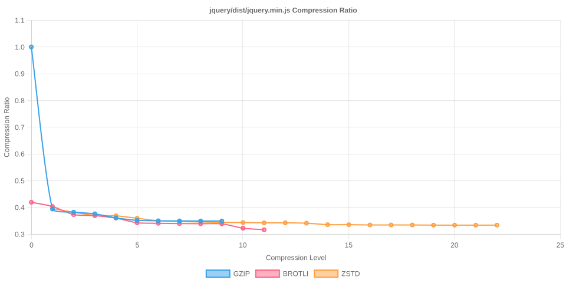
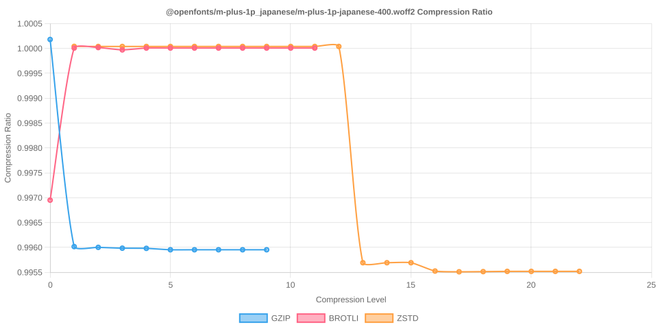
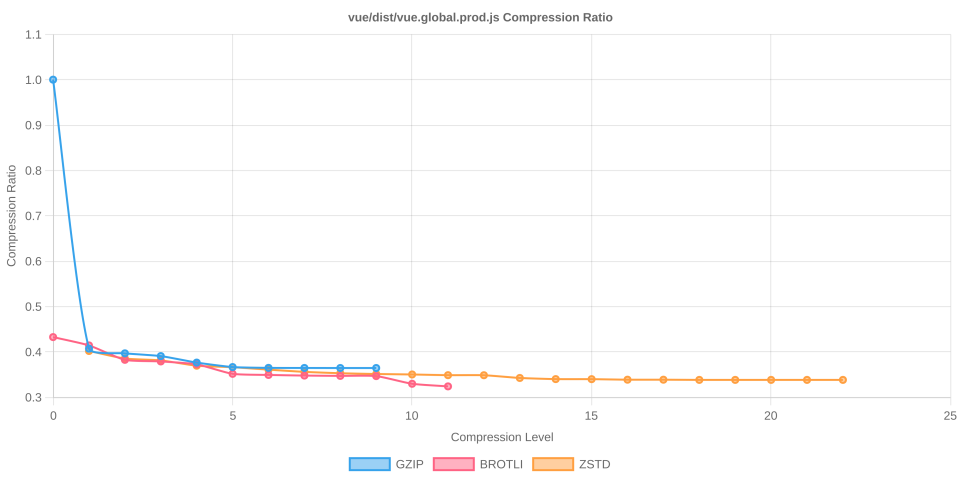
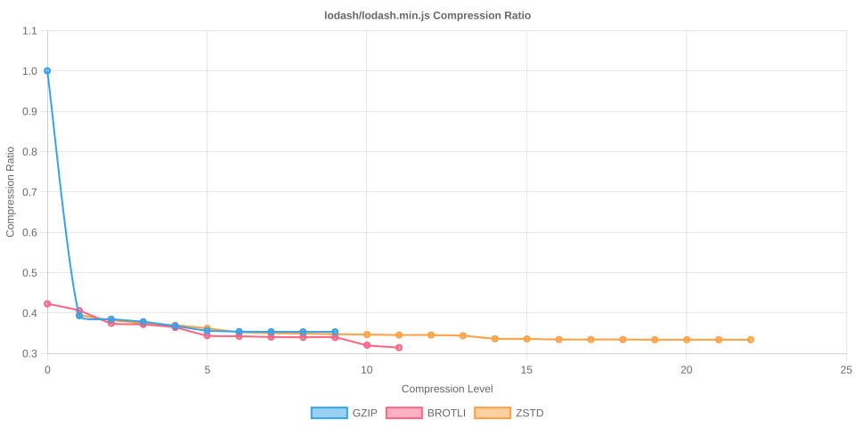

# Node Compression Benchmark

Last updated: 2026-11-23T21:08:59.226Z

This benchmark measures compression time, output size, and compression ratios for several popular npm packages across all gzip, Brotli, and Zstandard compression levels.

## Table of Contents

- [jquery/dist/jquery.min.js](#jquery-dist-jquery-min-js)
- [@expo-google-fonts/m-plus-1p/400Regular/MPLUS1p_400Regular.ttf](#expo-google-fonts-m-plus-1p-400regular-mplus1p-400regular-ttf)
- [@openfonts/m-plus-1p_japanese/m-plus-1p-japanese-400.woff2](#openfonts-m-plus-1p-japanese-m-plus-1p-japanese-400-woff2)
- [@codemirror/view/dist/index.js](#codemirror-view-dist-index-js)
- [react/cjs/react.production.js](#react-cjs-react-production-js)
- [dayjs/dayjs.min.js](#dayjs-dayjs-min-js)
- [vue/dist/vue.global.prod.js](#vue-dist-vue-global-prod-js)
- [lodash/lodash.min.js](#lodash-lodash-min-js)
- [@fortawesome/fontawesome-free/css/all.min.css](#fortawesome-fontawesome-free-css-all-min-css)
- [bootstrap/dist/css/bootstrap.min.css](#bootstrap-dist-css-bootstrap-min-css)
- [world-countries/dist/countries-unescaped.json](#world-countries-dist-countries-unescaped-json)
- [@sqlite.org/sqlite-wasm/dist/sqlite3.wasm](#sqlite-org-sqlite-wasm-dist-sqlite3-wasm)
- [tailwindcss/theme.css](#tailwindcss-theme-css)

Benchmark settings:

- Warmup runs per level: 1
- Fixed samples per level: 9
- Target relative interval radius: 0.0500
- Elapsed benchmark time: 200.3 seconds
- [Raw observations and environment](results/latest.json) · [Measurement methodology](BENCHMARK.md)
- Intervals have at least 95% coverage for independent, identically distributed samples. Precision met means both bounds are within the target distance of the observed median; it is not an accuracy guarantee.

<h2 id="jquery-dist-jquery-min-js">jquery/dist/jquery.min.js</h2>

- Original size: 78,965 bytes
- Chart: 

| Algorithm | Level | Time (ms) | Size (bytes) | Compression Ratio | Samples | Median CI (ms) | Precision met |
| --- | ---: | ---: | ---: | ---: | ---: | --- | --- |
| gzip | 0 | 0.126 | 78,993 | 1.0004 | 9 | 0.099–0.150 | no |
| gzip | 1 | 0.755 | 31,138 | 0.3943 | 9 | 0.741–0.774 | yes |
| gzip | 2 | 0.820 | 30,222 | 0.3827 | 9 | 0.812–0.833 | yes |
| gzip | 3 | 0.921 | 29,738 | 0.3766 | 9 | 0.913–0.935 | yes |
| gzip | 4 | 1.045 | 28,514 | 0.3611 | 9 | 1.034–1.076 | yes |
| gzip | 5 | 1.359 | 27,798 | 0.3520 | 9 | 1.352–1.372 | yes |
| gzip | 6 | 1.640 | 27,655 | 0.3502 | 9 | 1.630–1.647 | yes |
| gzip | 7 | 1.823 | 27,619 | 0.3498 | 9 | 1.821–1.846 | yes |
| gzip | 8 | 2.126 | 27,606 | 0.3496 | 9 | 2.120–2.146 | yes |
| gzip | 9 | 2.166 | 27,606 | 0.3496 | 9 | 2.143–2.168 | yes |
| brotli | 0 | 0.271 | 33,137 | 0.4196 | 9 | 0.242–0.316 | no |
| brotli | 1 | 0.388 | 31,905 | 0.4040 | 9 | 0.372–0.433 | no |
| brotli | 2 | 0.658 | 29,484 | 0.3734 | 9 | 0.648–0.700 | no |
| brotli | 3 | 0.742 | 29,187 | 0.3696 | 9 | 0.715–0.777 | yes |
| brotli | 4 | 1.112 | 28,456 | 0.3604 | 9 | 1.094–1.134 | yes |
| brotli | 5 | 1.686 | 27,075 | 0.3429 | 9 | 1.672–1.735 | yes |
| brotli | 6 | 1.797 | 26,921 | 0.3409 | 9 | 1.773–1.854 | yes |
| brotli | 7 | 5.806 | 26,847 | 0.3400 | 9 | 5.625–5.990 | yes |
| brotli | 8 | 2.319 | 26,802 | 0.3394 | 9 | 2.205–2.493 | no |
| brotli | 9 | 16.482 | 26,772 | 0.3390 | 9 | 16.031–16.827 | yes |
| brotli | 10 | 30.540 | 25,484 | 0.3227 | 9 | 30.071–31.941 | yes |
| brotli | 11 | 81.995 | 25,019 | 0.3168 | 9 | 81.405–84.193 | yes |
| zstd | 1 | 0.212 | 31,249 | 0.3957 | 9 | 0.183–0.313 | no |
| zstd | 2 | 0.206 | 30,186 | 0.3823 | 9 | 0.196–0.281 | no |
| zstd | 3 | 0.260 | 29,281 | 0.3708 | 9 | 0.237–0.334 | no |
| zstd | 4 | 0.383 | 29,146 | 0.3691 | 9 | 0.333–0.424 | no |
| zstd | 5 | 0.682 | 28,404 | 0.3597 | 9 | 0.681–0.704 | yes |
| zstd | 6 | 0.966 | 27,670 | 0.3504 | 9 | 0.960–0.981 | yes |
| zstd | 7 | 1.161 | 27,453 | 0.3477 | 9 | 1.157–1.172 | yes |
| zstd | 8 | 1.291 | 27,312 | 0.3459 | 9 | 1.273–1.335 | yes |
| zstd | 9 | 1.438 | 27,198 | 0.3444 | 9 | 1.430–1.453 | yes |
| zstd | 10 | 1.650 | 27,138 | 0.3437 | 9 | 1.639–1.693 | yes |
| zstd | 11 | 2.945 | 27,056 | 0.3426 | 9 | 2.941–2.971 | yes |
| zstd | 12 | 3.035 | 27,059 | 0.3427 | 9 | 3.009–3.066 | yes |
| zstd | 13 | 4.552 | 26,959 | 0.3414 | 9 | 4.489–4.611 | yes |
| zstd | 14 | 6.236 | 26,521 | 0.3359 | 9 | 6.152–6.391 | yes |
| zstd | 15 | 6.327 | 26,514 | 0.3358 | 9 | 6.260–6.413 | yes |
| zstd | 16 | 7.789 | 26,432 | 0.3347 | 9 | 7.726–7.893 | yes |
| zstd | 17 | 7.636 | 26,432 | 0.3347 | 9 | 7.583–7.692 | yes |
| zstd | 18 | 7.685 | 26,432 | 0.3347 | 9 | 7.604–7.866 | yes |
| zstd | 19 | 15.034 | 26,378 | 0.3340 | 9 | 14.999–15.521 | yes |
| zstd | 20 | 15.305 | 26,378 | 0.3340 | 9 | 15.124–15.698 | yes |
| zstd | 21 | 15.625 | 26,378 | 0.3340 | 9 | 15.484–16.330 | yes |
| zstd | 22 | 15.835 | 26,378 | 0.3340 | 9 | 15.576–16.413 | yes |

<h2 id="expo-google-fonts-m-plus-1p-400regular-mplus1p-400regular-ttf">@expo-google-fonts/m-plus-1p/400Regular/MPLUS1p_400Regular.ttf</h2>

- Original size: 1,714,248 bytes
- Chart: 

| Algorithm | Level | Time (ms) | Size (bytes) | Compression Ratio | Samples | Median CI (ms) | Precision met |
| --- | ---: | ---: | ---: | ---: | ---: | --- | --- |
| gzip | 0 | 1.185 | 1,714,526 | 1.0002 | 9 | 0.896–1.508 | no |
| gzip | 1 | 24.535 | 1,049,634 | 0.6123 | 9 | 23.587–24.699 | yes |
| gzip | 2 | 25.372 | 1,036,805 | 0.6048 | 9 | 24.704–26.949 | no |
| gzip | 3 | 27.625 | 1,030,268 | 0.6010 | 9 | 26.951–28.077 | yes |
| gzip | 4 | 29.124 | 1,015,229 | 0.5922 | 9 | 28.948–29.361 | yes |
| gzip | 5 | 36.115 | 999,772 | 0.5832 | 9 | 35.789–37.521 | yes |
| gzip | 6 | 42.259 | 997,720 | 0.5820 | 9 | 41.336–44.734 | no |
| gzip | 7 | 45.730 | 997,295 | 0.5818 | 9 | 45.447–47.123 | yes |
| gzip | 8 | 49.678 | 997,191 | 0.5817 | 9 | 49.376–50.389 | yes |
| gzip | 9 | 54.733 | 997,191 | 0.5817 | 9 | 54.567–55.971 | yes |
| brotli | 0 | 5.587 | 1,112,634 | 0.6491 | 9 | 5.528–5.653 | yes |
| brotli | 1 | 7.500 | 1,031,943 | 0.6020 | 9 | 7.444–7.661 | yes |
| brotli | 2 | 13.807 | 986,211 | 0.5753 | 9 | 13.712–13.948 | yes |
| brotli | 3 | 15.927 | 976,041 | 0.5694 | 9 | 15.852–16.498 | yes |
| brotli | 4 | 21.239 | 933,224 | 0.5444 | 9 | 21.102–21.664 | yes |
| brotli | 5 | 32.071 | 872,005 | 0.5087 | 9 | 31.767–32.892 | yes |
| brotli | 6 | 35.550 | 863,383 | 0.5037 | 9 | 34.526–36.234 | yes |
| brotli | 7 | 80.890 | 857,835 | 0.5004 | 9 | 78.210–85.285 | no |
| brotli | 8 | 98.677 | 855,950 | 0.4993 | 9 | 94.758–101.738 | yes |
| brotli | 9 | 143.793 | 849,266 | 0.4954 | 9 | 141.456–148.262 | yes |
| brotli | 10 | 1876.286 | 830,083 | 0.4842 | 9 | 1854.579–1891.931 | yes |
| brotli | 11 | 3167.113 | 806,920 | 0.4707 | 9 | 3116.414–3188.369 | yes |
| zstd | 1 | 5.156 | 1,063,995 | 0.6207 | 9 | 5.135–5.173 | yes |
| zstd | 2 | 6.188 | 995,049 | 0.5805 | 9 | 6.069–6.359 | yes |
| zstd | 3 | 8.972 | 951,924 | 0.5553 | 9 | 8.918–9.739 | no |
| zstd | 4 | 10.347 | 934,018 | 0.5449 | 9 | 10.246–10.469 | yes |
| zstd | 5 | 15.382 | 915,542 | 0.5341 | 9 | 15.352–15.751 | yes |
| zstd | 6 | 19.054 | 905,207 | 0.5280 | 9 | 18.952–19.138 | yes |
| zstd | 7 | 19.950 | 897,707 | 0.5237 | 9 | 19.745–20.615 | yes |
| zstd | 8 | 23.465 | 890,668 | 0.5196 | 9 | 23.189–24.350 | yes |
| zstd | 9 | 24.527 | 889,701 | 0.5190 | 9 | 23.496–24.852 | yes |
| zstd | 10 | 30.235 | 886,752 | 0.5173 | 9 | 29.393–31.005 | yes |
| zstd | 11 | 40.738 | 884,967 | 0.5162 | 9 | 38.656–48.298 | no |
| zstd | 12 | 41.647 | 884,967 | 0.5162 | 9 | 39.715–43.695 | yes |
| zstd | 13 | 123.851 | 884,574 | 0.5160 | 9 | 116.502–129.080 | no |
| zstd | 14 | 130.601 | 882,969 | 0.5151 | 9 | 125.530–136.016 | yes |
| zstd | 15 | 142.380 | 882,565 | 0.5148 | 9 | 138.510–145.994 | yes |
| zstd | 16 | 195.309 | 865,802 | 0.5051 | 9 | 184.884–207.707 | no |
| zstd | 17 | 206.999 | 858,980 | 0.5011 | 9 | 195.193–215.508 | no |
| zstd | 18 | 273.397 | 834,631 | 0.4869 | 9 | 269.299–279.275 | yes |
| zstd | 19 | 306.047 | 834,350 | 0.4867 | 9 | 287.475–319.545 | no |
| zstd | 20 | 295.890 | 834,350 | 0.4867 | 9 | 276.874–318.094 | no |
| zstd | 21 | 298.998 | 834,350 | 0.4867 | 9 | 272.520–304.980 | no |
| zstd | 22 | 272.627 | 834,350 | 0.4867 | 9 | 268.002–289.108 | no |

<h2 id="openfonts-m-plus-1p-japanese-m-plus-1p-japanese-400-woff2">@openfonts/m-plus-1p_japanese/m-plus-1p-japanese-400.woff2</h2>

- Original size: 598,576 bytes
- Chart: 

| Algorithm | Level | Time (ms) | Size (bytes) | Compression Ratio | Samples | Median CI (ms) | Precision met |
| --- | ---: | ---: | ---: | ---: | ---: | --- | --- |
| gzip | 0 | 0.288 | 598,684 | 1.0002 | 9 | 0.282–0.304 | no |
| gzip | 1 | 10.381 | 596,192 | 0.9960 | 9 | 10.355–10.436 | yes |
| gzip | 2 | 10.444 | 596,183 | 0.9960 | 9 | 10.397–11.097 | no |
| gzip | 3 | 10.426 | 596,173 | 0.9960 | 9 | 10.396–10.521 | yes |
| gzip | 4 | 10.853 | 596,171 | 0.9960 | 9 | 10.783–10.977 | yes |
| gzip | 5 | 10.781 | 596,154 | 0.9960 | 9 | 10.761–10.829 | yes |
| gzip | 6 | 10.816 | 596,154 | 0.9960 | 9 | 10.781–10.884 | yes |
| gzip | 7 | 10.785 | 596,154 | 0.9960 | 9 | 10.749–10.837 | yes |
| gzip | 8 | 10.823 | 596,154 | 0.9960 | 9 | 10.772–11.092 | yes |
| gzip | 9 | 10.816 | 596,154 | 0.9960 | 9 | 10.782–10.925 | yes |
| brotli | 0 | 0.194 | 596,751 | 0.9970 | 9 | 0.185–0.211 | no |
| brotli | 1 | 0.173 | 598,581 | 1.0000 | 9 | 0.157–0.190 | no |
| brotli | 2 | 0.466 | 598,587 | 1.0000 | 9 | 0.447–0.493 | no |
| brotli | 3 | 0.663 | 598,559 | 1.0000 | 9 | 0.550–1.251 | no |
| brotli | 4 | 0.655 | 598,581 | 1.0000 | 9 | 0.646–0.693 | no |
| brotli | 5 | 1.193 | 598,581 | 1.0000 | 9 | 1.030–1.290 | no |
| brotli | 6 | 1.184 | 598,581 | 1.0000 | 9 | 1.071–1.317 | no |
| brotli | 7 | 1.452 | 598,581 | 1.0000 | 9 | 1.396–2.246 | no |
| brotli | 8 | 1.618 | 598,581 | 1.0000 | 9 | 1.587–1.642 | yes |
| brotli | 9 | 17.253 | 598,581 | 1.0000 | 9 | 17.027–17.584 | yes |
| brotli | 10 | 97.570 | 598,581 | 1.0000 | 9 | 96.740–102.155 | yes |
| brotli | 11 | 238.476 | 598,581 | 1.0000 | 9 | 235.025–242.397 | yes |
| zstd | 1 | 0.221 | 598,601 | 1.0000 | 9 | 0.213–0.256 | no |
| zstd | 2 | 0.226 | 598,600 | 1.0000 | 9 | 0.207–0.247 | no |
| zstd | 3 | 0.254 | 598,600 | 1.0000 | 9 | 0.236–0.258 | no |
| zstd | 4 | 0.319 | 598,600 | 1.0000 | 9 | 0.272–0.732 | no |
| zstd | 5 | 0.365 | 598,600 | 1.0000 | 9 | 0.362–0.382 | yes |
| zstd | 6 | 0.369 | 598,600 | 1.0000 | 9 | 0.366–0.376 | yes |
| zstd | 7 | 0.420 | 598,600 | 1.0000 | 9 | 0.399–0.440 | no |
| zstd | 8 | 0.413 | 598,600 | 1.0000 | 9 | 0.403–0.452 | no |
| zstd | 9 | 0.496 | 598,600 | 1.0000 | 9 | 0.474–0.549 | no |
| zstd | 10 | 0.493 | 598,600 | 1.0000 | 9 | 0.479–0.499 | yes |
| zstd | 11 | 0.492 | 598,600 | 1.0000 | 9 | 0.479–0.498 | yes |
| zstd | 12 | 0.604 | 598,600 | 1.0000 | 9 | 0.491–1.105 | no |
| zstd | 13 | 1.673 | 595,998 | 0.9957 | 9 | 1.659–1.793 | no |
| zstd | 14 | 1.732 | 595,998 | 0.9957 | 9 | 1.672–1.770 | yes |
| zstd | 15 | 1.724 | 595,998 | 0.9957 | 9 | 1.620–1.783 | no |
| zstd | 16 | 12.159 | 595,898 | 0.9955 | 9 | 11.779–12.382 | yes |
| zstd | 17 | 12.113 | 595,889 | 0.9955 | 9 | 11.944–12.604 | yes |
| zstd | 18 | 21.470 | 595,891 | 0.9955 | 9 | 19.920–23.923 | no |
| zstd | 19 | 22.556 | 595,894 | 0.9955 | 9 | 22.026–23.341 | yes |
| zstd | 20 | 22.092 | 595,894 | 0.9955 | 9 | 21.121–22.508 | yes |
| zstd | 21 | 27.939 | 595,894 | 0.9955 | 9 | 21.837–33.614 | no |
| zstd | 22 | 23.715 | 595,894 | 0.9955 | 9 | 21.584–27.101 | no |

<h2 id="codemirror-view-dist-index-js">@codemirror/view/dist/index.js</h2>

- Original size: 495,588 bytes
- Chart: 

| Algorithm | Level | Time (ms) | Size (bytes) | Compression Ratio | Samples | Median CI (ms) | Precision met |
| --- | ---: | ---: | ---: | ---: | ---: | --- | --- |
| gzip | 0 | 0.229 | 495,681 | 1.0002 | 9 | 0.224–0.241 | no |
| gzip | 1 | 3.345 | 147,019 | 0.2967 | 9 | 3.333–3.386 | yes |
| gzip | 2 | 3.671 | 140,161 | 0.2828 | 9 | 3.652–3.685 | yes |
| gzip | 3 | 4.858 | 135,613 | 0.2736 | 9 | 4.846–4.874 | yes |
| gzip | 4 | 4.993 | 127,170 | 0.2566 | 9 | 4.971–5.011 | yes |
| gzip | 5 | 7.162 | 122,480 | 0.2471 | 9 | 7.134–7.191 | yes |
| gzip | 6 | 10.598 | 120,752 | 0.2437 | 9 | 10.589–10.619 | yes |
| gzip | 7 | 13.524 | 120,280 | 0.2427 | 9 | 13.510–13.553 | yes |
| gzip | 8 | 25.559 | 120,006 | 0.2421 | 9 | 25.541–25.596 | yes |
| gzip | 9 | 39.634 | 119,944 | 0.2420 | 9 | 39.617–39.677 | yes |
| brotli | 0 | 1.230 | 151,389 | 0.3055 | 9 | 1.212–1.238 | yes |
| brotli | 1 | 1.763 | 139,012 | 0.2805 | 9 | 1.752–1.775 | yes |
| brotli | 2 | 3.184 | 130,704 | 0.2637 | 9 | 3.174–3.197 | yes |
| brotli | 3 | 3.545 | 128,093 | 0.2585 | 9 | 3.513–3.588 | yes |
| brotli | 4 | 4.796 | 124,144 | 0.2505 | 9 | 4.782–4.827 | yes |
| brotli | 5 | 7.896 | 114,090 | 0.2302 | 9 | 7.867–8.041 | yes |
| brotli | 6 | 9.342 | 111,384 | 0.2248 | 9 | 9.108–10.185 | no |
| brotli | 7 | 11.392 | 109,376 | 0.2207 | 9 | 11.282–11.444 | yes |
| brotli | 8 | 13.719 | 108,340 | 0.2186 | 9 | 13.666–13.999 | yes |
| brotli | 9 | 32.565 | 107,449 | 0.2168 | 9 | 32.284–33.062 | yes |
| brotli | 10 | 241.234 | 99,878 | 0.2015 | 9 | 236.558–245.292 | yes |
| brotli | 11 | 610.579 | 97,648 | 0.1970 | 9 | 606.368–616.539 | yes |
| zstd | 1 | 1.486 | 139,921 | 0.2823 | 9 | 1.463–1.512 | yes |
| zstd | 2 | 1.514 | 135,629 | 0.2737 | 9 | 1.499–1.527 | yes |
| zstd | 3 | 1.788 | 127,698 | 0.2577 | 9 | 1.778–1.799 | yes |
| zstd | 4 | 1.922 | 127,469 | 0.2572 | 9 | 1.902–1.936 | yes |
| zstd | 5 | 3.660 | 118,828 | 0.2398 | 9 | 3.629–3.685 | yes |
| zstd | 6 | 5.013 | 114,849 | 0.2317 | 9 | 4.987–5.040 | yes |
| zstd | 7 | 5.669 | 113,233 | 0.2285 | 9 | 5.567–5.714 | yes |
| zstd | 8 | 7.144 | 112,404 | 0.2268 | 9 | 7.050–7.204 | yes |
| zstd | 9 | 7.102 | 112,404 | 0.2268 | 9 | 7.053–7.179 | yes |
| zstd | 10 | 8.267 | 111,395 | 0.2248 | 9 | 8.245–8.370 | yes |
| zstd | 11 | 10.560 | 110,772 | 0.2235 | 9 | 10.431–10.667 | yes |
| zstd | 12 | 10.579 | 110,772 | 0.2235 | 9 | 10.553–10.615 | yes |
| zstd | 13 | 23.199 | 109,611 | 0.2212 | 9 | 22.701–23.944 | yes |
| zstd | 14 | 27.555 | 108,976 | 0.2199 | 9 | 26.961–27.895 | yes |
| zstd | 15 | 31.383 | 108,836 | 0.2196 | 9 | 31.186–32.097 | yes |
| zstd | 16 | 53.492 | 103,236 | 0.2083 | 9 | 52.189–53.819 | yes |
| zstd | 17 | 59.987 | 102,296 | 0.2064 | 9 | 58.592–60.738 | yes |
| zstd | 18 | 81.245 | 101,518 | 0.2048 | 9 | 80.482–83.679 | yes |
| zstd | 19 | 102.218 | 101,389 | 0.2046 | 9 | 101.485–103.272 | yes |
| zstd | 20 | 103.627 | 101,389 | 0.2046 | 9 | 102.313–106.294 | yes |
| zstd | 21 | 103.387 | 101,411 | 0.2046 | 9 | 102.152–105.309 | yes |
| zstd | 22 | 108.743 | 101,411 | 0.2046 | 9 | 105.113–115.035 | no |

<h2 id="react-cjs-react-production-js">react/cjs/react.production.js</h2>

- Original size: 18,040 bytes
- Chart: 

| Algorithm | Level | Time (ms) | Size (bytes) | Compression Ratio | Samples | Median CI (ms) | Precision met |
| --- | ---: | ---: | ---: | ---: | ---: | --- | --- |
| gzip | 0 | 0.017 | 18,063 | 1.0013 | 9 | 0.015–0.018 | no |
| gzip | 1 | 0.066 | 5,189 | 0.2876 | 9 | 0.063–0.095 | no |
| gzip | 2 | 0.070 | 5,069 | 0.2810 | 9 | 0.065–0.097 | no |
| gzip | 3 | 0.073 | 5,003 | 0.2773 | 9 | 0.071–0.103 | no |
| gzip | 4 | 0.110 | 4,715 | 0.2614 | 9 | 0.095–0.145 | no |
| gzip | 5 | 0.121 | 4,618 | 0.2560 | 9 | 0.116–0.187 | no |
| gzip | 6 | 0.159 | 4,607 | 0.2554 | 9 | 0.150–0.210 | no |
| gzip | 7 | 0.185 | 4,600 | 0.2550 | 9 | 0.170–0.222 | no |
| gzip | 8 | 0.348 | 4,597 | 0.2548 | 9 | 0.311–0.383 | no |
| gzip | 9 | 0.324 | 4,597 | 0.2548 | 9 | 0.305–0.347 | no |
| brotli | 0 | 0.049 | 5,483 | 0.3039 | 9 | 0.045–0.058 | no |
| brotli | 1 | 0.056 | 5,356 | 0.2969 | 9 | 0.054–0.073 | no |
| brotli | 2 | 0.082 | 4,956 | 0.2747 | 9 | 0.076–0.129 | no |
| brotli | 3 | 0.161 | 4,866 | 0.2697 | 9 | 0.137–0.221 | no |
| brotli | 4 | 0.248 | 4,752 | 0.2634 | 9 | 0.156–0.303 | no |
| brotli | 5 | 0.271 | 4,451 | 0.2467 | 9 | 0.236–0.299 | no |
| brotli | 6 | 0.316 | 4,446 | 0.2465 | 9 | 0.289–0.355 | no |
| brotli | 7 | 0.321 | 4,432 | 0.2457 | 9 | 0.301–0.361 | no |
| brotli | 8 | 0.332 | 4,424 | 0.2452 | 9 | 0.310–0.371 | no |
| brotli | 9 | 5.677 | 4,416 | 0.2448 | 9 | 5.629–5.815 | yes |
| brotli | 10 | 6.634 | 4,142 | 0.2296 | 9 | 6.621–6.663 | yes |
| brotli | 11 | 16.817 | 4,027 | 0.2232 | 9 | 16.739–16.954 | yes |
| zstd | 1 | 0.043 | 5,114 | 0.2835 | 9 | 0.041–0.049 | no |
| zstd | 2 | 0.044 | 5,057 | 0.2803 | 9 | 0.043–0.051 | no |
| zstd | 3 | 0.057 | 4,922 | 0.2728 | 9 | 0.053–0.071 | no |
| zstd | 4 | 0.056 | 4,885 | 0.2708 | 9 | 0.053–0.084 | no |
| zstd | 5 | 0.112 | 4,708 | 0.2610 | 9 | 0.109–0.126 | no |
| zstd | 6 | 0.136 | 4,620 | 0.2561 | 9 | 0.132–0.186 | no |
| zstd | 7 | 0.168 | 4,618 | 0.2560 | 9 | 0.153–0.200 | no |
| zstd | 8 | 0.183 | 4,601 | 0.2550 | 9 | 0.164–0.224 | no |
| zstd | 9 | 0.232 | 4,592 | 0.2545 | 9 | 0.219–0.259 | no |
| zstd | 10 | 0.261 | 4,584 | 0.2541 | 9 | 0.256–0.301 | no |
| zstd | 11 | 0.513 | 4,562 | 0.2529 | 9 | 0.501–0.561 | no |
| zstd | 12 | 0.544 | 4,562 | 0.2529 | 9 | 0.536–0.558 | yes |
| zstd | 13 | 0.790 | 4,554 | 0.2524 | 9 | 0.783–0.809 | yes |
| zstd | 14 | 1.182 | 4,473 | 0.2479 | 9 | 1.176–1.204 | yes |
| zstd | 15 | 1.264 | 4,468 | 0.2477 | 9 | 1.252–1.273 | yes |
| zstd | 16 | 1.721 | 4,452 | 0.2468 | 9 | 1.714–1.728 | yes |
| zstd | 17 | 1.797 | 4,452 | 0.2468 | 9 | 1.793–1.806 | yes |
| zstd | 18 | 1.794 | 4,452 | 0.2468 | 9 | 1.786–1.802 | yes |
| zstd | 19 | 3.525 | 4,436 | 0.2459 | 9 | 3.511–3.554 | yes |
| zstd | 20 | 3.524 | 4,436 | 0.2459 | 9 | 3.514–3.547 | yes |
| zstd | 21 | 3.540 | 4,436 | 0.2459 | 9 | 3.517–3.622 | yes |
| zstd | 22 | 3.531 | 4,436 | 0.2459 | 9 | 3.523–3.548 | yes |

<h2 id="dayjs-dayjs-min-js">dayjs/dayjs.min.js</h2>

- Original size: 7,161 bytes
- Chart: 

| Algorithm | Level | Time (ms) | Size (bytes) | Compression Ratio | Samples | Median CI (ms) | Precision met |
| --- | ---: | ---: | ---: | ---: | ---: | --- | --- |
| gzip | 0 | 0.012 | 7,184 | 1.0032 | 9 | 0.010–0.020 | no |
| gzip | 1 | 0.080 | 3,220 | 0.4497 | 9 | 0.066–0.103 | no |
| gzip | 2 | 0.055 | 3,182 | 0.4444 | 9 | 0.046–0.086 | no |
| gzip | 3 | 0.047 | 3,153 | 0.4403 | 9 | 0.046–0.056 | no |
| gzip | 4 | 0.062 | 3,095 | 0.4322 | 9 | 0.052–0.101 | no |
| gzip | 5 | 0.059 | 3,051 | 0.4261 | 9 | 0.055–0.082 | no |
| gzip | 6 | 0.062 | 3,044 | 0.4251 | 9 | 0.059–0.069 | no |
| gzip | 7 | 0.068 | 3,042 | 0.4248 | 9 | 0.062–0.083 | no |
| gzip | 8 | 0.065 | 3,042 | 0.4248 | 9 | 0.063–0.079 | no |
| gzip | 9 | 0.064 | 3,042 | 0.4248 | 9 | 0.062–0.065 | yes |
| brotli | 0 | 0.025 | 3,549 | 0.4956 | 9 | 0.024–0.030 | no |
| brotli | 1 | 0.032 | 3,381 | 0.4721 | 9 | 0.031–0.038 | no |
| brotli | 2 | 0.049 | 3,263 | 0.4557 | 9 | 0.046–0.060 | no |
| brotli | 3 | 0.060 | 3,216 | 0.4491 | 9 | 0.055–0.074 | no |
| brotli | 4 | 0.095 | 3,147 | 0.4395 | 9 | 0.086–0.119 | no |
| brotli | 5 | 0.124 | 2,963 | 0.4138 | 9 | 0.116–0.157 | no |
| brotli | 6 | 0.160 | 2,952 | 0.4122 | 9 | 0.127–0.191 | no |
| brotli | 7 | 0.147 | 2,944 | 0.4111 | 9 | 0.128–0.182 | no |
| brotli | 8 | 0.135 | 2,944 | 0.4111 | 9 | 0.132–0.152 | no |
| brotli | 9 | 4.893 | 2,945 | 0.4113 | 9 | 4.570–5.165 | no |
| brotli | 10 | 2.723 | 2,814 | 0.3930 | 9 | 2.704–2.751 | yes |
| brotli | 11 | 6.710 | 2,772 | 0.3871 | 9 | 6.669–6.749 | yes |
| zstd | 1 | 0.038 | 3,254 | 0.4544 | 9 | 0.024–0.042 | no |
| zstd | 2 | 0.028 | 3,200 | 0.4469 | 9 | 0.027–0.045 | no |
| zstd | 3 | 0.030 | 3,176 | 0.4435 | 9 | 0.029–0.048 | no |
| zstd | 4 | 0.051 | 3,102 | 0.4332 | 9 | 0.048–0.065 | no |
| zstd | 5 | 0.053 | 3,079 | 0.4300 | 9 | 0.052–0.087 | no |
| zstd | 6 | 0.067 | 3,060 | 0.4273 | 9 | 0.064–0.092 | no |
| zstd | 7 | 0.078 | 3,053 | 0.4263 | 9 | 0.075–0.104 | no |
| zstd | 8 | 0.078 | 3,053 | 0.4263 | 9 | 0.076–0.085 | no |
| zstd | 9 | 0.106 | 3,055 | 0.4266 | 9 | 0.096–0.169 | no |
| zstd | 10 | 0.098 | 3,055 | 0.4266 | 9 | 0.096–0.136 | no |
| zstd | 11 | 0.216 | 3,044 | 0.4251 | 9 | 0.183–0.283 | no |
| zstd | 12 | 0.340 | 3,011 | 0.4205 | 9 | 0.321–0.360 | no |
| zstd | 13 | 0.423 | 2,998 | 0.4187 | 9 | 0.408–0.449 | no |
| zstd | 14 | 0.437 | 2,998 | 0.4187 | 9 | 0.424–0.448 | yes |
| zstd | 15 | 0.508 | 2,998 | 0.4187 | 9 | 0.438–0.682 | no |
| zstd | 16 | 0.809 | 2,992 | 0.4178 | 9 | 0.799–0.820 | yes |
| zstd | 17 | 0.840 | 2,992 | 0.4178 | 9 | 0.815–0.895 | no |
| zstd | 18 | 0.803 | 2,992 | 0.4178 | 9 | 0.793–0.830 | yes |
| zstd | 19 | 0.791 | 2,992 | 0.4178 | 9 | 0.788–0.795 | yes |
| zstd | 20 | 0.791 | 2,992 | 0.4178 | 9 | 0.790–0.795 | yes |
| zstd | 21 | 0.810 | 2,992 | 0.4178 | 9 | 0.796–0.857 | no |
| zstd | 22 | 0.801 | 2,992 | 0.4178 | 9 | 0.795–0.807 | yes |

<h2 id="vue-dist-vue-global-prod-js">vue/dist/vue.global.prod.js</h2>

- Original size: 174,069 bytes
- Chart: 

| Algorithm | Level | Time (ms) | Size (bytes) | Compression Ratio | Samples | Median CI (ms) | Precision met |
| --- | ---: | ---: | ---: | ---: | ---: | --- | --- |
| gzip | 0 | 0.087 | 174,112 | 1.0002 | 9 | 0.085–0.100 | no |
| gzip | 1 | 1.697 | 70,894 | 0.4073 | 9 | 1.694–1.709 | yes |
| gzip | 2 | 1.841 | 69,097 | 0.3970 | 9 | 1.833–1.847 | yes |
| gzip | 3 | 2.121 | 68,040 | 0.3909 | 9 | 2.104–2.129 | yes |
| gzip | 4 | 2.354 | 65,547 | 0.3766 | 9 | 2.345–2.366 | yes |
| gzip | 5 | 3.215 | 63,832 | 0.3667 | 9 | 3.207–3.221 | yes |
| gzip | 6 | 4.038 | 63,522 | 0.3649 | 9 | 4.028–4.043 | yes |
| gzip | 7 | 4.425 | 63,484 | 0.3647 | 9 | 4.419–4.433 | yes |
| gzip | 8 | 4.797 | 63,465 | 0.3646 | 9 | 4.789–4.824 | yes |
| gzip | 9 | 4.798 | 63,465 | 0.3646 | 9 | 4.781–4.808 | yes |
| brotli | 0 | 0.527 | 75,327 | 0.4327 | 9 | 0.505–0.560 | no |
| brotli | 1 | 0.760 | 72,135 | 0.4144 | 9 | 0.746–0.770 | yes |
| brotli | 2 | 1.454 | 66,608 | 0.3827 | 9 | 1.443–1.459 | yes |
| brotli | 3 | 1.604 | 65,988 | 0.3791 | 9 | 1.597–1.608 | yes |
| brotli | 4 | 2.240 | 64,867 | 0.3727 | 9 | 2.220–2.257 | yes |
| brotli | 5 | 3.700 | 61,235 | 0.3518 | 9 | 3.658–3.738 | yes |
| brotli | 6 | 4.114 | 60,809 | 0.3493 | 9 | 4.094–4.349 | no |
| brotli | 7 | 4.948 | 60,566 | 0.3479 | 9 | 4.892–5.076 | yes |
| brotli | 8 | 5.318 | 60,445 | 0.3472 | 9 | 5.312–5.363 | yes |
| brotli | 9 | 20.782 | 60,367 | 0.3468 | 9 | 20.628–21.553 | yes |
| brotli | 10 | 87.908 | 57,419 | 0.3299 | 9 | 86.889–89.223 | yes |
| brotli | 11 | 224.917 | 56,416 | 0.3241 | 9 | 224.341–225.847 | yes |
| zstd | 1 | 0.539 | 70,002 | 0.4022 | 9 | 0.526–0.570 | no |
| zstd | 2 | 0.669 | 67,102 | 0.3855 | 9 | 0.657–0.694 | yes |
| zstd | 3 | 0.840 | 66,390 | 0.3814 | 9 | 0.821–0.848 | yes |
| zstd | 4 | 1.491 | 64,353 | 0.3697 | 9 | 1.470–1.497 | yes |
| zstd | 5 | 1.639 | 63,775 | 0.3664 | 9 | 1.632–1.663 | yes |
| zstd | 6 | 2.053 | 62,834 | 0.3610 | 9 | 2.022–2.100 | yes |
| zstd | 7 | 2.438 | 61,986 | 0.3561 | 9 | 2.427–2.506 | yes |
| zstd | 8 | 3.060 | 61,456 | 0.3531 | 9 | 3.051–3.066 | yes |
| zstd | 9 | 3.525 | 61,169 | 0.3514 | 9 | 3.494–3.550 | yes |
| zstd | 10 | 4.294 | 60,988 | 0.3504 | 9 | 4.290–4.310 | yes |
| zstd | 11 | 7.655 | 60,716 | 0.3488 | 9 | 7.581–7.752 | yes |
| zstd | 12 | 7.960 | 60,694 | 0.3487 | 9 | 7.791–8.185 | yes |
| zstd | 13 | 12.781 | 59,648 | 0.3427 | 9 | 12.769–13.155 | yes |
| zstd | 14 | 15.134 | 59,209 | 0.3401 | 9 | 14.884–15.489 | yes |
| zstd | 15 | 15.440 | 59,190 | 0.3400 | 9 | 14.999–15.747 | yes |
| zstd | 16 | 18.811 | 58,985 | 0.3389 | 9 | 18.641–19.447 | yes |
| zstd | 17 | 18.802 | 58,985 | 0.3389 | 9 | 18.619–19.364 | yes |
| zstd | 18 | 31.412 | 58,906 | 0.3384 | 9 | 31.038–32.118 | yes |
| zstd | 19 | 31.258 | 58,906 | 0.3384 | 9 | 31.096–31.688 | yes |
| zstd | 20 | 31.526 | 58,906 | 0.3384 | 9 | 31.142–31.815 | yes |
| zstd | 21 | 31.577 | 58,906 | 0.3384 | 9 | 31.069–31.852 | yes |
| zstd | 22 | 31.245 | 58,906 | 0.3384 | 9 | 30.958–31.696 | yes |

<h2 id="lodash-lodash-min-js">lodash/lodash.min.js</h2>

- Original size: 73,234 bytes
- Chart: 

| Algorithm | Level | Time (ms) | Size (bytes) | Compression Ratio | Samples | Median CI (ms) | Precision met |
| --- | ---: | ---: | ---: | ---: | ---: | --- | --- |
| gzip | 0 | 0.042 | 73,262 | 1.0004 | 9 | 0.037–0.044 | no |
| gzip | 1 | 0.650 | 28,819 | 0.3935 | 9 | 0.635–0.664 | yes |
| gzip | 2 | 0.699 | 28,191 | 0.3849 | 9 | 0.698–0.716 | yes |
| gzip | 3 | 0.823 | 27,724 | 0.3786 | 9 | 0.817–0.829 | yes |
| gzip | 4 | 0.918 | 26,950 | 0.3680 | 9 | 0.909–0.924 | yes |
| gzip | 5 | 1.216 | 26,101 | 0.3564 | 9 | 1.206–1.229 | yes |
| gzip | 6 | 1.590 | 25,938 | 0.3542 | 9 | 1.579–1.593 | yes |
| gzip | 7 | 1.885 | 25,913 | 0.3538 | 9 | 1.877–1.896 | yes |
| gzip | 8 | 2.599 | 25,894 | 0.3536 | 9 | 2.585–2.620 | yes |
| gzip | 9 | 2.587 | 25,894 | 0.3536 | 9 | 2.586–2.594 | yes |
| brotli | 0 | 0.248 | 30,978 | 0.4230 | 9 | 0.230–0.297 | no |
| brotli | 1 | 0.295 | 29,754 | 0.4063 | 9 | 0.242–0.324 | no |
| brotli | 2 | 0.566 | 27,438 | 0.3747 | 9 | 0.559–0.584 | yes |
| brotli | 3 | 0.629 | 27,227 | 0.3718 | 9 | 0.620–0.646 | yes |
| brotli | 4 | 0.937 | 26,678 | 0.3643 | 9 | 0.925–0.945 | yes |
| brotli | 5 | 1.494 | 25,217 | 0.3443 | 9 | 1.454–1.699 | no |
| brotli | 6 | 1.633 | 25,093 | 0.3426 | 9 | 1.616–1.650 | yes |
| brotli | 7 | 1.949 | 24,950 | 0.3407 | 9 | 1.932–1.962 | yes |
| brotli | 8 | 2.067 | 24,912 | 0.3402 | 9 | 2.053–2.079 | yes |
| brotli | 9 | 15.235 | 24,870 | 0.3396 | 9 | 15.108–15.419 | yes |
| brotli | 10 | 33.548 | 23,472 | 0.3205 | 9 | 33.404–33.722 | yes |
| brotli | 11 | 82.276 | 23,030 | 0.3145 | 9 | 81.848–82.612 | yes |
| zstd | 1 | 0.162 | 28,919 | 0.3949 | 9 | 0.155–0.181 | no |
| zstd | 2 | 0.175 | 28,008 | 0.3824 | 9 | 0.167–0.241 | no |
| zstd | 3 | 0.216 | 27,463 | 0.3750 | 9 | 0.209–0.262 | no |
| zstd | 4 | 0.271 | 27,100 | 0.3700 | 9 | 0.249–0.325 | no |
| zstd | 5 | 0.611 | 26,525 | 0.3622 | 9 | 0.600–0.626 | yes |
| zstd | 6 | 0.838 | 25,834 | 0.3528 | 9 | 0.829–0.860 | yes |
| zstd | 7 | 1.011 | 25,663 | 0.3504 | 9 | 1.002–1.050 | yes |
| zstd | 8 | 1.116 | 25,557 | 0.3490 | 9 | 1.112–1.134 | yes |
| zstd | 9 | 1.283 | 25,466 | 0.3477 | 9 | 1.273–1.292 | yes |
| zstd | 10 | 1.502 | 25,397 | 0.3468 | 9 | 1.491–1.511 | yes |
| zstd | 11 | 2.680 | 25,317 | 0.3457 | 9 | 2.658–2.692 | yes |
| zstd | 12 | 2.786 | 25,315 | 0.3457 | 9 | 2.776–2.806 | yes |
| zstd | 13 | 4.277 | 25,185 | 0.3439 | 9 | 4.240–4.305 | yes |
| zstd | 14 | 5.875 | 24,642 | 0.3365 | 9 | 5.836–6.011 | yes |
| zstd | 15 | 5.968 | 24,606 | 0.3360 | 9 | 5.913–6.050 | yes |
| zstd | 16 | 7.510 | 24,499 | 0.3345 | 9 | 7.451–7.594 | yes |
| zstd | 17 | 7.468 | 24,499 | 0.3345 | 9 | 7.439–7.536 | yes |
| zstd | 18 | 7.452 | 24,499 | 0.3345 | 9 | 7.430–7.529 | yes |
| zstd | 19 | 14.151 | 24,463 | 0.3340 | 9 | 14.108–14.254 | yes |
| zstd | 20 | 14.170 | 24,463 | 0.3340 | 9 | 14.114–14.376 | yes |
| zstd | 21 | 14.330 | 24,463 | 0.3340 | 9 | 14.168–14.473 | yes |
| zstd | 22 | 14.183 | 24,463 | 0.3340 | 9 | 14.165–14.439 | yes |

<h2 id="fortawesome-fontawesome-free-css-all-min-css">@fortawesome/fontawesome-free/css/all.min.css</h2>

- Original size: 90,336 bytes
- Chart: 

| Algorithm | Level | Time (ms) | Size (bytes) | Compression Ratio | Samples | Median CI (ms) | Precision met |
| --- | ---: | ---: | ---: | ---: | ---: | --- | --- |
| gzip | 0 | 0.052 | 90,364 | 1.0003 | 9 | 0.046–0.064 | no |
| gzip | 1 | 0.537 | 25,642 | 0.2839 | 9 | 0.522–0.553 | yes |
| gzip | 2 | 0.607 | 25,381 | 0.2810 | 9 | 0.597–0.640 | no |
| gzip | 3 | 0.738 | 25,183 | 0.2788 | 9 | 0.728–0.759 | yes |
| gzip | 4 | 0.841 | 23,806 | 0.2635 | 9 | 0.834–0.863 | yes |
| gzip | 5 | 1.175 | 22,906 | 0.2536 | 9 | 1.160–1.187 | yes |
| gzip | 6 | 1.815 | 22,672 | 0.2510 | 9 | 1.797–1.824 | yes |
| gzip | 7 | 2.419 | 22,565 | 0.2498 | 9 | 2.412–2.459 | yes |
| gzip | 8 | 7.089 | 22,320 | 0.2471 | 9 | 7.055–8.490 | no |
| gzip | 9 | 7.157 | 22,318 | 0.2471 | 9 | 7.126–7.266 | yes |
| brotli | 0 | 0.156 | 27,781 | 0.3075 | 9 | 0.151–0.177 | no |
| brotli | 1 | 0.316 | 25,973 | 0.2875 | 9 | 0.271–0.326 | no |
| brotli | 2 | 0.560 | 23,497 | 0.2601 | 9 | 0.551–0.573 | yes |
| brotli | 3 | 0.640 | 23,445 | 0.2595 | 9 | 0.633–0.650 | yes |
| brotli | 4 | 0.903 | 23,003 | 0.2546 | 9 | 0.895–0.963 | no |
| brotli | 5 | 1.488 | 21,939 | 0.2429 | 9 | 1.466–1.650 | no |
| brotli | 6 | 1.665 | 21,822 | 0.2416 | 9 | 1.643–1.767 | no |
| brotli | 7 | 1.958 | 21,742 | 0.2407 | 9 | 1.953–1.967 | yes |
| brotli | 8 | 2.277 | 21,693 | 0.2401 | 9 | 2.263–2.302 | yes |
| brotli | 9 | 14.284 | 21,604 | 0.2392 | 9 | 14.190–14.776 | yes |
| brotli | 10 | 29.222 | 18,961 | 0.2099 | 9 | 29.045–29.744 | yes |
| brotli | 11 | 87.778 | 18,432 | 0.2040 | 9 | 87.620–88.068 | yes |
| zstd | 1 | 0.172 | 24,608 | 0.2724 | 9 | 0.168–0.204 | no |
| zstd | 2 | 0.188 | 24,387 | 0.2700 | 9 | 0.177–0.235 | no |
| zstd | 3 | 0.214 | 24,157 | 0.2674 | 9 | 0.206–0.265 | no |
| zstd | 4 | 0.242 | 24,076 | 0.2665 | 9 | 0.233–0.300 | no |
| zstd | 5 | 0.604 | 23,365 | 0.2586 | 9 | 0.596–0.643 | no |
| zstd | 6 | 0.865 | 22,468 | 0.2487 | 9 | 0.854–0.890 | yes |
| zstd | 7 | 1.055 | 21,961 | 0.2431 | 9 | 1.051–1.091 | yes |
| zstd | 8 | 1.227 | 21,892 | 0.2423 | 9 | 1.221–1.235 | yes |
| zstd | 9 | 1.522 | 21,821 | 0.2416 | 9 | 1.511–1.544 | yes |
| zstd | 10 | 2.091 | 21,755 | 0.2408 | 9 | 2.089–2.110 | yes |
| zstd | 11 | 3.070 | 21,610 | 0.2392 | 9 | 3.057–3.074 | yes |
| zstd | 12 | 4.077 | 21,581 | 0.2389 | 9 | 4.066–4.123 | yes |
| zstd | 13 | 4.821 | 21,357 | 0.2364 | 9 | 4.798–4.858 | yes |
| zstd | 14 | 6.538 | 20,565 | 0.2277 | 9 | 6.528–6.591 | yes |
| zstd | 15 | 7.814 | 20,426 | 0.2261 | 9 | 7.779–7.877 | yes |
| zstd | 16 | 10.112 | 20,254 | 0.2242 | 9 | 10.078–10.138 | yes |
| zstd | 17 | 13.596 | 20,220 | 0.2238 | 9 | 13.575–13.653 | yes |
| zstd | 18 | 21.149 | 20,218 | 0.2238 | 9 | 21.125–21.206 | yes |
| zstd | 19 | 20.425 | 20,225 | 0.2239 | 9 | 20.347–20.565 | yes |
| zstd | 20 | 23.945 | 20,194 | 0.2235 | 9 | 23.901–24.047 | yes |
| zstd | 21 | 35.788 | 20,185 | 0.2234 | 9 | 35.729–35.853 | yes |
| zstd | 22 | 42.061 | 20,186 | 0.2235 | 9 | 42.002–42.169 | yes |

<h2 id="bootstrap-dist-css-bootstrap-min-css">bootstrap/dist/css/bootstrap.min.css</h2>

- Original size: 232,360 bytes
- Chart: 

| Algorithm | Level | Time (ms) | Size (bytes) | Compression Ratio | Samples | Median CI (ms) | Precision met |
| --- | ---: | ---: | ---: | ---: | ---: | --- | --- |
| gzip | 0 | 0.110 | 232,413 | 1.0002 | 9 | 0.107–0.121 | no |
| gzip | 1 | 0.895 | 41,475 | 0.1785 | 9 | 0.891–0.913 | yes |
| gzip | 2 | 0.971 | 38,476 | 0.1656 | 9 | 0.962–0.974 | yes |
| gzip | 3 | 1.136 | 36,182 | 0.1557 | 9 | 1.133–1.149 | yes |
| gzip | 4 | 1.352 | 33,859 | 0.1457 | 9 | 1.339–1.380 | yes |
| gzip | 5 | 1.760 | 31,434 | 0.1353 | 9 | 1.750–1.774 | yes |
| gzip | 6 | 2.460 | 30,846 | 0.1328 | 9 | 2.454–2.473 | yes |
| gzip | 7 | 3.064 | 30,703 | 0.1321 | 9 | 3.057–3.076 | yes |
| gzip | 8 | 4.157 | 30,693 | 0.1321 | 9 | 4.141–4.189 | yes |
| gzip | 9 | 4.203 | 30,691 | 0.1321 | 9 | 4.193–4.218 | yes |
| brotli | 0 | 0.265 | 43,302 | 0.1864 | 9 | 0.242–0.330 | no |
| brotli | 1 | 0.489 | 39,981 | 0.1721 | 9 | 0.442–0.509 | no |
| brotli | 2 | 0.932 | 36,562 | 0.1574 | 9 | 0.926–0.945 | yes |
| brotli | 3 | 1.091 | 34,895 | 0.1502 | 9 | 1.089–1.101 | yes |
| brotli | 4 | 1.521 | 33,039 | 0.1422 | 9 | 1.512–1.525 | yes |
| brotli | 5 | 2.349 | 28,277 | 0.1217 | 9 | 2.325–2.538 | no |
| brotli | 6 | 2.676 | 27,459 | 0.1182 | 9 | 2.604–2.714 | yes |
| brotli | 7 | 3.005 | 26,981 | 0.1161 | 9 | 2.968–3.036 | yes |
| brotli | 8 | 3.352 | 26,832 | 0.1155 | 9 | 3.345–3.372 | yes |
| brotli | 9 | 14.525 | 26,593 | 0.1144 | 9 | 14.436–14.687 | yes |
| brotli | 10 | 79.324 | 23,494 | 0.1011 | 9 | 78.940–79.562 | yes |
| brotli | 11 | 255.211 | 22,775 | 0.0980 | 9 | 252.539–261.701 | yes |
| zstd | 1 | 0.375 | 35,583 | 0.1531 | 9 | 0.343–0.404 | no |
| zstd | 2 | 0.410 | 34,327 | 0.1477 | 9 | 0.393–0.419 | yes |
| zstd | 3 | 0.411 | 34,431 | 0.1482 | 9 | 0.375–0.450 | no |
| zstd | 4 | 1.142 | 31,007 | 0.1334 | 9 | 1.129–1.161 | yes |
| zstd | 5 | 1.321 | 29,774 | 0.1281 | 9 | 1.309–1.340 | yes |
| zstd | 6 | 1.557 | 29,751 | 0.1280 | 9 | 1.543–1.578 | yes |
| zstd | 7 | 1.745 | 29,733 | 0.1280 | 9 | 1.733–1.748 | yes |
| zstd | 8 | 2.148 | 28,664 | 0.1234 | 9 | 2.140–2.159 | yes |
| zstd | 9 | 2.523 | 28,253 | 0.1216 | 9 | 2.513–2.540 | yes |
| zstd | 10 | 3.106 | 28,067 | 0.1208 | 9 | 3.096–3.116 | yes |
| zstd | 11 | 6.600 | 27,912 | 0.1201 | 9 | 6.583–6.628 | yes |
| zstd | 12 | 8.093 | 27,823 | 0.1197 | 9 | 8.066–8.118 | yes |
| zstd | 13 | 15.340 | 27,289 | 0.1174 | 9 | 15.192–15.451 | yes |
| zstd | 14 | 18.096 | 26,840 | 0.1155 | 9 | 18.049–18.307 | yes |
| zstd | 15 | 22.858 | 26,485 | 0.1140 | 9 | 22.562–22.992 | yes |
| zstd | 16 | 34.951 | 26,085 | 0.1123 | 9 | 34.796–35.314 | yes |
| zstd | 17 | 38.231 | 26,061 | 0.1122 | 9 | 37.983–38.593 | yes |
| zstd | 18 | 53.046 | 26,025 | 0.1120 | 9 | 52.616–54.128 | yes |
| zstd | 19 | 58.992 | 26,027 | 0.1120 | 9 | 58.345–59.862 | yes |
| zstd | 20 | 59.931 | 26,039 | 0.1121 | 9 | 59.630–60.432 | yes |
| zstd | 21 | 59.941 | 26,039 | 0.1121 | 9 | 59.731–60.239 | yes |
| zstd | 22 | 59.944 | 26,039 | 0.1121 | 9 | 59.546–60.257 | yes |

<h2 id="world-countries-dist-countries-unescaped-json">world-countries/dist/countries-unescaped.json</h2>

- Original size: 615,946 bytes
- Chart: 

| Algorithm | Level | Time (ms) | Size (bytes) | Compression Ratio | Samples | Median CI (ms) | Precision met |
| --- | ---: | ---: | ---: | ---: | ---: | --- | --- |
| gzip | 0 | 0.282 | 616,054 | 1.0002 | 9 | 0.276–0.299 | no |
| gzip | 1 | 3.290 | 152,340 | 0.2473 | 9 | 3.274–3.336 | yes |
| gzip | 2 | 3.485 | 145,913 | 0.2369 | 9 | 3.481–3.502 | yes |
| gzip | 3 | 4.166 | 141,899 | 0.2304 | 9 | 4.147–4.177 | yes |
| gzip | 4 | 4.726 | 132,790 | 0.2156 | 9 | 4.709–4.750 | yes |
| gzip | 5 | 6.299 | 125,989 | 0.2045 | 9 | 6.256–6.468 | yes |
| gzip | 6 | 8.099 | 124,806 | 0.2026 | 9 | 8.073–8.145 | yes |
| gzip | 7 | 11.091 | 124,380 | 0.2019 | 9 | 11.075–11.094 | yes |
| gzip | 8 | 17.298 | 124,262 | 0.2017 | 9 | 17.288–17.360 | yes |
| gzip | 9 | 17.403 | 124,261 | 0.2017 | 9 | 17.373–17.446 | yes |
| brotli | 0 | 1.257 | 153,668 | 0.2495 | 9 | 1.255–1.282 | yes |
| brotli | 1 | 1.705 | 138,763 | 0.2253 | 9 | 1.687–1.722 | yes |
| brotli | 2 | 3.135 | 129,972 | 0.2110 | 9 | 3.120–3.165 | yes |
| brotli | 3 | 3.562 | 124,918 | 0.2028 | 9 | 3.544–3.582 | yes |
| brotli | 4 | 4.506 | 119,620 | 0.1942 | 9 | 4.493–4.586 | yes |
| brotli | 5 | 7.647 | 110,145 | 0.1788 | 9 | 7.506–7.802 | yes |
| brotli | 6 | 8.688 | 108,159 | 0.1756 | 9 | 8.672–8.891 | yes |
| brotli | 7 | 10.974 | 103,756 | 0.1684 | 9 | 10.862–11.469 | yes |
| brotli | 8 | 13.095 | 102,997 | 0.1672 | 9 | 13.008–13.165 | yes |
| brotli | 9 | 31.064 | 101,406 | 0.1646 | 9 | 30.832–31.428 | yes |
| brotli | 10 | 291.753 | 92,766 | 0.1506 | 9 | 289.367–293.678 | yes |
| brotli | 11 | 790.006 | 90,842 | 0.1475 | 9 | 786.259–795.117 | yes |
| zstd | 1 | 1.360 | 135,634 | 0.2202 | 9 | 1.353–1.379 | yes |
| zstd | 2 | 1.457 | 131,675 | 0.2138 | 9 | 1.448–1.473 | yes |
| zstd | 3 | 1.656 | 124,682 | 0.2024 | 9 | 1.651–1.688 | yes |
| zstd | 4 | 1.817 | 124,515 | 0.2022 | 9 | 1.790–1.828 | yes |
| zstd | 5 | 3.697 | 115,616 | 0.1877 | 9 | 3.665–3.748 | yes |
| zstd | 6 | 4.899 | 112,622 | 0.1828 | 9 | 4.885–4.961 | yes |
| zstd | 7 | 5.387 | 111,386 | 0.1808 | 9 | 5.325–5.551 | yes |
| zstd | 8 | 6.851 | 110,885 | 0.1800 | 9 | 6.728–6.990 | yes |
| zstd | 9 | 6.950 | 110,856 | 0.1800 | 9 | 6.819–7.103 | yes |
| zstd | 10 | 8.031 | 110,262 | 0.1790 | 9 | 8.016–8.077 | yes |
| zstd | 11 | 10.262 | 109,660 | 0.1780 | 9 | 10.220–10.311 | yes |
| zstd | 12 | 10.352 | 109,660 | 0.1780 | 9 | 10.307–10.431 | yes |
| zstd | 13 | 19.480 | 108,855 | 0.1767 | 9 | 19.408–19.637 | yes |
| zstd | 14 | 23.302 | 108,631 | 0.1764 | 9 | 23.249–23.654 | yes |
| zstd | 15 | 26.557 | 108,683 | 0.1764 | 9 | 26.383–26.982 | yes |
| zstd | 16 | 60.897 | 102,692 | 0.1667 | 9 | 60.002–62.635 | yes |
| zstd | 17 | 67.125 | 101,496 | 0.1648 | 9 | 66.403–67.586 | yes |
| zstd | 18 | 93.891 | 100,215 | 0.1627 | 9 | 93.592–95.776 | yes |
| zstd | 19 | 123.915 | 99,575 | 0.1617 | 9 | 123.075–125.393 | yes |
| zstd | 20 | 123.784 | 99,575 | 0.1617 | 9 | 123.330–132.965 | no |
| zstd | 21 | 124.375 | 99,575 | 0.1617 | 9 | 123.330–132.248 | no |
| zstd | 22 | 123.430 | 99,575 | 0.1617 | 9 | 122.797–125.020 | yes |

<h2 id="sqlite-org-sqlite-wasm-dist-sqlite3-wasm">@sqlite.org/sqlite-wasm/dist/sqlite3.wasm</h2>

- Original size: 859,730 bytes
- Chart: 

| Algorithm | Level | Time (ms) | Size (bytes) | Compression Ratio | Samples | Median CI (ms) | Precision met |
| --- | ---: | ---: | ---: | ---: | ---: | --- | --- |
| gzip | 0 | 0.480 | 859,878 | 1.0002 | 9 | 0.409–0.535 | no |
| gzip | 1 | 10.668 | 429,925 | 0.5001 | 9 | 10.653–10.703 | yes |
| gzip | 2 | 11.533 | 419,493 | 0.4879 | 9 | 11.518–11.552 | yes |
| gzip | 3 | 13.597 | 414,493 | 0.4821 | 9 | 13.569–13.644 | yes |
| gzip | 4 | 14.455 | 407,503 | 0.4740 | 9 | 14.424–14.480 | yes |
| gzip | 5 | 20.997 | 399,866 | 0.4651 | 9 | 20.944–21.077 | yes |
| gzip | 6 | 24.929 | 399,154 | 0.4643 | 9 | 24.903–25.008 | yes |
| gzip | 7 | 26.616 | 399,020 | 0.4641 | 9 | 26.446–26.958 | yes |
| gzip | 8 | 29.259 | 398,974 | 0.4641 | 9 | 29.231–29.325 | yes |
| gzip | 9 | 29.317 | 398,973 | 0.4641 | 9 | 29.282–29.367 | yes |
| brotli | 0 | 3.277 | 460,125 | 0.5352 | 9 | 3.236–3.534 | no |
| brotli | 1 | 4.427 | 442,506 | 0.5147 | 9 | 4.371–4.906 | no |
| brotli | 2 | 8.322 | 409,638 | 0.4765 | 9 | 8.309–8.486 | yes |
| brotli | 3 | 9.499 | 408,960 | 0.4757 | 9 | 9.489–9.724 | yes |
| brotli | 4 | 12.897 | 400,331 | 0.4656 | 9 | 12.773–13.123 | yes |
| brotli | 5 | 21.716 | 380,339 | 0.4424 | 9 | 21.541–21.932 | yes |
| brotli | 6 | 25.204 | 377,100 | 0.4386 | 9 | 25.167–25.377 | yes |
| brotli | 7 | 37.818 | 375,149 | 0.4364 | 9 | 36.780–38.420 | yes |
| brotli | 8 | 44.363 | 374,164 | 0.4352 | 9 | 43.902–46.017 | yes |
| brotli | 9 | 72.867 | 373,347 | 0.4343 | 9 | 71.432–73.453 | yes |
| brotli | 10 | 783.561 | 353,246 | 0.4109 | 9 | 778.400–807.507 | yes |
| brotli | 11 | 1682.125 | 344,353 | 0.4005 | 9 | 1676.202–1689.326 | yes |
| zstd | 1 | 2.695 | 457,015 | 0.5316 | 9 | 2.682–2.734 | yes |
| zstd | 2 | 3.452 | 426,694 | 0.4963 | 9 | 3.433–3.585 | yes |
| zstd | 3 | 4.962 | 411,278 | 0.4784 | 9 | 4.910–5.028 | yes |
| zstd | 4 | 5.771 | 408,051 | 0.4746 | 9 | 5.681–6.086 | no |
| zstd | 5 | 8.214 | 397,246 | 0.4621 | 9 | 8.132–8.273 | yes |
| zstd | 6 | 11.321 | 390,015 | 0.4536 | 9 | 11.237–11.689 | yes |
| zstd | 7 | 12.256 | 388,562 | 0.4520 | 9 | 12.220–12.558 | yes |
| zstd | 8 | 15.090 | 386,566 | 0.4496 | 9 | 15.022–15.215 | yes |
| zstd | 9 | 15.745 | 386,404 | 0.4494 | 9 | 15.484–15.955 | yes |
| zstd | 10 | 17.798 | 385,609 | 0.4485 | 9 | 17.326–19.258 | no |
| zstd | 11 | 21.296 | 385,152 | 0.4480 | 9 | 20.715–21.722 | yes |
| zstd | 12 | 21.251 | 385,152 | 0.4480 | 9 | 20.766–21.557 | yes |
| zstd | 13 | 46.514 | 383,952 | 0.4466 | 9 | 45.292–47.181 | yes |
| zstd | 14 | 47.917 | 383,886 | 0.4465 | 9 | 46.783–50.408 | no |
| zstd | 15 | 48.179 | 383,877 | 0.4465 | 9 | 47.283–50.542 | yes |
| zstd | 16 | 78.235 | 369,550 | 0.4298 | 9 | 77.597–81.617 | yes |
| zstd | 17 | 103.117 | 362,382 | 0.4215 | 9 | 100.545–104.581 | yes |
| zstd | 18 | 129.877 | 358,220 | 0.4167 | 9 | 127.086–130.957 | yes |
| zstd | 19 | 143.817 | 358,047 | 0.4165 | 9 | 143.101–152.218 | no |
| zstd | 20 | 155.688 | 358,047 | 0.4165 | 9 | 147.181–160.901 | no |
| zstd | 21 | 151.898 | 358,041 | 0.4165 | 9 | 146.386–158.974 | yes |
| zstd | 22 | 145.869 | 358,041 | 0.4165 | 9 | 143.976–150.205 | yes |

<h2 id="tailwindcss-theme-css">tailwindcss/theme.css</h2>

- Original size: 19,586 bytes
- Chart: 

| Algorithm | Level | Time (ms) | Size (bytes) | Compression Ratio | Samples | Median CI (ms) | Precision met |
| --- | ---: | ---: | ---: | ---: | ---: | --- | --- |
| gzip | 0 | 0.018 | 19,609 | 1.0012 | 9 | 0.017–0.019 | no |
| gzip | 1 | 0.073 | 5,565 | 0.2841 | 9 | 0.067–0.110 | no |
| gzip | 2 | 0.079 | 5,486 | 0.2801 | 9 | 0.074–0.114 | no |
| gzip | 3 | 0.124 | 5,419 | 0.2767 | 9 | 0.086–0.150 | no |
| gzip | 4 | 0.129 | 5,202 | 0.2656 | 9 | 0.102–0.167 | no |
| gzip | 5 | 0.153 | 4,958 | 0.2531 | 9 | 0.128–0.225 | no |
| gzip | 6 | 0.238 | 4,947 | 0.2526 | 9 | 0.217–0.260 | no |
| gzip | 7 | 0.360 | 4,921 | 0.2513 | 9 | 0.340–0.386 | no |
| gzip | 8 | 0.527 | 4,923 | 0.2514 | 9 | 0.509–0.545 | yes |
| gzip | 9 | 0.513 | 4,923 | 0.2514 | 9 | 0.506–0.521 | yes |
| brotli | 0 | 0.050 | 6,082 | 0.3105 | 9 | 0.046–0.061 | no |
| brotli | 1 | 0.059 | 5,794 | 0.2958 | 9 | 0.057–0.071 | no |
| brotli | 2 | 0.092 | 5,002 | 0.2554 | 9 | 0.083–0.137 | no |
| brotli | 3 | 0.114 | 4,986 | 0.2546 | 9 | 0.095–0.154 | no |
| brotli | 4 | 0.165 | 4,954 | 0.2529 | 9 | 0.141–0.213 | no |
| brotli | 5 | 0.315 | 4,641 | 0.2370 | 9 | 0.286–0.404 | no |
| brotli | 6 | 0.347 | 4,630 | 0.2364 | 9 | 0.332–0.370 | no |
| brotli | 7 | 0.427 | 4,622 | 0.2360 | 9 | 0.410–0.452 | no |
| brotli | 8 | 0.461 | 4,623 | 0.2360 | 9 | 0.443–0.488 | no |
| brotli | 9 | 5.733 | 4,612 | 0.2355 | 9 | 5.669–5.830 | yes |
| brotli | 10 | 6.160 | 3,996 | 0.2040 | 9 | 6.152–6.206 | yes |
| brotli | 11 | 18.677 | 3,863 | 0.1972 | 9 | 18.613–18.750 | yes |
| zstd | 1 | 0.044 | 5,441 | 0.2778 | 9 | 0.043–0.072 | no |
| zstd | 2 | 0.044 | 5,242 | 0.2676 | 9 | 0.044–0.068 | no |
| zstd | 3 | 0.064 | 5,234 | 0.2672 | 9 | 0.056–0.096 | no |
| zstd | 4 | 0.054 | 5,212 | 0.2661 | 9 | 0.054–0.065 | no |
| zstd | 5 | 0.111 | 5,133 | 0.2621 | 9 | 0.109–0.149 | no |
| zstd | 6 | 0.151 | 4,853 | 0.2478 | 9 | 0.141–0.179 | no |
| zstd | 7 | 0.180 | 4,757 | 0.2429 | 9 | 0.164–0.217 | no |
| zstd | 8 | 0.206 | 4,750 | 0.2425 | 9 | 0.188–0.229 | no |
| zstd | 9 | 0.267 | 4,744 | 0.2422 | 9 | 0.252–0.309 | no |
| zstd | 10 | 0.354 | 4,746 | 0.2423 | 9 | 0.338–0.397 | no |
| zstd | 11 | 0.470 | 4,745 | 0.2423 | 9 | 0.469–0.508 | no |
| zstd | 12 | 0.492 | 4,745 | 0.2423 | 9 | 0.486–0.513 | yes |
| zstd | 13 | 0.773 | 4,865 | 0.2484 | 9 | 0.772–0.817 | no |
| zstd | 14 | 1.367 | 4,497 | 0.2296 | 9 | 1.358–1.385 | yes |
| zstd | 15 | 1.455 | 4,490 | 0.2292 | 9 | 1.444–1.458 | yes |
| zstd | 16 | 1.906 | 4,430 | 0.2262 | 9 | 1.895–1.934 | yes |
| zstd | 17 | 1.905 | 4,430 | 0.2262 | 9 | 1.897–1.909 | yes |
| zstd | 18 | 1.917 | 4,430 | 0.2262 | 9 | 1.907–1.946 | yes |
| zstd | 19 | 3.727 | 4,414 | 0.2254 | 9 | 3.715–3.756 | yes |
| zstd | 20 | 3.751 | 4,415 | 0.2254 | 9 | 3.741–3.774 | yes |
| zstd | 21 | 3.756 | 4,415 | 0.2254 | 9 | 3.746–3.779 | yes |
| zstd | 22 | 3.739 | 4,415 | 0.2254 | 9 | 3.733–3.786 | yes |
