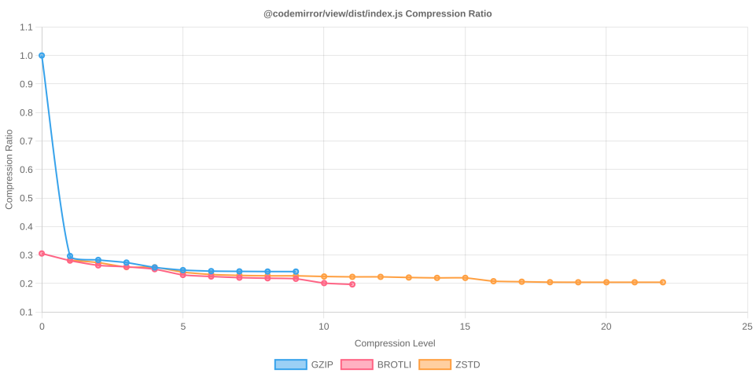
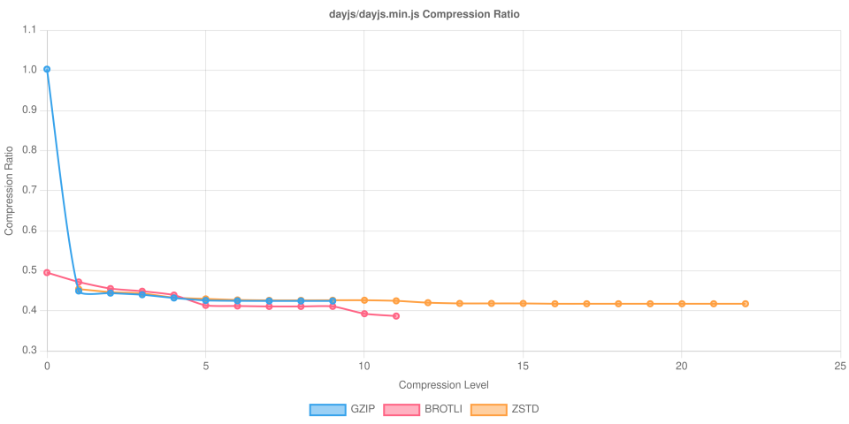
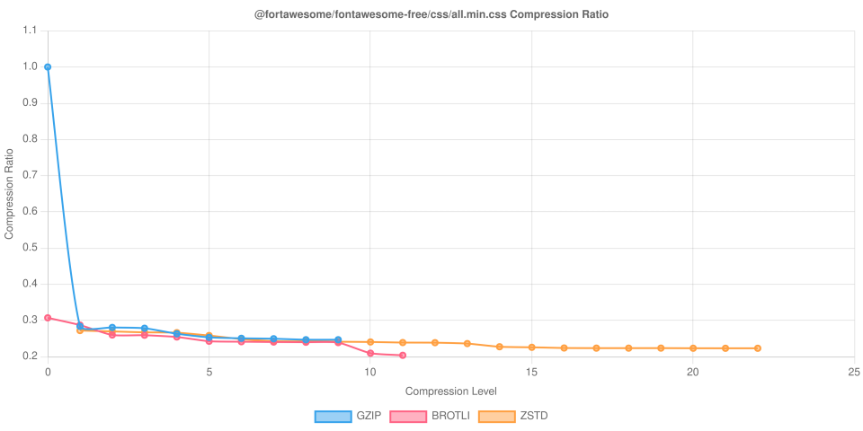
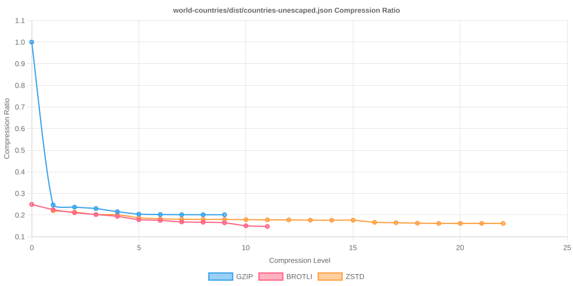

# Node Compression Benchmark

Last updated: 2026-11-26T21:07:42.483Z

This benchmark measures compression time, output size, and compression ratios for several popular npm packages across all gzip, Brotli, and Zstandard compression levels.

## Table of Contents

- [jquery/dist/jquery.min.js](#jquery-dist-jquery-min-js)
- [@expo-google-fonts/m-plus-1p/400Regular/MPLUS1p_400Regular.ttf](#expo-google-fonts-m-plus-1p-400regular-mplus1p-400regular-ttf)
- [@openfonts/m-plus-1p_japanese/m-plus-1p-japanese-400.woff2](#openfonts-m-plus-1p-japanese-m-plus-1p-japanese-400-woff2)
- [@codemirror/view/dist/index.js](#codemirror-view-dist-index-js)
- [react/cjs/react.production.js](#react-cjs-react-production-js)
- [dayjs/dayjs.min.js](#dayjs-dayjs-min-js)
- [vue/dist/vue.global.prod.js](#vue-dist-vue-global-prod-js)
- [lodash/lodash.min.js](#lodash-lodash-min-js)
- [@fortawesome/fontawesome-free/css/all.min.css](#fortawesome-fontawesome-free-css-all-min-css)
- [bootstrap/dist/css/bootstrap.min.css](#bootstrap-dist-css-bootstrap-min-css)
- [world-countries/dist/countries-unescaped.json](#world-countries-dist-countries-unescaped-json)
- [@sqlite.org/sqlite-wasm/dist/sqlite3.wasm](#sqlite-org-sqlite-wasm-dist-sqlite3-wasm)
- [tailwindcss/theme.css](#tailwindcss-theme-css)

Benchmark settings:

- Warmup runs per level: 1
- Fixed samples per level: 9
- Target relative interval radius: 0.0500
- Elapsed benchmark time: 191.2 seconds
- [Raw observations and environment](results/latest.json) · [Measurement methodology](BENCHMARK.md)
- Intervals have at least 95% coverage for independent, identically distributed samples. Precision met means both bounds are within the target distance of the observed median; it is not an accuracy guarantee.

<h2 id="jquery-dist-jquery-min-js">jquery/dist/jquery.min.js</h2>

- Original size: 78,965 bytes
- Chart: 

| Algorithm | Level | Time (ms) | Size (bytes) | Compression Ratio | Samples | Median CI (ms) | Precision met |
| --- | ---: | ---: | ---: | ---: | ---: | --- | --- |
| gzip | 0 | 0.111 | 78,993 | 1.0004 | 9 | 0.094–0.121 | no |
| gzip | 1 | 0.747 | 31,138 | 0.3943 | 9 | 0.742–0.771 | yes |
| gzip | 2 | 0.812 | 30,222 | 0.3827 | 9 | 0.810–0.826 | yes |
| gzip | 3 | 0.919 | 29,738 | 0.3766 | 9 | 0.912–0.926 | yes |
| gzip | 4 | 1.040 | 28,514 | 0.3611 | 9 | 1.028–1.067 | yes |
| gzip | 5 | 1.374 | 27,798 | 0.3520 | 9 | 1.361–1.390 | yes |
| gzip | 6 | 1.638 | 27,655 | 0.3502 | 9 | 1.625–1.646 | yes |
| gzip | 7 | 1.823 | 27,619 | 0.3498 | 9 | 1.809–1.846 | yes |
| gzip | 8 | 2.141 | 27,606 | 0.3496 | 9 | 2.128–2.164 | yes |
| gzip | 9 | 2.124 | 27,606 | 0.3496 | 9 | 2.117–2.149 | yes |
| brotli | 0 | 0.288 | 33,137 | 0.4196 | 9 | 0.228–0.299 | no |
| brotli | 1 | 0.380 | 31,905 | 0.4040 | 9 | 0.360–0.469 | no |
| brotli | 2 | 0.684 | 29,484 | 0.3734 | 9 | 0.666–0.710 | yes |
| brotli | 3 | 0.735 | 29,187 | 0.3696 | 9 | 0.709–0.780 | no |
| brotli | 4 | 1.062 | 28,456 | 0.3604 | 9 | 1.055–1.074 | yes |
| brotli | 5 | 1.599 | 27,075 | 0.3429 | 9 | 1.589–1.619 | yes |
| brotli | 6 | 1.770 | 26,921 | 0.3409 | 9 | 1.738–1.814 | yes |
| brotli | 7 | 5.022 | 26,847 | 0.3400 | 9 | 4.994–5.237 | yes |
| brotli | 8 | 2.115 | 26,802 | 0.3394 | 9 | 2.095–2.172 | yes |
| brotli | 9 | 14.609 | 26,772 | 0.3390 | 9 | 14.362–14.951 | yes |
| brotli | 10 | 29.548 | 25,484 | 0.3227 | 9 | 29.362–29.735 | yes |
| brotli | 11 | 81.254 | 25,019 | 0.3168 | 9 | 80.933–81.811 | yes |
| zstd | 1 | 0.211 | 31,249 | 0.3957 | 9 | 0.184–0.295 | no |
| zstd | 2 | 0.204 | 30,186 | 0.3823 | 9 | 0.196–0.255 | no |
| zstd | 3 | 0.302 | 29,281 | 0.3708 | 9 | 0.263–0.327 | no |
| zstd | 4 | 0.356 | 29,146 | 0.3691 | 9 | 0.298–0.420 | no |
| zstd | 5 | 0.688 | 28,404 | 0.3597 | 9 | 0.682–0.730 | no |
| zstd | 6 | 0.967 | 27,670 | 0.3504 | 9 | 0.963–1.019 | no |
| zstd | 7 | 1.156 | 27,453 | 0.3477 | 9 | 1.150–1.193 | yes |
| zstd | 8 | 1.281 | 27,312 | 0.3459 | 9 | 1.271–1.293 | yes |
| zstd | 9 | 1.435 | 27,198 | 0.3444 | 9 | 1.428–1.446 | yes |
| zstd | 10 | 1.598 | 27,138 | 0.3437 | 9 | 1.588–1.609 | yes |
| zstd | 11 | 2.931 | 27,056 | 0.3426 | 9 | 2.896–2.961 | yes |
| zstd | 12 | 3.016 | 27,059 | 0.3427 | 9 | 3.010–3.020 | yes |
| zstd | 13 | 4.479 | 26,959 | 0.3414 | 9 | 4.471–4.502 | yes |
| zstd | 14 | 6.176 | 26,521 | 0.3359 | 9 | 6.123–6.192 | yes |
| zstd | 15 | 6.403 | 26,514 | 0.3358 | 9 | 6.235–6.774 | no |
| zstd | 16 | 7.793 | 26,432 | 0.3347 | 9 | 7.722–8.095 | yes |
| zstd | 17 | 7.701 | 26,432 | 0.3347 | 9 | 7.653–7.736 | yes |
| zstd | 18 | 7.730 | 26,432 | 0.3347 | 9 | 7.678–7.756 | yes |
| zstd | 19 | 15.321 | 26,378 | 0.3340 | 9 | 15.232–15.415 | yes |
| zstd | 20 | 15.253 | 26,378 | 0.3340 | 9 | 15.163–15.783 | yes |
| zstd | 21 | 17.018 | 26,378 | 0.3340 | 9 | 15.193–20.918 | no |
| zstd | 22 | 15.151 | 26,378 | 0.3340 | 9 | 15.115–15.306 | yes |

<h2 id="expo-google-fonts-m-plus-1p-400regular-mplus1p-400regular-ttf">@expo-google-fonts/m-plus-1p/400Regular/MPLUS1p_400Regular.ttf</h2>

- Original size: 1,714,248 bytes
- Chart: 

| Algorithm | Level | Time (ms) | Size (bytes) | Compression Ratio | Samples | Median CI (ms) | Precision met |
| --- | ---: | ---: | ---: | ---: | ---: | --- | --- |
| gzip | 0 | 0.877 | 1,714,526 | 1.0002 | 9 | 0.807–1.102 | no |
| gzip | 1 | 24.402 | 1,049,634 | 0.6123 | 9 | 24.101–24.586 | yes |
| gzip | 2 | 24.754 | 1,036,805 | 0.6048 | 9 | 24.592–25.510 | yes |
| gzip | 3 | 26.249 | 1,030,268 | 0.6010 | 9 | 26.204–26.466 | yes |
| gzip | 4 | 29.191 | 1,015,229 | 0.5922 | 9 | 29.069–31.230 | no |
| gzip | 5 | 34.743 | 999,772 | 0.5832 | 9 | 34.675–34.848 | yes |
| gzip | 6 | 40.685 | 997,720 | 0.5820 | 9 | 40.585–41.032 | yes |
| gzip | 7 | 45.276 | 997,295 | 0.5818 | 9 | 44.575–46.179 | yes |
| gzip | 8 | 48.265 | 997,191 | 0.5817 | 9 | 48.198–49.378 | yes |
| gzip | 9 | 53.495 | 997,191 | 0.5817 | 9 | 53.370–54.141 | yes |
| brotli | 0 | 5.576 | 1,112,634 | 0.6491 | 9 | 5.494–5.834 | yes |
| brotli | 1 | 7.494 | 1,031,943 | 0.6020 | 9 | 7.423–7.549 | yes |
| brotli | 2 | 13.605 | 986,211 | 0.5753 | 9 | 13.436–13.793 | yes |
| brotli | 3 | 15.804 | 976,041 | 0.5694 | 9 | 15.722–15.831 | yes |
| brotli | 4 | 20.917 | 933,224 | 0.5444 | 9 | 20.489–21.016 | yes |
| brotli | 5 | 31.638 | 872,005 | 0.5087 | 9 | 31.234–32.178 | yes |
| brotli | 6 | 35.360 | 863,383 | 0.5037 | 9 | 34.820–36.998 | yes |
| brotli | 7 | 75.780 | 857,835 | 0.5004 | 9 | 74.153–77.421 | yes |
| brotli | 8 | 84.543 | 855,950 | 0.4993 | 9 | 83.745–85.088 | yes |
| brotli | 9 | 118.975 | 849,266 | 0.4954 | 9 | 118.721–119.923 | yes |
| brotli | 10 | 1775.059 | 830,083 | 0.4842 | 9 | 1770.567–1785.833 | yes |
| brotli | 11 | 3085.407 | 806,920 | 0.4707 | 9 | 3076.342–3090.050 | yes |
| zstd | 1 | 5.128 | 1,063,995 | 0.6207 | 9 | 5.116–5.164 | yes |
| zstd | 2 | 6.116 | 995,049 | 0.5805 | 9 | 6.058–6.178 | yes |
| zstd | 3 | 9.044 | 951,924 | 0.5553 | 9 | 8.953–9.059 | yes |
| zstd | 4 | 10.161 | 934,018 | 0.5449 | 9 | 10.057–10.287 | yes |
| zstd | 5 | 15.386 | 915,542 | 0.5341 | 9 | 15.269–15.502 | yes |
| zstd | 6 | 18.833 | 905,207 | 0.5280 | 9 | 18.710–18.978 | yes |
| zstd | 7 | 19.948 | 897,707 | 0.5237 | 9 | 19.791–20.035 | yes |
| zstd | 8 | 23.379 | 890,668 | 0.5196 | 9 | 23.278–23.585 | yes |
| zstd | 9 | 24.091 | 889,701 | 0.5190 | 9 | 23.993–24.443 | yes |
| zstd | 10 | 28.674 | 886,752 | 0.5173 | 9 | 28.470–28.874 | yes |
| zstd | 11 | 34.967 | 884,967 | 0.5162 | 9 | 34.550–35.706 | yes |
| zstd | 12 | 34.972 | 884,967 | 0.5162 | 9 | 34.674–35.401 | yes |
| zstd | 13 | 98.107 | 884,574 | 0.5160 | 9 | 96.488–98.615 | yes |
| zstd | 14 | 106.510 | 882,969 | 0.5151 | 9 | 105.805–112.885 | no |
| zstd | 15 | 109.591 | 882,565 | 0.5148 | 9 | 107.356–111.268 | yes |
| zstd | 16 | 156.865 | 865,802 | 0.5051 | 9 | 156.270–157.699 | yes |
| zstd | 17 | 173.542 | 858,980 | 0.5011 | 9 | 171.351–174.820 | yes |
| zstd | 18 | 231.685 | 834,631 | 0.4869 | 9 | 230.416–232.241 | yes |
| zstd | 19 | 241.438 | 834,350 | 0.4867 | 9 | 240.677–246.743 | yes |
| zstd | 20 | 248.289 | 834,350 | 0.4867 | 9 | 241.749–262.137 | no |
| zstd | 21 | 252.108 | 834,350 | 0.4867 | 9 | 248.588–264.400 | yes |
| zstd | 22 | 251.563 | 834,350 | 0.4867 | 9 | 247.297–252.873 | yes |

<h2 id="openfonts-m-plus-1p-japanese-m-plus-1p-japanese-400-woff2">@openfonts/m-plus-1p_japanese/m-plus-1p-japanese-400.woff2</h2>

- Original size: 598,576 bytes
- Chart: 

| Algorithm | Level | Time (ms) | Size (bytes) | Compression Ratio | Samples | Median CI (ms) | Precision met |
| --- | ---: | ---: | ---: | ---: | ---: | --- | --- |
| gzip | 0 | 0.268 | 598,684 | 1.0002 | 9 | 0.264–0.281 | yes |
| gzip | 1 | 10.494 | 596,192 | 0.9960 | 9 | 10.387–10.511 | yes |
| gzip | 2 | 10.350 | 596,183 | 0.9960 | 9 | 10.343–10.406 | yes |
| gzip | 3 | 10.384 | 596,173 | 0.9960 | 9 | 10.343–10.400 | yes |
| gzip | 4 | 10.757 | 596,171 | 0.9960 | 9 | 10.735–10.822 | yes |
| gzip | 5 | 10.769 | 596,154 | 0.9960 | 9 | 10.744–10.803 | yes |
| gzip | 6 | 10.777 | 596,154 | 0.9960 | 9 | 10.762–10.801 | yes |
| gzip | 7 | 10.790 | 596,154 | 0.9960 | 9 | 10.762–10.817 | yes |
| gzip | 8 | 10.796 | 596,154 | 0.9960 | 9 | 10.748–11.246 | yes |
| gzip | 9 | 10.753 | 596,154 | 0.9960 | 9 | 10.739–10.797 | yes |
| brotli | 0 | 0.184 | 596,751 | 0.9970 | 9 | 0.179–0.207 | no |
| brotli | 1 | 0.240 | 598,581 | 1.0000 | 9 | 0.221–0.248 | no |
| brotli | 2 | 0.493 | 598,587 | 1.0000 | 9 | 0.453–0.727 | no |
| brotli | 3 | 0.566 | 598,559 | 1.0000 | 9 | 0.539–1.296 | no |
| brotli | 4 | 0.656 | 598,581 | 1.0000 | 9 | 0.637–0.674 | yes |
| brotli | 5 | 1.075 | 598,581 | 1.0000 | 9 | 1.023–1.363 | no |
| brotli | 6 | 1.090 | 598,581 | 1.0000 | 9 | 1.076–1.398 | no |
| brotli | 7 | 1.476 | 598,581 | 1.0000 | 9 | 1.425–1.719 | no |
| brotli | 8 | 1.610 | 598,581 | 1.0000 | 9 | 1.570–1.673 | yes |
| brotli | 9 | 15.299 | 598,581 | 1.0000 | 9 | 15.116–16.328 | no |
| brotli | 10 | 92.627 | 598,581 | 1.0000 | 9 | 91.879–93.198 | yes |
| brotli | 11 | 234.458 | 598,581 | 1.0000 | 9 | 233.530–240.698 | yes |
| zstd | 1 | 0.213 | 598,601 | 1.0000 | 9 | 0.199–0.241 | no |
| zstd | 2 | 0.236 | 598,600 | 1.0000 | 9 | 0.207–0.243 | no |
| zstd | 3 | 0.291 | 598,600 | 1.0000 | 9 | 0.273–0.383 | no |
| zstd | 4 | 0.544 | 598,600 | 1.0000 | 9 | 0.256–0.809 | no |
| zstd | 5 | 0.359 | 598,600 | 1.0000 | 9 | 0.352–0.394 | no |
| zstd | 6 | 0.363 | 598,600 | 1.0000 | 9 | 0.352–0.377 | yes |
| zstd | 7 | 0.406 | 598,600 | 1.0000 | 9 | 0.380–0.414 | no |
| zstd | 8 | 0.403 | 598,600 | 1.0000 | 9 | 0.380–0.430 | no |
| zstd | 9 | 0.753 | 598,600 | 1.0000 | 9 | 0.474–1.064 | no |
| zstd | 10 | 0.460 | 598,600 | 1.0000 | 9 | 0.451–0.470 | yes |
| zstd | 11 | 0.498 | 598,600 | 1.0000 | 9 | 0.484–0.510 | yes |
| zstd | 12 | 0.509 | 598,600 | 1.0000 | 9 | 0.504–0.538 | no |
| zstd | 13 | 1.830 | 595,998 | 0.9957 | 9 | 1.712–3.087 | no |
| zstd | 14 | 1.666 | 595,998 | 0.9957 | 9 | 1.634–1.698 | yes |
| zstd | 15 | 1.655 | 595,998 | 0.9957 | 9 | 1.607–1.703 | yes |
| zstd | 16 | 11.753 | 595,898 | 0.9955 | 9 | 11.526–12.051 | yes |
| zstd | 17 | 11.765 | 595,889 | 0.9955 | 9 | 11.651–12.142 | yes |
| zstd | 18 | 16.453 | 595,891 | 0.9955 | 9 | 16.325–17.060 | yes |
| zstd | 19 | 20.037 | 595,894 | 0.9955 | 9 | 19.607–20.525 | yes |
| zstd | 20 | 20.022 | 595,894 | 0.9955 | 9 | 19.573–20.510 | yes |
| zstd | 21 | 19.880 | 595,894 | 0.9955 | 9 | 19.570–20.020 | yes |
| zstd | 22 | 19.901 | 595,894 | 0.9955 | 9 | 19.569–20.423 | yes |

<h2 id="codemirror-view-dist-index-js">@codemirror/view/dist/index.js</h2>

- Original size: 495,588 bytes
- Chart: 

| Algorithm | Level | Time (ms) | Size (bytes) | Compression Ratio | Samples | Median CI (ms) | Precision met |
| --- | ---: | ---: | ---: | ---: | ---: | --- | --- |
| gzip | 0 | 0.222 | 495,681 | 1.0002 | 9 | 0.218–0.230 | yes |
| gzip | 1 | 3.323 | 147,019 | 0.2967 | 9 | 3.321–3.353 | yes |
| gzip | 2 | 3.664 | 140,161 | 0.2828 | 9 | 3.658–3.672 | yes |
| gzip | 3 | 4.834 | 135,613 | 0.2736 | 9 | 4.828–5.474 | no |
| gzip | 4 | 4.976 | 127,170 | 0.2566 | 9 | 4.972–4.994 | yes |
| gzip | 5 | 7.150 | 122,480 | 0.2471 | 9 | 7.126–7.190 | yes |
| gzip | 6 | 10.616 | 120,752 | 0.2437 | 9 | 10.590–10.638 | yes |
| gzip | 7 | 13.512 | 120,280 | 0.2427 | 9 | 13.498–13.535 | yes |
| gzip | 8 | 25.527 | 120,006 | 0.2421 | 9 | 25.499–25.575 | yes |
| gzip | 9 | 39.673 | 119,944 | 0.2420 | 9 | 39.590–39.710 | yes |
| brotli | 0 | 1.229 | 151,389 | 0.3055 | 9 | 1.217–1.238 | yes |
| brotli | 1 | 1.752 | 139,012 | 0.2805 | 9 | 1.742–1.756 | yes |
| brotli | 2 | 3.170 | 130,704 | 0.2637 | 9 | 3.164–3.201 | yes |
| brotli | 3 | 3.528 | 128,093 | 0.2585 | 9 | 3.520–3.542 | yes |
| brotli | 4 | 4.812 | 124,144 | 0.2505 | 9 | 4.788–4.839 | yes |
| brotli | 5 | 7.906 | 114,090 | 0.2302 | 9 | 7.790–8.031 | yes |
| brotli | 6 | 9.202 | 111,384 | 0.2248 | 9 | 9.086–9.401 | yes |
| brotli | 7 | 11.356 | 109,376 | 0.2207 | 9 | 11.301–11.424 | yes |
| brotli | 8 | 13.804 | 108,340 | 0.2186 | 9 | 13.733–14.055 | yes |
| brotli | 9 | 30.609 | 107,449 | 0.2168 | 9 | 30.436–30.786 | yes |
| brotli | 10 | 235.567 | 99,878 | 0.2015 | 9 | 235.291–236.512 | yes |
| brotli | 11 | 605.815 | 97,648 | 0.1970 | 9 | 605.147–607.568 | yes |
| zstd | 1 | 1.477 | 139,921 | 0.2823 | 9 | 1.472–1.486 | yes |
| zstd | 2 | 1.522 | 135,629 | 0.2737 | 9 | 1.499–1.550 | yes |
| zstd | 3 | 1.772 | 127,698 | 0.2577 | 9 | 1.761–1.806 | yes |
| zstd | 4 | 1.915 | 127,469 | 0.2572 | 9 | 1.908–1.933 | yes |
| zstd | 5 | 3.626 | 118,828 | 0.2398 | 9 | 3.605–3.645 | yes |
| zstd | 6 | 4.992 | 114,849 | 0.2317 | 9 | 4.966–5.010 | yes |
| zstd | 7 | 5.611 | 113,233 | 0.2285 | 9 | 5.550–5.633 | yes |
| zstd | 8 | 7.053 | 112,404 | 0.2268 | 9 | 7.026–7.072 | yes |
| zstd | 9 | 7.053 | 112,404 | 0.2268 | 9 | 7.008–7.099 | yes |
| zstd | 10 | 8.158 | 111,395 | 0.2248 | 9 | 8.091–8.240 | yes |
| zstd | 11 | 10.588 | 110,772 | 0.2235 | 9 | 10.423–10.613 | yes |
| zstd | 12 | 10.595 | 110,772 | 0.2235 | 9 | 10.505–10.667 | yes |
| zstd | 13 | 22.717 | 109,611 | 0.2212 | 9 | 22.379–23.330 | yes |
| zstd | 14 | 27.368 | 108,976 | 0.2199 | 9 | 26.888–28.232 | yes |
| zstd | 15 | 30.544 | 108,836 | 0.2196 | 9 | 30.177–31.302 | yes |
| zstd | 16 | 53.826 | 103,236 | 0.2083 | 9 | 52.708–54.644 | yes |
| zstd | 17 | 59.614 | 102,296 | 0.2064 | 9 | 58.554–60.092 | yes |
| zstd | 18 | 79.273 | 101,518 | 0.2048 | 9 | 79.245–79.619 | yes |
| zstd | 19 | 101.564 | 101,389 | 0.2046 | 9 | 101.239–101.740 | yes |
| zstd | 20 | 100.991 | 101,389 | 0.2046 | 9 | 100.871–101.718 | yes |
| zstd | 21 | 101.840 | 101,411 | 0.2046 | 9 | 101.687–102.038 | yes |
| zstd | 22 | 101.472 | 101,411 | 0.2046 | 9 | 101.348–101.668 | yes |

<h2 id="react-cjs-react-production-js">react/cjs/react.production.js</h2>

- Original size: 18,040 bytes
- Chart: 

| Algorithm | Level | Time (ms) | Size (bytes) | Compression Ratio | Samples | Median CI (ms) | Precision met |
| --- | ---: | ---: | ---: | ---: | ---: | --- | --- |
| gzip | 0 | 0.017 | 18,063 | 1.0013 | 9 | 0.014–0.034 | no |
| gzip | 1 | 0.071 | 5,189 | 0.2876 | 9 | 0.063–0.106 | no |
| gzip | 2 | 0.068 | 5,069 | 0.2810 | 9 | 0.064–0.105 | no |
| gzip | 3 | 0.127 | 5,003 | 0.2773 | 9 | 0.095–0.188 | no |
| gzip | 4 | 0.100 | 4,715 | 0.2614 | 9 | 0.093–0.145 | no |
| gzip | 5 | 0.123 | 4,618 | 0.2560 | 9 | 0.113–0.186 | no |
| gzip | 6 | 0.150 | 4,607 | 0.2554 | 9 | 0.144–0.193 | no |
| gzip | 7 | 0.196 | 4,600 | 0.2550 | 9 | 0.178–0.228 | no |
| gzip | 8 | 0.314 | 4,597 | 0.2548 | 9 | 0.299–0.340 | no |
| gzip | 9 | 0.306 | 4,597 | 0.2548 | 9 | 0.300–0.321 | yes |
| brotli | 0 | 0.046 | 5,483 | 0.3039 | 9 | 0.044–0.065 | no |
| brotli | 1 | 0.054 | 5,356 | 0.2969 | 9 | 0.053–0.062 | no |
| brotli | 2 | 0.085 | 4,956 | 0.2747 | 9 | 0.074–0.106 | no |
| brotli | 3 | 0.103 | 4,866 | 0.2697 | 9 | 0.088–0.163 | no |
| brotli | 4 | 0.147 | 4,752 | 0.2634 | 9 | 0.134–0.204 | no |
| brotli | 5 | 0.255 | 4,451 | 0.2467 | 9 | 0.234–0.299 | no |
| brotli | 6 | 0.298 | 4,446 | 0.2465 | 9 | 0.281–0.325 | no |
| brotli | 7 | 0.321 | 4,432 | 0.2457 | 9 | 0.300–0.357 | no |
| brotli | 8 | 0.331 | 4,424 | 0.2452 | 9 | 0.311–0.348 | no |
| brotli | 9 | 5.087 | 4,416 | 0.2448 | 9 | 4.937–5.423 | no |
| brotli | 10 | 6.589 | 4,142 | 0.2296 | 9 | 6.578–6.622 | yes |
| brotli | 11 | 16.650 | 4,027 | 0.2232 | 9 | 16.586–16.736 | yes |
| zstd | 1 | 0.045 | 5,114 | 0.2835 | 9 | 0.040–0.066 | no |
| zstd | 2 | 0.043 | 5,057 | 0.2803 | 9 | 0.043–0.052 | no |
| zstd | 3 | 0.054 | 4,922 | 0.2728 | 9 | 0.052–0.067 | no |
| zstd | 4 | 0.056 | 4,885 | 0.2708 | 9 | 0.053–0.084 | no |
| zstd | 5 | 0.113 | 4,708 | 0.2610 | 9 | 0.109–0.146 | no |
| zstd | 6 | 0.138 | 4,620 | 0.2561 | 9 | 0.136–0.169 | no |
| zstd | 7 | 0.168 | 4,618 | 0.2560 | 9 | 0.155–0.220 | no |
| zstd | 8 | 0.202 | 4,601 | 0.2550 | 9 | 0.170–0.235 | no |
| zstd | 9 | 0.232 | 4,592 | 0.2545 | 9 | 0.217–0.260 | no |
| zstd | 10 | 0.267 | 4,584 | 0.2541 | 9 | 0.254–0.305 | no |
| zstd | 11 | 0.525 | 4,562 | 0.2529 | 9 | 0.513–0.562 | no |
| zstd | 12 | 0.547 | 4,562 | 0.2529 | 9 | 0.537–0.573 | yes |
| zstd | 13 | 0.803 | 4,554 | 0.2524 | 9 | 0.789–0.825 | yes |
| zstd | 14 | 1.190 | 4,473 | 0.2479 | 9 | 1.181–1.201 | yes |
| zstd | 15 | 1.263 | 4,468 | 0.2477 | 9 | 1.259–1.282 | yes |
| zstd | 16 | 1.719 | 4,452 | 0.2468 | 9 | 1.714–1.727 | yes |
| zstd | 17 | 1.795 | 4,452 | 0.2468 | 9 | 1.792–1.821 | yes |
| zstd | 18 | 1.800 | 4,452 | 0.2468 | 9 | 1.789–1.812 | yes |
| zstd | 19 | 3.525 | 4,436 | 0.2459 | 9 | 3.514–3.537 | yes |
| zstd | 20 | 3.524 | 4,436 | 0.2459 | 9 | 3.517–3.538 | yes |
| zstd | 21 | 3.531 | 4,436 | 0.2459 | 9 | 3.518–3.559 | yes |
| zstd | 22 | 3.525 | 4,436 | 0.2459 | 9 | 3.516–3.545 | yes |

<h2 id="dayjs-dayjs-min-js">dayjs/dayjs.min.js</h2>

- Original size: 7,161 bytes
- Chart: 

| Algorithm | Level | Time (ms) | Size (bytes) | Compression Ratio | Samples | Median CI (ms) | Precision met |
| --- | ---: | ---: | ---: | ---: | ---: | --- | --- |
| gzip | 0 | 0.015 | 7,184 | 1.0032 | 9 | 0.013–0.024 | no |
| gzip | 1 | 0.067 | 3,220 | 0.4497 | 9 | 0.063–0.081 | no |
| gzip | 2 | 0.065 | 3,182 | 0.4444 | 9 | 0.062–0.071 | no |
| gzip | 3 | 0.077 | 3,153 | 0.4403 | 9 | 0.070–0.089 | no |
| gzip | 4 | 0.096 | 3,095 | 0.4322 | 9 | 0.081–0.116 | no |
| gzip | 5 | 0.059 | 3,051 | 0.4261 | 9 | 0.058–0.087 | no |
| gzip | 6 | 0.101 | 3,044 | 0.4251 | 9 | 0.064–0.145 | no |
| gzip | 7 | 0.063 | 3,042 | 0.4248 | 9 | 0.061–0.073 | no |
| gzip | 8 | 0.064 | 3,042 | 0.4248 | 9 | 0.063–0.086 | no |
| gzip | 9 | 0.064 | 3,042 | 0.4248 | 9 | 0.062–0.079 | no |
| brotli | 0 | 0.024 | 3,549 | 0.4956 | 9 | 0.023–0.032 | no |
| brotli | 1 | 0.033 | 3,381 | 0.4721 | 9 | 0.031–0.052 | no |
| brotli | 2 | 0.047 | 3,263 | 0.4557 | 9 | 0.046–0.069 | no |
| brotli | 3 | 0.057 | 3,216 | 0.4491 | 9 | 0.056–0.072 | no |
| brotli | 4 | 0.087 | 3,147 | 0.4395 | 9 | 0.085–0.117 | no |
| brotli | 5 | 0.125 | 2,963 | 0.4138 | 9 | 0.116–0.155 | no |
| brotli | 6 | 0.129 | 2,952 | 0.4122 | 9 | 0.121–0.154 | no |
| brotli | 7 | 0.147 | 2,944 | 0.4111 | 9 | 0.130–0.189 | no |
| brotli | 8 | 0.137 | 2,944 | 0.4111 | 9 | 0.132–0.175 | no |
| brotli | 9 | 4.437 | 2,945 | 0.4113 | 9 | 4.422–4.545 | yes |
| brotli | 10 | 2.665 | 2,814 | 0.3930 | 9 | 2.643–2.681 | yes |
| brotli | 11 | 6.684 | 2,772 | 0.3871 | 9 | 6.665–6.694 | yes |
| zstd | 1 | 0.025 | 3,254 | 0.4544 | 9 | 0.024–0.047 | no |
| zstd | 2 | 0.028 | 3,200 | 0.4469 | 9 | 0.025–0.044 | no |
| zstd | 3 | 0.032 | 3,176 | 0.4435 | 9 | 0.028–0.047 | no |
| zstd | 4 | 0.050 | 3,102 | 0.4332 | 9 | 0.046–0.066 | no |
| zstd | 5 | 0.056 | 3,079 | 0.4300 | 9 | 0.052–0.084 | no |
| zstd | 6 | 0.074 | 3,060 | 0.4273 | 9 | 0.063–0.095 | no |
| zstd | 7 | 0.081 | 3,053 | 0.4263 | 9 | 0.075–0.095 | no |
| zstd | 8 | 0.077 | 3,053 | 0.4263 | 9 | 0.075–0.098 | no |
| zstd | 9 | 0.121 | 3,055 | 0.4266 | 9 | 0.099–0.155 | no |
| zstd | 10 | 0.099 | 3,055 | 0.4266 | 9 | 0.096–0.115 | no |
| zstd | 11 | 0.244 | 3,044 | 0.4251 | 9 | 0.217–0.275 | no |
| zstd | 12 | 0.316 | 3,011 | 0.4205 | 9 | 0.297–0.347 | no |
| zstd | 13 | 0.431 | 2,998 | 0.4187 | 9 | 0.427–0.455 | no |
| zstd | 14 | 0.415 | 2,998 | 0.4187 | 9 | 0.408–0.428 | yes |
| zstd | 15 | 0.426 | 2,998 | 0.4187 | 9 | 0.417–0.454 | no |
| zstd | 16 | 0.800 | 2,992 | 0.4178 | 9 | 0.794–0.818 | yes |
| zstd | 17 | 0.794 | 2,992 | 0.4178 | 9 | 0.793–0.799 | yes |
| zstd | 18 | 0.792 | 2,992 | 0.4178 | 9 | 0.789–0.810 | yes |
| zstd | 19 | 0.794 | 2,992 | 0.4178 | 9 | 0.791–0.804 | yes |
| zstd | 20 | 0.790 | 2,992 | 0.4178 | 9 | 0.788–0.800 | yes |
| zstd | 21 | 0.794 | 2,992 | 0.4178 | 9 | 0.788–0.809 | yes |
| zstd | 22 | 0.805 | 2,992 | 0.4178 | 9 | 0.798–0.814 | yes |

<h2 id="vue-dist-vue-global-prod-js">vue/dist/vue.global.prod.js</h2>

- Original size: 174,069 bytes
- Chart: 

| Algorithm | Level | Time (ms) | Size (bytes) | Compression Ratio | Samples | Median CI (ms) | Precision met |
| --- | ---: | ---: | ---: | ---: | ---: | --- | --- |
| gzip | 0 | 0.090 | 174,112 | 1.0002 | 9 | 0.088–0.104 | no |
| gzip | 1 | 1.700 | 70,894 | 0.4073 | 9 | 1.692–1.709 | yes |
| gzip | 2 | 1.843 | 69,097 | 0.3970 | 9 | 1.836–1.849 | yes |
| gzip | 3 | 2.119 | 68,040 | 0.3909 | 9 | 2.113–2.125 | yes |
| gzip | 4 | 2.359 | 65,547 | 0.3766 | 9 | 2.350–2.363 | yes |
| gzip | 5 | 3.237 | 63,832 | 0.3667 | 9 | 3.214–3.309 | yes |
| gzip | 6 | 4.057 | 63,522 | 0.3649 | 9 | 4.035–4.070 | yes |
| gzip | 7 | 4.432 | 63,484 | 0.3647 | 9 | 4.423–4.443 | yes |
| gzip | 8 | 4.850 | 63,465 | 0.3646 | 9 | 4.818–4.958 | yes |
| gzip | 9 | 4.780 | 63,465 | 0.3646 | 9 | 4.769–4.812 | yes |
| brotli | 0 | 0.525 | 75,327 | 0.4327 | 9 | 0.507–0.566 | no |
| brotli | 1 | 0.758 | 72,135 | 0.4144 | 9 | 0.749–0.762 | yes |
| brotli | 2 | 1.440 | 66,608 | 0.3827 | 9 | 1.433–1.451 | yes |
| brotli | 3 | 1.611 | 65,988 | 0.3791 | 9 | 1.595–1.623 | yes |
| brotli | 4 | 2.242 | 64,867 | 0.3727 | 9 | 2.233–2.353 | yes |
| brotli | 5 | 3.632 | 61,235 | 0.3518 | 9 | 3.598–3.742 | yes |
| brotli | 6 | 4.070 | 60,809 | 0.3493 | 9 | 4.054–4.106 | yes |
| brotli | 7 | 4.904 | 60,566 | 0.3479 | 9 | 4.883–4.959 | yes |
| brotli | 8 | 5.321 | 60,445 | 0.3472 | 9 | 5.281–5.370 | yes |
| brotli | 9 | 19.777 | 60,367 | 0.3468 | 9 | 19.514–28.035 | no |
| brotli | 10 | 86.682 | 57,419 | 0.3299 | 9 | 86.640–86.899 | yes |
| brotli | 11 | 224.585 | 56,416 | 0.3241 | 9 | 224.346–226.299 | yes |
| zstd | 1 | 0.523 | 70,002 | 0.4022 | 9 | 0.515–0.565 | no |
| zstd | 2 | 0.676 | 67,102 | 0.3855 | 9 | 0.658–0.696 | yes |
| zstd | 3 | 0.835 | 66,390 | 0.3814 | 9 | 0.820–0.842 | yes |
| zstd | 4 | 1.494 | 64,353 | 0.3697 | 9 | 1.482–1.528 | yes |
| zstd | 5 | 1.659 | 63,775 | 0.3664 | 9 | 1.647–1.696 | yes |
| zstd | 6 | 2.026 | 62,834 | 0.3610 | 9 | 2.023–2.058 | yes |
| zstd | 7 | 2.415 | 61,986 | 0.3561 | 9 | 2.410–2.435 | yes |
| zstd | 8 | 3.024 | 61,456 | 0.3531 | 9 | 3.014–3.030 | yes |
| zstd | 9 | 3.511 | 61,169 | 0.3514 | 9 | 3.503–3.534 | yes |
| zstd | 10 | 4.299 | 60,988 | 0.3504 | 9 | 4.290–4.323 | yes |
| zstd | 11 | 7.653 | 60,716 | 0.3488 | 9 | 7.630–7.692 | yes |
| zstd | 12 | 7.855 | 60,694 | 0.3487 | 9 | 7.707–8.167 | yes |
| zstd | 13 | 12.882 | 59,648 | 0.3427 | 9 | 12.623–13.127 | yes |
| zstd | 14 | 14.970 | 59,209 | 0.3401 | 9 | 14.844–15.505 | yes |
| zstd | 15 | 15.224 | 59,190 | 0.3400 | 9 | 15.130–15.574 | yes |
| zstd | 16 | 19.020 | 58,985 | 0.3389 | 9 | 18.847–19.086 | yes |
| zstd | 17 | 19.070 | 58,985 | 0.3389 | 9 | 18.875–19.176 | yes |
| zstd | 18 | 31.541 | 58,906 | 0.3384 | 9 | 31.316–32.112 | yes |
| zstd | 19 | 31.471 | 58,906 | 0.3384 | 9 | 31.422–31.658 | yes |
| zstd | 20 | 31.414 | 58,906 | 0.3384 | 9 | 31.301–31.468 | yes |
| zstd | 21 | 31.434 | 58,906 | 0.3384 | 9 | 31.307–31.626 | yes |
| zstd | 22 | 31.361 | 58,906 | 0.3384 | 9 | 31.265–31.685 | yes |

<h2 id="lodash-lodash-min-js">lodash/lodash.min.js</h2>

- Original size: 73,234 bytes
- Chart: 

| Algorithm | Level | Time (ms) | Size (bytes) | Compression Ratio | Samples | Median CI (ms) | Precision met |
| --- | ---: | ---: | ---: | ---: | ---: | --- | --- |
| gzip | 0 | 0.038 | 73,262 | 1.0004 | 9 | 0.037–0.040 | no |
| gzip | 1 | 0.659 | 28,819 | 0.3935 | 9 | 0.635–0.672 | yes |
| gzip | 2 | 0.715 | 28,191 | 0.3849 | 9 | 0.709–0.717 | yes |
| gzip | 3 | 0.823 | 27,724 | 0.3786 | 9 | 0.819–0.839 | yes |
| gzip | 4 | 0.909 | 26,950 | 0.3680 | 9 | 0.902–0.938 | yes |
| gzip | 5 | 1.210 | 26,101 | 0.3564 | 9 | 1.202–1.213 | yes |
| gzip | 6 | 1.570 | 25,938 | 0.3542 | 9 | 1.561–1.578 | yes |
| gzip | 7 | 1.892 | 25,913 | 0.3538 | 9 | 1.889–1.897 | yes |
| gzip | 8 | 2.596 | 25,894 | 0.3536 | 9 | 2.575–2.629 | yes |
| gzip | 9 | 2.570 | 25,894 | 0.3536 | 9 | 2.560–2.574 | yes |
| brotli | 0 | 0.162 | 30,978 | 0.4230 | 9 | 0.156–0.191 | no |
| brotli | 1 | 0.285 | 29,754 | 0.4063 | 9 | 0.236–0.308 | no |
| brotli | 2 | 0.562 | 27,438 | 0.3747 | 9 | 0.551–0.573 | yes |
| brotli | 3 | 0.627 | 27,227 | 0.3718 | 9 | 0.622–0.638 | yes |
| brotli | 4 | 0.946 | 26,678 | 0.3643 | 9 | 0.934–0.957 | yes |
| brotli | 5 | 1.498 | 25,217 | 0.3443 | 9 | 1.484–1.518 | yes |
| brotli | 6 | 1.627 | 25,093 | 0.3426 | 9 | 1.607–1.642 | yes |
| brotli | 7 | 1.942 | 24,950 | 0.3407 | 9 | 1.932–1.966 | yes |
| brotli | 8 | 2.079 | 24,912 | 0.3402 | 9 | 2.059–2.125 | yes |
| brotli | 9 | 14.578 | 24,870 | 0.3396 | 9 | 14.486–14.716 | yes |
| brotli | 10 | 33.461 | 23,472 | 0.3205 | 9 | 33.391–33.732 | yes |
| brotli | 11 | 82.148 | 23,030 | 0.3145 | 9 | 81.969–82.332 | yes |
| zstd | 1 | 0.159 | 28,919 | 0.3949 | 9 | 0.154–0.179 | no |
| zstd | 2 | 0.172 | 28,008 | 0.3824 | 9 | 0.164–0.239 | no |
| zstd | 3 | 0.215 | 27,463 | 0.3750 | 9 | 0.209–0.280 | no |
| zstd | 4 | 0.273 | 27,100 | 0.3700 | 9 | 0.249–0.351 | no |
| zstd | 5 | 0.620 | 26,525 | 0.3622 | 9 | 0.604–0.644 | yes |
| zstd | 6 | 0.839 | 25,834 | 0.3528 | 9 | 0.837–0.869 | yes |
| zstd | 7 | 1.005 | 25,663 | 0.3504 | 9 | 1.002–1.023 | yes |
| zstd | 8 | 1.118 | 25,557 | 0.3490 | 9 | 1.114–1.140 | yes |
| zstd | 9 | 1.281 | 25,466 | 0.3477 | 9 | 1.266–1.293 | yes |
| zstd | 10 | 1.494 | 25,397 | 0.3468 | 9 | 1.490–1.523 | yes |
| zstd | 11 | 2.650 | 25,317 | 0.3457 | 9 | 2.645–2.668 | yes |
| zstd | 12 | 2.764 | 25,315 | 0.3457 | 9 | 2.753–2.789 | yes |
| zstd | 13 | 4.260 | 25,185 | 0.3439 | 9 | 4.235–4.269 | yes |
| zstd | 14 | 5.906 | 24,642 | 0.3365 | 9 | 5.872–5.964 | yes |
| zstd | 15 | 5.942 | 24,606 | 0.3360 | 9 | 5.929–6.012 | yes |
| zstd | 16 | 7.495 | 24,499 | 0.3345 | 9 | 7.460–7.511 | yes |
| zstd | 17 | 7.481 | 24,499 | 0.3345 | 9 | 7.459–7.520 | yes |
| zstd | 18 | 7.514 | 24,499 | 0.3345 | 9 | 7.461–7.531 | yes |
| zstd | 19 | 14.219 | 24,463 | 0.3340 | 9 | 14.172–14.284 | yes |
| zstd | 20 | 14.263 | 24,463 | 0.3340 | 9 | 14.198–14.295 | yes |
| zstd | 21 | 14.208 | 24,463 | 0.3340 | 9 | 14.181–14.267 | yes |
| zstd | 22 | 14.236 | 24,463 | 0.3340 | 9 | 14.160–14.282 | yes |

<h2 id="fortawesome-fontawesome-free-css-all-min-css">@fortawesome/fontawesome-free/css/all.min.css</h2>

- Original size: 90,336 bytes
- Chart: 

| Algorithm | Level | Time (ms) | Size (bytes) | Compression Ratio | Samples | Median CI (ms) | Precision met |
| --- | ---: | ---: | ---: | ---: | ---: | --- | --- |
| gzip | 0 | 0.048 | 90,364 | 1.0003 | 9 | 0.044–0.061 | no |
| gzip | 1 | 0.543 | 25,642 | 0.2839 | 9 | 0.528–0.550 | yes |
| gzip | 2 | 0.614 | 25,381 | 0.2810 | 9 | 0.604–0.622 | yes |
| gzip | 3 | 0.735 | 25,183 | 0.2788 | 9 | 0.725–0.738 | yes |
| gzip | 4 | 0.845 | 23,806 | 0.2635 | 9 | 0.836–0.865 | yes |
| gzip | 5 | 1.169 | 22,906 | 0.2536 | 9 | 1.164–1.176 | yes |
| gzip | 6 | 1.798 | 22,672 | 0.2510 | 9 | 1.796–1.834 | yes |
| gzip | 7 | 2.427 | 22,565 | 0.2498 | 9 | 2.417–2.430 | yes |
| gzip | 8 | 7.075 | 22,320 | 0.2471 | 9 | 7.054–7.204 | yes |
| gzip | 9 | 7.159 | 22,318 | 0.2471 | 9 | 7.141–8.755 | no |
| brotli | 0 | 0.156 | 27,781 | 0.3075 | 9 | 0.151–0.183 | no |
| brotli | 1 | 0.286 | 25,973 | 0.2875 | 9 | 0.259–0.330 | no |
| brotli | 2 | 0.560 | 23,497 | 0.2601 | 9 | 0.544–0.574 | yes |
| brotli | 3 | 0.638 | 23,445 | 0.2595 | 9 | 0.628–0.659 | yes |
| brotli | 4 | 0.929 | 23,003 | 0.2546 | 9 | 0.917–0.939 | yes |
| brotli | 5 | 1.470 | 21,939 | 0.2429 | 9 | 1.434–1.501 | yes |
| brotli | 6 | 1.688 | 21,822 | 0.2416 | 9 | 1.661–1.747 | yes |
| brotli | 7 | 1.960 | 21,742 | 0.2407 | 9 | 1.960–1.968 | yes |
| brotli | 8 | 2.295 | 21,693 | 0.2401 | 9 | 2.283–2.306 | yes |
| brotli | 9 | 13.760 | 21,604 | 0.2392 | 9 | 13.593–13.974 | yes |
| brotli | 10 | 29.199 | 18,961 | 0.2099 | 9 | 29.101–29.411 | yes |
| brotli | 11 | 87.693 | 18,432 | 0.2040 | 9 | 87.548–87.774 | yes |
| zstd | 1 | 0.176 | 24,608 | 0.2724 | 9 | 0.165–0.214 | no |
| zstd | 2 | 0.180 | 24,387 | 0.2700 | 9 | 0.173–0.232 | no |
| zstd | 3 | 0.219 | 24,157 | 0.2674 | 9 | 0.204–0.271 | no |
| zstd | 4 | 0.242 | 24,076 | 0.2665 | 9 | 0.229–0.318 | no |
| zstd | 5 | 0.614 | 23,365 | 0.2586 | 9 | 0.602–0.626 | yes |
| zstd | 6 | 0.865 | 22,468 | 0.2487 | 9 | 0.859–0.884 | yes |
| zstd | 7 | 1.090 | 21,961 | 0.2431 | 9 | 1.057–1.465 | no |
| zstd | 8 | 1.243 | 21,892 | 0.2423 | 9 | 1.231–1.269 | yes |
| zstd | 9 | 1.557 | 21,821 | 0.2416 | 9 | 1.511–1.581 | yes |
| zstd | 10 | 2.096 | 21,755 | 0.2408 | 9 | 1.969–2.160 | no |
| zstd | 11 | 3.064 | 21,610 | 0.2392 | 9 | 3.053–3.092 | yes |
| zstd | 12 | 4.088 | 21,581 | 0.2389 | 9 | 4.076–4.113 | yes |
| zstd | 13 | 4.786 | 21,357 | 0.2364 | 9 | 4.777–4.802 | yes |
| zstd | 14 | 6.530 | 20,565 | 0.2277 | 9 | 6.509–6.606 | yes |
| zstd | 15 | 7.799 | 20,426 | 0.2261 | 9 | 7.769–7.845 | yes |
| zstd | 16 | 10.105 | 20,254 | 0.2242 | 9 | 10.076–10.178 | yes |
| zstd | 17 | 13.690 | 20,220 | 0.2238 | 9 | 13.588–14.080 | yes |
| zstd | 18 | 21.223 | 20,218 | 0.2238 | 9 | 21.143–21.360 | yes |
| zstd | 19 | 20.383 | 20,225 | 0.2239 | 9 | 20.306–20.496 | yes |
| zstd | 20 | 23.937 | 20,194 | 0.2235 | 9 | 23.878–24.045 | yes |
| zstd | 21 | 35.966 | 20,185 | 0.2234 | 9 | 35.801–36.172 | yes |
| zstd | 22 | 42.164 | 20,186 | 0.2235 | 9 | 42.075–42.234 | yes |

<h2 id="bootstrap-dist-css-bootstrap-min-css">bootstrap/dist/css/bootstrap.min.css</h2>

- Original size: 232,360 bytes
- Chart: 

| Algorithm | Level | Time (ms) | Size (bytes) | Compression Ratio | Samples | Median CI (ms) | Precision met |
| --- | ---: | ---: | ---: | ---: | ---: | --- | --- |
| gzip | 0 | 0.111 | 232,413 | 1.0002 | 9 | 0.107–0.133 | no |
| gzip | 1 | 0.900 | 41,475 | 0.1785 | 9 | 0.893–0.916 | yes |
| gzip | 2 | 0.969 | 38,476 | 0.1656 | 9 | 0.968–0.973 | yes |
| gzip | 3 | 1.142 | 36,182 | 0.1557 | 9 | 1.136–1.143 | yes |
| gzip | 4 | 1.354 | 33,859 | 0.1457 | 9 | 1.345–1.423 | no |
| gzip | 5 | 1.762 | 31,434 | 0.1353 | 9 | 1.752–1.771 | yes |
| gzip | 6 | 2.461 | 30,846 | 0.1328 | 9 | 2.456–2.467 | yes |
| gzip | 7 | 3.063 | 30,703 | 0.1321 | 9 | 3.055–3.097 | yes |
| gzip | 8 | 4.158 | 30,693 | 0.1321 | 9 | 4.147–4.190 | yes |
| gzip | 9 | 4.212 | 30,691 | 0.1321 | 9 | 4.195–4.237 | yes |
| brotli | 0 | 0.270 | 43,302 | 0.1864 | 9 | 0.247–0.333 | no |
| brotli | 1 | 0.470 | 39,981 | 0.1721 | 9 | 0.448–0.512 | no |
| brotli | 2 | 0.932 | 36,562 | 0.1574 | 9 | 0.928–0.942 | yes |
| brotli | 3 | 1.093 | 34,895 | 0.1502 | 9 | 1.088–1.098 | yes |
| brotli | 4 | 1.507 | 33,039 | 0.1422 | 9 | 1.503–1.520 | yes |
| brotli | 5 | 2.326 | 28,277 | 0.1217 | 9 | 2.298–2.458 | no |
| brotli | 6 | 2.793 | 27,459 | 0.1182 | 9 | 2.599–3.595 | no |
| brotli | 7 | 2.978 | 26,981 | 0.1161 | 9 | 2.963–2.989 | yes |
| brotli | 8 | 3.338 | 26,832 | 0.1155 | 9 | 3.330–3.352 | yes |
| brotli | 9 | 13.996 | 26,593 | 0.1144 | 9 | 13.916–14.238 | yes |
| brotli | 10 | 79.840 | 23,494 | 0.1011 | 9 | 79.643–81.573 | yes |
| brotli | 11 | 252.344 | 22,775 | 0.0980 | 9 | 252.029–253.989 | yes |
| zstd | 1 | 0.381 | 35,583 | 0.1531 | 9 | 0.346–0.399 | no |
| zstd | 2 | 0.399 | 34,327 | 0.1477 | 9 | 0.372–0.430 | no |
| zstd | 3 | 0.421 | 34,431 | 0.1482 | 9 | 0.398–0.447 | no |
| zstd | 4 | 1.135 | 31,007 | 0.1334 | 9 | 1.130–1.169 | yes |
| zstd | 5 | 1.322 | 29,774 | 0.1281 | 9 | 1.315–1.334 | yes |
| zstd | 6 | 1.537 | 29,751 | 0.1280 | 9 | 1.532–1.558 | yes |
| zstd | 7 | 1.736 | 29,733 | 0.1280 | 9 | 1.731–1.738 | yes |
| zstd | 8 | 2.166 | 28,664 | 0.1234 | 9 | 2.144–2.169 | yes |
| zstd | 9 | 2.514 | 28,253 | 0.1216 | 9 | 2.511–2.526 | yes |
| zstd | 10 | 3.091 | 28,067 | 0.1208 | 9 | 3.086–3.106 | yes |
| zstd | 11 | 6.627 | 27,912 | 0.1201 | 9 | 6.594–6.686 | yes |
| zstd | 12 | 8.101 | 27,823 | 0.1197 | 9 | 8.076–8.172 | yes |
| zstd | 13 | 15.250 | 27,289 | 0.1174 | 9 | 15.221–15.270 | yes |
| zstd | 14 | 18.112 | 26,840 | 0.1155 | 9 | 18.036–18.284 | yes |
| zstd | 15 | 22.674 | 26,485 | 0.1140 | 9 | 22.623–22.758 | yes |
| zstd | 16 | 35.153 | 26,085 | 0.1123 | 9 | 34.943–35.171 | yes |
| zstd | 17 | 38.238 | 26,061 | 0.1122 | 9 | 38.040–38.424 | yes |
| zstd | 18 | 53.032 | 26,025 | 0.1120 | 9 | 52.637–53.827 | yes |
| zstd | 19 | 58.268 | 26,027 | 0.1120 | 9 | 57.926–58.368 | yes |
| zstd | 20 | 60.027 | 26,039 | 0.1121 | 9 | 59.905–60.215 | yes |
| zstd | 21 | 59.929 | 26,039 | 0.1121 | 9 | 59.762–60.021 | yes |
| zstd | 22 | 60.030 | 26,039 | 0.1121 | 9 | 59.904–60.362 | yes |

<h2 id="world-countries-dist-countries-unescaped-json">world-countries/dist/countries-unescaped.json</h2>

- Original size: 615,946 bytes
- Chart: 

| Algorithm | Level | Time (ms) | Size (bytes) | Compression Ratio | Samples | Median CI (ms) | Precision met |
| --- | ---: | ---: | ---: | ---: | ---: | --- | --- |
| gzip | 0 | 0.281 | 616,054 | 1.0002 | 9 | 0.277–0.289 | yes |
| gzip | 1 | 3.279 | 152,340 | 0.2473 | 9 | 3.275–3.313 | yes |
| gzip | 2 | 3.487 | 145,913 | 0.2369 | 9 | 3.473–3.501 | yes |
| gzip | 3 | 4.162 | 141,899 | 0.2304 | 9 | 4.152–4.171 | yes |
| gzip | 4 | 4.710 | 132,790 | 0.2156 | 9 | 4.703–4.714 | yes |
| gzip | 5 | 6.272 | 125,989 | 0.2045 | 9 | 6.260–6.308 | yes |
| gzip | 6 | 8.124 | 124,806 | 0.2026 | 9 | 8.118–8.156 | yes |
| gzip | 7 | 11.172 | 124,380 | 0.2019 | 9 | 11.147–11.221 | yes |
| gzip | 8 | 17.714 | 124,262 | 0.2017 | 9 | 17.708–17.741 | yes |
| gzip | 9 | 17.766 | 124,261 | 0.2017 | 9 | 17.760–17.801 | yes |
| brotli | 0 | 1.532 | 153,668 | 0.2495 | 9 | 1.299–1.574 | no |
| brotli | 1 | 1.700 | 138,763 | 0.2253 | 9 | 1.691–1.727 | yes |
| brotli | 2 | 3.145 | 129,972 | 0.2110 | 9 | 3.135–3.158 | yes |
| brotli | 3 | 3.553 | 124,918 | 0.2028 | 9 | 3.542–3.567 | yes |
| brotli | 4 | 4.553 | 119,620 | 0.1942 | 9 | 4.530–4.577 | yes |
| brotli | 5 | 7.625 | 110,145 | 0.1788 | 9 | 7.548–7.672 | yes |
| brotli | 6 | 8.759 | 108,159 | 0.1756 | 9 | 8.716–9.089 | yes |
| brotli | 7 | 10.904 | 103,756 | 0.1684 | 9 | 10.851–10.936 | yes |
| brotli | 8 | 12.866 | 102,997 | 0.1672 | 9 | 12.826–13.032 | yes |
| brotli | 9 | 30.105 | 101,406 | 0.1646 | 9 | 29.942–30.554 | yes |
| brotli | 10 | 291.181 | 92,766 | 0.1506 | 9 | 289.664–292.662 | yes |
| brotli | 11 | 788.935 | 90,842 | 0.1475 | 9 | 786.887–791.291 | yes |
| zstd | 1 | 1.360 | 135,634 | 0.2202 | 9 | 1.355–1.372 | yes |
| zstd | 2 | 1.480 | 131,675 | 0.2138 | 9 | 1.459–1.539 | yes |
| zstd | 3 | 1.673 | 124,682 | 0.2024 | 9 | 1.662–1.691 | yes |
| zstd | 4 | 1.773 | 124,515 | 0.2022 | 9 | 1.751–1.787 | yes |
| zstd | 5 | 3.689 | 115,616 | 0.1877 | 9 | 3.665–3.717 | yes |
| zstd | 6 | 4.924 | 112,622 | 0.1828 | 9 | 4.911–4.947 | yes |
| zstd | 7 | 5.478 | 111,386 | 0.1808 | 9 | 5.432–5.539 | yes |
| zstd | 8 | 6.845 | 110,885 | 0.1800 | 9 | 6.811–6.921 | yes |
| zstd | 9 | 6.964 | 110,856 | 0.1800 | 9 | 6.931–7.005 | yes |
| zstd | 10 | 8.014 | 110,262 | 0.1790 | 9 | 7.967–8.045 | yes |
| zstd | 11 | 10.228 | 109,660 | 0.1780 | 9 | 10.163–10.319 | yes |
| zstd | 12 | 10.208 | 109,660 | 0.1780 | 9 | 10.177–10.257 | yes |
| zstd | 13 | 19.479 | 108,855 | 0.1767 | 9 | 19.259–19.660 | yes |
| zstd | 14 | 23.321 | 108,631 | 0.1764 | 9 | 23.149–23.528 | yes |
| zstd | 15 | 26.345 | 108,683 | 0.1764 | 9 | 26.199–26.542 | yes |
| zstd | 16 | 59.494 | 102,692 | 0.1667 | 9 | 59.446–60.000 | yes |
| zstd | 17 | 65.998 | 101,496 | 0.1648 | 9 | 65.678–66.114 | yes |
| zstd | 18 | 93.603 | 100,215 | 0.1627 | 9 | 93.485–94.120 | yes |
| zstd | 19 | 123.478 | 99,575 | 0.1617 | 9 | 122.996–124.053 | yes |
| zstd | 20 | 123.728 | 99,575 | 0.1617 | 9 | 123.393–123.864 | yes |
| zstd | 21 | 124.292 | 99,575 | 0.1617 | 9 | 123.687–124.797 | yes |
| zstd | 22 | 124.142 | 99,575 | 0.1617 | 9 | 123.957–124.729 | yes |

<h2 id="sqlite-org-sqlite-wasm-dist-sqlite3-wasm">@sqlite.org/sqlite-wasm/dist/sqlite3.wasm</h2>

- Original size: 859,730 bytes
- Chart: 

| Algorithm | Level | Time (ms) | Size (bytes) | Compression Ratio | Samples | Median CI (ms) | Precision met |
| --- | ---: | ---: | ---: | ---: | ---: | --- | --- |
| gzip | 0 | 0.369 | 859,878 | 1.0002 | 9 | 0.362–0.389 | no |
| gzip | 1 | 10.684 | 429,925 | 0.5001 | 9 | 10.670–10.737 | yes |
| gzip | 2 | 11.542 | 419,493 | 0.4879 | 9 | 11.530–11.560 | yes |
| gzip | 3 | 13.602 | 414,493 | 0.4821 | 9 | 13.569–13.760 | yes |
| gzip | 4 | 14.403 | 407,503 | 0.4740 | 9 | 14.385–14.438 | yes |
| gzip | 5 | 20.951 | 399,866 | 0.4651 | 9 | 20.915–21.032 | yes |
| gzip | 6 | 24.975 | 399,154 | 0.4643 | 9 | 24.960–25.038 | yes |
| gzip | 7 | 26.535 | 399,020 | 0.4641 | 9 | 26.523–26.623 | yes |
| gzip | 8 | 29.265 | 398,974 | 0.4641 | 9 | 29.204–29.471 | yes |
| gzip | 9 | 29.344 | 398,973 | 0.4641 | 9 | 29.279–29.384 | yes |
| brotli | 0 | 3.243 | 460,125 | 0.5352 | 9 | 3.215–3.262 | yes |
| brotli | 1 | 4.425 | 442,506 | 0.5147 | 9 | 4.385–4.433 | yes |
| brotli | 2 | 8.441 | 409,638 | 0.4765 | 9 | 8.415–8.674 | yes |
| brotli | 3 | 9.612 | 408,960 | 0.4757 | 9 | 9.584–9.672 | yes |
| brotli | 4 | 12.946 | 400,331 | 0.4656 | 9 | 12.850–13.150 | yes |
| brotli | 5 | 21.524 | 380,339 | 0.4424 | 9 | 21.381–25.095 | no |
| brotli | 6 | 25.116 | 377,100 | 0.4386 | 9 | 24.834–25.384 | yes |
| brotli | 7 | 37.058 | 375,149 | 0.4364 | 9 | 36.833–37.816 | yes |
| brotli | 8 | 43.730 | 374,164 | 0.4352 | 9 | 43.596–44.266 | yes |
| brotli | 9 | 69.153 | 373,347 | 0.4343 | 9 | 68.446–95.608 | no |
| brotli | 10 | 781.897 | 353,246 | 0.4109 | 9 | 778.339–783.123 | yes |
| brotli | 11 | 1682.475 | 344,353 | 0.4005 | 9 | 1676.376–1685.888 | yes |
| zstd | 1 | 2.679 | 457,015 | 0.5316 | 9 | 2.661–2.700 | yes |
| zstd | 2 | 3.398 | 426,694 | 0.4963 | 9 | 3.379–3.409 | yes |
| zstd | 3 | 5.027 | 411,278 | 0.4784 | 9 | 4.929–5.113 | yes |
| zstd | 4 | 5.760 | 408,051 | 0.4746 | 9 | 5.702–5.832 | yes |
| zstd | 5 | 8.321 | 397,246 | 0.4621 | 9 | 8.231–8.363 | yes |
| zstd | 6 | 11.360 | 390,015 | 0.4536 | 9 | 11.232–11.454 | yes |
| zstd | 7 | 12.194 | 388,562 | 0.4520 | 9 | 12.145–12.423 | yes |
| zstd | 8 | 15.199 | 386,566 | 0.4496 | 9 | 15.032–15.411 | yes |
| zstd | 9 | 15.449 | 386,404 | 0.4494 | 9 | 15.417–15.688 | yes |
| zstd | 10 | 17.303 | 385,609 | 0.4485 | 9 | 17.093–18.930 | no |
| zstd | 11 | 21.152 | 385,152 | 0.4480 | 9 | 20.940–21.243 | yes |
| zstd | 12 | 21.230 | 385,152 | 0.4480 | 9 | 21.013–21.827 | yes |
| zstd | 13 | 45.411 | 383,952 | 0.4466 | 9 | 44.890–45.823 | yes |
| zstd | 14 | 47.950 | 383,886 | 0.4465 | 9 | 46.783–48.076 | yes |
| zstd | 15 | 47.757 | 383,877 | 0.4465 | 9 | 46.723–48.985 | yes |
| zstd | 16 | 78.158 | 369,550 | 0.4298 | 9 | 77.874–78.496 | yes |
| zstd | 17 | 100.740 | 362,382 | 0.4215 | 9 | 100.470–100.987 | yes |
| zstd | 18 | 124.927 | 358,220 | 0.4167 | 9 | 124.855–126.491 | yes |
| zstd | 19 | 138.235 | 358,047 | 0.4165 | 9 | 137.327–138.659 | yes |
| zstd | 20 | 138.272 | 358,047 | 0.4165 | 9 | 137.499–138.618 | yes |
| zstd | 21 | 139.138 | 358,041 | 0.4165 | 9 | 138.244–139.343 | yes |
| zstd | 22 | 139.358 | 358,041 | 0.4165 | 9 | 138.378–140.441 | yes |

<h2 id="tailwindcss-theme-css">tailwindcss/theme.css</h2>

- Original size: 19,586 bytes
- Chart: 

| Algorithm | Level | Time (ms) | Size (bytes) | Compression Ratio | Samples | Median CI (ms) | Precision met |
| --- | ---: | ---: | ---: | ---: | ---: | --- | --- |
| gzip | 0 | 0.018 | 19,609 | 1.0012 | 9 | 0.016–0.042 | no |
| gzip | 1 | 0.079 | 5,565 | 0.2841 | 9 | 0.068–0.123 | no |
| gzip | 2 | 0.078 | 5,486 | 0.2801 | 9 | 0.072–0.115 | no |
| gzip | 3 | 0.083 | 5,419 | 0.2767 | 9 | 0.080–0.118 | no |
| gzip | 4 | 0.119 | 5,202 | 0.2656 | 9 | 0.106–0.167 | no |
| gzip | 5 | 0.173 | 4,958 | 0.2531 | 9 | 0.141–0.235 | no |
| gzip | 6 | 0.266 | 4,947 | 0.2526 | 9 | 0.243–0.306 | no |
| gzip | 7 | 0.389 | 4,921 | 0.2513 | 9 | 0.369–0.453 | no |
| gzip | 8 | 0.529 | 4,923 | 0.2514 | 9 | 0.522–0.546 | yes |
| gzip | 9 | 0.522 | 4,923 | 0.2514 | 9 | 0.511–0.538 | yes |
| brotli | 0 | 0.049 | 6,082 | 0.3105 | 9 | 0.045–0.063 | no |
| brotli | 1 | 0.058 | 5,794 | 0.2958 | 9 | 0.056–0.070 | no |
| brotli | 2 | 0.090 | 5,002 | 0.2554 | 9 | 0.081–0.111 | no |
| brotli | 3 | 0.116 | 4,986 | 0.2546 | 9 | 0.093–0.137 | no |
| brotli | 4 | 0.159 | 4,954 | 0.2529 | 9 | 0.148–0.228 | no |
| brotli | 5 | 0.319 | 4,641 | 0.2370 | 9 | 0.295–0.344 | no |
| brotli | 6 | 0.354 | 4,630 | 0.2364 | 9 | 0.327–0.393 | no |
| brotli | 7 | 0.423 | 4,622 | 0.2360 | 9 | 0.405–0.474 | no |
| brotli | 8 | 0.464 | 4,623 | 0.2360 | 9 | 0.456–0.498 | no |
| brotli | 9 | 5.527 | 4,612 | 0.2355 | 9 | 5.478–5.575 | yes |
| brotli | 10 | 6.183 | 3,996 | 0.2040 | 9 | 6.159–6.215 | yes |
| brotli | 11 | 18.636 | 3,863 | 0.1972 | 9 | 18.613–18.732 | yes |
| zstd | 1 | 0.045 | 5,441 | 0.2778 | 9 | 0.042–0.064 | no |
| zstd | 2 | 0.049 | 5,242 | 0.2676 | 9 | 0.044–0.061 | no |
| zstd | 3 | 0.056 | 5,234 | 0.2672 | 9 | 0.054–0.067 | no |
| zstd | 4 | 0.055 | 5,212 | 0.2661 | 9 | 0.055–0.082 | no |
| zstd | 5 | 0.114 | 5,133 | 0.2621 | 9 | 0.111–0.148 | no |
| zstd | 6 | 0.152 | 4,853 | 0.2478 | 9 | 0.149–0.194 | no |
| zstd | 7 | 0.191 | 4,757 | 0.2429 | 9 | 0.171–0.228 | no |
| zstd | 8 | 0.205 | 4,750 | 0.2425 | 9 | 0.193–0.238 | no |
| zstd | 9 | 0.273 | 4,744 | 0.2422 | 9 | 0.259–0.315 | no |
| zstd | 10 | 0.340 | 4,746 | 0.2423 | 9 | 0.332–0.384 | no |
| zstd | 11 | 0.479 | 4,745 | 0.2423 | 9 | 0.464–0.504 | no |
| zstd | 12 | 0.505 | 4,745 | 0.2423 | 9 | 0.492–0.510 | yes |
| zstd | 13 | 0.809 | 4,865 | 0.2484 | 9 | 0.793–0.827 | yes |
| zstd | 14 | 1.384 | 4,497 | 0.2296 | 9 | 1.366–1.391 | yes |
| zstd | 15 | 1.461 | 4,490 | 0.2292 | 9 | 1.457–1.493 | yes |
| zstd | 16 | 1.926 | 4,430 | 0.2262 | 9 | 1.913–1.945 | yes |
| zstd | 17 | 1.920 | 4,430 | 0.2262 | 9 | 1.910–1.936 | yes |
| zstd | 18 | 1.922 | 4,430 | 0.2262 | 9 | 1.913–1.934 | yes |
| zstd | 19 | 3.728 | 4,414 | 0.2254 | 9 | 3.719–3.755 | yes |
| zstd | 20 | 3.789 | 4,415 | 0.2254 | 9 | 3.773–3.826 | yes |
| zstd | 21 | 3.794 | 4,415 | 0.2254 | 9 | 3.787–3.833 | yes |
| zstd | 22 | 3.776 | 4,415 | 0.2254 | 9 | 3.768–3.791 | yes |
