# Node Compression Benchmark

Last updated: 2026-10-22T21:07:50.074Z

This benchmark measures compression time, output size, and compression ratios for several popular npm packages across all gzip, Brotli, and Zstandard compression levels.

## Table of Contents

- [jquery/dist/jquery.min.js](#jquery-dist-jquery-min-js)
- [@expo-google-fonts/m-plus-1p/400Regular/MPLUS1p_400Regular.ttf](#expo-google-fonts-m-plus-1p-400regular-mplus1p-400regular-ttf)
- [@openfonts/m-plus-1p_japanese/m-plus-1p-japanese-400.woff2](#openfonts-m-plus-1p-japanese-m-plus-1p-japanese-400-woff2)
- [@codemirror/view/dist/index.js](#codemirror-view-dist-index-js)
- [react/cjs/react.production.js](#react-cjs-react-production-js)
- [dayjs/dayjs.min.js](#dayjs-dayjs-min-js)
- [vue/dist/vue.global.prod.js](#vue-dist-vue-global-prod-js)
- [lodash/lodash.min.js](#lodash-lodash-min-js)
- [@fortawesome/fontawesome-free/css/all.min.css](#fortawesome-fontawesome-free-css-all-min-css)
- [bootstrap/dist/css/bootstrap.min.css](#bootstrap-dist-css-bootstrap-min-css)
- [world-countries/dist/countries-unescaped.json](#world-countries-dist-countries-unescaped-json)
- [@sqlite.org/sqlite-wasm/dist/sqlite3.wasm](#sqlite-org-sqlite-wasm-dist-sqlite3-wasm)
- [tailwindcss/theme.css](#tailwindcss-theme-css)

Benchmark settings:

- Warmup runs per level: 1
- Fixed samples per level: 9
- Target relative interval radius: 0.0500
- Elapsed benchmark time: 201.6 seconds
- [Raw observations and environment](results/latest.json) · [Measurement methodology](BENCHMARK.md)
- Intervals have at least 95% coverage for independent, identically distributed samples. Precision met means both bounds are within the target distance of the observed median; it is not an accuracy guarantee.

<h2 id="jquery-dist-jquery-min-js">jquery/dist/jquery.min.js</h2>

- Original size: 78,748 bytes
- Chart: 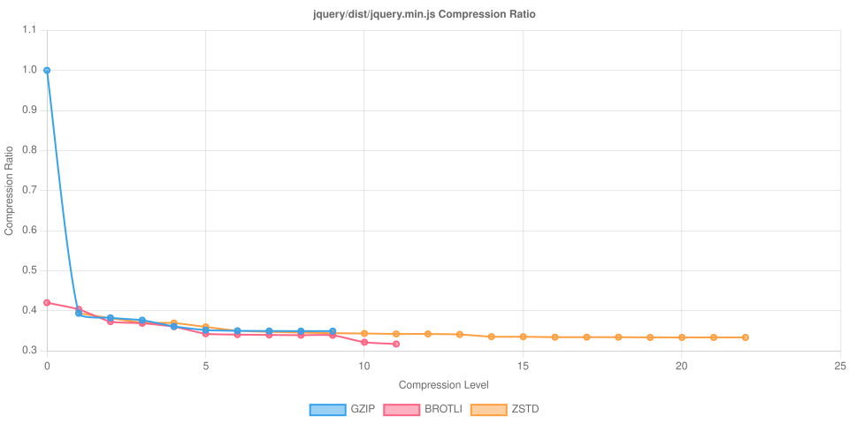

| Algorithm | Level | Time (ms) | Size (bytes) | Compression Ratio | Samples | Median CI (ms) | Precision met |
| --- | ---: | ---: | ---: | ---: | ---: | --- | --- |
| gzip | 0 | 0.148 | 78,776 | 1.0004 | 9 | 0.132–0.185 | no |
| gzip | 1 | 0.765 | 31,033 | 0.3941 | 9 | 0.757–0.780 | yes |
| gzip | 2 | 0.819 | 30,134 | 0.3827 | 9 | 0.809–0.824 | yes |
| gzip | 3 | 0.926 | 29,671 | 0.3768 | 9 | 0.918–0.942 | yes |
| gzip | 4 | 1.058 | 28,457 | 0.3614 | 9 | 1.044–1.124 | no |
| gzip | 5 | 1.399 | 27,721 | 0.3520 | 9 | 1.378–1.502 | no |
| gzip | 6 | 1.659 | 27,584 | 0.3503 | 9 | 1.636–1.859 | no |
| gzip | 7 | 1.817 | 27,547 | 0.3498 | 9 | 1.806–1.868 | yes |
| gzip | 8 | 2.122 | 27,530 | 0.3496 | 9 | 2.111–2.136 | yes |
| gzip | 9 | 2.105 | 27,530 | 0.3496 | 9 | 2.097–2.120 | yes |
| brotli | 0 | 0.283 | 33,111 | 0.4205 | 9 | 0.223–0.350 | no |
| brotli | 1 | 0.627 | 31,803 | 0.4039 | 9 | 0.607–0.648 | yes |
| brotli | 2 | 0.682 | 29,394 | 0.3733 | 9 | 0.640–0.725 | no |
| brotli | 3 | 0.769 | 29,072 | 0.3692 | 9 | 0.745–0.820 | no |
| brotli | 4 | 1.140 | 28,392 | 0.3605 | 9 | 1.106–1.285 | no |
| brotli | 5 | 1.561 | 27,013 | 0.3430 | 9 | 1.555–1.617 | yes |
| brotli | 6 | 1.771 | 26,844 | 0.3409 | 9 | 1.720–1.819 | yes |
| brotli | 7 | 3.076 | 26,773 | 0.3400 | 9 | 3.042–3.510 | no |
| brotli | 8 | 2.174 | 26,725 | 0.3394 | 9 | 2.120–2.252 | yes |
| brotli | 9 | 3.975 | 26,711 | 0.3392 | 9 | 3.872–4.114 | yes |
| brotli | 10 | 28.139 | 25,340 | 0.3218 | 9 | 27.665–28.536 | yes |
| brotli | 11 | 78.645 | 24,992 | 0.3174 | 9 | 77.962–78.986 | yes |
| zstd | 1 | 0.246 | 31,062 | 0.3944 | 9 | 0.179–0.341 | no |
| zstd | 2 | 0.211 | 30,069 | 0.3818 | 9 | 0.200–0.255 | no |
| zstd | 3 | 0.246 | 29,214 | 0.3710 | 9 | 0.222–0.293 | no |
| zstd | 4 | 0.363 | 29,108 | 0.3696 | 9 | 0.298–0.401 | no |
| zstd | 5 | 0.683 | 28,349 | 0.3600 | 9 | 0.672–0.703 | yes |
| zstd | 6 | 0.935 | 27,592 | 0.3504 | 9 | 0.924–0.952 | yes |
| zstd | 7 | 1.144 | 27,383 | 0.3477 | 9 | 1.139–1.153 | yes |
| zstd | 8 | 1.255 | 27,237 | 0.3459 | 9 | 1.245–1.263 | yes |
| zstd | 9 | 1.421 | 27,118 | 0.3444 | 9 | 1.396–1.451 | yes |
| zstd | 10 | 1.596 | 27,062 | 0.3437 | 9 | 1.587–1.630 | yes |
| zstd | 11 | 2.621 | 26,969 | 0.3425 | 9 | 2.607–2.692 | yes |
| zstd | 12 | 2.744 | 26,970 | 0.3425 | 9 | 2.733–2.751 | yes |
| zstd | 13 | 4.323 | 26,867 | 0.3412 | 9 | 4.311–4.367 | yes |
| zstd | 14 | 5.939 | 26,432 | 0.3357 | 9 | 5.909–5.963 | yes |
| zstd | 15 | 5.974 | 26,420 | 0.3355 | 9 | 5.935–6.026 | yes |
| zstd | 16 | 8.152 | 26,336 | 0.3344 | 9 | 7.932–9.850 | no |
| zstd | 17 | 7.605 | 26,336 | 0.3344 | 9 | 7.581–7.781 | yes |
| zstd | 18 | 7.689 | 26,336 | 0.3344 | 9 | 7.594–7.764 | yes |
| zstd | 19 | 15.151 | 26,282 | 0.3337 | 9 | 14.992–15.358 | yes |
| zstd | 20 | 15.145 | 26,282 | 0.3337 | 9 | 15.037–15.280 | yes |
| zstd | 21 | 15.184 | 26,282 | 0.3337 | 9 | 14.918–15.252 | yes |
| zstd | 22 | 15.264 | 26,282 | 0.3337 | 9 | 15.080–15.716 | yes |

<h2 id="expo-google-fonts-m-plus-1p-400regular-mplus1p-400regular-ttf">@expo-google-fonts/m-plus-1p/400Regular/MPLUS1p_400Regular.ttf</h2>

- Original size: 1,714,248 bytes
- Chart: 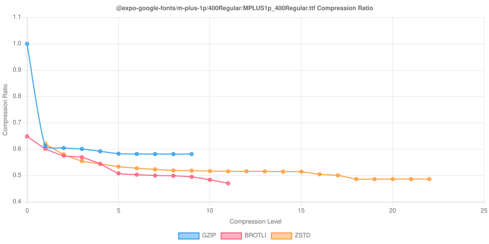

| Algorithm | Level | Time (ms) | Size (bytes) | Compression Ratio | Samples | Median CI (ms) | Precision met |
| --- | ---: | ---: | ---: | ---: | ---: | --- | --- |
| gzip | 0 | 1.057 | 1,714,526 | 1.0002 | 9 | 0.753–1.258 | no |
| gzip | 1 | 22.763 | 1,049,634 | 0.6123 | 9 | 22.387–23.861 | yes |
| gzip | 2 | 23.595 | 1,036,805 | 0.6048 | 9 | 23.563–26.984 | no |
| gzip | 3 | 25.123 | 1,030,268 | 0.6010 | 9 | 25.089–25.515 | yes |
| gzip | 4 | 28.362 | 1,015,229 | 0.5922 | 9 | 28.279–29.320 | yes |
| gzip | 5 | 34.067 | 999,772 | 0.5832 | 9 | 33.992–34.130 | yes |
| gzip | 6 | 40.661 | 997,720 | 0.5820 | 9 | 40.100–44.517 | no |
| gzip | 7 | 44.077 | 997,295 | 0.5818 | 9 | 43.971–45.643 | yes |
| gzip | 8 | 48.009 | 997,191 | 0.5817 | 9 | 47.926–48.300 | yes |
| gzip | 9 | 54.101 | 997,191 | 0.5817 | 9 | 53.664–54.443 | yes |
| brotli | 0 | 5.493 | 1,112,634 | 0.6491 | 9 | 5.461–5.809 | no |
| brotli | 1 | 7.837 | 1,031,943 | 0.6020 | 9 | 7.570–8.205 | yes |
| brotli | 2 | 13.700 | 986,211 | 0.5753 | 9 | 13.134–14.236 | yes |
| brotli | 3 | 16.326 | 976,041 | 0.5694 | 9 | 16.271–16.592 | yes |
| brotli | 4 | 23.422 | 933,224 | 0.5444 | 9 | 22.884–23.891 | yes |
| brotli | 5 | 32.259 | 872,005 | 0.5087 | 9 | 31.632–33.490 | yes |
| brotli | 6 | 36.062 | 863,383 | 0.5037 | 9 | 35.788–36.923 | yes |
| brotli | 7 | 72.466 | 857,835 | 0.5004 | 9 | 69.384–76.838 | no |
| brotli | 8 | 86.569 | 855,950 | 0.4993 | 9 | 81.614–92.270 | no |
| brotli | 9 | 117.927 | 849,266 | 0.4954 | 9 | 105.014–124.593 | no |
| brotli | 10 | 1817.771 | 830,083 | 0.4842 | 9 | 1792.569–1826.677 | yes |
| brotli | 11 | 3101.299 | 806,920 | 0.4707 | 9 | 3084.267–3117.923 | yes |
| zstd | 1 | 4.914 | 1,063,995 | 0.6207 | 9 | 4.896–4.936 | yes |
| zstd | 2 | 5.935 | 995,049 | 0.5805 | 9 | 5.918–6.191 | yes |
| zstd | 3 | 7.580 | 951,924 | 0.5553 | 9 | 7.442–7.760 | yes |
| zstd | 4 | 9.350 | 934,018 | 0.5449 | 9 | 9.257–9.388 | yes |
| zstd | 5 | 15.546 | 915,542 | 0.5341 | 9 | 15.446–15.779 | yes |
| zstd | 6 | 18.686 | 905,207 | 0.5280 | 9 | 18.604–18.741 | yes |
| zstd | 7 | 20.022 | 897,707 | 0.5237 | 9 | 19.699–20.608 | yes |
| zstd | 8 | 23.399 | 890,668 | 0.5196 | 9 | 23.309–23.654 | yes |
| zstd | 9 | 24.228 | 889,701 | 0.5190 | 9 | 23.861–24.545 | yes |
| zstd | 10 | 30.414 | 886,752 | 0.5173 | 9 | 29.408–31.870 | yes |
| zstd | 11 | 43.514 | 884,967 | 0.5162 | 9 | 41.756–44.535 | yes |
| zstd | 12 | 41.410 | 884,967 | 0.5162 | 9 | 38.290–44.494 | no |
| zstd | 13 | 105.433 | 884,574 | 0.5160 | 9 | 98.598–110.759 | no |
| zstd | 14 | 115.325 | 882,969 | 0.5151 | 9 | 109.652–118.993 | yes |
| zstd | 15 | 120.304 | 882,565 | 0.5148 | 9 | 112.936–125.536 | no |
| zstd | 16 | 175.145 | 865,802 | 0.5051 | 9 | 167.088–187.449 | no |
| zstd | 17 | 188.116 | 858,980 | 0.5011 | 9 | 181.818–196.490 | yes |
| zstd | 18 | 269.005 | 834,631 | 0.4869 | 9 | 263.301–273.450 | yes |
| zstd | 19 | 271.003 | 834,350 | 0.4867 | 9 | 260.699–274.738 | yes |
| zstd | 20 | 269.441 | 834,350 | 0.4867 | 9 | 263.990–275.187 | yes |
| zstd | 21 | 276.271 | 834,350 | 0.4867 | 9 | 269.234–286.091 | yes |
| zstd | 22 | 276.377 | 834,350 | 0.4867 | 9 | 266.573–281.780 | yes |

<h2 id="openfonts-m-plus-1p-japanese-m-plus-1p-japanese-400-woff2">@openfonts/m-plus-1p_japanese/m-plus-1p-japanese-400.woff2</h2>

- Original size: 598,576 bytes
- Chart: 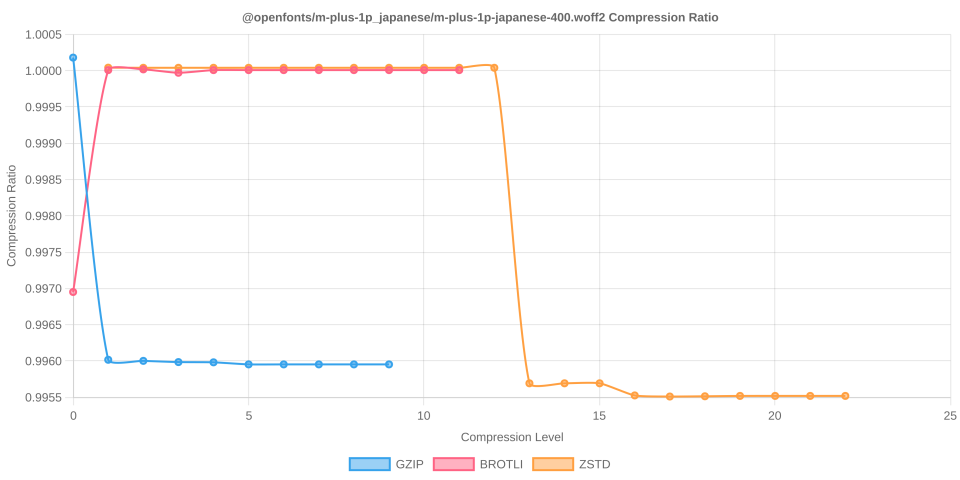

| Algorithm | Level | Time (ms) | Size (bytes) | Compression Ratio | Samples | Median CI (ms) | Precision met |
| --- | ---: | ---: | ---: | ---: | ---: | --- | --- |
| gzip | 0 | 0.258 | 598,684 | 1.0002 | 9 | 0.254–0.264 | yes |
| gzip | 1 | 10.200 | 596,192 | 0.9960 | 9 | 10.166–10.244 | yes |
| gzip | 2 | 10.197 | 596,183 | 0.9960 | 9 | 10.163–10.225 | yes |
| gzip | 3 | 10.202 | 596,173 | 0.9960 | 9 | 10.191–10.209 | yes |
| gzip | 4 | 10.973 | 596,171 | 0.9960 | 9 | 10.932–11.094 | yes |
| gzip | 5 | 10.936 | 596,154 | 0.9960 | 9 | 10.920–10.964 | yes |
| gzip | 6 | 10.937 | 596,154 | 0.9960 | 9 | 10.929–10.946 | yes |
| gzip | 7 | 10.986 | 596,154 | 0.9960 | 9 | 10.945–10.993 | yes |
| gzip | 8 | 10.942 | 596,154 | 0.9960 | 9 | 10.917–11.009 | yes |
| gzip | 9 | 10.979 | 596,154 | 0.9960 | 9 | 10.921–11.240 | yes |
| brotli | 0 | 0.198 | 596,751 | 0.9970 | 9 | 0.188–0.204 | no |
| brotli | 1 | 0.174 | 598,581 | 1.0000 | 9 | 0.147–0.193 | no |
| brotli | 2 | 0.434 | 598,587 | 1.0000 | 9 | 0.410–0.453 | no |
| brotli | 3 | 0.567 | 598,559 | 1.0000 | 9 | 0.547–0.583 | yes |
| brotli | 4 | 0.675 | 598,581 | 1.0000 | 9 | 0.640–0.908 | no |
| brotli | 5 | 1.228 | 598,581 | 1.0000 | 9 | 0.984–1.283 | no |
| brotli | 6 | 1.313 | 598,581 | 1.0000 | 9 | 1.043–1.538 | no |
| brotli | 7 | 1.640 | 598,581 | 1.0000 | 9 | 1.579–2.113 | no |
| brotli | 8 | 1.936 | 598,581 | 1.0000 | 9 | 1.772–3.639 | no |
| brotli | 9 | 3.650 | 598,581 | 1.0000 | 9 | 3.422–4.204 | no |
| brotli | 10 | 90.242 | 598,581 | 1.0000 | 9 | 88.834–97.251 | no |
| brotli | 11 | 220.553 | 598,581 | 1.0000 | 9 | 219.365–221.359 | yes |
| zstd | 1 | 0.231 | 598,601 | 1.0000 | 9 | 0.201–0.249 | no |
| zstd | 2 | 0.207 | 598,600 | 1.0000 | 9 | 0.203–0.233 | no |
| zstd | 3 | 0.237 | 598,600 | 1.0000 | 9 | 0.219–0.256 | no |
| zstd | 4 | 0.272 | 598,600 | 1.0000 | 9 | 0.235–0.309 | no |
| zstd | 5 | 0.476 | 598,600 | 1.0000 | 9 | 0.398–0.952 | no |
| zstd | 6 | 0.377 | 598,600 | 1.0000 | 9 | 0.371–0.394 | yes |
| zstd | 7 | 0.429 | 598,600 | 1.0000 | 9 | 0.394–0.448 | no |
| zstd | 8 | 0.414 | 598,600 | 1.0000 | 9 | 0.395–0.430 | yes |
| zstd | 9 | 0.474 | 598,600 | 1.0000 | 9 | 0.449–0.873 | no |
| zstd | 10 | 0.468 | 598,600 | 1.0000 | 9 | 0.457–0.575 | no |
| zstd | 11 | 0.485 | 598,600 | 1.0000 | 9 | 0.468–0.502 | yes |
| zstd | 12 | 0.483 | 598,600 | 1.0000 | 9 | 0.453–0.511 | no |
| zstd | 13 | 2.153 | 595,998 | 0.9957 | 9 | 1.965–5.278 | no |
| zstd | 14 | 2.724 | 595,998 | 0.9957 | 9 | 2.264–2.850 | no |
| zstd | 15 | 2.448 | 595,998 | 0.9957 | 9 | 2.346–2.807 | no |
| zstd | 16 | 13.176 | 595,898 | 0.9955 | 9 | 12.210–16.507 | no |
| zstd | 17 | 16.594 | 595,889 | 0.9955 | 9 | 11.862–21.840 | no |
| zstd | 18 | 20.401 | 595,891 | 0.9955 | 9 | 17.068–33.388 | no |
| zstd | 19 | 28.097 | 595,894 | 0.9955 | 9 | 21.948–36.888 | no |
| zstd | 20 | 36.280 | 595,894 | 0.9955 | 9 | 32.284–40.355 | no |
| zstd | 21 | 24.148 | 595,894 | 0.9955 | 9 | 21.407–30.168 | no |
| zstd | 22 | 32.275 | 595,894 | 0.9955 | 9 | 25.101–35.955 | no |

<h2 id="codemirror-view-dist-index-js">@codemirror/view/dist/index.js</h2>

- Original size: 495,588 bytes
- Chart: 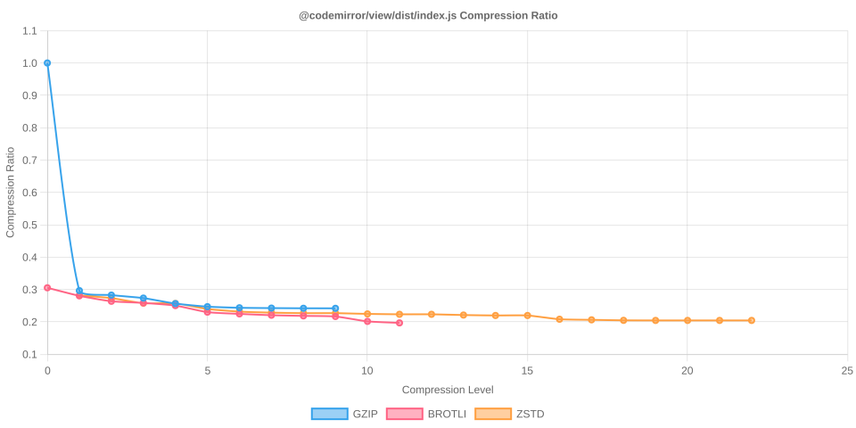

| Algorithm | Level | Time (ms) | Size (bytes) | Compression Ratio | Samples | Median CI (ms) | Precision met |
| --- | ---: | ---: | ---: | ---: | ---: | --- | --- |
| gzip | 0 | 0.239 | 495,681 | 1.0002 | 9 | 0.230–0.241 | yes |
| gzip | 1 | 3.368 | 147,019 | 0.2967 | 9 | 3.351–3.392 | yes |
| gzip | 2 | 3.693 | 140,161 | 0.2828 | 9 | 3.661–3.705 | yes |
| gzip | 3 | 4.880 | 135,613 | 0.2736 | 9 | 4.858–4.895 | yes |
| gzip | 4 | 4.964 | 127,170 | 0.2566 | 9 | 4.936–4.998 | yes |
| gzip | 5 | 7.218 | 122,480 | 0.2471 | 9 | 7.200–7.257 | yes |
| gzip | 6 | 10.674 | 120,752 | 0.2437 | 9 | 10.645–10.720 | yes |
| gzip | 7 | 13.739 | 120,280 | 0.2427 | 9 | 13.713–13.761 | yes |
| gzip | 8 | 25.940 | 120,006 | 0.2421 | 9 | 25.837–26.446 | yes |
| gzip | 9 | 40.148 | 119,944 | 0.2420 | 9 | 40.126–40.179 | yes |
| brotli | 0 | 1.225 | 151,389 | 0.3055 | 9 | 1.221–1.249 | yes |
| brotli | 1 | 1.799 | 139,012 | 0.2805 | 9 | 1.787–1.808 | yes |
| brotli | 2 | 3.153 | 130,704 | 0.2637 | 9 | 3.095–3.206 | yes |
| brotli | 3 | 3.635 | 128,093 | 0.2585 | 9 | 3.628–3.656 | yes |
| brotli | 4 | 5.238 | 124,144 | 0.2505 | 9 | 5.195–5.275 | yes |
| brotli | 5 | 8.183 | 114,090 | 0.2302 | 9 | 8.066–8.332 | yes |
| brotli | 6 | 9.437 | 111,384 | 0.2248 | 9 | 9.324–9.534 | yes |
| brotli | 7 | 11.847 | 109,376 | 0.2207 | 9 | 11.661–12.101 | yes |
| brotli | 8 | 14.684 | 108,340 | 0.2186 | 9 | 14.539–15.329 | yes |
| brotli | 9 | 19.250 | 107,449 | 0.2168 | 9 | 19.015–19.430 | yes |
| brotli | 10 | 238.632 | 99,878 | 0.2015 | 9 | 235.190–242.129 | yes |
| brotli | 11 | 576.548 | 97,648 | 0.1970 | 9 | 575.902–577.781 | yes |
| zstd | 1 | 1.395 | 139,921 | 0.2823 | 9 | 1.376–1.408 | yes |
| zstd | 2 | 1.498 | 135,629 | 0.2737 | 9 | 1.438–1.518 | yes |
| zstd | 3 | 1.745 | 127,698 | 0.2577 | 9 | 1.620–1.784 | no |
| zstd | 4 | 1.749 | 127,469 | 0.2572 | 9 | 1.733–1.834 | yes |
| zstd | 5 | 3.563 | 118,828 | 0.2398 | 9 | 3.551–3.586 | yes |
| zstd | 6 | 4.925 | 114,849 | 0.2317 | 9 | 4.904–4.954 | yes |
| zstd | 7 | 5.514 | 113,233 | 0.2285 | 9 | 5.487–5.534 | yes |
| zstd | 8 | 7.005 | 112,404 | 0.2268 | 9 | 6.987–7.072 | yes |
| zstd | 9 | 6.987 | 112,404 | 0.2268 | 9 | 6.963–7.021 | yes |
| zstd | 10 | 8.387 | 111,395 | 0.2248 | 9 | 8.331–8.535 | yes |
| zstd | 11 | 10.475 | 110,772 | 0.2235 | 9 | 10.391–10.562 | yes |
| zstd | 12 | 10.493 | 110,772 | 0.2235 | 9 | 10.455–10.721 | yes |
| zstd | 13 | 23.813 | 109,611 | 0.2212 | 9 | 22.622–26.584 | no |
| zstd | 14 | 27.262 | 108,976 | 0.2199 | 9 | 26.985–28.021 | yes |
| zstd | 15 | 30.345 | 108,836 | 0.2196 | 9 | 30.143–30.808 | yes |
| zstd | 16 | 56.152 | 103,236 | 0.2083 | 9 | 54.076–57.054 | yes |
| zstd | 17 | 61.157 | 102,296 | 0.2064 | 9 | 58.642–63.125 | yes |
| zstd | 18 | 89.711 | 101,518 | 0.2048 | 9 | 88.662–90.792 | yes |
| zstd | 19 | 111.005 | 101,389 | 0.2046 | 9 | 109.958–112.535 | yes |
| zstd | 20 | 109.555 | 101,389 | 0.2046 | 9 | 108.003–110.488 | yes |
| zstd | 21 | 112.540 | 101,411 | 0.2046 | 9 | 110.916–117.682 | yes |
| zstd | 22 | 111.961 | 101,411 | 0.2046 | 9 | 110.403–113.771 | yes |

<h2 id="react-cjs-react-production-js">react/cjs/react.production.js</h2>

- Original size: 18,040 bytes
- Chart: 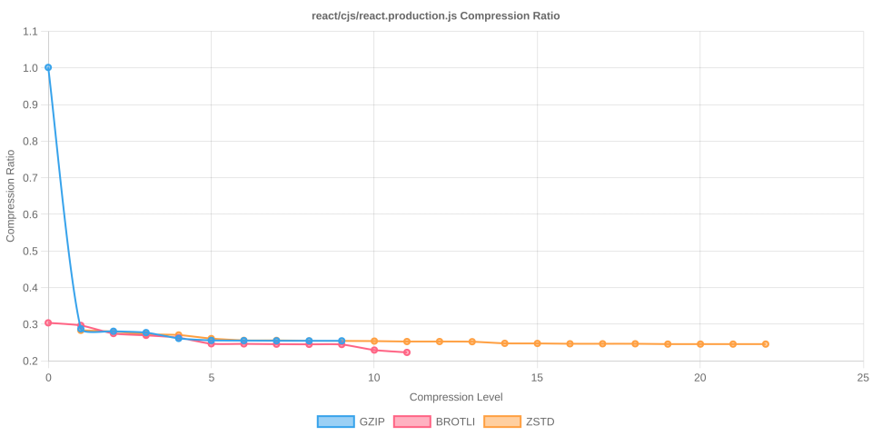

| Algorithm | Level | Time (ms) | Size (bytes) | Compression Ratio | Samples | Median CI (ms) | Precision met |
| --- | ---: | ---: | ---: | ---: | ---: | --- | --- |
| gzip | 0 | 0.015 | 18,063 | 1.0013 | 9 | 0.014–0.022 | no |
| gzip | 1 | 0.063 | 5,189 | 0.2876 | 9 | 0.054–0.089 | no |
| gzip | 2 | 0.070 | 5,069 | 0.2810 | 9 | 0.064–0.102 | no |
| gzip | 3 | 0.075 | 5,003 | 0.2773 | 9 | 0.065–0.110 | no |
| gzip | 4 | 0.096 | 4,715 | 0.2614 | 9 | 0.091–0.152 | no |
| gzip | 5 | 0.120 | 4,618 | 0.2560 | 9 | 0.107–0.197 | no |
| gzip | 6 | 0.159 | 4,607 | 0.2554 | 9 | 0.145–0.195 | no |
| gzip | 7 | 0.189 | 4,600 | 0.2550 | 9 | 0.168–0.226 | no |
| gzip | 8 | 0.332 | 4,597 | 0.2548 | 9 | 0.325–0.363 | no |
| gzip | 9 | 0.377 | 4,597 | 0.2548 | 9 | 0.348–0.410 | no |
| brotli | 0 | 0.043 | 5,483 | 0.3039 | 9 | 0.042–0.052 | no |
| brotli | 1 | 0.057 | 5,356 | 0.2969 | 9 | 0.054–0.073 | no |
| brotli | 2 | 0.082 | 4,956 | 0.2747 | 9 | 0.076–0.103 | no |
| brotli | 3 | 0.096 | 4,866 | 0.2697 | 9 | 0.092–0.138 | no |
| brotli | 4 | 0.195 | 4,752 | 0.2634 | 9 | 0.162–0.252 | no |
| brotli | 5 | 0.279 | 4,451 | 0.2467 | 9 | 0.237–0.315 | no |
| brotli | 6 | 0.293 | 4,446 | 0.2465 | 9 | 0.265–0.314 | no |
| brotli | 7 | 0.330 | 4,432 | 0.2457 | 9 | 0.311–0.366 | no |
| brotli | 8 | 0.338 | 4,424 | 0.2452 | 9 | 0.333–0.365 | no |
| brotli | 9 | 1.662 | 4,416 | 0.2448 | 9 | 1.573–1.728 | no |
| brotli | 10 | 6.348 | 4,142 | 0.2296 | 9 | 6.332–6.373 | yes |
| brotli | 11 | 15.833 | 4,027 | 0.2232 | 9 | 15.747–15.995 | yes |
| zstd | 1 | 0.044 | 5,114 | 0.2835 | 9 | 0.040–0.075 | no |
| zstd | 2 | 0.045 | 5,057 | 0.2803 | 9 | 0.045–0.063 | no |
| zstd | 3 | 0.051 | 4,922 | 0.2728 | 9 | 0.050–0.064 | no |
| zstd | 4 | 0.054 | 4,885 | 0.2708 | 9 | 0.052–0.080 | no |
| zstd | 5 | 0.116 | 4,708 | 0.2610 | 9 | 0.107–0.147 | no |
| zstd | 6 | 0.135 | 4,620 | 0.2561 | 9 | 0.130–0.173 | no |
| zstd | 7 | 0.154 | 4,618 | 0.2560 | 9 | 0.150–0.190 | no |
| zstd | 8 | 0.176 | 4,601 | 0.2550 | 9 | 0.161–0.223 | no |
| zstd | 9 | 0.230 | 4,592 | 0.2545 | 9 | 0.212–0.278 | no |
| zstd | 10 | 0.392 | 4,584 | 0.2541 | 9 | 0.262–0.425 | no |
| zstd | 11 | 0.509 | 4,562 | 0.2529 | 9 | 0.479–0.554 | no |
| zstd | 12 | 0.532 | 4,562 | 0.2529 | 9 | 0.514–0.560 | no |
| zstd | 13 | 0.743 | 4,554 | 0.2524 | 9 | 0.739–0.765 | yes |
| zstd | 14 | 1.176 | 4,473 | 0.2479 | 9 | 1.170–1.193 | yes |
| zstd | 15 | 1.253 | 4,468 | 0.2477 | 9 | 1.241–1.267 | yes |
| zstd | 16 | 1.801 | 4,452 | 0.2468 | 9 | 1.799–1.812 | yes |
| zstd | 17 | 1.897 | 4,452 | 0.2468 | 9 | 1.893–1.904 | yes |
| zstd | 18 | 1.895 | 4,452 | 0.2468 | 9 | 1.891–1.911 | yes |
| zstd | 19 | 3.724 | 4,436 | 0.2459 | 9 | 3.713–3.731 | yes |
| zstd | 20 | 3.739 | 4,436 | 0.2459 | 9 | 3.726–3.775 | yes |
| zstd | 21 | 3.749 | 4,436 | 0.2459 | 9 | 3.735–3.779 | yes |
| zstd | 22 | 3.733 | 4,436 | 0.2459 | 9 | 3.718–3.751 | yes |

<h2 id="dayjs-dayjs-min-js">dayjs/dayjs.min.js</h2>

- Original size: 7,161 bytes
- Chart: 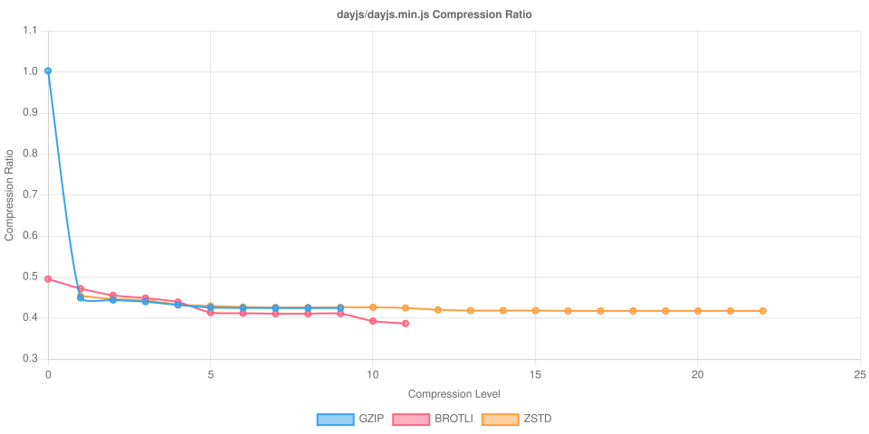

| Algorithm | Level | Time (ms) | Size (bytes) | Compression Ratio | Samples | Median CI (ms) | Precision met |
| --- | ---: | ---: | ---: | ---: | ---: | --- | --- |
| gzip | 0 | 0.013 | 7,184 | 1.0032 | 9 | 0.011–0.015 | no |
| gzip | 1 | 0.088 | 3,220 | 0.4497 | 9 | 0.065–0.116 | no |
| gzip | 2 | 0.040 | 3,182 | 0.4444 | 9 | 0.037–0.074 | no |
| gzip | 3 | 0.046 | 3,153 | 0.4403 | 9 | 0.039–0.060 | no |
| gzip | 4 | 0.053 | 3,095 | 0.4322 | 9 | 0.047–0.061 | no |
| gzip | 5 | 0.053 | 3,051 | 0.4261 | 9 | 0.050–0.072 | no |
| gzip | 6 | 0.060 | 3,044 | 0.4251 | 9 | 0.056–0.077 | no |
| gzip | 7 | 0.067 | 3,042 | 0.4248 | 9 | 0.057–0.075 | no |
| gzip | 8 | 0.059 | 3,042 | 0.4248 | 9 | 0.056–0.067 | no |
| gzip | 9 | 0.058 | 3,042 | 0.4248 | 9 | 0.057–0.064 | no |
| brotli | 0 | 0.024 | 3,549 | 0.4956 | 9 | 0.024–0.028 | no |
| brotli | 1 | 0.034 | 3,381 | 0.4721 | 9 | 0.032–0.042 | no |
| brotli | 2 | 0.049 | 3,263 | 0.4557 | 9 | 0.046–0.056 | no |
| brotli | 3 | 0.060 | 3,216 | 0.4491 | 9 | 0.057–0.070 | no |
| brotli | 4 | 0.107 | 3,147 | 0.4395 | 9 | 0.098–0.129 | no |
| brotli | 5 | 0.136 | 2,963 | 0.4138 | 9 | 0.123–0.201 | no |
| brotli | 6 | 0.131 | 2,952 | 0.4122 | 9 | 0.126–0.165 | no |
| brotli | 7 | 0.174 | 2,944 | 0.4111 | 9 | 0.149–0.197 | no |
| brotli | 8 | 0.176 | 2,944 | 0.4111 | 9 | 0.144–0.220 | no |
| brotli | 9 | 1.348 | 2,945 | 0.4113 | 9 | 1.309–1.364 | yes |
| brotli | 10 | 2.532 | 2,814 | 0.3930 | 9 | 2.517–2.568 | yes |
| brotli | 11 | 6.278 | 2,772 | 0.3871 | 9 | 6.264–6.297 | yes |
| zstd | 1 | 0.028 | 3,254 | 0.4544 | 9 | 0.023–0.045 | no |
| zstd | 2 | 0.026 | 3,200 | 0.4469 | 9 | 0.024–0.040 | no |
| zstd | 3 | 0.032 | 3,176 | 0.4435 | 9 | 0.030–0.051 | no |
| zstd | 4 | 0.052 | 3,102 | 0.4332 | 9 | 0.046–0.104 | no |
| zstd | 5 | 0.054 | 3,079 | 0.4300 | 9 | 0.053–0.067 | no |
| zstd | 6 | 0.069 | 3,060 | 0.4273 | 9 | 0.064–0.117 | no |
| zstd | 7 | 0.076 | 3,053 | 0.4263 | 9 | 0.075–0.104 | no |
| zstd | 8 | 0.076 | 3,053 | 0.4263 | 9 | 0.074–0.086 | no |
| zstd | 9 | 0.093 | 3,055 | 0.4266 | 9 | 0.089–0.155 | no |
| zstd | 10 | 0.092 | 3,055 | 0.4266 | 9 | 0.089–0.096 | yes |
| zstd | 11 | 0.216 | 3,044 | 0.4251 | 9 | 0.184–0.262 | no |
| zstd | 12 | 0.327 | 3,011 | 0.4205 | 9 | 0.307–0.366 | no |
| zstd | 13 | 0.436 | 2,998 | 0.4187 | 9 | 0.418–0.477 | no |
| zstd | 14 | 0.422 | 2,998 | 0.4187 | 9 | 0.410–0.430 | yes |
| zstd | 15 | 0.434 | 2,998 | 0.4187 | 9 | 0.415–0.466 | no |
| zstd | 16 | 0.802 | 2,992 | 0.4178 | 9 | 0.794–0.813 | yes |
| zstd | 17 | 0.799 | 2,992 | 0.4178 | 9 | 0.793–0.853 | no |
| zstd | 18 | 0.808 | 2,992 | 0.4178 | 9 | 0.802–0.832 | yes |
| zstd | 19 | 0.802 | 2,992 | 0.4178 | 9 | 0.797–0.808 | yes |
| zstd | 20 | 0.804 | 2,992 | 0.4178 | 9 | 0.798–0.836 | yes |
| zstd | 21 | 0.827 | 2,992 | 0.4178 | 9 | 0.811–0.852 | yes |
| zstd | 22 | 0.807 | 2,992 | 0.4178 | 9 | 0.801–0.827 | yes |

<h2 id="vue-dist-vue-global-prod-js">vue/dist/vue.global.prod.js</h2>

- Original size: 170,605 bytes
- Chart: 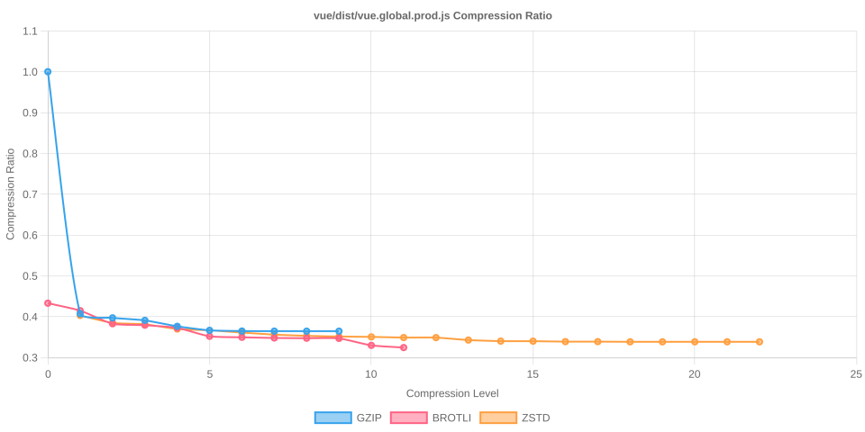

| Algorithm | Level | Time (ms) | Size (bytes) | Compression Ratio | Samples | Median CI (ms) | Precision met |
| --- | ---: | ---: | ---: | ---: | ---: | --- | --- |
| gzip | 0 | 0.088 | 170,648 | 1.0003 | 9 | 0.083–0.092 | no |
| gzip | 1 | 1.665 | 69,508 | 0.4074 | 9 | 1.653–1.686 | yes |
| gzip | 2 | 1.802 | 67,777 | 0.3973 | 9 | 1.793–1.804 | yes |
| gzip | 3 | 2.083 | 66,731 | 0.3911 | 9 | 2.078–2.098 | yes |
| gzip | 4 | 2.279 | 64,250 | 0.3766 | 9 | 2.276–2.285 | yes |
| gzip | 5 | 3.160 | 62,564 | 0.3667 | 9 | 3.143–3.175 | yes |
| gzip | 6 | 3.969 | 62,277 | 0.3650 | 9 | 3.966–3.999 | yes |
| gzip | 7 | 4.387 | 62,233 | 0.3648 | 9 | 4.368–4.494 | yes |
| gzip | 8 | 4.718 | 62,218 | 0.3647 | 9 | 4.692–4.733 | yes |
| gzip | 9 | 4.701 | 62,218 | 0.3647 | 9 | 4.665–4.722 | yes |
| brotli | 0 | 0.537 | 73,915 | 0.4333 | 9 | 0.493–0.725 | no |
| brotli | 1 | 0.741 | 70,800 | 0.4150 | 9 | 0.727–0.771 | yes |
| brotli | 2 | 1.388 | 65,325 | 0.3829 | 9 | 1.376–1.403 | yes |
| brotli | 3 | 1.665 | 64,715 | 0.3793 | 9 | 1.661–1.679 | yes |
| brotli | 4 | 2.405 | 63,583 | 0.3727 | 9 | 2.389–2.423 | yes |
| brotli | 5 | 3.574 | 60,073 | 0.3521 | 9 | 3.556–5.147 | no |
| brotli | 6 | 4.209 | 59,661 | 0.3497 | 9 | 4.147–4.403 | yes |
| brotli | 7 | 5.189 | 59,376 | 0.3480 | 9 | 5.127–5.379 | yes |
| brotli | 8 | 5.780 | 59,283 | 0.3475 | 9 | 5.668–6.073 | no |
| brotli | 9 | 7.561 | 59,203 | 0.3470 | 9 | 7.515–7.900 | yes |
| brotli | 10 | 86.764 | 56,291 | 0.3299 | 9 | 86.218–87.734 | yes |
| brotli | 11 | 214.059 | 55,372 | 0.3246 | 9 | 213.817–214.615 | yes |
| zstd | 1 | 0.493 | 68,788 | 0.4032 | 9 | 0.483–0.535 | no |
| zstd | 2 | 0.633 | 65,688 | 0.3850 | 9 | 0.623–0.653 | yes |
| zstd | 3 | 0.760 | 65,090 | 0.3815 | 9 | 0.754–0.783 | yes |
| zstd | 4 | 1.466 | 63,123 | 0.3700 | 9 | 1.451–1.489 | yes |
| zstd | 5 | 1.651 | 62,569 | 0.3667 | 9 | 1.639–1.666 | yes |
| zstd | 6 | 1.986 | 61,638 | 0.3613 | 9 | 1.976–1.991 | yes |
| zstd | 7 | 2.353 | 60,781 | 0.3563 | 9 | 2.341–2.361 | yes |
| zstd | 8 | 2.921 | 60,265 | 0.3532 | 9 | 2.915–2.967 | yes |
| zstd | 9 | 3.452 | 59,985 | 0.3516 | 9 | 3.444–3.487 | yes |
| zstd | 10 | 4.047 | 59,833 | 0.3507 | 9 | 4.040–4.113 | yes |
| zstd | 11 | 7.085 | 59,551 | 0.3491 | 9 | 7.003–7.138 | yes |
| zstd | 12 | 7.230 | 59,532 | 0.3489 | 9 | 7.206–7.253 | yes |
| zstd | 13 | 12.769 | 58,505 | 0.3429 | 9 | 12.179–13.711 | no |
| zstd | 14 | 16.004 | 58,059 | 0.3403 | 9 | 15.342–18.027 | no |
| zstd | 15 | 18.204 | 58,039 | 0.3402 | 9 | 17.863–18.667 | yes |
| zstd | 16 | 22.992 | 57,847 | 0.3391 | 9 | 22.331–24.378 | no |
| zstd | 17 | 23.176 | 57,847 | 0.3391 | 9 | 21.859–24.415 | no |
| zstd | 18 | 39.903 | 57,775 | 0.3386 | 9 | 36.603–42.645 | no |
| zstd | 19 | 41.795 | 57,775 | 0.3386 | 9 | 40.639–43.617 | yes |
| zstd | 20 | 35.689 | 57,775 | 0.3386 | 9 | 35.151–38.316 | no |
| zstd | 21 | 35.498 | 57,775 | 0.3386 | 9 | 34.635–35.994 | yes |
| zstd | 22 | 39.884 | 57,775 | 0.3386 | 9 | 36.240–40.651 | no |

<h2 id="lodash-lodash-min-js">lodash/lodash.min.js</h2>

- Original size: 73,234 bytes
- Chart: 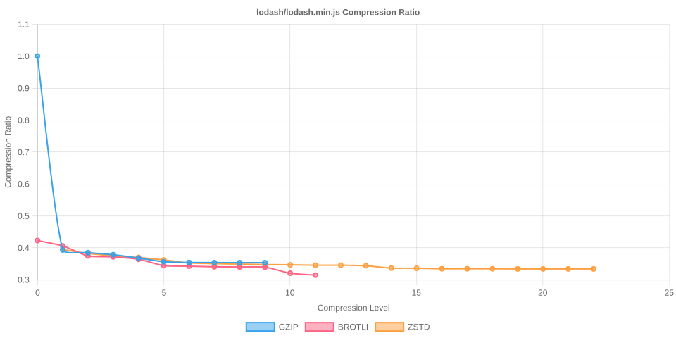

| Algorithm | Level | Time (ms) | Size (bytes) | Compression Ratio | Samples | Median CI (ms) | Precision met |
| --- | ---: | ---: | ---: | ---: | ---: | --- | --- |
| gzip | 0 | 0.040 | 73,262 | 1.0004 | 9 | 0.039–0.054 | no |
| gzip | 1 | 0.660 | 28,819 | 0.3935 | 9 | 0.646–0.678 | yes |
| gzip | 2 | 0.716 | 28,191 | 0.3849 | 9 | 0.711–0.725 | yes |
| gzip | 3 | 0.837 | 27,724 | 0.3786 | 9 | 0.836–0.841 | yes |
| gzip | 4 | 0.919 | 26,950 | 0.3680 | 9 | 0.912–0.932 | yes |
| gzip | 5 | 1.227 | 26,101 | 0.3564 | 9 | 1.223–1.240 | yes |
| gzip | 6 | 1.585 | 25,938 | 0.3542 | 9 | 1.580–1.588 | yes |
| gzip | 7 | 1.901 | 25,913 | 0.3538 | 9 | 1.897–1.905 | yes |
| gzip | 8 | 2.597 | 25,894 | 0.3536 | 9 | 2.583–2.601 | yes |
| gzip | 9 | 2.592 | 25,894 | 0.3536 | 9 | 2.581–2.603 | yes |
| brotli | 0 | 0.158 | 30,978 | 0.4230 | 9 | 0.155–0.201 | no |
| brotli | 1 | 0.261 | 29,754 | 0.4063 | 9 | 0.233–0.297 | no |
| brotli | 2 | 0.555 | 27,438 | 0.3747 | 9 | 0.551–0.572 | yes |
| brotli | 3 | 0.678 | 27,227 | 0.3718 | 9 | 0.669–0.911 | no |
| brotli | 4 | 1.056 | 26,678 | 0.3643 | 9 | 1.046–1.076 | yes |
| brotli | 5 | 1.492 | 25,217 | 0.3443 | 9 | 1.475–1.539 | yes |
| brotli | 6 | 1.698 | 25,093 | 0.3426 | 9 | 1.663–2.103 | no |
| brotli | 7 | 2.235 | 24,950 | 0.3407 | 9 | 2.205–2.315 | yes |
| brotli | 8 | 2.375 | 24,912 | 0.3402 | 9 | 2.262–2.577 | no |
| brotli | 9 | 2.740 | 24,870 | 0.3396 | 9 | 2.721–2.770 | yes |
| brotli | 10 | 33.353 | 23,472 | 0.3205 | 9 | 33.085–34.045 | yes |
| brotli | 11 | 78.087 | 23,030 | 0.3145 | 9 | 77.963–78.405 | yes |
| zstd | 1 | 0.154 | 28,919 | 0.3949 | 9 | 0.151–0.188 | no |
| zstd | 2 | 0.180 | 28,008 | 0.3824 | 9 | 0.171–0.248 | no |
| zstd | 3 | 0.215 | 27,463 | 0.3750 | 9 | 0.207–0.263 | no |
| zstd | 4 | 0.259 | 27,100 | 0.3700 | 9 | 0.237–0.333 | no |
| zstd | 5 | 0.616 | 26,525 | 0.3622 | 9 | 0.597–0.643 | yes |
| zstd | 6 | 0.831 | 25,834 | 0.3528 | 9 | 0.827–0.854 | yes |
| zstd | 7 | 1.010 | 25,663 | 0.3504 | 9 | 1.005–1.024 | yes |
| zstd | 8 | 1.112 | 25,557 | 0.3490 | 9 | 1.101–1.134 | yes |
| zstd | 9 | 1.283 | 25,466 | 0.3477 | 9 | 1.277–1.298 | yes |
| zstd | 10 | 1.516 | 25,397 | 0.3468 | 9 | 1.496–1.536 | yes |
| zstd | 11 | 2.535 | 25,317 | 0.3457 | 9 | 2.481–2.606 | yes |
| zstd | 12 | 2.575 | 25,315 | 0.3457 | 9 | 2.565–2.600 | yes |
| zstd | 13 | 4.158 | 25,185 | 0.3439 | 9 | 4.136–4.185 | yes |
| zstd | 14 | 5.805 | 24,642 | 0.3365 | 9 | 5.775–5.955 | yes |
| zstd | 15 | 5.930 | 24,606 | 0.3360 | 9 | 5.895–6.101 | yes |
| zstd | 16 | 7.808 | 24,499 | 0.3345 | 9 | 7.770–7.937 | yes |
| zstd | 17 | 7.805 | 24,499 | 0.3345 | 9 | 7.763–7.896 | yes |
| zstd | 18 | 7.871 | 24,499 | 0.3345 | 9 | 7.735–8.060 | yes |
| zstd | 19 | 15.090 | 24,463 | 0.3340 | 9 | 14.933–15.322 | yes |
| zstd | 20 | 15.533 | 24,463 | 0.3340 | 9 | 15.416–15.859 | yes |
| zstd | 21 | 14.922 | 24,463 | 0.3340 | 9 | 14.657–15.335 | yes |
| zstd | 22 | 14.821 | 24,463 | 0.3340 | 9 | 14.766–14.990 | yes |

<h2 id="fortawesome-fontawesome-free-css-all-min-css">@fortawesome/fontawesome-free/css/all.min.css</h2>

- Original size: 90,336 bytes
- Chart: 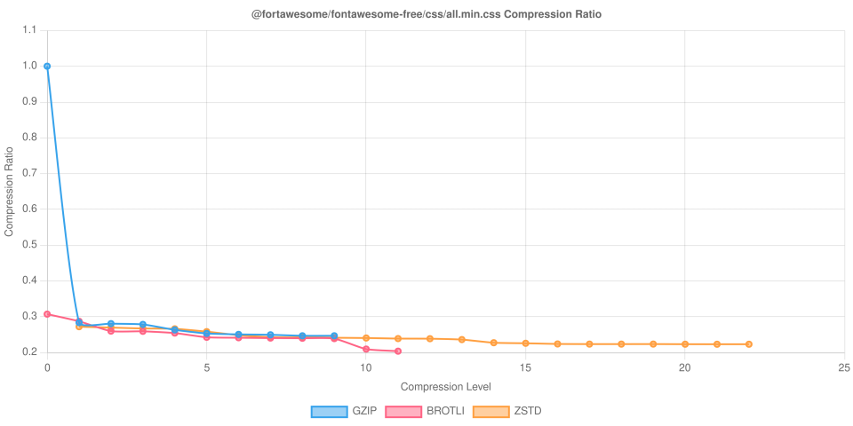

| Algorithm | Level | Time (ms) | Size (bytes) | Compression Ratio | Samples | Median CI (ms) | Precision met |
| --- | ---: | ---: | ---: | ---: | ---: | --- | --- |
| gzip | 0 | 0.047 | 90,364 | 1.0003 | 9 | 0.045–0.056 | no |
| gzip | 1 | 0.546 | 25,642 | 0.2839 | 9 | 0.532–0.559 | yes |
| gzip | 2 | 0.629 | 25,381 | 0.2810 | 9 | 0.621–0.639 | yes |
| gzip | 3 | 0.749 | 25,183 | 0.2788 | 9 | 0.738–0.761 | yes |
| gzip | 4 | 0.858 | 23,806 | 0.2635 | 9 | 0.855–0.865 | yes |
| gzip | 5 | 1.185 | 22,906 | 0.2536 | 9 | 1.177–1.197 | yes |
| gzip | 6 | 1.845 | 22,672 | 0.2510 | 9 | 1.838–1.852 | yes |
| gzip | 7 | 2.472 | 22,565 | 0.2498 | 9 | 2.462–2.478 | yes |
| gzip | 8 | 7.227 | 22,320 | 0.2471 | 9 | 7.189–7.283 | yes |
| gzip | 9 | 7.308 | 22,318 | 0.2471 | 9 | 7.290–7.398 | yes |
| brotli | 0 | 0.155 | 27,781 | 0.3075 | 9 | 0.147–0.215 | no |
| brotli | 1 | 0.318 | 25,973 | 0.2875 | 9 | 0.269–0.328 | no |
| brotli | 2 | 0.573 | 23,497 | 0.2601 | 9 | 0.564–0.588 | yes |
| brotli | 3 | 0.671 | 23,445 | 0.2595 | 9 | 0.657–0.694 | yes |
| brotli | 4 | 0.989 | 23,003 | 0.2546 | 9 | 0.972–1.046 | no |
| brotli | 5 | 1.539 | 21,939 | 0.2429 | 9 | 1.507–1.758 | no |
| brotli | 6 | 1.796 | 21,822 | 0.2416 | 9 | 1.772–2.052 | no |
| brotli | 7 | 2.312 | 21,742 | 0.2407 | 9 | 2.273–2.538 | no |
| brotli | 8 | 2.607 | 21,693 | 0.2401 | 9 | 2.563–2.651 | yes |
| brotli | 9 | 3.273 | 21,604 | 0.2392 | 9 | 3.235–3.365 | yes |
| brotli | 10 | 29.246 | 18,961 | 0.2099 | 9 | 28.327–29.851 | yes |
| brotli | 11 | 83.143 | 18,432 | 0.2040 | 9 | 82.903–83.691 | yes |
| zstd | 1 | 0.171 | 24,608 | 0.2724 | 9 | 0.164–0.231 | no |
| zstd | 2 | 0.187 | 24,387 | 0.2700 | 9 | 0.178–0.241 | no |
| zstd | 3 | 0.215 | 24,157 | 0.2674 | 9 | 0.209–0.267 | no |
| zstd | 4 | 0.245 | 24,076 | 0.2665 | 9 | 0.227–0.293 | no |
| zstd | 5 | 0.607 | 23,365 | 0.2586 | 9 | 0.590–0.633 | yes |
| zstd | 6 | 0.852 | 22,468 | 0.2487 | 9 | 0.845–0.873 | yes |
| zstd | 7 | 1.054 | 21,961 | 0.2431 | 9 | 1.051–1.074 | yes |
| zstd | 8 | 1.220 | 21,892 | 0.2423 | 9 | 1.208–1.253 | yes |
| zstd | 9 | 1.537 | 21,821 | 0.2416 | 9 | 1.532–1.554 | yes |
| zstd | 10 | 1.970 | 21,755 | 0.2408 | 9 | 1.957–2.003 | yes |
| zstd | 11 | 2.886 | 21,610 | 0.2392 | 9 | 2.868–2.908 | yes |
| zstd | 12 | 4.016 | 21,581 | 0.2389 | 9 | 3.994–4.065 | yes |
| zstd | 13 | 4.705 | 21,357 | 0.2364 | 9 | 4.628–4.859 | yes |
| zstd | 14 | 6.564 | 20,565 | 0.2277 | 9 | 6.452–6.605 | yes |
| zstd | 15 | 7.634 | 20,426 | 0.2261 | 9 | 7.575–7.790 | yes |
| zstd | 16 | 10.724 | 20,254 | 0.2242 | 9 | 10.658–11.035 | yes |
| zstd | 17 | 14.678 | 20,220 | 0.2238 | 9 | 14.589–14.962 | yes |
| zstd | 18 | 22.299 | 20,218 | 0.2238 | 9 | 22.037–22.513 | yes |
| zstd | 19 | 22.842 | 20,225 | 0.2239 | 9 | 22.530–23.094 | yes |
| zstd | 20 | 26.619 | 20,194 | 0.2235 | 9 | 26.379–26.884 | yes |
| zstd | 21 | 38.804 | 20,185 | 0.2234 | 9 | 38.621–39.337 | yes |
| zstd | 22 | 44.340 | 20,186 | 0.2235 | 9 | 44.100–44.633 | yes |

<h2 id="bootstrap-dist-css-bootstrap-min-css">bootstrap/dist/css/bootstrap.min.css</h2>

- Original size: 232,111 bytes
- Chart: 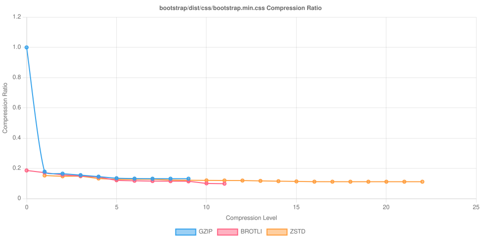

| Algorithm | Level | Time (ms) | Size (bytes) | Compression Ratio | Samples | Median CI (ms) | Precision met |
| --- | ---: | ---: | ---: | ---: | ---: | --- | --- |
| gzip | 0 | 0.119 | 232,164 | 1.0002 | 9 | 0.116–0.128 | no |
| gzip | 1 | 0.923 | 41,452 | 0.1786 | 9 | 0.913–0.949 | yes |
| gzip | 2 | 0.987 | 38,418 | 0.1655 | 9 | 0.983–0.994 | yes |
| gzip | 3 | 1.152 | 36,152 | 0.1558 | 9 | 1.142–1.162 | yes |
| gzip | 4 | 1.384 | 33,830 | 0.1457 | 9 | 1.374–1.772 | no |
| gzip | 5 | 1.788 | 31,408 | 0.1353 | 9 | 1.770–1.818 | yes |
| gzip | 6 | 2.496 | 30,823 | 0.1328 | 9 | 2.487–2.506 | yes |
| gzip | 7 | 3.091 | 30,680 | 0.1322 | 9 | 3.078–3.114 | yes |
| gzip | 8 | 4.218 | 30,670 | 0.1321 | 9 | 4.205–4.262 | yes |
| gzip | 9 | 4.240 | 30,669 | 0.1321 | 9 | 4.235–4.308 | yes |
| brotli | 0 | 0.265 | 43,268 | 0.1864 | 9 | 0.243–0.326 | no |
| brotli | 1 | 0.469 | 39,941 | 0.1721 | 9 | 0.453–0.515 | no |
| brotli | 2 | 0.944 | 36,514 | 0.1573 | 9 | 0.935–0.955 | yes |
| brotli | 3 | 1.122 | 34,781 | 0.1498 | 9 | 1.113–1.152 | yes |
| brotli | 4 | 1.629 | 33,048 | 0.1424 | 9 | 1.620–1.659 | yes |
| brotli | 5 | 2.399 | 28,253 | 0.1217 | 9 | 2.358–2.503 | yes |
| brotli | 6 | 2.802 | 27,431 | 0.1182 | 9 | 2.779–2.970 | no |
| brotli | 7 | 3.072 | 26,971 | 0.1162 | 9 | 3.031–3.147 | yes |
| brotli | 8 | 3.494 | 26,813 | 0.1155 | 9 | 3.459–3.543 | yes |
| brotli | 9 | 4.178 | 26,569 | 0.1145 | 9 | 4.110–4.281 | yes |
| brotli | 10 | 81.920 | 23,482 | 0.1012 | 9 | 80.113–82.051 | yes |
| brotli | 11 | 236.511 | 22,970 | 0.0990 | 9 | 236.350–237.076 | yes |
| zstd | 1 | 0.328 | 35,549 | 0.1532 | 9 | 0.294–0.375 | no |
| zstd | 2 | 0.380 | 34,301 | 0.1478 | 9 | 0.354–0.434 | no |
| zstd | 3 | 0.386 | 34,393 | 0.1482 | 9 | 0.379–0.424 | no |
| zstd | 4 | 1.133 | 30,973 | 0.1334 | 9 | 1.127–1.145 | yes |
| zstd | 5 | 1.321 | 29,744 | 0.1281 | 9 | 1.310–1.338 | yes |
| zstd | 6 | 1.517 | 29,727 | 0.1281 | 9 | 1.506–1.528 | yes |
| zstd | 7 | 1.679 | 29,710 | 0.1280 | 9 | 1.668–1.699 | yes |
| zstd | 8 | 2.072 | 28,645 | 0.1234 | 9 | 2.070–2.078 | yes |
| zstd | 9 | 2.538 | 28,235 | 0.1216 | 9 | 2.526–2.559 | yes |
| zstd | 10 | 3.046 | 28,044 | 0.1208 | 9 | 3.034–3.070 | yes |
| zstd | 11 | 6.428 | 27,895 | 0.1202 | 9 | 6.422–6.597 | yes |
| zstd | 12 | 7.947 | 27,805 | 0.1198 | 9 | 7.919–8.051 | yes |
| zstd | 13 | 14.892 | 27,283 | 0.1175 | 9 | 14.765–15.352 | yes |
| zstd | 14 | 18.703 | 26,828 | 0.1156 | 9 | 18.363–27.968 | no |
| zstd | 15 | 23.628 | 26,465 | 0.1140 | 9 | 23.227–23.745 | yes |
| zstd | 16 | 39.646 | 26,071 | 0.1123 | 9 | 39.571–39.779 | yes |
| zstd | 17 | 43.693 | 26,041 | 0.1122 | 9 | 43.283–44.224 | yes |
| zstd | 18 | 61.110 | 26,008 | 0.1120 | 9 | 60.560–61.615 | yes |
| zstd | 19 | 66.799 | 26,015 | 0.1121 | 9 | 66.175–67.071 | yes |
| zstd | 20 | 69.173 | 26,014 | 0.1121 | 9 | 68.410–69.260 | yes |
| zstd | 21 | 69.104 | 26,014 | 0.1121 | 9 | 68.616–69.765 | yes |
| zstd | 22 | 69.341 | 26,014 | 0.1121 | 9 | 68.303–70.017 | yes |

<h2 id="world-countries-dist-countries-unescaped-json">world-countries/dist/countries-unescaped.json</h2>

- Original size: 615,946 bytes
- Chart: 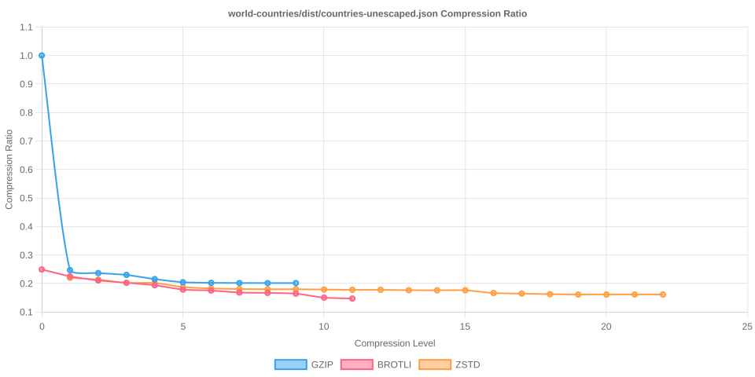

| Algorithm | Level | Time (ms) | Size (bytes) | Compression Ratio | Samples | Median CI (ms) | Precision met |
| --- | ---: | ---: | ---: | ---: | ---: | --- | --- |
| gzip | 0 | 0.290 | 616,054 | 1.0002 | 9 | 0.285–0.299 | yes |
| gzip | 1 | 3.288 | 152,340 | 0.2473 | 9 | 3.272–4.484 | no |
| gzip | 2 | 3.463 | 145,913 | 0.2369 | 9 | 3.449–3.472 | yes |
| gzip | 3 | 4.158 | 141,899 | 0.2304 | 9 | 4.138–4.199 | yes |
| gzip | 4 | 4.754 | 132,790 | 0.2156 | 9 | 4.735–4.792 | yes |
| gzip | 5 | 6.292 | 125,989 | 0.2045 | 9 | 6.272–6.354 | yes |
| gzip | 6 | 8.117 | 124,806 | 0.2026 | 9 | 8.101–8.274 | yes |
| gzip | 7 | 11.107 | 124,380 | 0.2019 | 9 | 11.079–11.121 | yes |
| gzip | 8 | 17.722 | 124,262 | 0.2017 | 9 | 17.707–17.746 | yes |
| gzip | 9 | 17.292 | 124,261 | 0.2017 | 9 | 17.255–17.321 | yes |
| brotli | 0 | 1.236 | 153,668 | 0.2495 | 9 | 1.221–1.254 | yes |
| brotli | 1 | 1.682 | 138,763 | 0.2253 | 9 | 1.671–1.702 | yes |
| brotli | 2 | 3.157 | 129,972 | 0.2110 | 9 | 3.120–3.583 | no |
| brotli | 3 | 3.727 | 124,918 | 0.2028 | 9 | 3.710–3.895 | yes |
| brotli | 4 | 5.048 | 119,620 | 0.1942 | 9 | 5.024–5.106 | yes |
| brotli | 5 | 8.075 | 110,145 | 0.1788 | 9 | 7.991–8.216 | yes |
| brotli | 6 | 9.450 | 108,159 | 0.1756 | 9 | 9.260–9.641 | yes |
| brotli | 7 | 11.675 | 103,756 | 0.1684 | 9 | 11.589–12.182 | yes |
| brotli | 8 | 14.943 | 102,997 | 0.1672 | 9 | 14.557–16.386 | no |
| brotli | 9 | 18.616 | 101,406 | 0.1646 | 9 | 18.052–18.722 | yes |
| brotli | 10 | 292.037 | 92,766 | 0.1506 | 9 | 287.424–297.646 | yes |
| brotli | 11 | 755.839 | 90,842 | 0.1475 | 9 | 754.505–759.986 | yes |
| zstd | 1 | 1.302 | 135,634 | 0.2202 | 9 | 1.291–1.341 | yes |
| zstd | 2 | 1.395 | 131,675 | 0.2138 | 9 | 1.389–1.421 | yes |
| zstd | 3 | 1.670 | 124,682 | 0.2024 | 9 | 1.667–1.686 | yes |
| zstd | 4 | 1.770 | 124,515 | 0.2022 | 9 | 1.754–1.812 | yes |
| zstd | 5 | 3.733 | 115,616 | 0.1877 | 9 | 3.693–3.777 | yes |
| zstd | 6 | 4.917 | 112,622 | 0.1828 | 9 | 4.890–4.971 | yes |
| zstd | 7 | 5.583 | 111,386 | 0.1808 | 9 | 5.552–5.750 | yes |
| zstd | 8 | 7.227 | 110,885 | 0.1800 | 9 | 7.122–7.559 | yes |
| zstd | 9 | 7.726 | 110,856 | 0.1800 | 9 | 7.550–7.966 | yes |
| zstd | 10 | 9.361 | 110,262 | 0.1790 | 9 | 9.257–9.578 | yes |
| zstd | 11 | 11.244 | 109,660 | 0.1780 | 9 | 10.880–11.554 | yes |
| zstd | 12 | 11.273 | 109,660 | 0.1780 | 9 | 11.105–11.755 | yes |
| zstd | 13 | 25.266 | 108,855 | 0.1767 | 9 | 24.701–26.721 | no |
| zstd | 14 | 30.849 | 108,631 | 0.1764 | 9 | 29.642–32.688 | no |
| zstd | 15 | 33.315 | 108,683 | 0.1764 | 9 | 30.562–33.674 | no |
| zstd | 16 | 69.076 | 102,692 | 0.1667 | 9 | 68.064–69.459 | yes |
| zstd | 17 | 70.111 | 101,496 | 0.1648 | 9 | 69.596–72.284 | yes |
| zstd | 18 | 108.362 | 100,215 | 0.1627 | 9 | 107.346–109.594 | yes |
| zstd | 19 | 137.953 | 99,575 | 0.1617 | 9 | 135.827–143.549 | yes |
| zstd | 20 | 139.474 | 99,575 | 0.1617 | 9 | 136.476–144.814 | yes |
| zstd | 21 | 138.976 | 99,575 | 0.1617 | 9 | 137.580–144.820 | yes |
| zstd | 22 | 140.264 | 99,575 | 0.1617 | 9 | 139.159–144.119 | yes |

<h2 id="sqlite-org-sqlite-wasm-dist-sqlite3-wasm">@sqlite.org/sqlite-wasm/dist/sqlite3.wasm</h2>

- Original size: 859,730 bytes
- Chart: 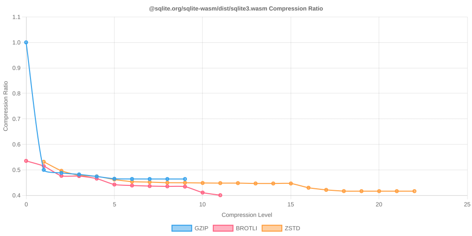

| Algorithm | Level | Time (ms) | Size (bytes) | Compression Ratio | Samples | Median CI (ms) | Precision met |
| --- | ---: | ---: | ---: | ---: | ---: | --- | --- |
| gzip | 0 | 0.424 | 859,878 | 1.0002 | 9 | 0.357–0.639 | no |
| gzip | 1 | 10.588 | 429,925 | 0.5001 | 9 | 10.558–10.649 | yes |
| gzip | 2 | 11.600 | 419,493 | 0.4879 | 9 | 11.511–12.039 | yes |
| gzip | 3 | 13.661 | 414,493 | 0.4821 | 9 | 13.657–13.673 | yes |
| gzip | 4 | 14.240 | 407,503 | 0.4740 | 9 | 14.202–14.270 | yes |
| gzip | 5 | 21.004 | 399,866 | 0.4651 | 9 | 20.990–21.039 | yes |
| gzip | 6 | 24.970 | 399,154 | 0.4643 | 9 | 24.925–25.088 | yes |
| gzip | 7 | 26.540 | 399,020 | 0.4641 | 9 | 26.487–26.755 | yes |
| gzip | 8 | 29.332 | 398,974 | 0.4641 | 9 | 29.127–29.434 | yes |
| gzip | 9 | 28.974 | 398,973 | 0.4641 | 9 | 28.928–29.026 | yes |
| brotli | 0 | 3.182 | 460,125 | 0.5352 | 9 | 3.168–3.223 | yes |
| brotli | 1 | 4.446 | 442,506 | 0.5147 | 9 | 4.379–4.492 | yes |
| brotli | 2 | 8.359 | 409,638 | 0.4765 | 9 | 8.321–8.372 | yes |
| brotli | 3 | 10.186 | 408,960 | 0.4757 | 9 | 10.174–10.194 | yes |
| brotli | 4 | 13.892 | 400,331 | 0.4656 | 9 | 13.849–14.019 | yes |
| brotli | 5 | 22.448 | 380,339 | 0.4424 | 9 | 22.320–22.593 | yes |
| brotli | 6 | 27.157 | 377,100 | 0.4386 | 9 | 26.623–28.172 | yes |
| brotli | 7 | 42.434 | 375,149 | 0.4364 | 9 | 41.594–43.103 | yes |
| brotli | 8 | 51.276 | 374,164 | 0.4352 | 9 | 50.912–54.556 | no |
| brotli | 9 | 63.451 | 373,347 | 0.4343 | 9 | 62.091–64.525 | yes |
| brotli | 10 | 794.660 | 353,246 | 0.4109 | 9 | 789.631–798.883 | yes |
| brotli | 11 | 1647.075 | 344,353 | 0.4005 | 9 | 1640.645–1663.003 | yes |
| zstd | 1 | 2.549 | 457,015 | 0.5316 | 9 | 2.509–2.593 | yes |
| zstd | 2 | 3.196 | 426,694 | 0.4963 | 9 | 3.178–3.312 | yes |
| zstd | 3 | 4.738 | 411,278 | 0.4784 | 9 | 4.454–4.792 | no |
| zstd | 4 | 5.494 | 408,051 | 0.4746 | 9 | 5.462–5.570 | yes |
| zstd | 5 | 8.475 | 397,246 | 0.4621 | 9 | 8.369–8.720 | yes |
| zstd | 6 | 11.596 | 390,015 | 0.4536 | 9 | 11.447–11.731 | yes |
| zstd | 7 | 12.830 | 388,562 | 0.4520 | 9 | 12.566–13.006 | yes |
| zstd | 8 | 15.277 | 386,566 | 0.4496 | 9 | 15.217–15.404 | yes |
| zstd | 9 | 15.342 | 386,404 | 0.4494 | 9 | 15.291–15.394 | yes |
| zstd | 10 | 17.590 | 385,609 | 0.4485 | 9 | 17.401–17.708 | yes |
| zstd | 11 | 20.896 | 385,152 | 0.4480 | 9 | 20.791–21.090 | yes |
| zstd | 12 | 22.202 | 385,152 | 0.4480 | 9 | 21.520–24.572 | no |
| zstd | 13 | 54.746 | 383,952 | 0.4466 | 9 | 51.624–56.522 | no |
| zstd | 14 | 59.013 | 383,886 | 0.4465 | 9 | 55.530–64.414 | no |
| zstd | 15 | 69.334 | 383,877 | 0.4465 | 9 | 67.255–76.967 | no |
| zstd | 16 | 116.229 | 369,550 | 0.4298 | 9 | 106.300–124.041 | no |
| zstd | 17 | 152.567 | 362,382 | 0.4215 | 9 | 134.933–169.197 | no |
| zstd | 18 | 194.531 | 358,220 | 0.4167 | 9 | 178.104–208.583 | no |
| zstd | 19 | 210.452 | 358,047 | 0.4165 | 9 | 209.886–217.058 | yes |
| zstd | 20 | 210.228 | 358,047 | 0.4165 | 9 | 205.860–217.877 | yes |
| zstd | 21 | 218.353 | 358,041 | 0.4165 | 9 | 205.552–227.808 | no |
| zstd | 22 | 214.232 | 358,041 | 0.4165 | 9 | 210.944–216.940 | yes |

<h2 id="tailwindcss-theme-css">tailwindcss/theme.css</h2>

- Original size: 19,586 bytes
- Chart: 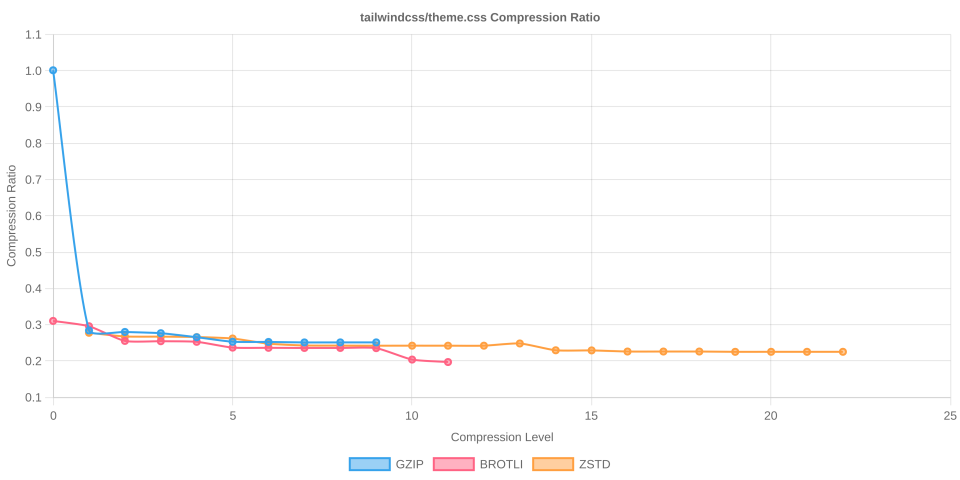

| Algorithm | Level | Time (ms) | Size (bytes) | Compression Ratio | Samples | Median CI (ms) | Precision met |
| --- | ---: | ---: | ---: | ---: | ---: | --- | --- |
| gzip | 0 | 0.015 | 19,609 | 1.0012 | 9 | 0.015–0.019 | no |
| gzip | 1 | 0.061 | 5,565 | 0.2841 | 9 | 0.058–0.105 | no |
| gzip | 2 | 0.080 | 5,486 | 0.2801 | 9 | 0.067–0.132 | no |
| gzip | 3 | 0.091 | 5,419 | 0.2767 | 9 | 0.083–0.140 | no |
| gzip | 4 | 0.110 | 5,202 | 0.2656 | 9 | 0.098–0.150 | no |
| gzip | 5 | 0.163 | 4,958 | 0.2531 | 9 | 0.139–0.231 | no |
| gzip | 6 | 0.305 | 4,947 | 0.2526 | 9 | 0.277–0.355 | no |
| gzip | 7 | 0.402 | 4,921 | 0.2513 | 9 | 0.395–0.434 | no |
| gzip | 8 | 0.535 | 4,923 | 0.2514 | 9 | 0.527–0.547 | yes |
| gzip | 9 | 0.538 | 4,923 | 0.2514 | 9 | 0.532–0.638 | no |
| brotli | 0 | 0.044 | 6,082 | 0.3105 | 9 | 0.043–0.066 | no |
| brotli | 1 | 0.061 | 5,794 | 0.2958 | 9 | 0.059–0.076 | no |
| brotli | 2 | 0.086 | 5,002 | 0.2554 | 9 | 0.080–0.110 | no |
| brotli | 3 | 0.121 | 4,986 | 0.2546 | 9 | 0.102–0.143 | no |
| brotli | 4 | 0.191 | 4,954 | 0.2529 | 9 | 0.159–0.236 | no |
| brotli | 5 | 0.318 | 4,641 | 0.2370 | 9 | 0.304–0.421 | no |
| brotli | 6 | 0.369 | 4,630 | 0.2364 | 9 | 0.341–0.390 | no |
| brotli | 7 | 0.446 | 4,622 | 0.2360 | 9 | 0.426–0.478 | no |
| brotli | 8 | 0.490 | 4,623 | 0.2360 | 9 | 0.470–0.573 | no |
| brotli | 9 | 0.603 | 4,612 | 0.2355 | 9 | 0.582–0.637 | no |
| brotli | 10 | 6.057 | 3,996 | 0.2040 | 9 | 6.021–6.197 | yes |
| brotli | 11 | 17.787 | 3,863 | 0.1972 | 9 | 17.659–17.819 | yes |
| zstd | 1 | 0.045 | 5,441 | 0.2778 | 9 | 0.041–0.054 | no |
| zstd | 2 | 0.045 | 5,242 | 0.2676 | 9 | 0.043–0.055 | no |
| zstd | 3 | 0.055 | 5,234 | 0.2672 | 9 | 0.053–0.078 | no |
| zstd | 4 | 0.057 | 5,212 | 0.2661 | 9 | 0.055–0.067 | no |
| zstd | 5 | 0.110 | 5,133 | 0.2621 | 9 | 0.108–0.124 | no |
| zstd | 6 | 0.146 | 4,853 | 0.2478 | 9 | 0.141–0.190 | no |
| zstd | 7 | 0.173 | 4,757 | 0.2429 | 9 | 0.165–0.207 | no |
| zstd | 8 | 0.198 | 4,750 | 0.2425 | 9 | 0.185–0.225 | no |
| zstd | 9 | 0.266 | 4,744 | 0.2422 | 9 | 0.250–0.293 | no |
| zstd | 10 | 0.331 | 4,746 | 0.2423 | 9 | 0.322–0.362 | no |
| zstd | 11 | 0.483 | 4,745 | 0.2423 | 9 | 0.460–0.498 | yes |
| zstd | 12 | 0.472 | 4,745 | 0.2423 | 9 | 0.464–0.478 | yes |
| zstd | 13 | 0.744 | 4,865 | 0.2484 | 9 | 0.736–0.752 | yes |
| zstd | 14 | 1.355 | 4,497 | 0.2296 | 9 | 1.348–1.364 | yes |
| zstd | 15 | 1.430 | 4,490 | 0.2292 | 9 | 1.422–1.446 | yes |
| zstd | 16 | 1.988 | 4,430 | 0.2262 | 9 | 1.980–2.017 | yes |
| zstd | 17 | 1.981 | 4,430 | 0.2262 | 9 | 1.973–1.994 | yes |
| zstd | 18 | 1.978 | 4,430 | 0.2262 | 9 | 1.973–1.989 | yes |
| zstd | 19 | 3.903 | 4,414 | 0.2254 | 9 | 3.889–3.913 | yes |
| zstd | 20 | 3.932 | 4,415 | 0.2254 | 9 | 3.915–3.935 | yes |
| zstd | 21 | 3.929 | 4,415 | 0.2254 | 9 | 3.920–3.931 | yes |
| zstd | 22 | 3.926 | 4,415 | 0.2254 | 9 | 3.916–3.938 | yes |
