# Node Compression Benchmark

Last updated: 2026-11-06T21:08:10.507Z

This benchmark measures compression time, output size, and compression ratios for several popular npm packages across all gzip, Brotli, and Zstandard compression levels.

## Table of Contents

- [jquery/dist/jquery.min.js](#jquery-dist-jquery-min-js)
- [@expo-google-fonts/m-plus-1p/400Regular/MPLUS1p_400Regular.ttf](#expo-google-fonts-m-plus-1p-400regular-mplus1p-400regular-ttf)
- [@openfonts/m-plus-1p_japanese/m-plus-1p-japanese-400.woff2](#openfonts-m-plus-1p-japanese-m-plus-1p-japanese-400-woff2)
- [@codemirror/view/dist/index.js](#codemirror-view-dist-index-js)
- [react/cjs/react.production.js](#react-cjs-react-production-js)
- [dayjs/dayjs.min.js](#dayjs-dayjs-min-js)
- [vue/dist/vue.global.prod.js](#vue-dist-vue-global-prod-js)
- [lodash/lodash.min.js](#lodash-lodash-min-js)
- [@fortawesome/fontawesome-free/css/all.min.css](#fortawesome-fontawesome-free-css-all-min-css)
- [bootstrap/dist/css/bootstrap.min.css](#bootstrap-dist-css-bootstrap-min-css)
- [world-countries/dist/countries-unescaped.json](#world-countries-dist-countries-unescaped-json)
- [@sqlite.org/sqlite-wasm/dist/sqlite3.wasm](#sqlite-org-sqlite-wasm-dist-sqlite3-wasm)
- [tailwindcss/theme.css](#tailwindcss-theme-css)

Benchmark settings:

- Warmup runs per level: 1
- Fixed samples per level: 9
- Target relative interval radius: 0.0500
- Elapsed benchmark time: 231.7 seconds
- [Raw observations and environment](results/latest.json) · [Measurement methodology](BENCHMARK.md)
- Intervals have at least 95% coverage for independent, identically distributed samples. Precision met means both bounds are within the target distance of the observed median; it is not an accuracy guarantee.

<h2 id="jquery-dist-jquery-min-js">jquery/dist/jquery.min.js</h2>

- Original size: 78,748 bytes
- Chart: 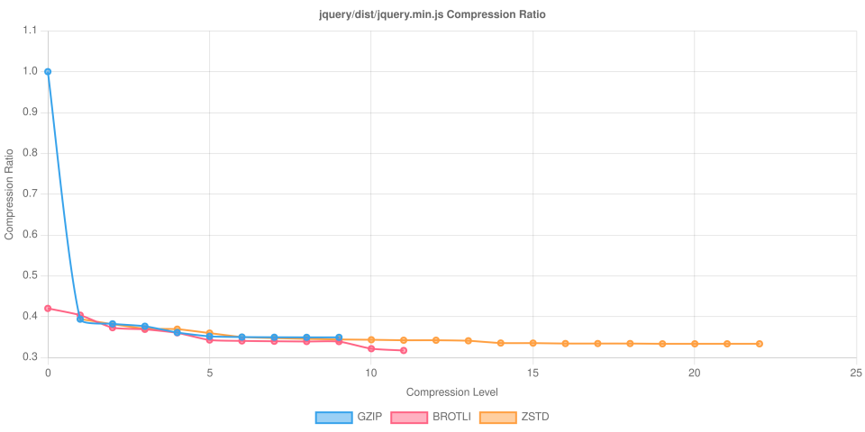

| Algorithm | Level | Time (ms) | Size (bytes) | Compression Ratio | Samples | Median CI (ms) | Precision met |
| --- | ---: | ---: | ---: | ---: | ---: | --- | --- |
| gzip | 0 | 0.150 | 78,776 | 1.0004 | 9 | 0.141–0.169 | no |
| gzip | 1 | 0.873 | 31,033 | 0.3941 | 9 | 0.859–0.881 | yes |
| gzip | 2 | 0.948 | 30,134 | 0.3827 | 9 | 0.937–0.970 | yes |
| gzip | 3 | 1.527 | 29,671 | 0.3768 | 9 | 1.260–1.571 | no |
| gzip | 4 | 1.262 | 28,457 | 0.3614 | 9 | 1.244–1.285 | yes |
| gzip | 5 | 1.602 | 27,721 | 0.3520 | 9 | 1.581–1.614 | yes |
| gzip | 6 | 1.880 | 27,584 | 0.3503 | 9 | 1.857–1.887 | yes |
| gzip | 7 | 2.041 | 27,547 | 0.3498 | 9 | 2.034–2.049 | yes |
| gzip | 8 | 2.378 | 27,530 | 0.3496 | 9 | 2.371–2.387 | yes |
| gzip | 9 | 2.408 | 27,530 | 0.3496 | 9 | 2.374–2.425 | yes |
| brotli | 0 | 0.376 | 33,111 | 0.4205 | 9 | 0.330–0.410 | no |
| brotli | 1 | 0.468 | 31,803 | 0.4039 | 9 | 0.442–0.535 | no |
| brotli | 2 | 0.943 | 29,394 | 0.3733 | 9 | 0.942–1.026 | no |
| brotli | 3 | 0.977 | 29,072 | 0.3692 | 9 | 0.962–1.034 | no |
| brotli | 4 | 1.469 | 28,392 | 0.3605 | 9 | 1.453–1.491 | yes |
| brotli | 5 | 2.111 | 27,013 | 0.3430 | 9 | 2.100–2.139 | yes |
| brotli | 6 | 2.267 | 26,844 | 0.3409 | 9 | 2.256–2.287 | yes |
| brotli | 7 | 6.257 | 26,773 | 0.3400 | 9 | 6.212–6.555 | yes |
| brotli | 8 | 2.732 | 26,725 | 0.3394 | 9 | 2.700–2.856 | yes |
| brotli | 9 | 17.929 | 26,711 | 0.3392 | 9 | 17.609–18.349 | yes |
| brotli | 10 | 33.891 | 25,340 | 0.3218 | 9 | 33.736–34.219 | yes |
| brotli | 11 | 97.899 | 24,992 | 0.3174 | 9 | 97.826–98.175 | yes |
| zstd | 1 | 0.318 | 31,062 | 0.3944 | 9 | 0.298–0.380 | no |
| zstd | 2 | 0.336 | 30,069 | 0.3818 | 9 | 0.323–0.432 | no |
| zstd | 3 | 0.404 | 29,214 | 0.3710 | 9 | 0.403–0.418 | yes |
| zstd | 4 | 0.509 | 29,108 | 0.3696 | 9 | 0.496–0.546 | no |
| zstd | 5 | 0.862 | 28,349 | 0.3600 | 9 | 0.851–0.878 | yes |
| zstd | 6 | 1.193 | 27,592 | 0.3504 | 9 | 1.184–1.220 | yes |
| zstd | 7 | 1.432 | 27,383 | 0.3477 | 9 | 1.421–1.452 | yes |
| zstd | 8 | 1.570 | 27,237 | 0.3459 | 9 | 1.564–1.623 | yes |
| zstd | 9 | 1.786 | 27,118 | 0.3444 | 9 | 1.766–1.793 | yes |
| zstd | 10 | 2.030 | 27,062 | 0.3437 | 9 | 2.010–2.068 | yes |
| zstd | 11 | 3.725 | 26,969 | 0.3425 | 9 | 3.696–3.813 | yes |
| zstd | 12 | 3.833 | 26,970 | 0.3425 | 9 | 3.815–3.852 | yes |
| zstd | 13 | 5.823 | 26,867 | 0.3412 | 9 | 5.814–5.918 | yes |
| zstd | 14 | 8.202 | 26,432 | 0.3357 | 9 | 8.148–8.216 | yes |
| zstd | 15 | 8.369 | 26,420 | 0.3355 | 9 | 8.347–8.461 | yes |
| zstd | 16 | 10.741 | 26,336 | 0.3344 | 9 | 10.689–10.851 | yes |
| zstd | 17 | 10.717 | 26,336 | 0.3344 | 9 | 10.679–10.831 | yes |
| zstd | 18 | 10.672 | 26,336 | 0.3344 | 9 | 10.659–10.859 | yes |
| zstd | 19 | 21.029 | 26,282 | 0.3337 | 9 | 20.892–21.345 | yes |
| zstd | 20 | 21.128 | 26,282 | 0.3337 | 9 | 20.981–22.613 | no |
| zstd | 21 | 21.068 | 26,282 | 0.3337 | 9 | 20.998–21.172 | yes |
| zstd | 22 | 21.095 | 26,282 | 0.3337 | 9 | 20.998–21.234 | yes |

<h2 id="expo-google-fonts-m-plus-1p-400regular-mplus1p-400regular-ttf">@expo-google-fonts/m-plus-1p/400Regular/MPLUS1p_400Regular.ttf</h2>

- Original size: 1,714,248 bytes
- Chart: 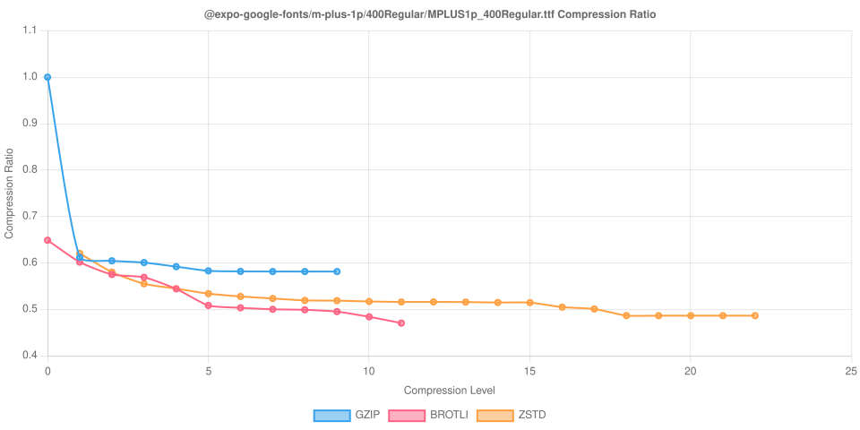

| Algorithm | Level | Time (ms) | Size (bytes) | Compression Ratio | Samples | Median CI (ms) | Precision met |
| --- | ---: | ---: | ---: | ---: | ---: | --- | --- |
| gzip | 0 | 1.204 | 1,714,526 | 1.0002 | 9 | 0.939–1.668 | no |
| gzip | 1 | 27.611 | 1,049,634 | 0.6123 | 9 | 26.888–27.887 | yes |
| gzip | 2 | 28.030 | 1,036,805 | 0.6048 | 9 | 27.919–29.543 | no |
| gzip | 3 | 29.672 | 1,030,268 | 0.6010 | 9 | 29.609–30.077 | yes |
| gzip | 4 | 33.758 | 1,015,229 | 0.5922 | 9 | 33.708–33.868 | yes |
| gzip | 5 | 39.786 | 999,772 | 0.5832 | 9 | 39.570–40.650 | yes |
| gzip | 6 | 46.838 | 997,720 | 0.5820 | 9 | 46.610–47.027 | yes |
| gzip | 7 | 50.685 | 997,295 | 0.5818 | 9 | 50.168–50.819 | yes |
| gzip | 8 | 54.454 | 997,191 | 0.5817 | 9 | 54.319–54.705 | yes |
| gzip | 9 | 60.746 | 997,191 | 0.5817 | 9 | 60.469–61.235 | yes |
| brotli | 0 | 6.624 | 1,112,634 | 0.6491 | 9 | 6.599–6.707 | yes |
| brotli | 1 | 9.246 | 1,031,943 | 0.6020 | 9 | 9.238–9.480 | yes |
| brotli | 2 | 18.574 | 986,211 | 0.5753 | 9 | 18.454–18.762 | yes |
| brotli | 3 | 21.540 | 976,041 | 0.5694 | 9 | 21.430–21.668 | yes |
| brotli | 4 | 27.285 | 933,224 | 0.5444 | 9 | 27.087–27.863 | yes |
| brotli | 5 | 40.496 | 872,005 | 0.5087 | 9 | 39.891–40.664 | yes |
| brotli | 6 | 44.198 | 863,383 | 0.5037 | 9 | 43.771–45.511 | yes |
| brotli | 7 | 95.519 | 857,835 | 0.5004 | 9 | 95.349–96.480 | yes |
| brotli | 8 | 106.749 | 855,950 | 0.4993 | 9 | 105.954–136.550 | no |
| brotli | 9 | 155.644 | 849,266 | 0.4954 | 9 | 149.704–178.414 | no |
| brotli | 10 | 2156.897 | 830,083 | 0.4842 | 9 | 2149.273–2184.988 | yes |
| brotli | 11 | 3746.564 | 806,920 | 0.4707 | 9 | 3738.944–3754.600 | yes |
| zstd | 1 | 6.326 | 1,063,995 | 0.6207 | 9 | 6.313–6.349 | yes |
| zstd | 2 | 8.061 | 995,049 | 0.5805 | 9 | 8.037–8.257 | yes |
| zstd | 3 | 12.098 | 951,924 | 0.5553 | 9 | 12.075–12.345 | yes |
| zstd | 4 | 12.877 | 934,018 | 0.5449 | 9 | 12.840–12.954 | yes |
| zstd | 5 | 18.749 | 915,542 | 0.5341 | 9 | 18.675–19.113 | yes |
| zstd | 6 | 22.938 | 905,207 | 0.5280 | 9 | 22.798–23.095 | yes |
| zstd | 7 | 23.913 | 897,707 | 0.5237 | 9 | 23.824–24.174 | yes |
| zstd | 8 | 28.479 | 890,668 | 0.5196 | 9 | 28.329–28.990 | yes |
| zstd | 9 | 29.673 | 889,701 | 0.5190 | 9 | 29.429–29.854 | yes |
| zstd | 10 | 36.166 | 886,752 | 0.5173 | 9 | 35.997–36.359 | yes |
| zstd | 11 | 44.343 | 884,967 | 0.5162 | 9 | 43.707–46.226 | yes |
| zstd | 12 | 43.725 | 884,967 | 0.5162 | 9 | 43.549–44.094 | yes |
| zstd | 13 | 92.868 | 884,574 | 0.5160 | 9 | 90.904–98.554 | no |
| zstd | 14 | 103.654 | 882,969 | 0.5151 | 9 | 99.427–106.386 | yes |
| zstd | 15 | 103.986 | 882,565 | 0.5148 | 9 | 103.262–109.673 | no |
| zstd | 16 | 162.288 | 865,802 | 0.5051 | 9 | 160.544–167.964 | yes |
| zstd | 17 | 183.729 | 858,980 | 0.5011 | 9 | 180.485–186.544 | yes |
| zstd | 18 | 266.651 | 834,631 | 0.4869 | 9 | 261.950–278.563 | yes |
| zstd | 19 | 281.232 | 834,350 | 0.4867 | 9 | 278.291–285.051 | yes |
| zstd | 20 | 280.679 | 834,350 | 0.4867 | 9 | 277.480–285.459 | yes |
| zstd | 21 | 285.454 | 834,350 | 0.4867 | 9 | 283.676–289.762 | yes |
| zstd | 22 | 282.364 | 834,350 | 0.4867 | 9 | 280.324–295.705 | yes |

<h2 id="openfonts-m-plus-1p-japanese-m-plus-1p-japanese-400-woff2">@openfonts/m-plus-1p_japanese/m-plus-1p-japanese-400.woff2</h2>

- Original size: 598,576 bytes
- Chart: 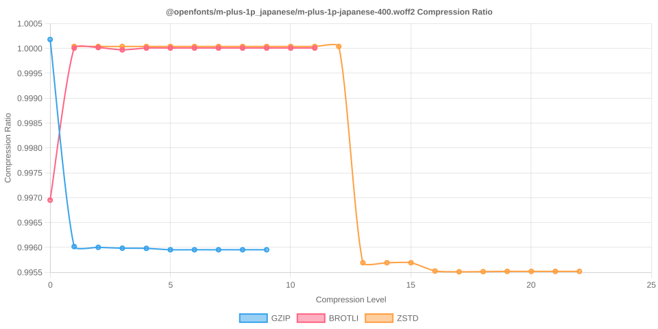

| Algorithm | Level | Time (ms) | Size (bytes) | Compression Ratio | Samples | Median CI (ms) | Precision met |
| --- | ---: | ---: | ---: | ---: | ---: | --- | --- |
| gzip | 0 | 0.315 | 598,684 | 1.0002 | 9 | 0.302–0.355 | no |
| gzip | 1 | 11.772 | 596,192 | 0.9960 | 9 | 11.720–11.828 | yes |
| gzip | 2 | 11.793 | 596,183 | 0.9960 | 9 | 11.743–11.830 | yes |
| gzip | 3 | 11.777 | 596,173 | 0.9960 | 9 | 11.760–11.947 | yes |
| gzip | 4 | 12.498 | 596,171 | 0.9960 | 9 | 12.477–12.547 | yes |
| gzip | 5 | 12.543 | 596,154 | 0.9960 | 9 | 12.486–12.631 | yes |
| gzip | 6 | 12.528 | 596,154 | 0.9960 | 9 | 12.507–12.556 | yes |
| gzip | 7 | 12.548 | 596,154 | 0.9960 | 9 | 12.520–12.665 | yes |
| gzip | 8 | 12.521 | 596,154 | 0.9960 | 9 | 12.495–12.551 | yes |
| gzip | 9 | 12.467 | 596,154 | 0.9960 | 9 | 12.447–12.493 | yes |
| brotli | 0 | 0.240 | 596,751 | 0.9970 | 9 | 0.236–0.253 | no |
| brotli | 1 | 0.301 | 598,581 | 1.0000 | 9 | 0.270–0.309 | no |
| brotli | 2 | 0.985 | 598,587 | 1.0000 | 9 | 0.614–1.025 | no |
| brotli | 3 | 0.744 | 598,559 | 1.0000 | 9 | 0.727–1.494 | no |
| brotli | 4 | 0.965 | 598,581 | 1.0000 | 9 | 0.960–0.984 | yes |
| brotli | 5 | 1.577 | 598,581 | 1.0000 | 9 | 1.436–1.652 | no |
| brotli | 6 | 1.524 | 598,581 | 1.0000 | 9 | 1.497–1.890 | no |
| brotli | 7 | 1.898 | 598,581 | 1.0000 | 9 | 1.881–2.695 | no |
| brotli | 8 | 2.174 | 598,581 | 1.0000 | 9 | 2.155–2.206 | yes |
| brotli | 9 | 3.199 | 598,581 | 1.0000 | 9 | 3.172–3.693 | no |
| brotli | 10 | 107.431 | 598,581 | 1.0000 | 9 | 106.921–108.126 | yes |
| brotli | 11 | 286.544 | 598,581 | 1.0000 | 9 | 285.635–287.823 | yes |
| zstd | 1 | 0.269 | 598,601 | 1.0000 | 9 | 0.264–0.289 | no |
| zstd | 2 | 0.274 | 598,600 | 1.0000 | 9 | 0.266–0.300 | no |
| zstd | 3 | 0.339 | 598,600 | 1.0000 | 9 | 0.315–0.360 | no |
| zstd | 4 | 0.449 | 598,600 | 1.0000 | 9 | 0.314–0.993 | no |
| zstd | 5 | 0.447 | 598,600 | 1.0000 | 9 | 0.438–0.477 | no |
| zstd | 6 | 0.460 | 598,600 | 1.0000 | 9 | 0.451–0.473 | yes |
| zstd | 7 | 0.511 | 598,600 | 1.0000 | 9 | 0.483–0.540 | no |
| zstd | 8 | 0.495 | 598,600 | 1.0000 | 9 | 0.463–0.546 | no |
| zstd | 9 | 0.816 | 598,600 | 1.0000 | 9 | 0.659–1.542 | no |
| zstd | 10 | 0.671 | 598,600 | 1.0000 | 9 | 0.670–0.696 | yes |
| zstd | 11 | 0.681 | 598,600 | 1.0000 | 9 | 0.674–0.688 | yes |
| zstd | 12 | 0.674 | 598,600 | 1.0000 | 9 | 0.663–0.690 | yes |
| zstd | 13 | 2.098 | 595,998 | 0.9957 | 9 | 2.063–2.252 | no |
| zstd | 14 | 2.062 | 595,998 | 0.9957 | 9 | 2.036–2.106 | yes |
| zstd | 15 | 2.091 | 595,998 | 0.9957 | 9 | 2.042–2.118 | yes |
| zstd | 16 | 14.996 | 595,898 | 0.9955 | 9 | 14.945–15.647 | yes |
| zstd | 17 | 15.033 | 595,889 | 0.9955 | 9 | 14.941–15.062 | yes |
| zstd | 18 | 22.942 | 595,891 | 0.9955 | 9 | 22.781–23.022 | yes |
| zstd | 19 | 27.782 | 595,894 | 0.9955 | 9 | 27.597–27.951 | yes |
| zstd | 20 | 27.839 | 595,894 | 0.9955 | 9 | 27.706–28.393 | yes |
| zstd | 21 | 28.846 | 595,894 | 0.9955 | 9 | 27.639–30.123 | yes |
| zstd | 22 | 29.801 | 595,894 | 0.9955 | 9 | 28.846–37.161 | no |

<h2 id="codemirror-view-dist-index-js">@codemirror/view/dist/index.js</h2>

- Original size: 495,588 bytes
- Chart: 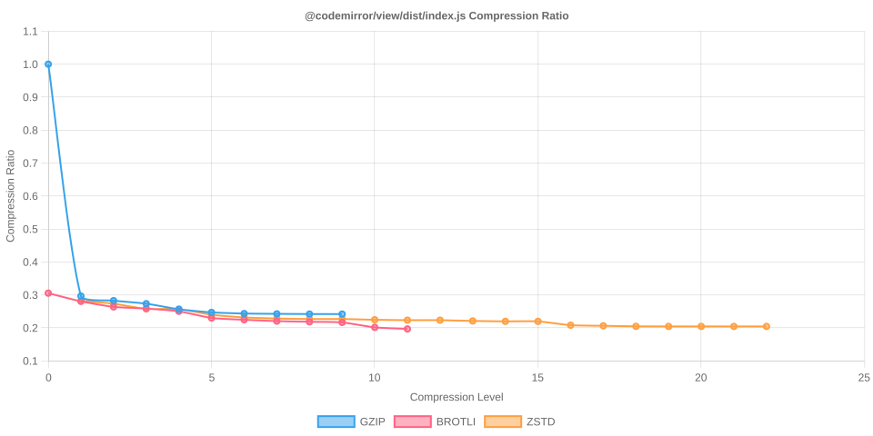

| Algorithm | Level | Time (ms) | Size (bytes) | Compression Ratio | Samples | Median CI (ms) | Precision met |
| --- | ---: | ---: | ---: | ---: | ---: | --- | --- |
| gzip | 0 | 0.254 | 495,681 | 1.0002 | 9 | 0.252–0.281 | no |
| gzip | 1 | 3.796 | 147,019 | 0.2967 | 9 | 3.782–3.811 | yes |
| gzip | 2 | 4.191 | 140,161 | 0.2828 | 9 | 4.178–4.209 | yes |
| gzip | 3 | 5.529 | 135,613 | 0.2736 | 9 | 5.497–5.590 | yes |
| gzip | 4 | 6.023 | 127,170 | 0.2566 | 9 | 5.983–6.060 | yes |
| gzip | 5 | 8.345 | 122,480 | 0.2471 | 9 | 8.314–8.499 | yes |
| gzip | 6 | 11.988 | 120,752 | 0.2437 | 9 | 11.957–12.018 | yes |
| gzip | 7 | 15.170 | 120,280 | 0.2427 | 9 | 15.145–15.206 | yes |
| gzip | 8 | 28.405 | 120,006 | 0.2421 | 9 | 28.384–28.443 | yes |
| gzip | 9 | 44.304 | 119,944 | 0.2420 | 9 | 44.241–44.426 | yes |
| brotli | 0 | 1.468 | 151,389 | 0.3055 | 9 | 1.463–1.500 | yes |
| brotli | 1 | 2.134 | 139,012 | 0.2805 | 9 | 2.110–2.165 | yes |
| brotli | 2 | 4.736 | 130,704 | 0.2637 | 9 | 4.709–4.782 | yes |
| brotli | 3 | 5.107 | 128,093 | 0.2585 | 9 | 5.087–5.142 | yes |
| brotli | 4 | 6.819 | 124,144 | 0.2505 | 9 | 6.785–6.840 | yes |
| brotli | 5 | 10.355 | 114,090 | 0.2302 | 9 | 10.316–10.529 | yes |
| brotli | 6 | 11.791 | 111,384 | 0.2248 | 9 | 11.589–11.866 | yes |
| brotli | 7 | 14.489 | 109,376 | 0.2207 | 9 | 14.413–14.973 | yes |
| brotli | 8 | 17.726 | 108,340 | 0.2186 | 9 | 17.618–17.865 | yes |
| brotli | 9 | 38.448 | 107,449 | 0.2168 | 9 | 38.323–38.487 | yes |
| brotli | 10 | 276.924 | 99,878 | 0.2015 | 9 | 276.237–279.533 | yes |
| brotli | 11 | 720.969 | 97,648 | 0.1970 | 9 | 719.740–721.742 | yes |
| zstd | 1 | 1.852 | 139,921 | 0.2823 | 9 | 1.847–1.888 | yes |
| zstd | 2 | 2.022 | 135,629 | 0.2737 | 9 | 2.017–2.068 | yes |
| zstd | 3 | 2.290 | 127,698 | 0.2577 | 9 | 2.287–2.306 | yes |
| zstd | 4 | 2.400 | 127,469 | 0.2572 | 9 | 2.382–2.431 | yes |
| zstd | 5 | 4.478 | 118,828 | 0.2398 | 9 | 4.401–4.576 | yes |
| zstd | 6 | 6.283 | 114,849 | 0.2317 | 9 | 6.053–6.444 | yes |
| zstd | 7 | 7.040 | 113,233 | 0.2285 | 9 | 6.918–7.162 | yes |
| zstd | 8 | 8.822 | 112,404 | 0.2268 | 9 | 8.670–9.040 | yes |
| zstd | 9 | 8.915 | 112,404 | 0.2268 | 9 | 8.660–9.039 | yes |
| zstd | 10 | 10.347 | 111,395 | 0.2248 | 9 | 10.269–10.518 | yes |
| zstd | 11 | 13.207 | 110,772 | 0.2235 | 9 | 13.135–13.447 | yes |
| zstd | 12 | 13.396 | 110,772 | 0.2235 | 9 | 13.207–13.545 | yes |
| zstd | 13 | 27.291 | 109,611 | 0.2212 | 9 | 27.197–27.443 | yes |
| zstd | 14 | 32.789 | 108,976 | 0.2199 | 9 | 32.711–32.867 | yes |
| zstd | 15 | 36.536 | 108,836 | 0.2196 | 9 | 36.406–36.596 | yes |
| zstd | 16 | 66.244 | 103,236 | 0.2083 | 9 | 66.130–66.362 | yes |
| zstd | 17 | 74.315 | 102,296 | 0.2064 | 9 | 74.057–74.460 | yes |
| zstd | 18 | 105.866 | 101,518 | 0.2048 | 9 | 105.825–106.395 | yes |
| zstd | 19 | 136.962 | 101,389 | 0.2046 | 9 | 136.571–137.338 | yes |
| zstd | 20 | 136.769 | 101,389 | 0.2046 | 9 | 136.491–137.020 | yes |
| zstd | 21 | 137.373 | 101,411 | 0.2046 | 9 | 136.865–139.560 | yes |
| zstd | 22 | 137.383 | 101,411 | 0.2046 | 9 | 137.077–137.999 | yes |

<h2 id="react-cjs-react-production-js">react/cjs/react.production.js</h2>

- Original size: 18,040 bytes
- Chart: 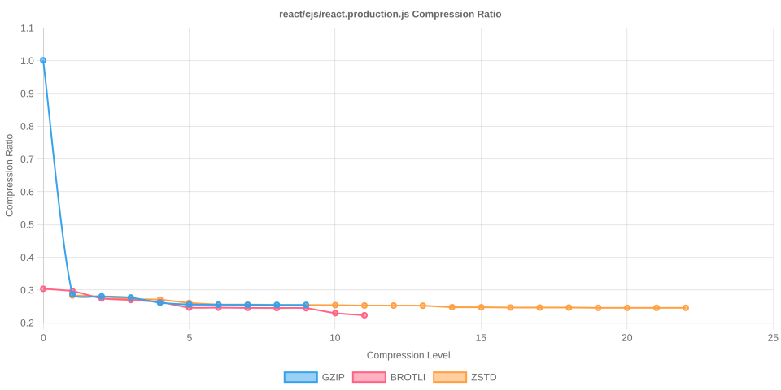

| Algorithm | Level | Time (ms) | Size (bytes) | Compression Ratio | Samples | Median CI (ms) | Precision met |
| --- | ---: | ---: | ---: | ---: | ---: | --- | --- |
| gzip | 0 | 0.019 | 18,063 | 1.0013 | 9 | 0.018–0.024 | no |
| gzip | 1 | 0.111 | 5,189 | 0.2876 | 9 | 0.096–0.159 | no |
| gzip | 2 | 0.132 | 5,069 | 0.2810 | 9 | 0.118–0.153 | no |
| gzip | 3 | 0.142 | 5,003 | 0.2773 | 9 | 0.131–0.175 | no |
| gzip | 4 | 0.185 | 4,715 | 0.2614 | 9 | 0.176–0.220 | no |
| gzip | 5 | 0.239 | 4,618 | 0.2560 | 9 | 0.227–0.267 | no |
| gzip | 6 | 0.290 | 4,607 | 0.2554 | 9 | 0.277–0.306 | no |
| gzip | 7 | 0.324 | 4,600 | 0.2550 | 9 | 0.316–0.342 | no |
| gzip | 8 | 0.465 | 4,597 | 0.2548 | 9 | 0.455–0.474 | yes |
| gzip | 9 | 0.465 | 4,597 | 0.2548 | 9 | 0.458–0.480 | yes |
| brotli | 0 | 0.057 | 5,483 | 0.3039 | 9 | 0.054–0.071 | no |
| brotli | 1 | 0.065 | 5,356 | 0.2969 | 9 | 0.063–0.091 | no |
| brotli | 2 | 0.154 | 4,956 | 0.2747 | 9 | 0.145–0.190 | no |
| brotli | 3 | 0.183 | 4,866 | 0.2697 | 9 | 0.158–0.221 | no |
| brotli | 4 | 0.280 | 4,752 | 0.2634 | 9 | 0.267–0.304 | no |
| brotli | 5 | 0.389 | 4,451 | 0.2467 | 9 | 0.380–0.423 | no |
| brotli | 6 | 0.423 | 4,446 | 0.2465 | 9 | 0.405–0.428 | yes |
| brotli | 7 | 0.464 | 4,432 | 0.2457 | 9 | 0.447–0.490 | no |
| brotli | 8 | 0.479 | 4,424 | 0.2452 | 9 | 0.468–0.498 | yes |
| brotli | 9 | 0.565 | 4,416 | 0.2448 | 9 | 0.557–0.584 | yes |
| brotli | 10 | 7.832 | 4,142 | 0.2296 | 9 | 7.790–7.863 | yes |
| brotli | 11 | 20.079 | 4,027 | 0.2232 | 9 | 20.010–20.121 | yes |
| zstd | 1 | 0.073 | 5,114 | 0.2835 | 9 | 0.061–0.086 | no |
| zstd | 2 | 0.060 | 5,057 | 0.2803 | 9 | 0.058–0.083 | no |
| zstd | 3 | 0.089 | 4,922 | 0.2728 | 9 | 0.081–0.113 | no |
| zstd | 4 | 0.094 | 4,885 | 0.2708 | 9 | 0.081–0.104 | no |
| zstd | 5 | 0.177 | 4,708 | 0.2610 | 9 | 0.162–0.189 | no |
| zstd | 6 | 0.225 | 4,620 | 0.2561 | 9 | 0.213–0.253 | no |
| zstd | 7 | 0.269 | 4,618 | 0.2560 | 9 | 0.263–0.284 | no |
| zstd | 8 | 0.314 | 4,601 | 0.2550 | 9 | 0.298–0.338 | no |
| zstd | 9 | 0.342 | 4,592 | 0.2545 | 9 | 0.332–0.355 | yes |
| zstd | 10 | 0.384 | 4,584 | 0.2541 | 9 | 0.371–0.420 | no |
| zstd | 11 | 0.679 | 4,562 | 0.2529 | 9 | 0.659–0.702 | yes |
| zstd | 12 | 0.721 | 4,562 | 0.2529 | 9 | 0.697–0.730 | yes |
| zstd | 13 | 1.014 | 4,554 | 0.2524 | 9 | 1.011–1.027 | yes |
| zstd | 14 | 1.602 | 4,473 | 0.2479 | 9 | 1.586–1.621 | yes |
| zstd | 15 | 1.700 | 4,468 | 0.2477 | 9 | 1.691–1.707 | yes |
| zstd | 16 | 2.497 | 4,452 | 0.2468 | 9 | 2.490–2.506 | yes |
| zstd | 17 | 2.637 | 4,452 | 0.2468 | 9 | 2.624–2.641 | yes |
| zstd | 18 | 2.646 | 4,452 | 0.2468 | 9 | 2.627–2.717 | yes |
| zstd | 19 | 5.169 | 4,436 | 0.2459 | 9 | 5.159–5.253 | yes |
| zstd | 20 | 5.164 | 4,436 | 0.2459 | 9 | 5.153–5.187 | yes |
| zstd | 21 | 5.173 | 4,436 | 0.2459 | 9 | 5.160–5.229 | yes |
| zstd | 22 | 5.189 | 4,436 | 0.2459 | 9 | 5.169–5.226 | yes |

<h2 id="dayjs-dayjs-min-js">dayjs/dayjs.min.js</h2>

- Original size: 7,161 bytes
- Chart: 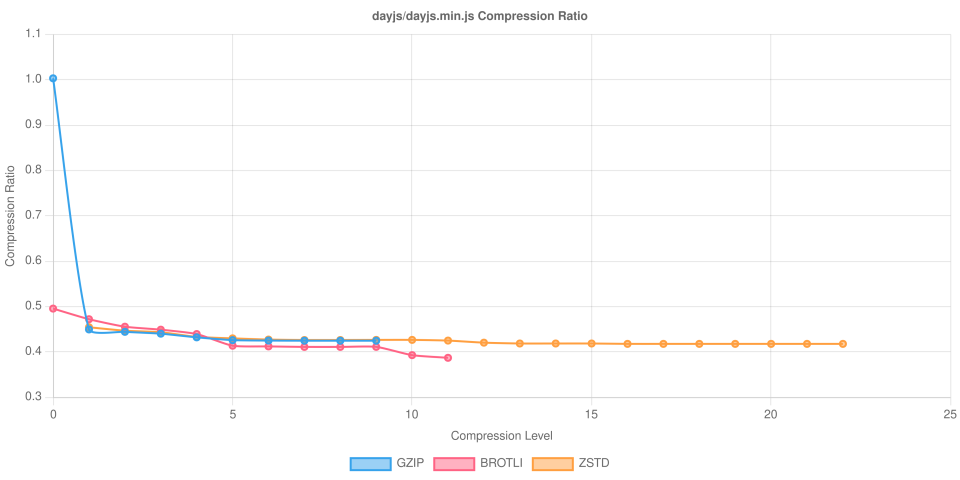

| Algorithm | Level | Time (ms) | Size (bytes) | Compression Ratio | Samples | Median CI (ms) | Precision met |
| --- | ---: | ---: | ---: | ---: | ---: | --- | --- |
| gzip | 0 | 0.014 | 7,184 | 1.0032 | 9 | 0.012–0.020 | no |
| gzip | 1 | 0.072 | 3,220 | 0.4497 | 9 | 0.059–0.082 | no |
| gzip | 2 | 0.071 | 3,182 | 0.4444 | 9 | 0.061–0.086 | no |
| gzip | 3 | 0.065 | 3,153 | 0.4403 | 9 | 0.058–0.095 | no |
| gzip | 4 | 0.091 | 3,095 | 0.4322 | 9 | 0.079–0.118 | no |
| gzip | 5 | 0.098 | 3,051 | 0.4261 | 9 | 0.084–0.137 | no |
| gzip | 6 | 0.100 | 3,044 | 0.4251 | 9 | 0.090–0.117 | no |
| gzip | 7 | 0.099 | 3,042 | 0.4248 | 9 | 0.096–0.123 | no |
| gzip | 8 | 0.093 | 3,042 | 0.4248 | 9 | 0.089–0.100 | no |
| gzip | 9 | 0.100 | 3,042 | 0.4248 | 9 | 0.095–0.123 | no |
| brotli | 0 | 0.030 | 3,549 | 0.4956 | 9 | 0.030–0.040 | no |
| brotli | 1 | 0.042 | 3,381 | 0.4721 | 9 | 0.039–0.058 | no |
| brotli | 2 | 0.068 | 3,263 | 0.4557 | 9 | 0.066–0.088 | no |
| brotli | 3 | 0.082 | 3,216 | 0.4491 | 9 | 0.077–0.099 | no |
| brotli | 4 | 0.156 | 3,147 | 0.4395 | 9 | 0.145–0.177 | no |
| brotli | 5 | 0.218 | 2,963 | 0.4138 | 9 | 0.207–0.256 | no |
| brotli | 6 | 0.234 | 2,952 | 0.4122 | 9 | 0.217–0.252 | no |
| brotli | 7 | 0.260 | 2,944 | 0.4111 | 9 | 0.250–0.293 | no |
| brotli | 8 | 0.265 | 2,944 | 0.4111 | 9 | 0.248–0.283 | no |
| brotli | 9 | 0.310 | 2,945 | 0.4113 | 9 | 0.298–0.332 | no |
| brotli | 10 | 3.159 | 2,814 | 0.3930 | 9 | 3.140–3.189 | yes |
| brotli | 11 | 7.895 | 2,772 | 0.3871 | 9 | 7.885–7.938 | yes |
| zstd | 1 | 0.034 | 3,254 | 0.4544 | 9 | 0.032–0.069 | no |
| zstd | 2 | 0.044 | 3,200 | 0.4469 | 9 | 0.040–0.069 | no |
| zstd | 3 | 0.057 | 3,176 | 0.4435 | 9 | 0.049–0.077 | no |
| zstd | 4 | 0.088 | 3,102 | 0.4332 | 9 | 0.071–0.126 | no |
| zstd | 5 | 0.096 | 3,079 | 0.4300 | 9 | 0.082–0.119 | no |
| zstd | 6 | 0.119 | 3,060 | 0.4273 | 9 | 0.107–0.146 | no |
| zstd | 7 | 0.137 | 3,053 | 0.4263 | 9 | 0.126–0.161 | no |
| zstd | 8 | 0.126 | 3,053 | 0.4263 | 9 | 0.114–0.155 | no |
| zstd | 9 | 0.201 | 3,055 | 0.4266 | 9 | 0.192–0.218 | no |
| zstd | 10 | 0.202 | 3,055 | 0.4266 | 9 | 0.196–0.215 | no |
| zstd | 11 | 0.351 | 3,044 | 0.4251 | 9 | 0.342–0.383 | no |
| zstd | 12 | 0.501 | 3,011 | 0.4205 | 9 | 0.490–0.514 | yes |
| zstd | 13 | 0.633 | 2,998 | 0.4187 | 9 | 0.627–0.658 | yes |
| zstd | 14 | 0.644 | 2,998 | 0.4187 | 9 | 0.635–0.667 | yes |
| zstd | 15 | 0.646 | 2,998 | 0.4187 | 9 | 0.638–0.679 | no |
| zstd | 16 | 1.237 | 2,992 | 0.4178 | 9 | 1.231–1.252 | yes |
| zstd | 17 | 1.233 | 2,992 | 0.4178 | 9 | 1.228–1.244 | yes |
| zstd | 18 | 1.236 | 2,992 | 0.4178 | 9 | 1.227–1.243 | yes |
| zstd | 19 | 1.243 | 2,992 | 0.4178 | 9 | 1.233–1.248 | yes |
| zstd | 20 | 1.221 | 2,992 | 0.4178 | 9 | 1.214–1.243 | yes |
| zstd | 21 | 1.221 | 2,992 | 0.4178 | 9 | 1.217–1.227 | yes |
| zstd | 22 | 1.220 | 2,992 | 0.4178 | 9 | 1.215–1.236 | yes |

<h2 id="vue-dist-vue-global-prod-js">vue/dist/vue.global.prod.js</h2>

- Original size: 170,605 bytes
- Chart: 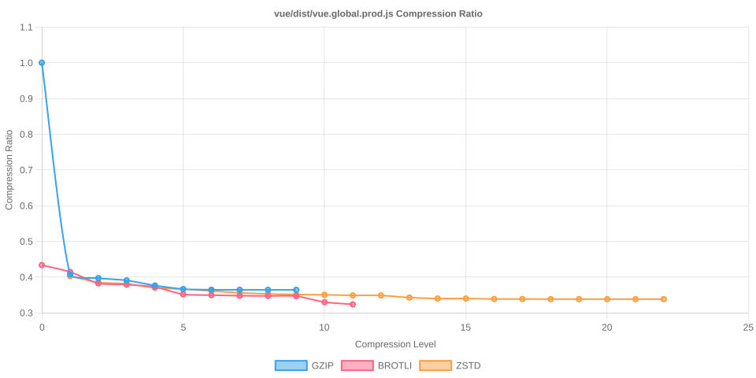

| Algorithm | Level | Time (ms) | Size (bytes) | Compression Ratio | Samples | Median CI (ms) | Precision met |
| --- | ---: | ---: | ---: | ---: | ---: | --- | --- |
| gzip | 0 | 0.101 | 170,648 | 1.0003 | 9 | 0.096–0.112 | no |
| gzip | 1 | 1.897 | 69,508 | 0.4074 | 9 | 1.893–1.916 | yes |
| gzip | 2 | 2.050 | 67,777 | 0.3973 | 9 | 2.046–2.063 | yes |
| gzip | 3 | 2.337 | 66,731 | 0.3911 | 9 | 2.327–2.347 | yes |
| gzip | 4 | 2.749 | 64,250 | 0.3766 | 9 | 2.745–2.788 | yes |
| gzip | 5 | 3.623 | 62,564 | 0.3667 | 9 | 3.616–3.634 | yes |
| gzip | 6 | 4.488 | 62,277 | 0.3650 | 9 | 4.471–4.525 | yes |
| gzip | 7 | 4.868 | 62,233 | 0.3648 | 9 | 4.860–4.876 | yes |
| gzip | 8 | 5.262 | 62,218 | 0.3647 | 9 | 5.256–5.266 | yes |
| gzip | 9 | 5.279 | 62,218 | 0.3647 | 9 | 5.262–5.287 | yes |
| brotli | 0 | 0.661 | 73,915 | 0.4333 | 9 | 0.660–0.689 | yes |
| brotli | 1 | 0.926 | 70,800 | 0.4150 | 9 | 0.907–0.948 | yes |
| brotli | 2 | 2.011 | 65,325 | 0.3829 | 9 | 2.005–2.025 | yes |
| brotli | 3 | 2.235 | 64,715 | 0.3793 | 9 | 2.187–2.270 | yes |
| brotli | 4 | 3.104 | 63,583 | 0.3727 | 9 | 3.084–3.160 | yes |
| brotli | 5 | 4.727 | 60,073 | 0.3521 | 9 | 4.677–4.773 | yes |
| brotli | 6 | 5.150 | 59,661 | 0.3497 | 9 | 5.032–5.170 | yes |
| brotli | 7 | 6.118 | 59,376 | 0.3480 | 9 | 6.069–6.291 | yes |
| brotli | 8 | 6.560 | 59,283 | 0.3475 | 9 | 6.542–6.594 | yes |
| brotli | 9 | 7.808 | 59,203 | 0.3470 | 9 | 7.775–7.839 | yes |
| brotli | 10 | 102.020 | 56,291 | 0.3299 | 9 | 101.764–102.247 | yes |
| brotli | 11 | 265.151 | 55,372 | 0.3246 | 9 | 264.069–269.083 | yes |
| zstd | 1 | 0.669 | 68,788 | 0.4032 | 9 | 0.661–0.686 | yes |
| zstd | 2 | 0.819 | 65,688 | 0.3850 | 9 | 0.812–0.846 | yes |
| zstd | 3 | 1.041 | 65,090 | 0.3815 | 9 | 1.033–1.050 | yes |
| zstd | 4 | 1.813 | 63,123 | 0.3700 | 9 | 1.782–1.847 | yes |
| zstd | 5 | 2.002 | 62,569 | 0.3667 | 9 | 1.989–2.059 | yes |
| zstd | 6 | 2.437 | 61,638 | 0.3613 | 9 | 2.418–2.460 | yes |
| zstd | 7 | 3.068 | 60,781 | 0.3563 | 9 | 2.921–3.119 | yes |
| zstd | 8 | 3.638 | 60,265 | 0.3532 | 9 | 3.629–3.664 | yes |
| zstd | 9 | 4.246 | 59,985 | 0.3516 | 9 | 4.232–4.267 | yes |
| zstd | 10 | 5.162 | 59,833 | 0.3507 | 9 | 5.118–5.256 | yes |
| zstd | 11 | 9.369 | 59,551 | 0.3491 | 9 | 9.303–9.435 | yes |
| zstd | 12 | 9.587 | 59,532 | 0.3489 | 9 | 9.545–9.617 | yes |
| zstd | 13 | 16.046 | 58,505 | 0.3429 | 9 | 16.012–16.243 | yes |
| zstd | 14 | 18.970 | 58,059 | 0.3403 | 9 | 18.912–18.976 | yes |
| zstd | 15 | 19.308 | 58,039 | 0.3402 | 9 | 19.270–19.457 | yes |
| zstd | 16 | 24.876 | 57,847 | 0.3391 | 9 | 24.806–25.569 | yes |
| zstd | 17 | 24.859 | 57,847 | 0.3391 | 9 | 24.823–25.027 | yes |
| zstd | 18 | 42.112 | 57,775 | 0.3386 | 9 | 41.999–42.315 | yes |
| zstd | 19 | 42.140 | 57,775 | 0.3386 | 9 | 42.061–42.325 | yes |
| zstd | 20 | 42.214 | 57,775 | 0.3386 | 9 | 42.063–42.290 | yes |
| zstd | 21 | 42.182 | 57,775 | 0.3386 | 9 | 42.069–42.312 | yes |
| zstd | 22 | 42.149 | 57,775 | 0.3386 | 9 | 42.044–42.319 | yes |

<h2 id="lodash-lodash-min-js">lodash/lodash.min.js</h2>

- Original size: 73,234 bytes
- Chart: 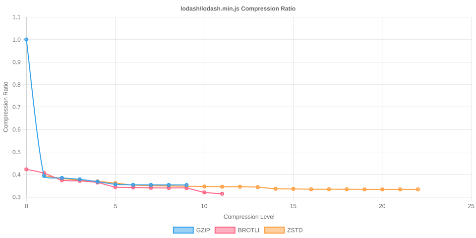

| Algorithm | Level | Time (ms) | Size (bytes) | Compression Ratio | Samples | Median CI (ms) | Precision met |
| --- | ---: | ---: | ---: | ---: | ---: | --- | --- |
| gzip | 0 | 0.048 | 73,262 | 1.0004 | 9 | 0.044–0.052 | no |
| gzip | 1 | 0.749 | 28,819 | 0.3935 | 9 | 0.741–0.793 | no |
| gzip | 2 | 0.829 | 28,191 | 0.3849 | 9 | 0.817–0.840 | yes |
| gzip | 3 | 0.944 | 27,724 | 0.3786 | 9 | 0.934–0.966 | yes |
| gzip | 4 | 1.105 | 26,950 | 0.3680 | 9 | 1.094–1.112 | yes |
| gzip | 5 | 1.419 | 26,101 | 0.3564 | 9 | 1.403–1.443 | yes |
| gzip | 6 | 1.800 | 25,938 | 0.3542 | 9 | 1.794–1.835 | yes |
| gzip | 7 | 2.132 | 25,913 | 0.3538 | 9 | 2.123–2.146 | yes |
| gzip | 8 | 2.879 | 25,894 | 0.3536 | 9 | 2.876–2.888 | yes |
| gzip | 9 | 2.876 | 25,894 | 0.3536 | 9 | 2.865–2.894 | yes |
| brotli | 0 | 0.255 | 30,978 | 0.4230 | 9 | 0.247–0.283 | no |
| brotli | 1 | 0.374 | 29,754 | 0.4063 | 9 | 0.358–0.389 | yes |
| brotli | 2 | 0.784 | 27,438 | 0.3747 | 9 | 0.771–0.804 | yes |
| brotli | 3 | 0.849 | 27,227 | 0.3718 | 9 | 0.846–0.858 | yes |
| brotli | 4 | 1.282 | 26,678 | 0.3643 | 9 | 1.263–1.301 | yes |
| brotli | 5 | 1.943 | 25,217 | 0.3443 | 9 | 1.905–1.973 | yes |
| brotli | 6 | 2.089 | 25,093 | 0.3426 | 9 | 2.059–2.169 | yes |
| brotli | 7 | 2.451 | 24,950 | 0.3407 | 9 | 2.426–2.478 | yes |
| brotli | 8 | 2.597 | 24,912 | 0.3402 | 9 | 2.591–2.619 | yes |
| brotli | 9 | 3.158 | 24,870 | 0.3396 | 9 | 3.105–3.196 | yes |
| brotli | 10 | 39.524 | 23,472 | 0.3205 | 9 | 39.388–39.612 | yes |
| brotli | 11 | 97.815 | 23,030 | 0.3145 | 9 | 97.725–97.995 | yes |
| zstd | 1 | 0.263 | 28,919 | 0.3949 | 9 | 0.251–0.279 | no |
| zstd | 2 | 0.286 | 28,008 | 0.3824 | 9 | 0.282–0.298 | yes |
| zstd | 3 | 0.357 | 27,463 | 0.3750 | 9 | 0.344–0.378 | no |
| zstd | 4 | 0.440 | 27,100 | 0.3700 | 9 | 0.432–0.448 | yes |
| zstd | 5 | 0.766 | 26,525 | 0.3622 | 9 | 0.760–0.778 | yes |
| zstd | 6 | 1.139 | 25,834 | 0.3528 | 9 | 1.036–1.158 | no |
| zstd | 7 | 1.276 | 25,663 | 0.3504 | 9 | 1.274–1.286 | yes |
| zstd | 8 | 1.389 | 25,557 | 0.3490 | 9 | 1.384–1.397 | yes |
| zstd | 9 | 1.605 | 25,466 | 0.3477 | 9 | 1.599–1.620 | yes |
| zstd | 10 | 1.884 | 25,397 | 0.3468 | 9 | 1.878–1.899 | yes |
| zstd | 11 | 3.385 | 25,317 | 0.3457 | 9 | 3.365–3.402 | yes |
| zstd | 12 | 3.502 | 25,315 | 0.3457 | 9 | 3.483–3.539 | yes |
| zstd | 13 | 5.548 | 25,185 | 0.3439 | 9 | 5.527–5.568 | yes |
| zstd | 14 | 7.838 | 24,642 | 0.3365 | 9 | 7.812–7.956 | yes |
| zstd | 15 | 7.999 | 24,606 | 0.3360 | 9 | 7.961–8.030 | yes |
| zstd | 16 | 10.369 | 24,499 | 0.3345 | 9 | 10.337–10.381 | yes |
| zstd | 17 | 10.409 | 24,499 | 0.3345 | 9 | 10.398–10.426 | yes |
| zstd | 18 | 10.389 | 24,499 | 0.3345 | 9 | 10.361–10.413 | yes |
| zstd | 19 | 19.858 | 24,463 | 0.3340 | 9 | 19.836–19.998 | yes |
| zstd | 20 | 19.811 | 24,463 | 0.3340 | 9 | 19.740–19.928 | yes |
| zstd | 21 | 19.822 | 24,463 | 0.3340 | 9 | 19.781–19.871 | yes |
| zstd | 22 | 19.828 | 24,463 | 0.3340 | 9 | 19.785–19.985 | yes |

<h2 id="fortawesome-fontawesome-free-css-all-min-css">@fortawesome/fontawesome-free/css/all.min.css</h2>

- Original size: 90,336 bytes
- Chart: 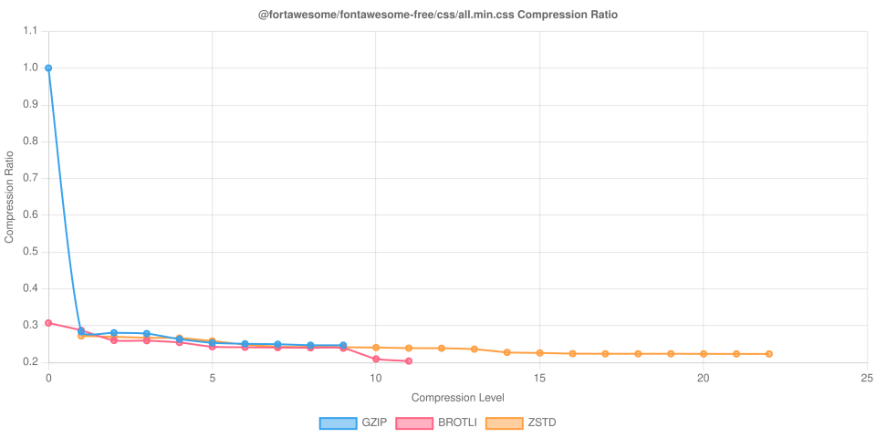

| Algorithm | Level | Time (ms) | Size (bytes) | Compression Ratio | Samples | Median CI (ms) | Precision met |
| --- | ---: | ---: | ---: | ---: | ---: | --- | --- |
| gzip | 0 | 0.056 | 90,364 | 1.0003 | 9 | 0.051–0.065 | no |
| gzip | 1 | 0.644 | 25,642 | 0.2839 | 9 | 0.621–0.652 | yes |
| gzip | 2 | 0.698 | 25,381 | 0.2810 | 9 | 0.694–0.722 | yes |
| gzip | 3 | 0.831 | 25,183 | 0.2788 | 9 | 0.827–0.848 | yes |
| gzip | 4 | 1.037 | 23,806 | 0.2635 | 9 | 1.027–1.048 | yes |
| gzip | 5 | 1.382 | 22,906 | 0.2536 | 9 | 1.377–1.403 | yes |
| gzip | 6 | 2.078 | 22,672 | 0.2510 | 9 | 2.067–2.088 | yes |
| gzip | 7 | 2.757 | 22,565 | 0.2498 | 9 | 2.740–2.795 | yes |
| gzip | 8 | 8.001 | 22,320 | 0.2471 | 9 | 7.997–8.018 | yes |
| gzip | 9 | 8.088 | 22,318 | 0.2471 | 9 | 8.061–8.112 | yes |
| brotli | 0 | 0.266 | 27,781 | 0.3075 | 9 | 0.246–0.287 | no |
| brotli | 1 | 0.390 | 25,973 | 0.2875 | 9 | 0.375–0.403 | yes |
| brotli | 2 | 0.812 | 23,497 | 0.2601 | 9 | 0.804–0.822 | yes |
| brotli | 3 | 0.900 | 23,445 | 0.2595 | 9 | 0.889–0.925 | yes |
| brotli | 4 | 1.273 | 23,003 | 0.2546 | 9 | 1.254–1.292 | yes |
| brotli | 5 | 1.919 | 21,939 | 0.2429 | 9 | 1.891–2.097 | no |
| brotli | 6 | 2.168 | 21,822 | 0.2416 | 9 | 2.116–2.281 | no |
| brotli | 7 | 2.515 | 21,742 | 0.2407 | 9 | 2.485–2.531 | yes |
| brotli | 8 | 2.879 | 21,693 | 0.2401 | 9 | 2.873–2.914 | yes |
| brotli | 9 | 3.746 | 21,604 | 0.2392 | 9 | 3.712–3.776 | yes |
| brotli | 10 | 34.754 | 18,961 | 0.2099 | 9 | 34.739–35.015 | yes |
| brotli | 11 | 107.250 | 18,432 | 0.2040 | 9 | 107.079–107.615 | yes |
| zstd | 1 | 0.288 | 24,608 | 0.2724 | 9 | 0.281–0.306 | no |
| zstd | 2 | 0.300 | 24,387 | 0.2700 | 9 | 0.285–0.328 | no |
| zstd | 3 | 0.355 | 24,157 | 0.2674 | 9 | 0.345–0.386 | no |
| zstd | 4 | 0.423 | 24,076 | 0.2665 | 9 | 0.401–0.429 | no |
| zstd | 5 | 0.872 | 23,365 | 0.2586 | 9 | 0.762–0.928 | no |
| zstd | 6 | 1.094 | 22,468 | 0.2487 | 9 | 1.082–1.102 | yes |
| zstd | 7 | 1.348 | 21,961 | 0.2431 | 9 | 1.335–1.368 | yes |
| zstd | 8 | 1.548 | 21,892 | 0.2423 | 9 | 1.527–1.624 | yes |
| zstd | 9 | 1.911 | 21,821 | 0.2416 | 9 | 1.906–1.913 | yes |
| zstd | 10 | 2.563 | 21,755 | 0.2408 | 9 | 2.554–2.613 | yes |
| zstd | 11 | 3.871 | 21,610 | 0.2392 | 9 | 3.850–3.937 | yes |
| zstd | 12 | 5.070 | 21,581 | 0.2389 | 9 | 5.056–5.092 | yes |
| zstd | 13 | 6.236 | 21,357 | 0.2364 | 9 | 6.206–6.547 | yes |
| zstd | 14 | 8.634 | 20,565 | 0.2277 | 9 | 8.609–8.644 | yes |
| zstd | 15 | 10.233 | 20,426 | 0.2261 | 9 | 10.205–10.303 | yes |
| zstd | 16 | 14.220 | 20,254 | 0.2242 | 9 | 14.184–14.247 | yes |
| zstd | 17 | 18.760 | 20,220 | 0.2238 | 9 | 18.732–18.865 | yes |
| zstd | 18 | 27.063 | 20,218 | 0.2238 | 9 | 27.015–27.162 | yes |
| zstd | 19 | 29.798 | 20,225 | 0.2239 | 9 | 29.694–29.929 | yes |
| zstd | 20 | 34.604 | 20,194 | 0.2235 | 9 | 34.547–34.652 | yes |
| zstd | 21 | 47.020 | 20,185 | 0.2234 | 9 | 46.946–47.077 | yes |
| zstd | 22 | 53.897 | 20,186 | 0.2235 | 9 | 53.769–54.203 | yes |

<h2 id="bootstrap-dist-css-bootstrap-min-css">bootstrap/dist/css/bootstrap.min.css</h2>

- Original size: 232,111 bytes
- Chart: 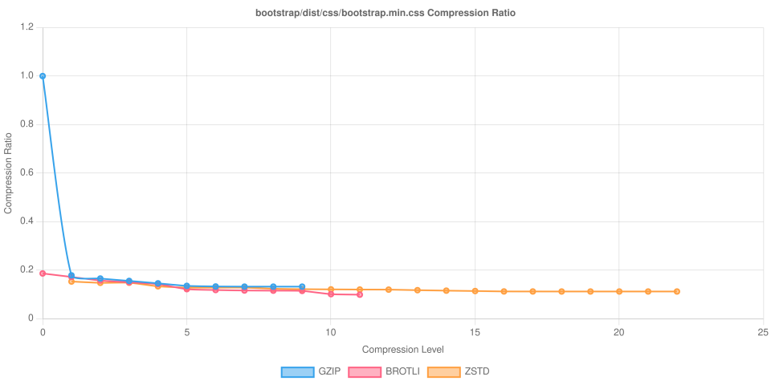

| Algorithm | Level | Time (ms) | Size (bytes) | Compression Ratio | Samples | Median CI (ms) | Precision met |
| --- | ---: | ---: | ---: | ---: | ---: | --- | --- |
| gzip | 0 | 0.129 | 232,164 | 1.0002 | 9 | 0.123–0.151 | no |
| gzip | 1 | 1.021 | 41,452 | 0.1786 | 9 | 1.011–1.041 | yes |
| gzip | 2 | 1.105 | 38,418 | 0.1655 | 9 | 1.096–1.127 | yes |
| gzip | 3 | 1.295 | 36,152 | 0.1558 | 9 | 1.285–1.312 | yes |
| gzip | 4 | 1.740 | 33,830 | 0.1457 | 9 | 1.734–1.746 | yes |
| gzip | 5 | 2.187 | 31,408 | 0.1353 | 9 | 2.177–2.220 | yes |
| gzip | 6 | 2.935 | 30,823 | 0.1328 | 9 | 2.933–2.956 | yes |
| gzip | 7 | 3.554 | 30,680 | 0.1322 | 9 | 3.542–3.572 | yes |
| gzip | 8 | 4.765 | 30,670 | 0.1321 | 9 | 4.735–4.776 | yes |
| gzip | 9 | 4.817 | 30,669 | 0.1321 | 9 | 4.804–4.964 | yes |
| brotli | 0 | 0.417 | 43,268 | 0.1864 | 9 | 0.404–0.451 | no |
| brotli | 1 | 0.592 | 39,941 | 0.1721 | 9 | 0.581–0.630 | no |
| brotli | 2 | 1.358 | 36,514 | 0.1573 | 9 | 1.350–1.373 | yes |
| brotli | 3 | 1.512 | 34,781 | 0.1498 | 9 | 1.497–1.532 | yes |
| brotli | 4 | 2.054 | 33,048 | 0.1424 | 9 | 2.045–2.073 | yes |
| brotli | 5 | 2.983 | 28,253 | 0.1217 | 9 | 2.968–3.186 | no |
| brotli | 6 | 3.292 | 27,431 | 0.1182 | 9 | 3.275–3.354 | yes |
| brotli | 7 | 3.753 | 26,971 | 0.1162 | 9 | 3.725–3.803 | yes |
| brotli | 8 | 4.220 | 26,813 | 0.1155 | 9 | 4.217–4.259 | yes |
| brotli | 9 | 5.145 | 26,569 | 0.1145 | 9 | 5.123–5.189 | yes |
| brotli | 10 | 97.470 | 23,482 | 0.1012 | 9 | 97.344–97.717 | yes |
| brotli | 11 | 311.260 | 22,970 | 0.0990 | 9 | 310.877–311.467 | yes |
| zstd | 1 | 0.476 | 35,549 | 0.1532 | 9 | 0.469–0.490 | yes |
| zstd | 2 | 0.517 | 34,301 | 0.1478 | 9 | 0.504–0.537 | yes |
| zstd | 3 | 0.548 | 34,393 | 0.1482 | 9 | 0.535–0.585 | no |
| zstd | 4 | 1.440 | 30,973 | 0.1334 | 9 | 1.410–1.495 | yes |
| zstd | 5 | 1.623 | 29,744 | 0.1281 | 9 | 1.616–1.638 | yes |
| zstd | 6 | 1.921 | 29,727 | 0.1281 | 9 | 1.908–1.994 | yes |
| zstd | 7 | 2.619 | 29,710 | 0.1280 | 9 | 2.170–2.810 | no |
| zstd | 8 | 2.972 | 28,645 | 0.1234 | 9 | 2.732–3.081 | no |
| zstd | 9 | 3.153 | 28,235 | 0.1216 | 9 | 3.116–3.294 | yes |
| zstd | 10 | 4.497 | 28,044 | 0.1208 | 9 | 4.373–4.567 | yes |
| zstd | 11 | 8.128 | 27,895 | 0.1202 | 9 | 8.078–8.206 | yes |
| zstd | 12 | 9.930 | 27,805 | 0.1198 | 9 | 9.882–9.972 | yes |
| zstd | 13 | 18.632 | 27,283 | 0.1175 | 9 | 18.609–18.708 | yes |
| zstd | 14 | 22.748 | 26,828 | 0.1156 | 9 | 22.672–23.011 | yes |
| zstd | 15 | 29.064 | 26,465 | 0.1140 | 9 | 29.055–29.171 | yes |
| zstd | 16 | 51.450 | 26,071 | 0.1123 | 9 | 51.282–51.508 | yes |
| zstd | 17 | 57.396 | 26,041 | 0.1122 | 9 | 57.368–57.544 | yes |
| zstd | 18 | 77.610 | 26,008 | 0.1120 | 9 | 77.521–77.800 | yes |
| zstd | 19 | 87.312 | 26,015 | 0.1121 | 9 | 87.122–87.579 | yes |
| zstd | 20 | 90.993 | 26,014 | 0.1121 | 9 | 90.881–91.039 | yes |
| zstd | 21 | 90.967 | 26,014 | 0.1121 | 9 | 90.798–91.069 | yes |
| zstd | 22 | 90.949 | 26,014 | 0.1121 | 9 | 90.854–91.009 | yes |

<h2 id="world-countries-dist-countries-unescaped-json">world-countries/dist/countries-unescaped.json</h2>

- Original size: 615,946 bytes
- Chart: 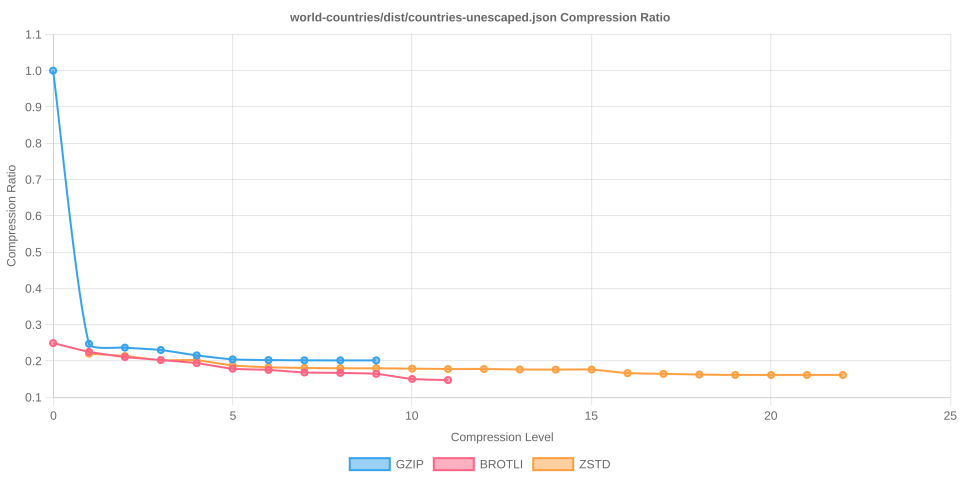

| Algorithm | Level | Time (ms) | Size (bytes) | Compression Ratio | Samples | Median CI (ms) | Precision met |
| --- | ---: | ---: | ---: | ---: | ---: | --- | --- |
| gzip | 0 | 0.311 | 616,054 | 1.0002 | 9 | 0.305–0.328 | no |
| gzip | 1 | 3.728 | 152,340 | 0.2473 | 9 | 3.714–3.741 | yes |
| gzip | 2 | 3.968 | 145,913 | 0.2369 | 9 | 3.959–3.998 | yes |
| gzip | 3 | 4.685 | 141,899 | 0.2304 | 9 | 4.675–4.718 | yes |
| gzip | 4 | 5.852 | 132,790 | 0.2156 | 9 | 5.834–5.861 | yes |
| gzip | 5 | 7.497 | 125,989 | 0.2045 | 9 | 7.476–7.575 | yes |
| gzip | 6 | 9.434 | 124,806 | 0.2026 | 9 | 9.417–9.474 | yes |
| gzip | 7 | 12.566 | 124,380 | 0.2019 | 9 | 12.556–12.613 | yes |
| gzip | 8 | 19.045 | 124,262 | 0.2017 | 9 | 19.019–19.085 | yes |
| gzip | 9 | 19.136 | 124,261 | 0.2017 | 9 | 19.126–19.313 | yes |
| brotli | 0 | 1.515 | 153,668 | 0.2495 | 9 | 1.510–1.551 | yes |
| brotli | 1 | 2.070 | 138,763 | 0.2253 | 9 | 2.048–2.118 | yes |
| brotli | 2 | 4.574 | 129,972 | 0.2110 | 9 | 4.537–4.621 | yes |
| brotli | 3 | 4.962 | 124,918 | 0.2028 | 9 | 4.948–4.981 | yes |
| brotli | 4 | 6.342 | 119,620 | 0.1942 | 9 | 6.330–6.352 | yes |
| brotli | 5 | 9.899 | 110,145 | 0.1788 | 9 | 9.865–9.963 | yes |
| brotli | 6 | 11.285 | 108,159 | 0.1756 | 9 | 11.146–11.491 | yes |
| brotli | 7 | 14.050 | 103,756 | 0.1684 | 9 | 14.012–14.142 | yes |
| brotli | 8 | 16.940 | 102,997 | 0.1672 | 9 | 16.909–17.052 | yes |
| brotli | 9 | 21.568 | 101,406 | 0.1646 | 9 | 21.434–22.011 | yes |
| brotli | 10 | 338.226 | 92,766 | 0.1506 | 9 | 337.791–338.967 | yes |
| brotli | 11 | 939.930 | 90,842 | 0.1475 | 9 | 938.590–942.061 | yes |
| zstd | 1 | 1.738 | 135,634 | 0.2202 | 9 | 1.730–1.750 | yes |
| zstd | 2 | 1.914 | 131,675 | 0.2138 | 9 | 1.901–1.938 | yes |
| zstd | 3 | 2.109 | 124,682 | 0.2024 | 9 | 2.101–2.122 | yes |
| zstd | 4 | 2.184 | 124,515 | 0.2022 | 9 | 2.165–2.224 | yes |
| zstd | 5 | 4.544 | 115,616 | 0.1877 | 9 | 4.470–4.641 | yes |
| zstd | 6 | 6.159 | 112,622 | 0.1828 | 9 | 6.019–6.416 | yes |
| zstd | 7 | 7.088 | 111,386 | 0.1808 | 9 | 6.629–7.355 | no |
| zstd | 8 | 8.619 | 110,885 | 0.1800 | 9 | 8.502–8.992 | yes |
| zstd | 9 | 8.848 | 110,856 | 0.1800 | 9 | 8.625–9.119 | yes |
| zstd | 10 | 10.149 | 110,262 | 0.1790 | 9 | 10.056–10.305 | yes |
| zstd | 11 | 13.812 | 109,660 | 0.1780 | 9 | 13.502–13.929 | yes |
| zstd | 12 | 13.557 | 109,660 | 0.1780 | 9 | 13.388–13.722 | yes |
| zstd | 13 | 23.986 | 108,855 | 0.1767 | 9 | 23.882–24.247 | yes |
| zstd | 14 | 28.450 | 108,631 | 0.1764 | 9 | 28.396–28.566 | yes |
| zstd | 15 | 31.999 | 108,683 | 0.1764 | 9 | 31.907–32.063 | yes |
| zstd | 16 | 75.618 | 102,692 | 0.1667 | 9 | 75.048–76.798 | yes |
| zstd | 17 | 83.768 | 101,496 | 0.1648 | 9 | 83.505–86.069 | yes |
| zstd | 18 | 127.643 | 100,215 | 0.1627 | 9 | 127.289–127.749 | yes |
| zstd | 19 | 172.586 | 99,575 | 0.1617 | 9 | 172.354–173.001 | yes |
| zstd | 20 | 172.460 | 99,575 | 0.1617 | 9 | 172.391–172.981 | yes |
| zstd | 21 | 172.608 | 99,575 | 0.1617 | 9 | 172.443–172.923 | yes |
| zstd | 22 | 172.664 | 99,575 | 0.1617 | 9 | 172.430–172.942 | yes |

<h2 id="sqlite-org-sqlite-wasm-dist-sqlite3-wasm">@sqlite.org/sqlite-wasm/dist/sqlite3.wasm</h2>

- Original size: 859,730 bytes
- Chart: 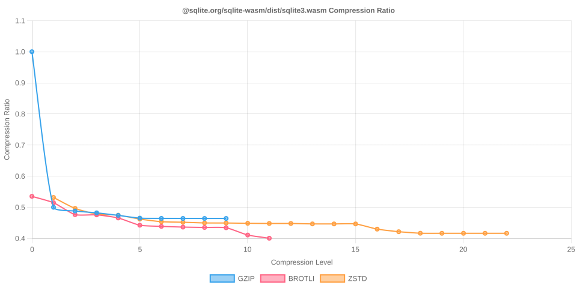

| Algorithm | Level | Time (ms) | Size (bytes) | Compression Ratio | Samples | Median CI (ms) | Precision met |
| --- | ---: | ---: | ---: | ---: | ---: | --- | --- |
| gzip | 0 | 0.436 | 859,878 | 1.0002 | 9 | 0.425–0.448 | yes |
| gzip | 1 | 12.250 | 429,925 | 0.5001 | 9 | 12.227–12.365 | yes |
| gzip | 2 | 13.249 | 419,493 | 0.4879 | 9 | 13.218–13.313 | yes |
| gzip | 3 | 15.378 | 414,493 | 0.4821 | 9 | 15.296–15.430 | yes |
| gzip | 4 | 17.010 | 407,503 | 0.4740 | 9 | 16.992–17.043 | yes |
| gzip | 5 | 23.976 | 399,866 | 0.4651 | 9 | 23.929–24.059 | yes |
| gzip | 6 | 28.058 | 399,154 | 0.4643 | 9 | 28.011–28.128 | yes |
| gzip | 7 | 29.735 | 399,020 | 0.4641 | 9 | 29.715–29.906 | yes |
| gzip | 8 | 32.675 | 398,974 | 0.4641 | 9 | 32.605–34.285 | yes |
| gzip | 9 | 32.711 | 398,973 | 0.4641 | 9 | 32.685–32.757 | yes |
| brotli | 0 | 3.911 | 460,125 | 0.5352 | 9 | 3.896–3.923 | yes |
| brotli | 1 | 5.450 | 442,506 | 0.5147 | 9 | 5.412–5.470 | yes |
| brotli | 2 | 11.836 | 409,638 | 0.4765 | 9 | 11.802–11.936 | yes |
| brotli | 3 | 13.315 | 408,960 | 0.4757 | 9 | 13.197–13.473 | yes |
| brotli | 4 | 18.383 | 400,331 | 0.4656 | 9 | 18.333–18.439 | yes |
| brotli | 5 | 27.780 | 380,339 | 0.4424 | 9 | 27.680–28.123 | yes |
| brotli | 6 | 32.294 | 377,100 | 0.4386 | 9 | 32.147–32.368 | yes |
| brotli | 7 | 47.551 | 375,149 | 0.4364 | 9 | 47.407–48.500 | yes |
| brotli | 8 | 56.057 | 374,164 | 0.4352 | 9 | 55.821–58.829 | yes |
| brotli | 9 | 69.770 | 373,347 | 0.4343 | 9 | 69.596–70.103 | yes |
| brotli | 10 | 917.426 | 353,246 | 0.4109 | 9 | 916.060–926.554 | yes |
| brotli | 11 | 1980.249 | 344,353 | 0.4005 | 9 | 1979.790–1983.575 | yes |
| zstd | 1 | 3.327 | 457,015 | 0.5316 | 9 | 3.306–3.351 | yes |
| zstd | 2 | 4.308 | 426,694 | 0.4963 | 9 | 4.271–4.348 | yes |
| zstd | 3 | 6.586 | 411,278 | 0.4784 | 9 | 6.506–6.613 | yes |
| zstd | 4 | 7.217 | 408,051 | 0.4746 | 9 | 7.180–7.232 | yes |
| zstd | 5 | 10.029 | 397,246 | 0.4621 | 9 | 9.981–10.356 | yes |
| zstd | 6 | 13.667 | 390,015 | 0.4536 | 9 | 13.596–13.951 | yes |
| zstd | 7 | 14.728 | 388,562 | 0.4520 | 9 | 14.685–14.803 | yes |
| zstd | 8 | 18.262 | 386,566 | 0.4496 | 9 | 18.224–18.376 | yes |
| zstd | 9 | 18.817 | 386,404 | 0.4494 | 9 | 18.796–18.954 | yes |
| zstd | 10 | 21.385 | 385,609 | 0.4485 | 9 | 21.321–21.629 | yes |
| zstd | 11 | 26.022 | 385,152 | 0.4480 | 9 | 25.857–26.296 | yes |
| zstd | 12 | 25.993 | 385,152 | 0.4480 | 9 | 25.909–26.071 | yes |
| zstd | 13 | 53.389 | 383,952 | 0.4466 | 9 | 53.289–53.917 | yes |
| zstd | 14 | 54.829 | 383,886 | 0.4465 | 9 | 54.773–54.978 | yes |
| zstd | 15 | 55.322 | 383,877 | 0.4465 | 9 | 55.227–55.669 | yes |
| zstd | 16 | 94.388 | 369,550 | 0.4298 | 9 | 94.114–94.627 | yes |
| zstd | 17 | 119.709 | 362,382 | 0.4215 | 9 | 119.523–119.955 | yes |
| zstd | 18 | 152.296 | 358,220 | 0.4167 | 9 | 151.658–163.548 | no |
| zstd | 19 | 169.535 | 358,047 | 0.4165 | 9 | 168.390–171.700 | yes |
| zstd | 20 | 169.121 | 358,047 | 0.4165 | 9 | 168.269–170.529 | yes |
| zstd | 21 | 170.423 | 358,041 | 0.4165 | 9 | 169.227–172.007 | yes |
| zstd | 22 | 170.639 | 358,041 | 0.4165 | 9 | 170.158–171.611 | yes |

<h2 id="tailwindcss-theme-css">tailwindcss/theme.css</h2>

- Original size: 19,586 bytes
- Chart: 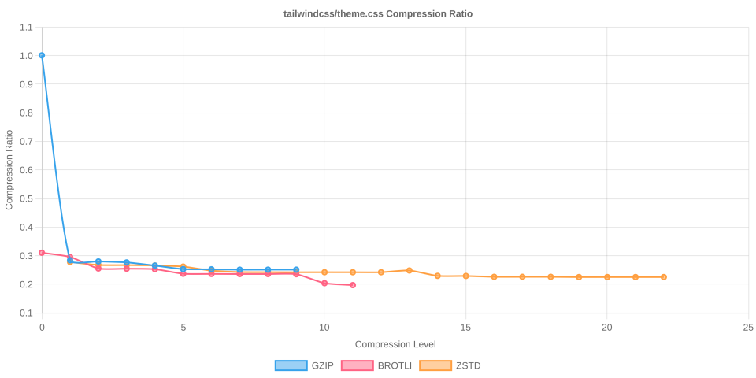

| Algorithm | Level | Time (ms) | Size (bytes) | Compression Ratio | Samples | Median CI (ms) | Precision met |
| --- | ---: | ---: | ---: | ---: | ---: | --- | --- |
| gzip | 0 | 0.025 | 19,609 | 1.0012 | 9 | 0.020–0.034 | no |
| gzip | 1 | 0.132 | 5,565 | 0.2841 | 9 | 0.119–0.159 | no |
| gzip | 2 | 0.141 | 5,486 | 0.2801 | 9 | 0.137–0.166 | no |
| gzip | 3 | 0.166 | 5,419 | 0.2767 | 9 | 0.162–0.181 | no |
| gzip | 4 | 0.211 | 5,202 | 0.2656 | 9 | 0.201–0.240 | no |
| gzip | 5 | 0.270 | 4,958 | 0.2531 | 9 | 0.260–0.299 | no |
| gzip | 6 | 0.364 | 4,947 | 0.2526 | 9 | 0.356–0.377 | yes |
| gzip | 7 | 0.496 | 4,921 | 0.2513 | 9 | 0.480–0.512 | yes |
| gzip | 8 | 0.652 | 4,923 | 0.2514 | 9 | 0.638–0.665 | yes |
| gzip | 9 | 0.647 | 4,923 | 0.2514 | 9 | 0.635–0.650 | yes |
| brotli | 0 | 0.068 | 6,082 | 0.3105 | 9 | 0.059–0.082 | no |
| brotli | 1 | 0.079 | 5,794 | 0.2958 | 9 | 0.071–0.093 | no |
| brotli | 2 | 0.153 | 5,002 | 0.2554 | 9 | 0.147–0.188 | no |
| brotli | 3 | 0.178 | 4,986 | 0.2546 | 9 | 0.169–0.214 | no |
| brotli | 4 | 0.296 | 4,954 | 0.2529 | 9 | 0.278–0.320 | no |
| brotli | 5 | 0.456 | 4,641 | 0.2370 | 9 | 0.442–0.480 | no |
| brotli | 6 | 0.494 | 4,630 | 0.2364 | 9 | 0.490–0.517 | yes |
| brotli | 7 | 0.574 | 4,622 | 0.2360 | 9 | 0.560–0.593 | yes |
| brotli | 8 | 0.636 | 4,623 | 0.2360 | 9 | 0.619–0.667 | yes |
| brotli | 9 | 0.752 | 4,612 | 0.2355 | 9 | 0.737–0.765 | yes |
| brotli | 10 | 7.477 | 3,996 | 0.2040 | 9 | 7.428–7.528 | yes |
| brotli | 11 | 22.444 | 3,863 | 0.1972 | 9 | 22.413–22.498 | yes |
| zstd | 1 | 0.071 | 5,441 | 0.2778 | 9 | 0.063–0.090 | no |
| zstd | 2 | 0.071 | 5,242 | 0.2676 | 9 | 0.063–0.087 | no |
| zstd | 3 | 0.087 | 5,234 | 0.2672 | 9 | 0.085–0.117 | no |
| zstd | 4 | 0.092 | 5,212 | 0.2661 | 9 | 0.085–0.124 | no |
| zstd | 5 | 0.170 | 5,133 | 0.2621 | 9 | 0.162–0.182 | no |
| zstd | 6 | 0.241 | 4,853 | 0.2478 | 9 | 0.232–0.257 | no |
| zstd | 7 | 0.286 | 4,757 | 0.2429 | 9 | 0.281–0.307 | no |
| zstd | 8 | 0.322 | 4,750 | 0.2425 | 9 | 0.315–0.333 | yes |
| zstd | 9 | 0.386 | 4,744 | 0.2422 | 9 | 0.381–0.395 | yes |
| zstd | 10 | 0.480 | 4,746 | 0.2423 | 9 | 0.472–0.501 | yes |
| zstd | 11 | 0.634 | 4,745 | 0.2423 | 9 | 0.624–0.643 | yes |
| zstd | 12 | 0.677 | 4,745 | 0.2423 | 9 | 0.671–0.693 | yes |
| zstd | 13 | 1.038 | 4,865 | 0.2484 | 9 | 1.029–1.086 | yes |
| zstd | 14 | 1.860 | 4,497 | 0.2296 | 9 | 1.857–1.879 | yes |
| zstd | 15 | 1.969 | 4,490 | 0.2292 | 9 | 1.965–1.981 | yes |
| zstd | 16 | 2.746 | 4,430 | 0.2262 | 9 | 2.737–2.780 | yes |
| zstd | 17 | 2.759 | 4,430 | 0.2262 | 9 | 2.746–2.791 | yes |
| zstd | 18 | 2.748 | 4,430 | 0.2262 | 9 | 2.738–2.775 | yes |
| zstd | 19 | 5.388 | 4,414 | 0.2254 | 9 | 5.357–5.421 | yes |
| zstd | 20 | 5.427 | 4,415 | 0.2254 | 9 | 5.392–5.493 | yes |
| zstd | 21 | 5.414 | 4,415 | 0.2254 | 9 | 5.390–5.449 | yes |
| zstd | 22 | 5.407 | 4,415 | 0.2254 | 9 | 5.397–5.440 | yes |
